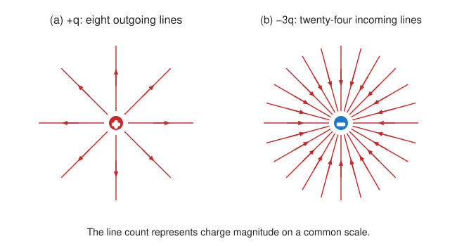
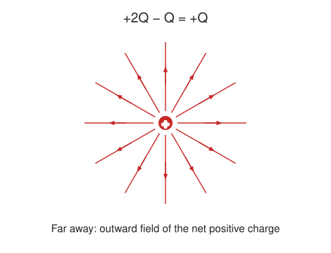

::: abstract

- Calculate the total force (magnitude and direction) exerted on a test charge from more than one charge
- Describe an electric field diagram of a positive point charge; of a negative point charge with twice the magnitude of positive charge
- Draw the electric field lines between two points of the same charge; between two points of opposite charge.

:::

Drawings using lines to represent **electric fields** around charged objects are
very useful in visualizing field strength and direction. Since the electric
field has both magnitude and direction, it is a vector. Like all **vectors**,
the electric field can be represented by an arrow that has length proportional
to its magnitude and that points in the correct direction. (We have used arrows
extensively to represent force vectors, for example.)

[[Figure 1]](#Figure1) shows two pictorial representations of the same electric
field created by a positive point charge $$Q $$ .
[[Figure 1]](#Figure1) (b) shows the standard representation using continuous
lines. [[Figure 1]](#Figure1) (a) shows numerous individual arrows with each
arrow representing the force on a test charge $$q $$ . Field lines are
essentially a map of infinitesimal force vectors.

 . (a) Arrows representing the electric field’s magnitude and direction. (b) In the standard representation, the arrows are replaced by continuous field lines having the same direction at any point as the electric field. The closeness of the lines is directly related to the strength of the electric field. A test charge placed anywhere will feel a force in the direction of the field line; this force will have a strength proportional to the density of the lines (being greater near the charge, for example).')
{: #Figure1}

Note that the electric field is defined for a positive test charge $$q $$ , so
that the field lines point away from a positive charge and toward a negative
charge. (See [[Figure 2]](#Figure2).) The electric field strength is exactly
proportional to the number of field lines per unit area, since the magnitude of
the electric field for a point charge is $$E=k\|Q\|/{r}^{2} $$ and area is
proportional to $${r}^{2} $$ . This pictorial representation, in which field
lines represent the direction and their closeness (that is, their areal density
or the number of lines crossing a unit area) represents strength, is used for
all fields: electrostatic, gravitational, magnetic, and others.

 A positive charge. (b) A negative charge of equal magnitude. (c) A larger negative charge.')
{: #Figure2}

In many situations, there are multiple charges. The total electric field created
by multiple charges is the vector sum of the individual fields created by each
charge. The following example shows how to add electric field vectors.

::: example

Adding Electric Fields

Find the magnitude and direction of the total electric field due to the two point charges, $${q}_{1} $$
and $${q}_{2} $$ ,
at the origin of the coordinate system as shown in [[Figure 3]](#Figure3).

 and ( E_{2} ) at the origin O add to ( E_\\text{tot} ).')
{: #Figure3}

**Strategy**

Since the electric field is a vector (having magnitude and direction), we add
electric fields with the same vector techniques used for other types of vectors.
We first must find the electric field due to each charge at the point of
interest, which is the origin of the coordinate system (O) in this instance. We
pretend that there is a positive test charge, $$q $$ , at point O, which allows
us to determine the direction of the fields $${\vb{E}}_{1} $$ and
$${\vb{E}}\_{2} $$ . Once those fields are found, the total field can
be determined using **vector addition**.

**Solution**

The electric field strength at the origin due to $${q}_{1} $$ is labeled $${E}_{1} $$ and is calculated:

 $$\begin{array}{l}{E}_{1}=k\frac{ {q}_{1}}{ {r}_{1}^{2}}=\left( 8.99 \times 10^{9} \text{N}\cdot {\text{m}}^{2}{\text{/C}}^{2}\right) \frac{\left( 5.00 \times 10^{-9} \text{C}\right)}{ {\left( 2.00 \times 10^{-2} \text{m} \right)}^{2}}\\ {E}_{1}= 1.124 \times 10^{5} \text{N/C}.\end{array} $$ 

Similarly, $${E}_{2} $$ is

 $$\begin{array}{l}{E}_{2}=k\frac{ {q}_{2}}{ {r}_{2}^{2}}=\left( 8.99 \times 10^{9}  \text{N}\cdot {\text{m}}^{2}{\text{/C}}^{2}\right)\frac{\left( 10.0 \times 10^{-9}  \text{C}\right)}{ {\left( 4.00 \times 10^{-2}  \text{m}\right)}^{2}}\\ {E}_{2}= 0.5619 \times 10^{5}  \text{N/C}.\end{array} $$

Four digits have been retained in this solution to illustrate that $${E}_{1} $$
is exactly twice the magnitude of $${E}_{2} $$ .
Now arrows are drawn to represent the magnitudes and directions of $${\vb{E}}_{1} $$
and $${\vb{E}}_{2} $$ .
(See [[Figure 3]](#Figure3).) The direction of the electric field is that of the force on a positive charge so both arrows point directly away from the positive charges that create them. The arrow for $${\vb{E}}_{1} $$
is exactly twice the length of that for $${\vb{E}}_{2} $$ .
The arrows form a right triangle in this case and can be added using the Pythagorean theorem. The magnitude of the total field $${E}_{\text{tot}} $$
is

$$\begin{array}{lll}
{E}_{\text{tot}}& =& {\left( {E}_{1}^{2}+{E}_{2}^{2} \right) }^{1/2}\\
{E}_{\text{tot}}& =& { \left\{ { \left(  1.124 \times 10^{5}  \text{N/C} \right) }^{2}+{\left( 0.5619 \times 10^{5}  \text{N/C} \right)}^{2} \right\} }^{1/2}\\
{E}_{\text{tot}}& =&  1.26 \times 10^{5}  \text{N/C} \text{.} \end{array} $$

The direction is

 $$\begin{array}{lll}\theta & =& {\tan}^{-1}\left(\frac{ {E}_{1}}{ {E}_{2}}\right)\\ \theta & =& {\tan}^{-1}\left(\frac{ 1.124 \times 10^{5} \text{N/C}}{ 0.5619 \times 10^{5} \text{N/C}} \right)\\ \theta & =& 63.4º,\end{array} $$ 

or $$63.4º $$ above the _x_-axis.

**Discussion**

In cases where the electric field vectors to be added are not perpendicular,
vector components or graphical techniques can be used. The total electric field
found in this example is the total electric field at only one point in space. To
find the total electric field due to these two charges over an entire region,
the same technique must be repeated for each point in the region. This
impossibly lengthy task (there are an infinite number of points in space) can be
avoided by calculating the total field at representative points and using some
of the unifying features noted next.

:::

[[Figure 4]](#Figure4) shows how the electric field from two point charges can
be drawn by finding the total field at representative points and drawing
electric field lines consistent with those points. While the electric fields
from multiple charges are more complex than those of single charges, some simple
features are easily noticed.

For example, the field is weaker between like charges, as shown by the lines
being farther apart in that region. (This is because the fields from each charge
exert opposing forces on any charge placed between them.) (
See [[Figure 4]](#Figure4) and [[Figure 5]](#Figure5)(a).) Furthermore, at a
great distance from two like charges, the field becomes identical to the field
from a single, larger charge.

[[Figure 5]](#Figure5)(b) shows the electric field of two unlike charges. The
field is stronger between the charges. In that region, the fields from each
charge are in the same direction, and so their strengths add. The field of two
unlike charges is weak at large distances, because the fields of the individual
charges are in opposite directions and so their strengths subtract. At very
large distances, the field of two unlike charges looks like that of a smaller
single charge.

 and ( q_{2} ) produce the resultant electric field shown. The field is calculated at representative points and then smooth field lines drawn following the rules outlined in the text.')
{: #Figure4}

 Two negative charges produce the fields shown. It is very similar to the field produced by two positive charges, except that the directions are reversed. The field is clearly weaker between the charges. The individual forces on a test charge in that region are in opposite directions. (b) Two opposite charges produce the field shown, which is stronger in the region between the charges.')
{: #Figure5}

We use electric field lines to visualize and analyze electric fields (the lines
are a pictorial tool, not a physical entity in themselves). The properties of
electric field lines for any charge distribution can be summarized as follows:

1. Field lines must begin on positive charges and terminate on negative charges,
   or at infinity in the hypothetical case of isolated charges.
2. The number of field lines leaving a positive charge or entering a negative
   charge is proportional to the magnitude of the charge.
3. The strength of the field is proportional to the closeness of the field
   lines—more precisely, it is proportional to the number of lines per unit area
   perpendicular to the lines.
4. The direction of the electric field is tangent to the field line at any point
   in space.
5. Field lines can never cross.

The last property means that the field is unique at any point. The field line
represents the direction of the field; so if they crossed, the field would have
two directions at that location (an impossibility if the field is unique).

::: note {"class":"note","data-has-label":"true","data-label":""}

PhET Explorations: Charges and Fields

Move point charges around on the playing field and then view the electric field, voltages, equipotential lines, and more. It\'s colorful, it\'s dynamic, it\'s free.

<iframe width="660" height="371.4" src="https://phet.colorado.edu/sims/html/charges-and-fields/latest/charges-and-fields_en.html"></iframe>

:::

### Section Summary

- Drawings of electric field lines are useful visual tools. The properties of
  electric field lines for any charge distribution are that:
- Field lines must begin on positive charges and terminate on negative charges,
  or at infinity in the hypothetical case of isolated charges.
- The number of field lines leaving a positive charge or entering a negative
  charge is proportional to the magnitude of the charge.
- The strength of the field is proportional to the closeness of the field
  lines—more precisely, it is proportional to the number of lines per unit area
  perpendicular to the lines.
- The direction of the electric field is tangent to the field line at any point
  in space.
- Field lines can never cross.

### Conceptual Questions

::: problem

Compare and contrast the Coulomb force field and the electric field. To do this, make a list of five properties for the Coulomb force field analogous to the five properties listed for electric field lines. Compare each item in your list of Coulomb force field properties with those of the electric field—are they the same or different? (For example, electric field lines cannot cross. Is the same true for Coulomb field lines?)

:::

::: solution

**Strategy**

Define a force field for one fixed, nonzero test charge using $$\vec F=q\vec E$$, and compare the five field-line rules.

**Solution**

1. For positive $$q$$, force lines start on positive sources and end on negative sources or infinity; for negative $$q$$, their arrows reverse.
2. With a fixed drawing convention, the number of force lines is proportional to source-charge magnitude, just as for electric field lines.
3. Line density indicates force magnitude for a fixed test charge, since $$|\vec F|=|q||\vec E|$$.
4. The force is tangent to its force lines, as the electric field is tangent to its lines.
5. Force lines cannot cross at a point with nonzero force, because the force there has a unique direction.

**Discussion**

The curves are the same as the electric-field curves for a fixed test charge; their arrow directions reverse for negative charge and their magnitude scale depends on the test charge. Thus all five rules have direct force-field counterparts once the test charge is specified.

:::

::: problem

[[Figure 6]](#Figure6) shows an electric field extending over three regions, labeled I, II, and III. Answer the following questions. (a) Are there any isolated charges? If so, in what region and what are their signs? (b) Where is the field strongest? (c) Where is it weakest? (d) Where is the field the most uniform?

{: #Figure6}

:::

::: solution

**Strategy**

Look for line endpoints, line spacing, and parallelism in Figure 6.

**Solution**

(a) Two lines terminate at the two marked points in region II, so those isolated charges are negative. No positive source is shown. (b) The field is strongest near those point charges, where lines converge; among the broad regions away from the charges, region I has the greatest line density. (c) Region III has the widest spacing and weakest field away from the charges. (d) Region I has the straightest, most nearly equally spaced parallel lines and is the most uniform.

**Discussion**

The field is not uniform near the negative charges in region II, and ideal point-charge fields grow without bound at their positions. The diagram therefore shows two negative charges in II, a strong nearly uniform incoming field in I, and a weaker spreading field in III.

:::

### Problem Exercises

::: problem

(a) Sketch the electric field lines near a point charge $$+q $$ .
(b) Do the same for a point charge $$-3.00q $$.

:::

::: solution

**Strategy**

Use radial symmetry and draw numbers of lines proportional to charge magnitude on the same scale.

**Solution**

For $$+q$$, draw radial arrows away from the charge. For $$-3.00q$$, draw three times as many radial arrows, directed toward the charge. The sketch uses eight outgoing and twenty-four incoming lines, respectively.

**Discussion**

The chosen number of lines is arbitrary, but its ratio and the arrow directions are not. The positive charge has an outward radial field, and the negative charge has an inward radial field with three times the magnitude at the same distance.

:::

::: problem

Sketch the electric field lines a long distance from the charge distributions shown in [[Figure 5]](#Figure5) (a) and (b)

:::

::: solution

**Strategy**

At distances much greater than the charge separation, first examine the total charge.

**Solution**

For Figure 5(a), the two charges $$-q$$ have total charge $$-2q$$, so the far field is approximately radial inward. For Figure 5(b), $$+q$$ and $$-q$$ have zero net charge, so the leading far field is a dipole: its lines emerge from the positive side and curve toward the negative side, rather than becoming a radial monopole field. For comparison, the two positive charges of Figure 4 give an approximately radial outward far field of charge $$q_1+q_2$$.

**Discussion**

The monopole term falls as $$1/r^2$$, while the equal-and-opposite pair’s leading dipole field falls as $$1/r^3$$. Thus two like charges have a radial far field set by their sum, but the neutral pair retains a weaker dipole pattern.

:::

::: problem

[[Figure 7]](#Figure7) shows the electric field lines near two charges $${q}_{1} $$
and $${q}_{2} $$ .
What is the ratio of their magnitudes? (b) Sketch the electric field lines a long distance from the charges shown in the figure.

{: #Figure7}

:::

::: solution

**Strategy**

Count the lines terminating on each charge using the same line-count convention, and then find the sign of the net charge.

**Solution**

(a) In the figure the arrowheads point away from the small red charge, so it is positive; the lines end on the large sphere, which is negative. About twice as many lines leave the positive charge as end on the sphere (roughly half of them go off to infinity), so the magnitude ratio is $$|q_{\text{positive}}|/|q_{\text{negative}}|=2$$. (b) Write these as $$+2Q$$ and $$-Q$$. The total charge is $$+Q$$, and at distances much larger than their separation the field is approximately radial outward.

**Discussion**

The near field is asymmetric, but its distant leading term is the field of the net negative charge. The positive charge has twice the negative charge’s magnitude, and the far-field arrows point outward.

:::

::: problem

Sketch the electric field lines in the vicinity of two opposite charges, where the negative charge is three times greater in magnitude than the positive. (See [[Figure 7]](#Figure7) for a similar situation).

:::

::: solution

**Strategy**

Trace the sum of the two point-charge fields, and use three times as many lines at the negative charge.

**Solution**

Choose six representative lines leaving $$+q$$ and eighteen entering $$-3q$$. All six outgoing lines terminate on the negative charge; twelve additional lines enter from infinity. The arrows point from the positive charge toward the negative charge, or from infinity toward the negative charge.

**Discussion**

The total charge is $$-2q$$, consistent with an inward far field and an excess of incoming lines. The required sketch therefore has connecting lines from $$+q$$ to $$-3q$$ and twice as many additional lines arriving from infinity.

:::

::: glossary

### Glossary

{: class="glossary-title"}

electric field
: a three-dimensional map of the electric force extended out into space from a
point charge

electric field lines
: a series of lines drawn from a point charge representing the magnitude and
direction of force exerted by that charge

vector
: a quantity with both magnitude and direction

vector addition
: mathematical combination of two or more vectors, including their magnitudes,
directions, and positions

:::
