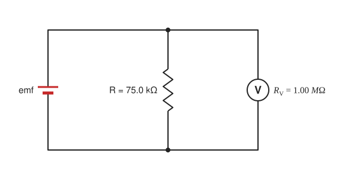

::: abstract

* Explain why a voltmeter must be connected in parallel with the circuit.
* Draw a diagram showing an ammeter correctly connected in a circuit.
* Describe how a galvanometer can be used as either a voltmeter or an ammeter.
* Find the resistance that must be placed in series with a galvanometer to allow it to be used as a voltmeter with a given reading.
* Explain why measuring the voltage or current in a circuit can never be exact.

:::

**Voltmeters** measure voltage, whereas **ammeters**{: class="term"} measure
current. Some of the meters in automobile dashboards, digital cameras, cell
phones, and tuner-amplifiers are voltmeters or ammeters. (
See [[Figure 1]](#Figure1).) The internal construction of the simplest of these
meters and how they are connected to the system they monitor give further
insight into applications of series and parallel connections.

 in this 1996 Volkswagen are voltmeters that register the voltage output of “sender” units, which are hopefully proportional to the amount of gasoline in the tank and the engine temperature. (credit: Christian Giersing)')
{: #Figure1}

Voltmeters are connected in parallel with whatever device’s voltage is to be
measured. A parallel connection is used because objects in parallel experience
the same potential difference. (See [[Figure 2]](#Figure2), where the voltmeter
is represented by the symbol V.)

Ammeters are connected in series with whatever device’s current is to be
measured. A series connection is used because objects in series have the same
current passing through them. (See [[Figure 3]](#Figure3), where the ammeter is
represented by the symbol A.)

 To measure potential differences in this series circuit, the voltmeter (V) is placed in parallel with the voltage source or either of the resistors. Note that terminal voltage is measured between points a and b. It is not possible to connect the voltmeter directly across the emf without including its internal resistance, r. (b) A digital voltmeter in use. (credit: Messtechniker, Wikimedia Commons)')
{: #Figure2}

 is placed in series to measure current. All of the current in this circuit flows through the meter. The ammeter would have the same reading if located between points d and e or between points f and a as it does in the position shown. (Note that the script capital E stands for emf, and r  stands for the internal resistance of the source of potential difference.)')
{: #Figure3}

### Analog Meters: Galvanometers

**Analog meters** have a needle that swivels to point at numbers on a scale, as
opposed to **digital meters**, which have numerical readouts similar to a
hand-held calculator. The heart of most analog meters is a device called a **galvanometer**, denoted by G. Current flow through a galvanometer, $${I}_{\text{G}} $$ , produces a proportional needle deflection. (This deflection is
due to the force of a magnetic field upon a current-carrying wire.)

The two crucial characteristics of a given galvanometer are its resistance and
current sensitivity. **Current sensitivity** is the current that gives a **full-scale deflection** of the galvanometer’s needle, the maximum current that
the instrument can measure. For example, a galvanometer with a current
sensitivity of $$50 \text{μA} $$ has a maximum deflection of its needle when
$$50 \text{μA} $$ flows through it, reads half-scale when $$25 \mu A $$ flows
through it, and so on.

If such a galvanometer has a $$25-\Omega $$ resistance, then a voltage of only
$$V=IR=\left(50 \text{ μA}\right)\left(25 \text{Ω}\right)=1.25 \text{mV} $$
produces a full-scale reading. By connecting resistors to this galvanometer in
different ways, you can use it as either a voltmeter or ammeter that can measure
a broad range of voltages or currents.

#### Galvanometer as Voltmeter

[[Figure 4]](#Figure4) shows how a galvanometer can be used as a voltmeter by
connecting it in series with a large resistance, $$R $$ . The value of the
resistance $$R $$ is determined by the maximum voltage to be measured. Suppose
you want 10 V to produce a full-scale deflection of a voltmeter containing a
$$25 \text{-Ω} $$ galvanometer with a $$50 \text{-μA} $$ sensitivity. Then 10 V
applied to the meter must produce a current of $$50 \text{μA} $$ . The total
resistance must be

 $${R}_{\text{tot}}=R+r=\frac{V}{I}=\frac{10 \text{V}}{50 \text{μA}}=200 \text{k}\Omega , or $$

 $$R={R}_{\text{tot}}-r=200 \text{kΩ}-25 \Omega \approx 200 \text{k}\Omega . $$

( $$R $$ is so large that the galvanometer resistance, $$r $$ , is nearly
negligible.) Note that 5 V applied to this voltmeter produces a half-scale
deflection by producing a $$25 \text{-μA} $$ current through the meter, and so
the voltmeter’s reading is proportional to voltage as desired.

This voltmeter would not be useful for voltages less than about half a volt,
because the meter deflection would be small and difficult to read accurately.
For other voltage ranges, other resistances are placed in series with the
galvanometer. Many meters have a choice of scales. That choice involves
switching an appropriate resistance into series with the galvanometer.

 . The larger the voltage to be measured, the larger ( R ) must be. (Note that r  represents the internal resistance of the galvanometer.)')
{: #Figure4}

#### Galvanometer as Ammeter

The same galvanometer can also be made into an ammeter by placing it in parallel
with a small resistance $$R $$ , often called the **shunt resistance**, as shown
in [[Figure 5]](#Figure5). Since the shunt resistance is small, most of the
current passes through it, allowing an ammeter to measure currents much greater
than those producing a full-scale deflection of the galvanometer.

Suppose, for example, an ammeter is needed that gives a full-scale deflection
for 1.0 A, and contains the same $$25 \text{-}\Omega $$ galvanometer with its
$$50 \text{-μA} $$ sensitivity. Since $$R $$ and $$r $$ are in parallel, the
voltage across them is the same.

These $$IR $$ drops are $$IR={I}_{\text{G}}r $$ so that $$IR=\frac{ {I}_{\text{G}}}{I}=\frac{R}{r} $$ . Solving for $$R $$ , and noting that $${I}_{\text{G}} $$ is $$50 \text{μA} $$ and $$I $$ is 0.999950 A, we have

$$R=r\frac{ {I}_{\text{G}}}{I}=\left(25 \Omega \right)\frac{50 \text{μA}}{0.999950 \text{A}}= 1.25 \times 10^{-3} \Omega . $$

 placed in parallel with a galvanometer G produces an ammeter, the full-scale deflection of which depends on the choice of ( R ) . The larger the current to be measured, the smaller ( R ) must be. Most of the current (I) flowing through the meter is shunted through ( R ) to protect the galvanometer.  (Note that r  represents the internal resistance of the galvanometer.) Ammeters may also have multiple scales for greater flexibility in application. The various scales are achieved by switching various shunt resistances in parallel with the galvanometer—the greater the maximum current to be measured, the smaller the shunt resistance must be.')
{: #Figure5}

### Taking Measurements Alters the Circuit

When you use a voltmeter or ammeter, you are connecting another resistor to an
existing circuit and, thus, altering the circuit. Ideally, voltmeters and
ammeters do not appreciably affect the circuit, but it is instructive to examine
the circumstances under which they do or do not interfere.

First, consider the voltmeter, which is always placed in parallel with the
device being measured. Very little current flows through the voltmeter if its
resistance is a few orders of magnitude greater than the device, and so the
circuit is not appreciably affected. (See [[Figure 6]](#Figure6)(a).) (A large
resistance in parallel with a small one has a combined resistance essentially
equal to the small one.) If, however, the voltmeter’s resistance is comparable
to that of the device being measured, then the two in parallel have a smaller
resistance, appreciably affecting the circuit. (See [[Figure 6]](#Figure6)(b).)
The voltage across the device is not the same as when the voltmeter is out of
the circuit.

 A voltmeter having a resistance much larger than the device \(R_{\text{Voltmeter}} \gg R\) with which it is in parallel produces a parallel resistance essentially the same as the device and does not appreciably affect the circuit being measured. (b) Here the voltmeter has the same resistance as the device \(R_{\text{Voltmeter}} \approx R\), so that the parallel resistance is half of what it is when the voltmeter is not connected. This is an example of a significant alteration of the circuit and is to be avoided.')
{: #Figure6}

An ammeter is placed in series in the branch of the circuit being measured, so
that its resistance adds to that branch. Normally, the ammeter’s resistance is
very small compared with the resistances of the devices in the circuit, and so
the extra resistance is negligible. (See [[Figure 7]](#Figure7)(a).) However, if
very small load resistances are involved, or if the ammeter is not as low in
resistance as it should be, then the total series resistance is significantly
greater, and the current in the branch being measured is reduced. (
See [[Figure 7]](#Figure7)(b).)

A practical problem can occur if the ammeter is connected incorrectly. If it was
put in parallel with the resistor to measure the current in it, you could
possibly damage the meter; the low resistance of the ammeter would allow most of
the current in the circuit to go through the galvanometer, and this current
would be larger since the effective resistance is smaller.

 An ammeter normally has such a small resistance that the total series resistance in the branch being measured is not appreciably increased. The circuit is essentially unaltered compared with when the ammeter is absent. (b) Here the ammeter’s resistance is the same as that of the branch, so that the total resistance is doubled and the current is half what it is without the ammeter. This significant alteration of the circuit is to be avoided.')
{: #Figure7}

One solution to the problem of voltmeters and ammeters interfering with the
circuits being measured is to use galvanometers with greater sensitivity. This
allows construction of voltmeters with greater resistance and ammeters with
smaller resistance than when less sensitive galvanometers are used.

There are practical limits to galvanometer sensitivity, but it is possible to
get analog meters that make measurements accurate to a few percent. Note that
the inaccuracy comes from altering the circuit, not from a fault in the meter.

::: note {"class":"note","data-has-label":"true","data-label":""}

Connections: Limits to Knowledge

Making a measurement alters the system being measured in a manner that produces uncertainty in the measurement. For macroscopic systems, such as the circuits discussed in this module, the alteration can usually be made negligibly small, but it cannot be eliminated entirely. For submicroscopic systems, such as atoms, nuclei, and smaller particles, measurement alters the system in a manner that cannot be made arbitrarily small. This actually limits knowledge of the system—even limiting what nature can know about itself. We shall see profound implications of this when the Heisenberg uncertainty principle is discussed in the modules on quantum mechanics.

There is another measurement technique based on drawing no current at all and,
hence, not altering the circuit at all. These are called null measurements and
are the topic of [Null Measurements](../contents/ch21NullMeasurements). Digital meters that
employ solid-state electronics and null measurements can attain accuracies of
one part in $$10^{6} $$.

:::

Check Your Understanding

::: problem

Digital meters are able to detect smaller currents than analog meters employing galvanometers. How does this explain their ability to measure voltage and current more accurately than analog meters?

:::

::: solution {"class":"solution","data-print-placement":"here"}

Since digital meters require less current than analog meters, they alter the circuit less than analog meters. Their resistance as a voltmeter can be far greater than an analog meter, and their resistance as an ammeter can be far less than an analog meter. Consult [[Figure 2]](#Figure2) and [[Figure 3]](#Figure3) and their discussion in the text.

:::

::: note {"class":"note","data-has-label":"true","data-label":""}

PhET Explorations: Circuit Construction Kit (DC Only), Virtual Lab

Stimulate a neuron and monitor what happens. Pause, rewind, and move forward in time in order to observe the ions as they move across the neuron membrane.

<iframe width="660" height="371.4" src="https://phet.colorado.edu/sims/html/circuit-construction-kit-dc/latest/circuit-construction-kit-dc_en.html"></iframe>

:::

### Section Summary

- Voltmeters measure voltage, and ammeters measure current.
- A voltmeter is placed in parallel with the voltage source to receive full
  voltage and must have a large resistance to limit its effect on the circuit.
- An ammeter is placed in series to get the full current flowing through a
  branch and must have a small resistance to limit its effect on the circuit.
- Both can be based on the combination of a resistor and a galvanometer, a
  device that gives an analog reading of current.
- Standard voltmeters and ammeters alter the circuit being measured and are thus
  limited in accuracy.

### Conceptual Questions

::: problem

Why should you not connect an ammeter directly across a voltage source as shown in [[Figure 8]](#Figure8)? (Note that script E in the figure stands for emf.)

{: #Figure8}

:::

::: solution

**Strategy**

An ammeter is designed to go in series and therefore has a very small resistance $$ R_{\text{A}} $$. Connected directly across the source, it is the only load, so $$ I = \text{emf}/(r + R_{\text{A}}) $$. Use a $$ 12.0\text{-V} $$ car battery with $$ r = 0.0200 \ \Omega $$ and an ammeter with $$ R_{\text{A}} = 0.0100 \ \Omega $$ and a $$ 1.00\text{-A} $$ full-scale reading.

**Solution**

$$ I = \frac{\text{emf}}{r + R_{\text{A}}} = \frac{12.0 \text{ V}}{0.0200 \ \Omega + 0.0100 \ \Omega} = 400 \text{ A} $$

This is 400 times the meter's full-scale current. The power dissipated in the ammeter would be

$$ P = I^2 R_{\text{A}} = (400 \text{ A})^2(0.0100 \ \Omega) = 1.60 \times 10^{3} \text{ W} $$

enough to burn out its shunt and galvanometer (or blow its fuse), and the battery would also heat up and drain rapidly.

You should not connect an ammeter directly across a voltage source because its very small resistance short-circuits the source, so a huge current flows (about $$ 400 \text{ A} $$ for a $$ 12.0\text{-V} $$ battery in this example) that can destroy the meter and damage the source.

:::

::: problem

Suppose you are using a multimeter (one designed to measure a range of voltages, currents, and resistances) to measure current in a circuit and you inadvertently leave it in a voltmeter mode. What effect will the meter have on the circuit? What would happen if you were measuring voltage but accidentally put the meter in the ammeter mode?

:::

::: solution

**Strategy**

A voltmeter has a very large resistance and is meant to be connected in parallel; an ammeter has a very small resistance and is meant to be connected in series. Examine what each does when connected the wrong way. Take a circuit with a $$ 12.0\text{-V} $$ source and a $$ 100\text{-}\Omega $$ load, a voltmeter of $$ 1.00 \text{ M}\Omega $$, and an ammeter of $$ 0.100 \ \Omega $$.

**Solution**

**Voltmeter mode in series:** the meter adds $$ 1.00 \text{ M}\Omega $$ in series with the load, so the current falls from $$ (12.0 \text{ V})/(100 \ \Omega) = 0.120 \text{ A} $$ to

$$ I = \frac{12.0 \text{ V}}{100 \ \Omega + 1.00 \times 10^{6} \ \Omega} = 1.20 \times 10^{-5} \text{ A} $$

The circuit effectively stops working, and the meter reads nearly the full $$ 12.0 \text{ V} $$ rather than a current. Nothing is damaged, but the measurement is useless.

**Ammeter mode in parallel:** the meter's $$ 0.100 \ \Omega $$ is placed across the load, nearly short-circuiting it. If the full $$ 12.0 \text{ V} $$ appeared across the meter, the current through it would be

$$ I = \frac{12.0 \text{ V}}{0.100 \ \Omega} = 120 \text{ A} $$

In practice, the source's internal resistance limits the current, but it is still far above the meter's rating, so the meter's fuse blows or the meter is damaged, and the load loses its voltage.

Left in voltmeter mode while measuring current, the meter's large resistance in series nearly stops the current in the circuit (from $$ 0.120 \text{ A} $$ to $$ 12 \ \mu\text{A} $$ in this example) and gives a meaningless reading; left in ammeter mode while measuring voltage, the meter's small resistance in parallel short-circuits the element, drawing a very large current that can blow the meter's fuse or damage it.

:::

::: problem

Specify the points to which you could connect a voltmeter to measure the following potential differences in [[Figure 9]](#Figure9): (a) the potential difference of the voltage source; (b) the potential difference across  $${R}_{1} $$ ;  (c) across  $${R}_{2} $$ ;  (d) across  $${R}_{3} $$ ;  (e) across  $${R}_{2} $$
 and  $${R}_{3} $$ .
 Note that there may be more than one answer to each part.

{: #Figure9}

:::

::: solution

**Strategy**

A voltmeter measures the potential difference between the two points it touches. Points joined by a wire with no resistor between them are at the same potential, so any point on a wire can be used. In [[Figure 9]](#Figure9), the top wire a–b–c (including i above $$ R_1 $$) is at one potential, the bottom wire h–g–f (including j below $$ R_1 $$) at another, and d and e (joined by a wire) are at a third. For reference, the circuit has $$ R_{23} = 6.0 \ \Omega + 1.5 \ \Omega = 7.5 \ \Omega $$ in parallel with $$ R_1 = 3.0 \ \Omega $$, an equivalent of $$ 2.14 \ \Omega $$, so $$ I = (90 \text{ V})/(2.14 \ \Omega + 0.25 \ \Omega) = 37.6 \text{ A} $$ and the terminal voltage is $$ 90 \text{ V} - (37.6 \text{ A})(0.25 \ \Omega) = 80.6 \text{ V} $$.

**Solution**

**(a)** The voltage source: a and h, or any top point (a, b, i, c) with any bottom point (h, g, j, f). The meter reads the terminal voltage, $$ 80.6 \text{ V} $$.

**(b)** Across $$ R_1 $$: i and j. Because $$ R_1 $$ connects the top and bottom wires directly, b and g, a and h, or c and f also work; all read $$ 80.6 \text{ V} $$.

**(c)** Across $$ R_2 $$: c and d, or any top point (a, b, i, c) with d or e. The reading is $$ (80.6 \text{ V})(6.0 \ \Omega/7.5 \ \Omega) = 64.5 \text{ V} $$.

**(d)** Across $$ R_3 $$: e and f, or d or e with any bottom point (h, g, j, f). The reading is $$ (80.6 \text{ V})(1.5 \ \Omega/7.5 \ \Omega) = 16.1 \text{ V} $$.

**(e)** Across $$ R_2 $$ and $$ R_3 $$ together: c and f, or any top point with any bottom point, reading $$ 80.6 \text{ V} $$.

Connect the voltmeter (a) between a and h for the source, (b) between i and j for $$ R_1 $$, (c) between c and d for $$ R_2 $$, (d) between e and f for $$ R_3 $$, and (e) between c and f for $$ R_2 $$ and $$ R_3 $$ together; any points joined to these by wire alone give the same readings, and (a), (b), and (e) all measure the same terminal voltage because $$ R_1 $$ and the $$ R_2 $$–$$ R_3 $$ branch are in parallel with the source.

:::

::: problem

To measure currents in [[Figure 9]](#Figure9), you would replace a wire between two points with an ammeter. Specify the points between which you would place an ammeter to measure the following: (a) the total current; (b) the current flowing through  $${R}_{1} $$ ;  (c) through  $${R}_{2} $$ ;  (d) through  $${R}_{3} $$ .
 Note that there may be more than one answer to each part.

:::

::: solution

**Strategy**

An ammeter must carry exactly the current to be measured, so it replaces a piece of wire through which that current, and only that current, flows. Trace the currents in [[Figure 9]](#Figure9): the total current leaves the source at a, divides at b into the $$ R_1 $$ branch and the c branch, and recombines at g before returning to h. Using the values from the previous question, $$ I = 37.6 \text{ A} $$, $$ I_1 = (80.6 \text{ V})/(3.0 \ \Omega) = 26.9 \text{ A} $$, and $$ I_{23} = (80.6 \text{ V})/(7.5 \ \Omega) = 10.7 \text{ A} $$.

**Solution**

**(a)** Total current: between a and b, or between g and h. The meter reads $$ 37.6 \text{ A} $$.

**(b)** Through $$ R_1 $$: between b and i, or between j and g ($$ 26.9 \text{ A} $$).

**(c)** Through $$ R_2 $$: between b and c, between d and e, or between f and g ($$ 10.7 \text{ A} $$).

**(d)** Through $$ R_3 $$: the same places as for $$ R_2 $$, because $$ R_2 $$ and $$ R_3 $$ are in series and carry the same current: b and c, d and e, or f and g ($$ 10.7 \text{ A} $$).

Place the ammeter (a) between a and b (or g and h) for the total current, (b) between b and i (or j and g) for $$ R_1 $$, and (c, d) between b and c, d and e, or f and g for both $$ R_2 $$ and $$ R_3 $$, which carry the same current because they are in series.

:::

### Problem Exercises

::: problem

What is the sensitivity of the galvanometer (that is, what current gives a full-scale deflection) inside a voltmeter that has a  $$ 1.00\text{-M}\Omega  $$
 resistance on its 30.0-V scale?

:::

::: solution

 $$30 \mu\text{A} $$

:::

::: problem

What is the sensitivity of the galvanometer (that is, what current gives a full-scale deflection) inside a voltmeter that has a  $$ 25.0\text{-k}\Omega  $$
 resistance on its 100-V scale?

:::

::: solution

**Strategy**

The full-scale voltage (100 V) causes full-scale deflection current through the total resistance (25.0 kΩ). Use Ohm's law to find the galvanometer sensitivity.

**Solution**

$$I_G = \frac{V}{R} = \frac{100 \text{ V}}{25.0 \times 10^3 \text{ Ω}} = 4.00 \times 10^{-3} \text{ A} = 4.00 \text{ mA}$$

**Discussion**

The galvanometer sensitivity of 4.00 mA is relatively high compared to precision galvanometers (which typically have sensitivities of 50-100 μA). This higher current requirement makes the voltmeter less ideal for measuring delicate circuits, but it simplifies construction and reduces cost.

The galvanometer sensitivity is 4.00 mA.

:::

::: problem

Find the resistance that must be placed in series with a  $$ 25.0-\Omega  $$
 galvanometer having a  $$50.0-\mu A $$
 sensitivity (the same as the one discussed in the text) to allow it to be used as a voltmeter with a 0.100-V full-scale reading.

:::

::: solution

 $$1.98 \text{k}\Omega  $$

:::

::: problem

Find the resistance that must be placed in series with a  $$ 25.0-\Omega  $$
 galvanometer having a  $$ 50.0-\mu A $$
 sensitivity (the same as the one discussed in the text) to allow it to be used as a voltmeter with a 3000-V full-scale reading. Include a circuit diagram with your solution.

:::

::: solution

**Strategy**

For full-scale reading, 3000 V must produce 50.0 μA through the series combination of galvanometer (25.0 Ω) and series resistor $$R$$. Use $$V = I(R + r)$$ to find $$R$$.

**Solution**

Circuit diagram: Series resistor $$R$$ connected with galvanometer $$r = 25.0 \text{ Ω}$$ to form a voltmeter.

Total resistance needed:

$$R_{\text{total}} = \frac{V}{I} = \frac{3000 \text{ V}}{50.0 \times 10^{-6} \text{ A}} = 6.00 \times 10^{7} \text{ Ω} = 60.0 \text{ MΩ}$$

Series resistor required:

$$R = R_{\text{total}} - r = 60.0 \times 10^{6} \text{ Ω} - 25.0 \text{ Ω} \approx 60.0 \text{ MΩ}$$

(The galvanometer resistance is negligible compared to the series resistor.)

**Discussion**

The very large series resistance (60.0 MΩ) is needed because the galvanometer's full-scale current (50.0 μA) is tiny. At 3000 V, most voltage drops across the 60-MΩ resistor. Such high-voltage voltmeters require excellent insulation and careful construction to prevent leakage currents that would affect readings.

The required series resistance is 60.0 MΩ (with circuit showing $$R$$ in series with galvanometer).

:::

::: problem

Find the resistance that must be placed in parallel with a  $$ 25.0-\Omega  $$
 galvanometer having a  $$ 50.0-\mu A $$
 sensitivity (the same as the one discussed in the text) to allow it to be used as an ammeter with a 10.0-A full-scale reading. Include a circuit diagram with your solution.

:::

 $$ 1.25 \times 10^{-4}  \Omega  $$

::: problem

Find the resistance that must be placed in parallel with a  $$ 25.0-\Omega  $$
 galvanometer having a  $$ 50.0-\mu A $$
 sensitivity (the same as the one discussed in the text) to allow it to be used as an ammeter with a 300-mA full-scale reading.

:::

::: solution

**Strategy**

At full scale, 300 mA total current flows, with 50.0 μA through the galvanometer and the rest through the shunt resistor $$R$$. Since they're in parallel, $$V_G = V_R$$, giving $$I_G r = I_R R$$.

**Solution**

Current through shunt:

$$I_R = I_{\text{total}} - I_G = 300 \times 10^{-3} \text{ A} - 50.0 \times 10^{-6} \text{ A} \approx 0.300 \text{ A}$$

Voltage across galvanometer:

$$V_G = I_G r = (50.0 \times 10^{-6} \text{ A})(25.0 \text{ Ω}) = 1.25 \times 10^{-3} \text{ V} = 1.25 \text{ mV}$$

Shunt resistance:

$$R = \frac{V_G}{I_R} = \frac{1.25 \times 10^{-3} \text{ V}}{0.300 \text{ A}} = 4.17 \times 10^{-3} \text{ Ω} = 4.17 \text{ mΩ}$$

Alternatively, using the ratio formula:

$$R = r \frac{I_G}{I_R} = 25.0 \text{ Ω} \times \frac{50.0 \times 10^{-6} \text{ A}}{0.300 \text{ A}} = 4.17 \text{ mΩ}$$

**Discussion**

The very small shunt resistance (4.17 mΩ) diverts most of the 300-mA current away from the sensitive galvanometer, allowing only 50.0 μA to flow through it for full-scale deflection. This demonstrates why ammeters must have very low resistance—they're designed not to impede current flow significantly when placed in series with a circuit.

The required shunt resistance is 4.17 mΩ.

:::

::: problem

Find the resistance that must be placed in series with a  $$ 10.0-\Omega  $$
 galvanometer having a  $$100 \text{-μA} $$
 sensitivity to allow it to be used as a voltmeter with: (a) a 300-V full-scale reading, and (b) a 0.300-V full-scale reading.

:::

::: solution

(a)  $$3.00 \text{M}\Omega  $$
(b)  $$2.99 \text{k}\Omega  $$

:::

::: problem

Find the resistance that must be placed in parallel with a  $$ 10.0-\Omega  $$
 galvanometer having a  $$100 \text{-μA} $$
 sensitivity to allow it to be used as an ammeter with: (a) a 20.0-A full-scale reading, and (b) a 100-mA full-scale reading.

:::

::: solution

**Strategy**

For each case, use $$R = r \times I_G/(I_{\text{total}} - I_G)$$ where most current flows through the shunt.

**Solution**

Galvanometer voltage at full scale:

$$V_G = I_G r = (100 \times 10^{-6} \text{ A})(10.0 \text{ Ω}) = 1.00 \times 10^{-3} \text{ V} = 1.00 \text{ mV}$$

**(a)** For 20.0-A full scale:

Current through shunt: $$I_R \approx 20.0 \text{ A}$$ (since $$I_G << I_{\text{total}}$$)

Shunt resistance:

$$R = \frac{V_G}{I_R} = \frac{1.00 \times 10^{-3} \text{ V}}{20.0 \text{ A}} = 5.00 \times 10^{-5} \text{ Ω} = 50.0 \text{ μΩ}$$

**(b)** For 100-mA full scale:

Current through shunt: $$I_R = 0.100 \text{ A} - 0.0001 \text{ A} \approx 0.0999 \text{ A}$$

Shunt resistance:

$$R = \frac{V_G}{I_R} = \frac{1.00 \times 10^{-3} \text{ V}}{0.0999 \text{ A}} = 1.00 \times 10^{-2} \text{ Ω} = 10.0 \text{ mΩ}$$

**Discussion**

The shunt resistance is dramatically different for the two scales: 50.0 μΩ for 20-A scale versus 10.0 mΩ for 100-mA scale—a factor of 200 difference. Lower shunt resistance allows more current to bypass the galvanometer. Multi-range ammeters use switchable shunt resistors to provide different full-scale readings.

(a) 50.0 μΩ, (b) 10.0 mΩ.

:::

::: problem

Suppose you measure the terminal voltage of a 1.585-V alkaline cell having an internal resistance of  $$ 0.100 \Omega  $$
 by placing a  $$ 1.00\text{-k}\Omega  $$
 voltmeter across its terminals. (See [[Figure 10]](#Figure10).) (a) What current flows? (b) Find the terminal voltage. (c) To see how close the measured terminal voltage is to the emf, calculate their ratio.

{: #Figure10}

:::

::: solution

(a) 1.58 mA

(b) 1.5848 V (need four digits to see the difference)

(c) 0.99990 (need five digits to see the difference from unity)

:::

::: problem

Suppose you measure the terminal voltage of a 3.200-V lithium cell having an internal resistance of  $$ 5.00 \Omega  $$
 by placing a  $$ 1.00\text{-k}\Omega  $$
 voltmeter across its terminals. (a) What current flows? (b) Find the terminal voltage. (c) To see how close the measured terminal voltage is to the emf, calculate their ratio.

:::

::: solution

**Strategy**

The voltmeter is the only load, so it is in series with the internal resistance: $$ I = \text{emf}/(r + R_{\text{V}}) $$. The voltmeter reads the terminal voltage $$ V = IR_{\text{V}} $$.

**Solution**

**(a)**

$$ I = \frac{\text{emf}}{r + R_{\text{V}}} = \frac{3.200 \text{ V}}{5.00 \ \Omega + 1000 \ \Omega} = 3.184 \times 10^{-3} \text{ A} $$

**(b)**

$$ V = IR_{\text{V}} = (3.184 \times 10^{-3} \text{ A})(1000 \ \Omega) = 3.184 \text{ V} $$

**(c)**

$$ \frac{V}{\text{emf}} = \frac{3.184 \text{ V}}{3.200 \text{ V}} = 0.9950 $$

**Discussion**

The ratio is $$ R_{\text{V}}/(r + R_{\text{V}}) = (1000 \ \Omega)/(1005 \ \Omega) $$, so the reading is 0.5% below the emf. A voltmeter with a much larger resistance, such as $$ 10 \text{ M}\Omega $$, would draw far less current and read the emf almost exactly.

(a) A current of $$ 3.18 \text{ mA} $$ flows. (b) The terminal voltage is $$ 3.184 \text{ V} $$. (c) The ratio of the measured terminal voltage to the emf is $$ 0.9950 $$.

:::

::: problem

A certain ammeter has a resistance of  $$ 5.00 \times 10^{-5}  \Omega  $$
 on its 3.00-A scale and contains a  $$ 10.0-\Omega  $$
 galvanometer. What is the sensitivity of the galvanometer?

:::

::: solution

 $$ 15.0 \mu A $$

:::

::: problem

A  $$ 1.00\text{-MΩ} $$
 voltmeter is placed in parallel with a  $$ 75.0\text{-k}\Omega  $$
 resistor in a circuit. (a) Draw a circuit diagram of the connection. (b) What is the resistance of the combination? (c) If the voltage across the combination is kept the same as it was across the  $$ 75.0\text{-k}\Omega  $$
 resistor alone, what is the percent increase in current? (d) If the current through the combination is kept the same as it was through the  $$ 75.0\text{-k}\Omega  $$
 resistor alone, what is the percentage decrease in voltage? (e) Are the changes found in parts (c) and (d) significant? Discuss.

:::

::: solution

**Strategy**

The voltmeter and resistor are in parallel, so combine them with $$ 1/R_{p} = 1/R_1 + 1/R_2 $$. At fixed voltage, current is inversely proportional to resistance, $$ I = V/R $$; at fixed current, voltage is proportional to resistance, $$ V = IR $$.

**Solution**

**(a)**

**(b)**

$$ R_{p} = \left( \frac{1}{1.00 \times 10^{6} \ \Omega} + \frac{1}{7.50 \times 10^{4} \ \Omega} \right)^{-1} = 6.98 \times 10^{4} \ \Omega = 69.8 \text{ k}\Omega $$

**(c)** At the same voltage $$ V $$,

$$ \frac{I_{\text{new}}}{I_{\text{old}}} = \frac{V/R_{p}}{V/R} = \frac{R}{R_{p}} = \frac{75.0 \text{ k}\Omega}{69.77 \text{ k}\Omega} = 1.075 $$

an increase of $$ 7.50\% $$.

**(d)** At the same current $$ I $$,

$$ \frac{V_{\text{new}}}{V_{\text{old}}} = \frac{IR_{p}}{IR} = \frac{69.77 \text{ k}\Omega}{75.0 \text{ k}\Omega} = 0.930 $$

a decrease of $$ 6.98\% $$.

**(e)** Yes. Changes of about 7% are significant for most measurements: the voltmeter itself alters the circuit it is measuring, because its resistance is only about 13 times the resistance it is measuring across.

**Discussion**

A voltmeter disturbs a circuit very little only when its resistance is much larger than the resistance it is connected across. A digital meter of $$ 10 \text{ M}\Omega $$ would reduce the effect to under 1%.

(b) The combination has a resistance of $$ 69.8 \text{ k}\Omega $$. (c) The current increases by $$ 7.50\% $$. (d) The voltage decreases by $$ 6.98\% $$. (e) These changes are significant; the $$ 1.00\text{-M}\Omega $$ voltmeter's resistance is not large enough compared with $$ 75.0 \text{ k}\Omega $$ to make an accurate measurement.

:::

::: problem

A  $$0.0200\text{-Ω} $$
 ammeter is placed in series with a  $$10.00\text{-Ω} $$
 resistor in a circuit. (a) Draw a circuit diagram of the connection. (b) Calculate the resistance of the combination. (c) If the voltage is kept the same across the combination as it was through the  $$10.00\text{-Ω} $$
 resistor alone, what is the percent decrease in current? (d) If the current is kept the same through the combination as it was through the  $$10.00\text{-Ω} $$
 resistor alone, what is the percent increase in voltage? (e) Are the changes found in parts (c) and (d) significant? Discuss.

:::

::: solution

(a)

(b) $$ 10.02 \Omega $$
(c) 0.9980, or a $$2.0 \times 10^{-1} $$ percent decrease

(d) 1.002, or a $$2.0 \times 10^{-1} $$ percent increase

(e) Not significant.

:::

::: problem

**Unreasonable Results**

Suppose you have a $$ 40.0-\Omega $$ galvanometer with a $$ 25.0-\mu A $$
sensitivity. (a) What resistance would you put in series with it to allow it to
be used as a voltmeter that has a full-scale deflection for 0.500 mV? (b) What
is unreasonable about this result? (c) Which assumptions are responsible?

:::

::: solution

**Strategy**

For a voltmeter, the series resistance $$ R $$ plus the galvanometer resistance $$ r $$ must carry the full-scale current $$ I_{\text{G}} $$ when the full-scale voltage is applied: $$ V = I_{\text{G}}(R + r) $$. Solve for $$ R $$.

**Solution**

**(a)**

$$ R = \frac{V}{I_{\text{G}}} - r = \frac{0.500 \times 10^{-3} \text{ V}}{25.0 \times 10^{-6} \text{ A}} - 40.0 \ \Omega = 20.0 \ \Omega - 40.0 \ \Omega = -20.0 \ \Omega $$

**(b)** A resistance cannot be negative.

**(c)** The galvanometer alone already needs

$$ V_{\text{G}} = I_{\text{G}}r = (25.0 \times 10^{-6} \text{ A})(40.0 \ \Omega) = 1.00 \times 10^{-3} \text{ V} $$

for full-scale deflection, so it cannot be made into a voltmeter with a smaller full-scale reading of $$ 0.500 \text{ mV} $$ by adding series resistance. The assumed full-scale voltage is too small for this galvanometer.

**Discussion**

Adding series resistance can only increase the full-scale voltage. To read $$ 0.500 \text{ mV} $$ full scale, one would need a more sensitive galvanometer, such as $$ 25.0 \ \mu\text{A} $$ with less than $$ 20 \ \Omega $$ of resistance, or an amplifier.

(a) The required resistance would be $$ -20.0 \ \Omega $$. (b) A negative resistance is impossible. (c) The full-scale voltage of 0.500 mV is less than the $$ 1.00 \text{ mV} $$ the galvanometer itself needs for full-scale deflection, so the assumption is inconsistent.

:::

::: problem

**Unreasonable Results**

(a) What resistance would you put in parallel with a $$ 40.0-\Omega $$
galvanometer having a $$25.0-\mu A $$ sensitivity to allow it to be used as an
ammeter that has a full-scale deflection for $$ 10.0-\mu A $$ ?
(b) What is unreasonable about this result? (c) Which assumptions are
responsible?

:::

::: solution

(a)  $$- 66.7 \Omega  $$
(b) You can’t have negative resistance.

(c) It is unreasonable that $${I}_{G} $$ is greater than $${I}_{\text{tot}} $$
(see [[Figure 5]](#Figure5)). You cannot achieve a full-scale deflection using a
current less than the sensitivity of the galvanometer.

:::

::: glossary

### Glossary
{: class="glossary-title"}

voltmeter
: an instrument that measures voltage

ammeter
: an instrument that measures current

analog meter
: a measuring instrument that gives a readout in the form of a needle movement
over a marked gauge

digital meter
: a measuring instrument that gives a readout in a digital form

galvanometer
: an analog measuring device, denoted by G, that measures current flow using a
needle deflection caused by a magnetic field force acting upon a
current-carrying wire

current sensitivity
: the maximum current that a galvanometer can read

full-scale deflection
: the maximum deflection of a galvanometer needle, also known as current
sensitivity; a galvanometer with a full-scale deflection of $$50 \text{μA} $$
has a maximum deflection of its needle when $$50 \text{μA} $$ flows through it

shunt resistance
: a small resistance $$R $$ placed in parallel with a galvanometer G to produce
an ammeter; the larger the current to be measured, the smaller $$R $$ must be;
most of the current flowing through the meter is shunted through $$R $$ to
protect the galvanometer

:::
