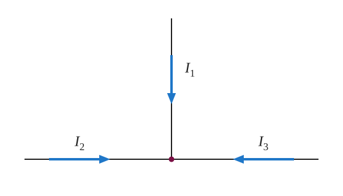

::: abstract

* Analyze a complex circuit using Kirchhoff’s rules, using the conventions for determining the correct signs of various terms.

:::

Many complex circuits, such as the one in [[Figure 1]](#Figure1), cannot be
analyzed with the series-parallel techniques developed
in [Resistors in Series and Parallel](../contents/ch21ResistorsInSeriesAndInParallel)
and [Electromotive Force: Terminal Voltage](../contents/ch21ElectromotiveForce). There are,
however, two circuit analysis rules that can be used to analyze any circuit,
simple or complex. These rules are special cases of the laws of conservation of
charge and conservation of energy. The rules are known as **Kirchhoff’s rules**,
after their inventor Gustav Kirchhoff (1824–1887).

{: #Figure1}

::: note {"class":"note","data-has-label":"true","data-label":""}

Kirchhoff’s Rules

*  Kirchhoff’s first rule—the junction rule. The sum of all currents entering a junction must equal the sum of all currents leaving the junction.
*  Kirchhoff’s second rule—the loop rule. The algebraic sum of changes in potential around any closed circuit path (loop) must be zero.

:::

Explanations of the two rules will now be given, followed by problem-solving
hints for applying Kirchhoff’s rules, and a worked example that uses them.

### Kirchhoff’s First Rule

Kirchhoff’s first rule (the **junction rule**) is an application of the
conservation of charge to a junction; it is illustrated
in [[Figure 2]](#Figure2). Current is the flow of charge, and charge is
conserved; thus, whatever charge flows into the junction must flow out.
Kirchhoff’s first rule requires that $${I}_{1}={I}_{2}+{I}_{3} $$
(see figure). Equations like this can and will be used to analyze circuits and
to solve circuit problems.

::: note {"class":"note","data-has-label":"true","data-label":""}

Making Connections: Conservation Laws

Kirchhoff’s rules for circuit analysis are applications of **conservation laws** to circuits. The first rule is the application of conservation of charge, while the second rule is the application of conservation of energy. Conservation laws, even used in a specific application, such as circuit analysis, are so basic as to form the foundation of that application.

:::

. Here ( I_{1} ) must be 11 A, since ( I_{2} ) is 7 A and ( I_{3} ) is 4 A.')
{: #Figure2}

### Kirchhoff’s Second Rule

Kirchhoff’s second rule (the **loop rule**) is an application of conservation of
energy. The loop rule is stated in terms of potential, $$V $$ , rather than
potential energy, but the two are related since $${\text{PE}}\_{\text{elec}}=qV $$

. Recall that **emf**{: class="term"} is the potential difference of a source
when no current is flowing. In a closed loop, whatever energy is supplied by emf
must be transferred into other forms by devices in the loop, since there are no
other ways in which energy can be transferred into or out of the
circuit. [[Figure 3]](#Figure3) illustrates the changes in potential in a simple
series circuit loop.

Kirchhoff’s second rule requires $$\text{emf}-Ir-IR_{1}-IR_{2}=0 $$ .
Rearranged, this is $$\text{emf}=Ir+IR_{1}+IR_{2} $$ , which means the emf
equals the sum of the $$IR $$
(voltage) drops in the loop.

 In this standard schematic of a simple series circuit, the emf supplies 18 V, which is reduced to zero by the resistances, with 1 V across the internal resistance, and 12 V and 5 V across the two load resistances, for a total of 18 V. (b) This perspective view represents the potential as something like a roller coaster, where charge is raised in potential by the emf and lowered by the resistances. (Note that the script E stands for emf.)")
{: #Figure3}

### Applying Kirchhoff’s Rules

By applying Kirchhoff’s rules, we generate equations that allow us to find the
unknowns in circuits. The unknowns may be currents, emfs, or resistances. Each
time a rule is applied, an equation is produced. If there are as many
independent equations as unknowns, then the problem can be solved. There are two
decisions you must make when applying Kirchhoff’s rules. These decisions
determine the signs of various quantities in the equations you obtain from
applying the rules.

1. When applying Kirchhoff’s first rule, the junction rule, you must label the
   current in each branch and decide in what direction it is going. For example,
   in [[Figure 1]](#Figure1), [[Figure 2]](#Figure2), and [[Figure 3]](#Figure3)
   , currents are labeled $${I}_{1} $$ , $${I}_{2} $$ , $${I}_{3} $$ , and $$I $$ , and arrows indicate their directions. There is no risk here, for if you
   choose the wrong direction, the current will be of the correct magnitude but
   negative.
2. When applying Kirchhoff’s second rule, the loop rule, you must identify a
   closed loop and decide in which direction to go around it, clockwise or
   counterclockwise. For example, in [[Figure 3]](#Figure3) the loop was
   traversed in the same direction as the current (clockwise). Again, there is
   no risk; going around the circuit in the opposite direction reverses the sign
   of every term in the equation, which is like multiplying both sides of the
   equation by $$-1. $$

[[Figure 4]](#Figure4) and the following points will help you get the plus or
minus signs right when applying the loop rule. Note that the resistors and emfs
are traversed by going from a to b. In many circuits, it will be necessary to
construct more than one loop. In traversing each loop, one needs to be
consistent for the sign of the change in potential. (See [[Example 1]](#Example1)
.)

{: #Figure4}

* When a resistor is traversed in the same direction as the current, the change
  in potential is $$-IR $$ .
  (See [[Figure 4]](#Figure4).)
* When a resistor is traversed in the direction opposite to the current, the
  change in potential is $$+IR $$ .
  (See [[Figure 4]](#Figure4).)
* When an emf is traversed from $$- $$ to + (the same direction it moves
  positive charge), the change in potential is +emf. (See [[Figure 4]](#Figure4)
  .)
* When an emf is traversed from + to $$- $$ (opposite to the direction it moves
  positive charge), the change in potential is $$- $$ emf. (
  See [[Figure 4]](#Figure4).)

::: example {"id":"Example1","class":"example"}

Calculating Current: Using Kirchhoff’s Rules

Find the currents flowing in the circuit in [[Figure 5]](#Figure5).

![Junctions a on the left and e on the right. Top branch from a: up through R2 = 2.5 ohms, then along the top through b, emf1 = 18 V with its positive terminal toward c, c, r1 = 0.5 ohm and d, then down to e. Middle branch: R1 = 6.0 ohms between a and e. Bottom branch from a: down, then along the bottom through h, emf2 = 45 V with its positive terminal toward g, g, r2 = 0.5 ohm and f, then up through R3 = 1.5 ohms to e. Assumed currents: I2 around the top branch from a toward e, I1 through R1 from e toward a, and I3 around the bottom branch from a toward e.](../resources/Figure_21_03_05.svg "This circuit is similar to that in Figure 1, but the resistances and emfs are specified. The currents in each branch are labeled and assumed to move in the directions shown. This example uses Kirchhoff&#x2019;s rules to find the currents.")
{: #Figure5}

**Strategy**

This circuit is sufficiently complex that the currents cannot be found using
Ohm’s law and the series-parallel techniques—it is necessary to use Kirchhoff’s
rules. Currents have been labeled $${I}_{1} $$ , $${I}_{2} $$ , and $${I}_{3} $$
in the figure and assumptions have been made about their directions. Locations
on the diagram have been labeled with letters a through h. In the solution we
will apply the junction and loop rules, seeking three independent equations to
allow us to solve for the three unknown currents.

**Solution**

We begin by applying Kirchhoff’s first or junction rule at point a. This gives

 $${I}_{1}={I}_{2}+{I}_{3}, $$

since  $${I}_{1} $$  flows into the junction, while  $${I}_{2} $$  and  $${I}_{3} $$
 flow out. Applying the junction rule at e produces exactly the same equation, so that no new information is obtained. This is a single equation with three unknowns—three independent equations are needed, and so the loop rule must be applied.

Now we consider the loop abcdea. Going from a to b, we traverse $${R}_{2} $$ in
the same (assumed) direction of the current $${I}_{2} $$ , and so the change in
potential is $$-{I}_{2}{R}_{2} $$ . Then going from b to c, we go from $$- $$ to
+, so that the change in potential is $$+{\text{emf}}_{1} $$ . Traversing the
internal resistance $${r}_{1} $$ from c to d gives $$-{I}_{2}{r}_{1} $$ .
Completing the loop by going from d to a again traverses a resistor in the same
direction as its current, giving a change in potential of $$-{I}_{1}{R}_{1} $$.

The loop rule states that the changes in potential sum to zero. Thus,

 $$-{I}_{2}{R}_{2}+{\text{emf}}_{1}-{I}_{2}{r}_{1}-{I}_{1}{R}_{1}=-{I}_{2}\left({R}_{2}+{r}_{1}\right)+{\text{emf}}_{1}-{I}_{1}{R}_{1}=0. $$

Substituting values from the circuit diagram for the resistances and emf, and canceling the ampere unit gives

 $$-{3I}_{2}+18-{6I}_{1}=0. $$

Now applying the loop rule to aefgha (we could have chosen abcdefgha as well) similarly gives

 $$+ {I}_{1}{R}_{1}+{I}_{3}{R}_{3}+{I}_{3}{r}_{2}-{\text{emf}}_{2}= + {I}_{1}{R}_{1}+{I}_{3}\left({R}_{3}+{r}_{2}\right)-{\text{emf}}_{2}=0. $$

Note that the signs are reversed compared with the other loop, because elements are traversed in the opposite direction. With values entered, this becomes

 $$+ {6I}_{1}+{2I}_{3}-45=0. $$

These three equations are sufficient to solve for the three unknown currents. First, solve the second equation for  $${I}_{2} $$
\:

 $${I}_{2}=6-{2I}_{1}. $$

Now solve the third equation for  $${I}_{3} $$
\:

 $${I}_{3}= 22.5-{3I}_{1}. $$

Substituting these two new equations into the first one allows us to find a value for  $${I}_{1} $$
\:

 $${I}_{1}={I}_{2}+{I}_{3}=\left(6-{2I}_{1}\right)+\left( 22.5-{3I}_{1}\right)= 28.5-{5I}_{1}. $$

Combining terms gives

 $${6I}_{1}= 28.5, and $$

 $${I}_{1}=4.75 \text{A}. $$

Substituting this value for  $${I}_{1} $$  back into the fourth equation gives

 $${I}_{2}=6-{2I}_{1}=6-9.50 $$

 $${I}_{2}=-3.50 \text{A}. $$

The minus sign means  $${I}_{2} $$
 flows in the direction opposite to that assumed in [[Figure 5]](#Figure5).

Finally, substituting the value for $${I}_{1} $$ into the fifth equation gives

 $${I}_{3}=22.5-{3I}_{1}=22.5- 14.25  $$

 $${I}_{3}=8.25 \text{A}. $$

**Discussion**

Just as a check, we note that indeed $${I}_{1}={I}_{2}+{I}_{3} $$ . The results
could also have been checked by entering all of the values into the equation for
the abcdefgha loop.

:::

::: note {"class":"note","data-has-label":"true","data-label":""}

Problem-Solving Strategies for Kirchhoff’s Rules

1.   Make certain there is a clear circuit diagram on which you can label all known and unknown resistances, emfs, and currents. If a current is unknown, you must assign it a direction. This is necessary for determining the signs of potential changes. If you assign the direction incorrectly, the current will be found to have a negative value—no harm done.
2.   Apply the junction rule to any junction in the circuit. Each time the junction rule is applied, you should get an equation with a current that does not appear in a previous application—if not, then the equation is redundant.
3.   Apply the loop rule to as many loops as needed to solve for the unknowns in the problem. (There must be as many independent equations as unknowns.) To apply the loop rule, you must choose a direction to go around the loop. Then carefully and consistently determine the signs of the potential changes for each element using the four bulleted points discussed above in conjunction with [[Figure 4]](#Figure4).
4.   Solve the simultaneous equations for the unknowns. This may involve many algebraic steps, requiring careful checking and rechecking.
5.   Check to see whether the answers are reasonable and consistent. The numbers should be of the correct order of magnitude, neither exceedingly large nor vanishingly small. The signs should be reasonable—for example, no resistance should be negative. Check to see that the values obtained satisfy the various equations obtained from applying the rules. The currents should satisfy the junction rule, for example.

:::

The material in this section is correct in theory. We should be able to verify
it by making measurements of current and voltage. In fact, some of the devices
used to make such measurements are straightforward applications of the
principles covered so far and are explored in the next modules. As we shall see,
a very basic, even profound, fact results—making a measurement alters the
quantity being measured.

Check Your Understanding

::: problem

Can Kirchhoff’s rules be applied to simple series and parallel circuits or are they restricted for use in more complicated circuits that are not combinations of series and parallel?

:::

::: solution {"class":"solution","data-print-placement":"here"}

Kirchhoff's rules can be applied to any circuit since they are applications to circuits of two conservation laws. Conservation laws are the most broadly applicable principles in physics. It is usually mathematically simpler to use the rules for series and parallel in simpler circuits so we emphasize Kirchhoff’s rules for use in more complicated situations. But the rules for series and parallel can be derived from Kirchhoff’s rules. Moreover, Kirchhoff’s rules can be expanded to devices other than resistors and emfs, such as capacitors, and are one of the basic analysis devices in circuit analysis.

:::

### Section Summary

* Kirchhoff’s rules can be used to analyze any circuit, simple or complex.
* Kirchhoff’s first rule—the junction rule: The sum of all currents entering a
  junction must equal the sum of all currents leaving the junction.
* Kirchhoff’s second rule—the loop rule: The algebraic sum of changes in
  potential around any closed circuit path (loop) must be zero.
* The two rules are based, respectively, on the laws of conservation of charge
  and energy.
* When calculating potential and current using Kirchhoff’s rules, a set of
  conventions must be followed for determining the correct signs of various
  terms.
* The simpler series and parallel rules are special cases of Kirchhoff’s rules.

### Conceptual Questions

::: problem

Can all of the currents going into the junction in [[Figure 6]](#Figure6) be positive? Explain.

:::

::: solution

**Strategy**

Apply the junction rule, which expresses conservation of charge: charge does not pile up at a junction, so the currents into it must add to zero when all three are drawn as entering.

**Solution**

With all three currents defined as entering the junction,

$$ I_1 + I_2 + I_3 = 0 $$

If all three were positive, charge would flow into the junction each second and none would leave. For example, $$ 2.0 \text{ A} + 1.0 \text{ A} + 3.0 \text{ A} = 6.0 \text{ A} $$ would mean $$ 6.0 \text{ C} $$ of charge accumulating at the junction every second, which does not happen in a steady circuit. At least one current must be negative, meaning that it actually flows out of the junction; for example, $$ I_1 = 2.0 \text{ A} $$, $$ I_2 = 1.0 \text{ A} $$, and $$ I_3 = -3.0 \text{ A} $$.

No, not all of the currents into the junction can be positive, because conservation of charge requires $$ I_1 + I_2 + I_3 = 0 $$, so at least one of them must be negative, that is, must actually flow out of the junction.

:::

{: #Figure6}

::: problem

Apply the junction rule to junction b in [[Figure 7]](#Figure7). Is any new information gained by applying the junction rule at e?

:::

::: solution

**Strategy**

At a junction, the current entering equals the current leaving. Read the current directions off [[Figure 7]](#Figure7): $$ I_1 $$ enters b from the left, $$ I_2 $$ leaves toward c, and $$ I_3 $$ leaves downward toward g. Then examine junction e, where the same three branches meet.

**Solution**

At junction b:

$$ I_1 = I_2 + I_3 $$

At junction e, $$ I_3 $$ arrives from the middle branch and $$ I_2 $$ arrives from the right branch (through $$ r_4 $$ and $$ \text{emf}_4 $$), while $$ I_1 $$ leaves through $$ R_4 $$ toward f:

$$ I_2 + I_3 = I_1 $$

This is the same equation. With the currents found in the problems for this figure, $$ I_1 = 0.381 \text{ A} $$, $$ I_2 = -0.814 \text{ A} $$, and $$ I_3 = 1.20 \text{ A} $$, both equations read $$ 0.381 \text{ A} = -0.814 \text{ A} + 1.195 \text{ A} $$. A circuit with two junctions gives only one independent junction equation; the other two equations needed must come from the loop rule.

The junction rule at b gives $$ I_1 = I_2 + I_3 $$, and applying it at e gives no new information, because it yields the same equation, $$ I_2 + I_3 = I_1 $$.

:::

![Corners a (top left), c (top right), d (bottom right) and f (bottom left), with junctions b on the top wire and e on the bottom wire joined by a middle branch. Left branch f to a: emf1 = 18 V with r1 = 0.5 ohm. Top: R1 = 20 ohms from a to b and R3 = 8 ohms from b to c. Middle branch b to e: R2 = 6 ohms, point g, emf2 = 3.0 V and r2 = 0.25 ohm. Right branch c to d: emf3 = 12 V and r3 = 0.5 ohm. Bottom: R4 = 15 ohms from f to e, then emf4 = 24 V and r4 = 0.75 ohm from e to d. Currents I1 flows from a toward b, then splits into I2 toward c and I3 down the middle branch.](../resources/Figure_21_03_07.svg " ")
{: #Figure7}

::: problem

(a) What is the potential difference going from point a to point b in [[Figure 7]](#Figure7)? (b) What is the potential difference going from c to b? (c) From e to g? (d) From e to d?

:::

::: solution

**Strategy**

Follow each path in the stated direction. Crossing a resistor in the direction of its current is a drop of $$ IR $$; crossing it against the current is a rise of $$ IR $$. Crossing an emf from its $$ - $$ terminal (short plate) to its $$ + $$ terminal (long plate) is a rise; the opposite is a drop. In [[Figure 7]](#Figure7), $$ \text{emf}_2 $$ has its positive (long) plate toward e and $$ \text{emf}_4 $$ has its positive plate toward d. The potential difference "from x to y" is $$ V_y - V_x $$. Use $$ I_1 = 0.381 \text{ A} $$, $$ I_2 = -0.814 \text{ A} $$, and $$ I_3 = 1.20 \text{ A} $$ to evaluate each result.

**Solution**

**(a)** From a to b we cross $$ R_1 $$ in the direction of $$ I_1 $$, a drop:

$$ V_b - V_a = -I_1R_1 = -(0.381 \text{ A})(20 \ \Omega) = -7.6 \text{ V} $$

**(b)** From c to b we cross $$ R_3 $$ against the direction of $$ I_2 $$, a rise:

$$ V_b - V_c = +I_2R_3 = (-0.814 \text{ A})(8 \ \Omega) = -6.5 \text{ V} $$

The result is negative because $$ I_2 $$ actually flows opposite to its arrow.

**(c)** From e to g we cross $$ r_2 $$ against $$ I_3 $$ (a rise of $$ I_3r_2 $$), then cross $$ \text{emf}_2 $$ from its $$ + $$ to its $$ - $$ terminal (a drop of $$ 3.0 \text{ V} $$):

$$ V_g - V_e = I_3r_2 - \text{emf}_2 = (1.20 \text{ A})(0.25 \ \Omega) - 3.0 \text{ V} = -2.7 \text{ V} $$

**(d)** From e to d we cross $$ \text{emf}_4 $$ from $$ - $$ to $$ + $$ (a rise of $$ 24 \text{ V} $$), then cross $$ r_4 $$ against $$ I_2 $$, which flows from d toward e (a rise of $$ I_2r_4 $$):

$$ V_d - V_e = \text{emf}_4 + I_2r_4 = 24 \text{ V} + (-0.814 \text{ A})(0.75 \ \Omega) = 23.4 \text{ V} $$

The potential differences are (a) $$ V_b - V_a = -I_1R_1 = -7.6 \text{ V} $$, (b) $$ V_b - V_c = I_2R_3 = -6.5 \text{ V} $$, (c) $$ V_g - V_e = I_3r_2 - \text{emf}_2 = -2.7 \text{ V} $$, and (d) $$ V_d - V_e = \text{emf}_4 + I_2r_4 = 23.4 \text{ V} $$.

:::

::: problem

Apply the loop rule to loop afedcba in [[Figure 7]](#Figure7).

:::

::: solution

**Strategy**

Go around the outer loop a → f → e → d → c → b → a and add every change in potential; the sum must be zero. Use the sign rules from the previous question. $$ I_1 $$ flows up the left branch (from f to a), and $$ I_2 $$ flows down the right branch (from c to d) and back along d → e.

**Solution**

Term by term:

- a → f: through $$ r_1 $$ against $$ I_1 $$: $$ +I_1r_1 $$; through $$ \text{emf}_1 $$ from $$ + $$ to $$ - $$: $$ -18 \text{ V} $$
- f → e: through $$ R_4 $$ against $$ I_1 $$: $$ +I_1R_4 $$
- e → d: through $$ \text{emf}_4 $$ from $$ - $$ to $$ + $$: $$ +24 \text{ V} $$; through $$ r_4 $$ against $$ I_2 $$: $$ +I_2r_4 $$
- d → c: through $$ r_3 $$ against $$ I_2 $$: $$ +I_2r_3 $$; through $$ \text{emf}_3 $$ from $$ + $$ to $$ - $$: $$ -12 \text{ V} $$
- c → b: through $$ R_3 $$ against $$ I_2 $$: $$ +I_2R_3 $$
- b → a: through $$ R_1 $$ against $$ I_1 $$: $$ +I_1R_1 $$

The loop rule gives

$$ I_1(r_1 + R_4 + R_1) + I_2(r_4 + r_3 + R_3) - 18 \text{ V} + 24 \text{ V} - 12 \text{ V} = 0 $$

$$ I_1(0.5 \ \Omega + 15 \ \Omega + 20 \ \Omega) + I_2(0.75 \ \Omega + 0.5 \ \Omega + 8 \ \Omega) = 6 \text{ V} $$

$$ (35.5 \ \Omega)I_1 + (9.25 \ \Omega)I_2 = 6.0 \text{ V} $$

Check with the solved currents: $$ (35.5 \ \Omega)(0.381 \text{ A}) + (9.25 \ \Omega)(-0.814 \text{ A}) = 13.5 \text{ V} - 7.5 \text{ V} = 6.0 \text{ V} $$.

The loop rule for loop afedcba gives $$ (35.5 \ \Omega)I_1 + (9.25 \ \Omega)I_2 = 6.0 \text{ V} $$, which is $$ I_1(r_1 + R_4 + R_1) + I_2(r_4 + r_3 + R_3) - \text{emf}_1 + \text{emf}_4 - \text{emf}_3 = 0 $$.

:::

::: problem

Apply the loop rule to loops abgefa and cbgedc in [[Figure 7]](#Figure7).

:::

::: solution

**Strategy**

Use the same sign rules as before. In loop abgefa, go a → b → g → e → f → a; in loop cbgedc, go c → b → g → e → d → c. $$ I_3 $$ flows down the middle branch from b through g to e.

**Solution**

**Loop abgefa:**

- a → b: through $$ R_1 $$ with $$ I_1 $$: $$ -I_1R_1 $$
- b → g: through $$ R_2 $$ with $$ I_3 $$: $$ -I_3R_2 $$
- g → e: through $$ \text{emf}_2 $$ from $$ - $$ to $$ + $$: $$ +3.0 \text{ V} $$; through $$ r_2 $$ with $$ I_3 $$: $$ -I_3r_2 $$
- e → f: through $$ R_4 $$ with $$ I_1 $$: $$ -I_1R_4 $$
- f → a: through $$ \text{emf}_1 $$ from $$ - $$ to $$ + $$: $$ +18 \text{ V} $$; through $$ r_1 $$ with $$ I_1 $$: $$ -I_1r_1 $$

$$ -I_1(R_1 + R_4 + r_1) - I_3(R_2 + r_2) + 3.0 \text{ V} + 18 \text{ V} = 0 \quad \Rightarrow \quad (35.5 \ \Omega)I_1 + (6.25 \ \Omega)I_3 = 21.0 \text{ V} $$

Check: $$ (35.5 \ \Omega)(0.381 \text{ A}) + (6.25 \ \Omega)(1.195 \text{ A}) = 13.5 \text{ V} + 7.5 \text{ V} = 21.0 \text{ V} $$.

**Loop cbgedc:**

- c → b: through $$ R_3 $$ against $$ I_2 $$: $$ +I_2R_3 $$
- b → g → e: as above, $$ -I_3R_2 + 3.0 \text{ V} - I_3r_2 $$
- e → d: through $$ \text{emf}_4 $$ from $$ - $$ to $$ + $$: $$ +24 \text{ V} $$; through $$ r_4 $$ against $$ I_2 $$: $$ +I_2r_4 $$
- d → c: through $$ r_3 $$ against $$ I_2 $$: $$ +I_2r_3 $$; through $$ \text{emf}_3 $$ from $$ + $$ to $$ - $$: $$ -12 \text{ V} $$

$$ I_2(R_3 + r_4 + r_3) - I_3(R_2 + r_2) + 3.0 \text{ V} + 24 \text{ V} - 12 \text{ V} = 0 \quad \Rightarrow \quad (6.25 \ \Omega)I_3 - (9.25 \ \Omega)I_2 = 15.0 \text{ V} $$

Check: $$ (6.25 \ \Omega)(1.195 \text{ A}) - (9.25 \ \Omega)(-0.814 \text{ A}) = 7.5 \text{ V} + 7.5 \text{ V} = 15.0 \text{ V} $$.

Subtracting the second equation from the first gives the equation for loop afedcba, so only two of the three loop equations are independent.

The loop rule gives $$ (35.5 \ \Omega)I_1 + (6.25 \ \Omega)I_3 = 21.0 \text{ V} $$ for loop abgefa and $$ (6.25 \ \Omega)I_3 - (9.25 \ \Omega)I_2 = 15.0 \text{ V} $$ for loop cbgedc.

:::

### Problem Exercises

::: problem

Apply the loop rule to loop abcdefgha in [[Figure 5]](#Figure5).

:::

 $$-{I}_{2}{R}_{2}+{\text{emf}}_{1}-I_{2}{r}_{1}+I_{3}{R}_{3}+I_{3}{r}_{2}-{\text{emf}}_{2}=0 $$

::: problem

Apply the loop rule to loop aedcba in [[Figure 5]](#Figure5).

:::

::: solution

**Strategy**

Traverse loop aedcba, summing potential changes. Use sign conventions: $$-IR$$ when traversing a resistor in the current direction, $$+IR$$ opposite to current, $$+\text{emf}$$ from - to +, $$-\text{emf}$$ from + to -.

**Solution**

Loop aedcba (clockwise):
- a to e: through $$R_1$$ opposite to $$I_1$$: $$+I_1 R_1$$
- e to d: through $$r_2$$ opposite to $$I_3$$: $$+I_3 r_2$$
- d to c: through emf₂ from + to -: $$-\text{emf}_2$$
- c to b: through $$r_1$$ in direction of $$I_2$$: $$-I_2 r_1$$
- b to a: through $$R_2$$ in direction of $$I_2$$: $$-I_2 R_2$$

Sum equals zero:

$$+I_1 R_1 + I_3 r_2 - \text{emf}_2 - I_2 r_1 - I_2 R_2 = 0$$

Rearranged:

$$I_1 R_1 - I_2(R_2 + r_1) + I_3 r_2 = \text{emf}_2$$

**Discussion**

This is the same equation that would be obtained by combining the loop abcdea equation with the junction rule, demonstrating that not all loop equations are independent.

The loop equation is: $$I_1 R_1 + I_3 r_2 - \text{emf}_2 - I_2 r_1 - I_2 R_2 = 0$$.

:::

::: problem

Verify the second equation in [[Example 1]](#Example1) by substituting the values found for the currents  $${I}_{1} $$
 and  $${I}_{2} $$.

:::

::: solution

**Strategy**

From Example 1, the second equation is $$-3I_2 + 18 - 6I_1 = 0$$. The found values are $$I_1 = 4.75 \text{ A}$$ and $$I_2 = -3.50 \text{ A}$$. Substitute and verify the equation holds.

**Solution**

Substitute values into $$-3I_2 + 18 - 6I_1 = 0$$:

$$-3(-3.50) + 18 - 6(4.75) = 10.5 + 18 - 28.5 = 0$$ ✓

**Discussion**

The equation is satisfied exactly, confirming the solution is correct. This verification step is important in Kirchhoff's Rules problems to catch algebraic errors.

Verified: $$-3(-3.50) + 18 - 6(4.75) = 0$$.

:::

::: problem

Verify the third equation in [[Example 1]](#Example1) by substituting the values found for the currents  $${I}_{1} $$
 and  $${I}_{3} $$.

:::

::: solution

**Strategy**

The third equation from Example 1 is $$+6I_1 + 2I_3 - 45 = 0$$. Substitute $$I_1 = 4.75 \text{ A}$$ and $$I_3 = 8.25 \text{ A}$$ to verify.

**Solution**

$$+6(4.75) + 2(8.25) - 45 = 28.5 + 16.5 - 45 = 0$$ ✓

**Discussion**

The equation is satisfied, confirming our currents are correct. All three verification checks (junction rule and two loop equations) pass, giving confidence in the solution.

Verified: $$+6(4.75) + 2(8.25) - 45 = 0$$.

:::

::: problem

Apply the junction rule at point a in [[Figure 8]](#Figure8).

![Junctions a on the left and e on the right are joined by three branches. Top branch, from a up through R1 = 5.0 ohms, along the top through points b, emf1 = 24.0 V, c, r1 = 0.10 ohm and d, then down through R5 = 20 ohms to e. Middle branch from a: emf2 = 48.0 V, point k, r2 = 0.50 ohm, point l and R2 = 40 ohms to e. Bottom branch from a down through R3 = 78 ohms, along the bottom through j, emf3 = 6.0 V, i, r3 = 0.05 ohm and h, then up through g, emf4 = 36.0 V, f and r4 = 0.20 ohm to e. Currents I1 flows up through R1, I2 to the right through the middle branch, and I3 up through R3.](../resources/Figure_21_03_08.svg " ")
{: #Figure8}

:::

 $${I}_{3}=I_{1}+I_{2} $$

::: problem

Apply the loop rule to loop abcdefghija in [[Figure 8]](#Figure8).

:::

::: solution

Traverse the outer loop abcdefghija in Figure 8. The top branch carries $$I_1$$ and the bottom branch carries $$I_3$$, both in the traversal direction. The sources contribute $$+\mathcal E_1-\mathcal E_4+\mathcal E_3$$. Therefore

$$\mathcal E_1-\mathcal E_4+\mathcal E_3-I_1(R_1+r_1+R_5)-I_3(R_3+r_3+r_4)=0.$$

With the printed values,

$$24.0-36.0+6.0-25.1I_1-78.25I_3=0.$$

There is no resistor $$R_4$$ in this figure.

:::

::: problem

Apply the loop rule to loop akledcba in [[Figure 8]](#Figure8).

:::

 $${\text{emf}}_{2}-I_{2}{r}_{2}-I_{2}{R}_{2}+I_{1}{R}_{5}+{I}_{1}{r}_{1}-{\text{emf}}_{1}+I_{1}{R}_{1}=0 $$

::: problem

Find the currents flowing in the circuit in [[Figure 8]](#Figure8). Explicitly show how you follow the steps in
the [Problem-Solving Strategies for Series and Parallel Resistors](../contents/ch21ResistorsInSeriesAndInParallel#Note1).

:::

::: solution

**Strategy**

Use the labeled current directions in Figure 8, read each cell polarity from its long positive plate, and write one junction equation and two independent loop equations.

**Solution**

At junction a, $$I_3=I_1+I_2$$. The top branch has resistance $$5.0\ \Omega+0.10\ \Omega+20\ \Omega=25.1\ \Omega$$, the middle branch $$40\ \Omega+0.50\ \Omega=40.5\ \Omega$$, and the bottom branch $$78\ \Omega+0.05\ \Omega+0.20\ \Omega=78.25\ \Omega$$.

Loop akledcba gives

$$48.0-40.5I_2+25.1I_1-24.0=0.$$

For the outer loop abcdefghija, the emf sum is $$+24.0-36.0+6.0$$:

$$24.0-36.0+6.0-25.1I_1-78.25I_3=0.$$

Solving these with the junction equation gives

$$I_1=-0.345\ \text{A},\qquad I_2=0.379\ \text{A},\qquad I_3=0.0340\ \text{A}.$$

**Check**

The negative $$I_1$$ means flow opposite its arrow. The third loop gives $$48.0-40.5I_2-36.0+6.0-78.25I_3=0$$, consistent with the solution. Substituting unrounded currents satisfies all three loop equations.

:::

::: problem

Solve [[Example 1]](#Example1), but use loop abcdefgha instead of loop akledcba. Explicitly show how you follow the
steps in the [Problem-Solving Strategies for Series and Parallel Resistors](../contents/ch21ResistorsInSeriesAndInParallel#Note1).

:::

::: solution

(a)  $$I_{1}=4.75 \text{A} $$
(b)  $$I_{2}=-3.5 \text{A} $$
(c)  $$I_{3}=8.25 \text{A} $$

:::

::: problem

Find the currents flowing in the circuit in [[Figure 7]](#Figure7).

:::

::: solution

Use the labeled directions and the cell polarities in Figure 7. The junction equation at b is

$$I_1=I_2+I_3.$$

The left, middle, and right branch resistances are 35.5 Ω, 6.25 Ω, and 9.25 Ω. The 12-V cell has its positive plate below, and the 24-V cell has its positive plate to the right. Thus, taking node e as zero potential,

$$V_b=18.0-35.5I_1=-3.00+6.25I_3=12.0+9.25I_2.$$

Equating the three expressions gives two independent equations:

$$35.5I_1+6.25I_3=21.0,$$

$$6.25I_3-9.25I_2=15.0.$$

Solving yields

$$I_1=0.381\ \text{A},\qquad I_2=-0.814\ \text{A},\qquad I_3=1.20\ \text{A}.$$

Thus $$I_2$$ flows opposite its arrow. The remaining loop condition is $$35.5I_1+9.25I_2=6.00$$, which the unrounded solution also satisfies.

:::

::: problem

**Unreasonable Results**

Consider the circuit in [[Figure 9]](#Figure9), and suppose that the emfs are
unknown and the currents are given to be $${I}_{1}=5.00 \text{A} $$ , $${I}_{2}=3.0\text{ A} $$ , and $${I}_{3}= -2.00 \text{A} $$ .
(a) Could you find the emfs? (b) What is wrong with the assumptions?

![Junctions a on the left and e on the right. Top branch from a: up through R2 = 2.5 ohms, then along the top through b, emf1 = 18 V with its positive terminal toward c, c, r1 = 0.5 ohm and d, then down to e. Middle branch: R1 = 6.0 ohms between a and e. Bottom branch from a: down, then along the bottom through h, emf2 = 45 V with its positive terminal toward g, g, r2 = 0.5 ohm and f, then up through R3 = 1.5 ohms to e. Assumed currents: I2 around the top branch from a toward e, I1 through R1 from e toward a, and I3 around the bottom branch from a toward e.](../resources/Figure_21_03_09.svg " ")
{: #Figure9}

:::

::: solution

(a) No, you would get inconsistent equations to solve.

(b)  $${I}_{1}\ne {I}_{2}+{I}_{3} $$ . The assumed currents violate the junction
rule.

:::

::: glossary

### Glossary
{: class="glossary-title"}

Kirchhoff’s rules
: a set of two rules, based on conservation of charge and energy, governing
current and changes in potential in an electric circuit

junction rule
: Kirchhoff’s first rule, which applies the conservation of charge to a
junction; current is the flow of charge; thus, whatever charge flows into the
junction must flow out; the rule can be stated $${I}_{1}={I}_{2}+{I}_{3} $$

loop rule
: Kirchhoff’s second rule, which states that in a closed loop, whatever energy
is supplied by emf must be transferred into other forms by devices in the loop,
since there are no other ways in which energy can be transferred into or out of
the circuit. Thus, the emf equals the sum of the $$IR $$
(voltage) drops in the loop and can be stated:
$$\text{emf}=Ir+IR_{1}+IR_{2} $$

conservation laws
: require that energy and charge be conserved in a system

:::
