::: abstract

* Describe a straight-line graph in terms of its slope and y-intercept.
* Determine average velocity or instantaneous velocity from a graph of position vs. time.
* Determine average or instantaneous acceleration from a graph of velocity vs. time.
* Derive a graph of velocity vs. time from a graph of position vs. time.
* Derive a graph of acceleration vs. time from a graph of velocity vs. time.

:::

A graph, like a picture, is worth a thousand words. Graphs not only contain
numerical information; they also reveal relationships between physical
quantities. This section uses graphs of position, velocity, and acceleration
versus time to illustrate one-dimensional kinematics.

### Slopes and General Relationships

First note that graphs in this text have perpendicular axes, one horizontal and
the other vertical. When two physical quantities are plotted against one another
in such a graph, the horizontal axis is usually considered to be an
**independent variable** and the vertical axis a **dependent variable**. If we
call the horizontal axis the $$ x $$ -axis and the vertical axis the $$ y $$
-axis, as in [Figure 1](#Figure1), a straight-line graph has the general form

 $$ y= m x+b. $$

Here $$ m $$ is the **slope**, defined to be the rise divided by the run (as
seen in the figure) of the straight line. The letter $$ b $$ is used for the
**y-intercept**, which is the point at which the line crosses the vertical axis.

')
{: #Figure1}

### Graph of Position vs. Time (_a_ = 0, so _v_ is constant)

Time is usually an independent variable that other quantities, such as position,
depend upon. A graph of position versus time would, thus, have $$ x $$ on the
vertical axis and $$ t $$ on the horizontal axis. [Figure 2](#Figure2) is just such
a straight-line graph. It shows a graph of position versus time for a
jet-powered car on the very flat Bonneville Salt Flats in Utah.

{: #Figure2}

Using the relationship between dependent and independent variables, we see that
the slope in the graph above is average velocity $$ \overline{v} $$ and the
intercept is position at time zero—that is, $$ x_{0} $$. Substituting these
symbols into $$ y= mx+b $$ gives

 $$ x=\overline{v}t+x_{0} $$

or

 $$ x=x_{0}+\overline{v}t . $$

Thus a graph of position versus time gives a general relationship among
displacement(change in position), velocity, and time, as well as giving detailed
numerical information about a specific situation.

::: note {"class":"note","data-label":""}

The Slope of *x* vs. *t*

The slope of the graph of position $$ x $$ vs. time $$ t $$ is velocity $$ v $$.

 $$ \text{slope}=\frac{ \Delta x}{\Delta t}=v $$

Notice that this equation is the same as that derived algebraically from other motion equations
in [Motion Equations for Constant Acceleration in One Dimension](./ch2MotionEquationsForConstantAccelerationInOneDimension).

:::

From the figure we can see that the car has a position of 525 m at 0.50 s and
2000 m at 6.40 s. Its position at other times can be read from the graph;
furthermore, information about its velocity and acceleration can also be
obtained from the graph.

::: example

Determining Average Velocity from a Graph of Position versus Time: Jet Car

Find the average velocity of the car whose position is graphed in [Figure 2](#Figure2).

**Strategy**

The slope of a graph of $$ x $$ vs. $$ t $$ is average velocity, since slope
equals rise over run. In this case, rise = change in position and run = change
in time, so that

 $$ \text{slope}=\frac{ \Delta x}{\Delta t}=\overline{v}. $$

Since the slope is constant here, any two points on the graph can be used to find the slope. (Generally speaking, it is most accurate to use two widely separated points on the straight line. This is because any error in reading data from the graph is proportionally smaller if the interval is larger.)

**Solution**

1\. Choose two points on the line. In this case, we choose the points labeled on
the graph: (6.4 s, 2000 m) and (0.50 s, 525 m). (Note, however, that you could
choose any two points.)

2\. Substitute the $$ x $$ and $$ t $$ values of the chosen points into the
equation. Remember in calculating change $$ \left(\Delta \right) $$ we always
use final value minus initial value.

 $$ \overline{v}=\frac{ \Delta x}{\Delta t}=\frac{2000 \m -525 \m }{6.4 \s  -0.50 \s }, $$

yielding

 $$ \overline{v}=250 \ms . $$

**Discussion**

This is an impressively large land speed (900 km/h, or about 560 mi/h): much
greater than the typical highway speed limit of 60 mi/h (27 m/s or 96 km/h), but
considerably shy of the record of 341 m/s (1228 km/h or 763 mi/h) set in 1997.

:::

### Graphs of Motion when $$ a $$ is constant but $$ a\ne 0 $$

The graphs in [Figure 3](#Figure3)
below represent the motion of the jet-powered car as it accelerates toward its
top speed, but only during the time when its acceleration is constant. Time
starts at zero for this motion (
as if measured with a stopwatch), and the position and velocity are initially
200 m and 15 m/s, respectively.

 The slope of an \( x \) vs. \( t \) graph is velocity. This is shown at two points, and the instantaneous velocities obtained are plotted in the next graph. Instantaneous velocity at any point is the slope of the tangent at that point.
(b) The slope of the \( v \) vs. \( t \) graph is constant for this part of the motion, indicating constant acceleration.
(c) Acceleration has the constant value of \( 5.0 \mss \) over the time interval plotted.')
{: #Figure3}

')
{: #Figure4}

The graph of position versus time in [Figure 3](#Figure3)(a) is a curve rather than
a straight line. The slope of the curve becomes steeper as time progresses,
showing that the velocity is increasing over time. The slope at any point on a
position-versus-time graph is the instantaneous velocity at that point. It is
found by drawing a straight line tangent to the curve at the point of interest
and taking the slope of this straight line. Tangent lines are shown for two
points in [Figure 3](#Figure3)(a). If this is done at every point on the curve and
the values are plotted against time, then the graph of velocity versus time
shown in [Figure 3](#Figure3)(b) is obtained. Furthermore, the slope of the graph
of velocity versus time is acceleration, which is shown in [Figure 3](#Figure3)(c).

::: example

Determining Instantaneous Velocity from the Slope at a Point: Jet Car

Calculate the velocity of the jet car at a time of 25 s by finding the slope of the $$ x $$ vs. $$ t $$
graph in the graph below.

![A graph of displacement versus time for a jet car. The x axis for time runs from zero to thirty five seconds. The y axis for displacement runs from zero to three thousand meters. The curve depicting displacement is concave up. The slope of the curve increases over time. Slope equals velocity v. There are two points on the curve, labeled, P and Q. P is located at time equals ten seconds. Q is located and time equals twenty-five seconds. A line tangent to P at ten seconds is drawn and has a slope delta x sub P over delta t sub p. A line tangent to Q at twenty five seconds is drawn and has a slope equal to delta x sub q over delta t sub q. Select coordinates are given in a table and consist of the following: time zero seconds displacement two hundred meters; time five seconds displacement three hundred thirty eight meters; time ten seconds displacement six hundred meters; time fifteen seconds displacement nine hundred eighty eight meters. Time twenty seconds displacement one thousand five hundred meters; time twenty five seconds displacement two thousand one hundred thirty eight meters; time thirty seconds displacement two thousand nine hundred meters.](../resources/Figure_02_08_05.svg 'The slope of an \( x \) vs. \( t \) graph is velocity. This is shown at two points. Instantaneous velocity at any point is the slope of the tangent at that point.')
{: #Figure5}

**Strategy**

The slope of a curve at a point is equal to the slope of a straight line tangent
to the curve at that point. This principle is illustrated in [Figure 5](#Figure5),
where Q is the point at $$ t=25 \s $$.

**Solution**

1\. Find the tangent line to the curve at $$ t=25 \s $$.

2\. Determine the endpoints of the tangent. These correspond to a position of
1300 m at time 19 s and a position of 3120 m at time 32 s.

3\. Plug these endpoints into the equation to solve for the slope, $$ v $$.

 $$ \text{slope}=v_{Q}=\frac{ \Delta x_{Q}}{ \Delta t_{Q}}=\frac{ \left(3120 \m -1300 \m \right)}{\left(32 \s  -19 \s \right)} $$

Thus,

 $$ v_{Q}=\frac{1820 \m }{13 \s }=140 \ms . $$

**Discussion**

This is the value given in this figure’s table for $$ v $$ at $$ t=25 \s $$. The
value of 140 m/s for $$ v_{Q} $$ is plotted in [Figure 5](#Figure5). The entire
graph of $$ v $$ vs. $$ t $$ can be obtained in this fashion.

:::

Carrying this one step further, we note that the slope of a velocity versus time
graph is acceleration. Slope is rise divided by run; on a $$ v $$ vs. $$ t $$
graph, rise = change in velocity $$ \Delta v $$ and run = change in time $$ \Delta t $$.

::: note {"class":"note","data-label":""}

The Slope of \(v \) vs. \(t\)

The slope of a graph of velocity $$ v $$ vs. time $$ t $$
is acceleration $$ a $$.

 $$ \text{slope}=\frac{ \Delta v}{\Delta t}=a $$

:::

Since the velocity versus time graph in [Figure 3](#Figure3)(b) is a straight line,
its slope is the same everywhere, implying that acceleration is constant.
Acceleration versus time is graphed in [Figure 3](#Figure3)(c).

Additional general information can be obtained from [Figure 5](#Figure5) and the
expression for a straight line, $$ y=m x+b $$.

In this case, the vertical axis $$ y $$ is $$ V $$, the intercept $$ b $$ is $$ v_{0} $$, the slope $$ m $$ is $$ a $$, and the horizontal axis $$ x $$ is $$ t $$
. Substituting these symbols yields

 $$ v=v_{0}+a t . $$

A general relationship for velocity, acceleration, and time has again been
obtained from a graph. Notice that this equation was also derived algebraically
from other motion equations
in [Motion Equations for Constant Acceleration in One Dimension](./ch2MotionEquationsForConstantAccelerationInOneDimension)
.

It is not accidental that the same equations are obtained by graphical analysis
as by algebraic techniques. In fact, an important way to *discover* physical
relationships is to measure various physical quantities and then make graphs of
one quantity against another to see if they are correlated in any way.
Correlations suggest physical relationships and might be shown by smooth graphs
such as those above. From such graphs, mathematical relationships can sometimes
be postulated. Further experiments are then performed to determine the validity
of the hypothesized relationships.

### Graphs of Motion Where Acceleration is Not Constant

Now consider the motion of the jet car as it goes from 165 m/s to its top
velocity of 250 m/s, graphed in [Figure 6](#Figure6). Time again starts at zero,
and the initial position and velocity are 2900 m and 165 m/s, respectively. (
These were the final position and velocity of the car in the motion graphed
in [Figure 3](#Figure3).) Acceleration gradually decreases from $$ 5.0 \mss $$ to
zero when the car hits 250 m/s. The slope of the $$ x $$ vs. $$ t $$ graph
increases until $$ t=55 \s $$, after which time the slope is constant.
Similarly, velocity increases until 55 s and then becomes constant, since
acceleration decreases to zero at 55 s and remains zero afterward.

 The slope of this graph is velocity; it is plotted in the next graph.
(b) The velocity gradually approaches its top value. The slope of this graph is acceleration; it is plotted in the final graph.
(c) Acceleration gradually declines to zero when velocity becomes constant.')
{: #Figure6}

::: example

Calculating Acceleration from a Graph of Velocity versus Time

Calculate the acceleration of the jet car at a time of 25 s by finding the
slope of the $$ v $$ vs. $$ t $$ graph in [Figure 6](#Figure6)(b).

**Strategy**

The slope of the curve at $$ t=25 \s $$ is equal to the slope of the line
tangent at that point, as illustrated in [Figure 6](#Figure6)(b).

**Solution**

Determine endpoints of the tangent line from the figure, and then plug them into
the equation to solve for slope, $$ a $$.

 $$ \text{slope}=\frac{ \Delta v}{\Delta t}=\frac{ \left(260 \ms -210 \ms \right)}{\left(51 \s  -1.0 s\right)} $$

 $$ a=\frac{50 \ms }{50 \s }=1.0 \mss . $$

**Discussion**

Note that this value for $$ a $$ is consistent with the value plotted
in [Figure 6](#Figure6)(c) at $$ t=25 \s $$.

:::

A graph of position versus time can be used to generate a graph of velocity
versus time, and a graph of velocity versus time can be used to generate a graph
of acceleration versus time. We do this by finding the slope of the graphs at
every point. If the graph is linear (i.e., a line with a constant slope), it is
easy to find the slope at any point and you have the slope for every point.
Graphical analysis of motion can be used to describe both specific and general
characteristics of kinematics. Graphs can also be used for other topics in
physics. An important aspect of exploring physical relationships is to graph
them and look for underlying relationships.

Check Your Understanding

::: problem

A graph of velocity vs. time of a ship coming into a harbor is shown below.
(a) Describe the motion of the ship based on the graph.
(b) What would a graph of the ship’s acceleration look like?

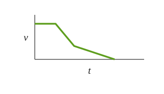
{: #Figure7}

:::

::: solution

(a) The ship moves at constant velocity and then begins
to decelerate at a constant rate. At some point, its deceleration rate
decreases. It maintains this lower deceleration rate until it stops moving.

(b) A graph of acceleration vs. time would show zero acceleration in the first
leg, large and constant negative acceleration in the second leg, and constant
negative acceleration.

{: #Figure8}

:::

:::: note {"class":"note","data-label":"OpenLyceum Exploration"}

Match the Motion Graph

Move the character so the position or velocity graph matches the target. The slope of the position graph is the velocity, and the slope of the velocity graph is the acceleration.

::: figure {}

<iframe loading="lazy" src="https://openlyceum.github.io/MotionMatch/?screens=1" width="800" height="600" allowfullscreen></iframe>
<figcaption>
Matching a motion graph
</figcaption>

:::

::::

### Section Summary

* Graphs of motion can be used to analyze motion.
* Graphical solutions yield identical solutions to mathematical methods for
  deriving motion equations.
* The slope of a graph of displacement $$ x $$ vs. time $$ t $$ is velocity $$ v $$.
* The slope of a graph of velocity $$ v $$ vs. time $$ t $$ graph is acceleration $$ a $$.
* Average velocity, instantaneous velocity, and acceleration can all be obtained
  by analyzing graphs.

### Conceptual Questions

::: problem

(a) Explain how you can use the graph of position versus time in [Figure 9](#Figure9) to describe the change in velocity over time.
Identify (b) the time ( $$ t_{a} $$, $$ t_{b} $$, $$ t_{c} $$, $$ t_{d} $$, or $$ t_{e} $$) at which the instantaneous velocity is greatest,
(c) the time at which it is
zero, and
(d) the time at which it is negative.

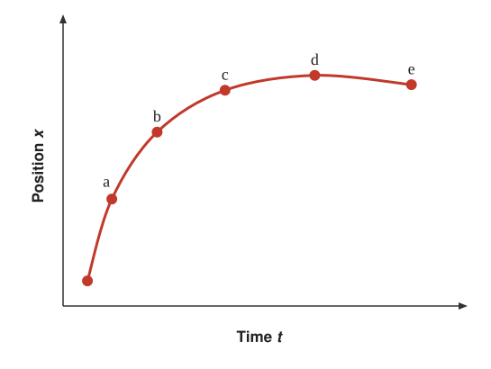
{: #Figure9}

:::

::: solution

**Strategy**

Read instantaneous velocity from the slope of a tangent to the position–time curve, rather than from the curve’s height.

**Solution**

**(a)** The instantaneous velocity is $$v_x=dx/dt$$. With the graph’s upward coordinate representing positive position, an upward-sloping tangent gives positive velocity, a horizontal tangent gives zero velocity, and a downward-sloping tangent gives negative velocity.

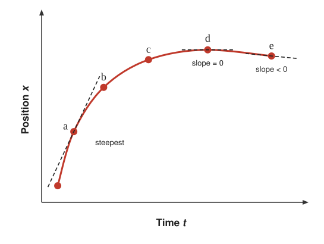

Among the marked times, the slopes decrease from $$t_a$$ through $$t_d$$ and become negative at $$t_e$$. Thus **(b)** the greatest velocity is at $$t_a$$, **(c)** the zero velocity is at $$t_d$$, and **(d)** the negative velocity is at $$t_e$$. The axes have no numerical scale, so a speed in m/s cannot be read from them. As an illustrative tangent calculation only, a rise of $$4.0\m$$ over $$2.0\s$$ would give $$v_x=(4.0\m)/(2.0\s)=2.0\ms$$.

Velocity is the tangent slope of the position graph, so it is greatest at tₐ, zero at t_d, and negative at t_e among the marked times.

:::

::: problem

(a) Sketch a graph of velocity versus time corresponding to the graph of position versus time given in [Figure 10](#Figure10).
(b) Identify the time or times ( $$ t_{a} $$, $$ t_{b} $$, $$ t_{c} $$, etc.) at which the instantaneous velocity is
greatest.
(c) At which times is it zero?
(d) At which times is it negative?

{: #Figure10}

:::

::: solution

**Strategy**

Sketch the slope of Figure 10 as a function of time, preserving the signs and horizontal tangencies of the original curve.

**Solution**

**(a)** Use $$v_x=dx/dt$$. The position decreases up to $$t_c$$, rises to $$t_e$$, falls to $$t_g$$, and rises again toward $$t_l$$. The corresponding velocity sketch is:

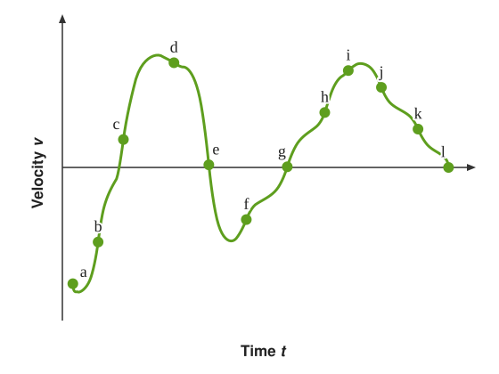

**(b)** Among the labeled points, $$t_d$$ has the steepest positive position tangent and hence the greatest instantaneous velocity. The later steep rising portion also has a large positive velocity, but the sketch does not provide precise numerical speeds.

**(c)** Horizontal position tangents give zero velocity at $$t_c,t_e,t_g,t_l$$.

**(d)** The labeled negative velocities occur at $$t_a,t_b,t_f$$; more generally velocity is negative wherever position is decreasing. A tangent slope would have units of position/time, such as $$(-2.0\m)/(1.0\s)=-2.0\ms$$ if numerical scales were supplied.

The velocity sketch follows the position slope: among the marked times it is greatest at t_d, zero at t_c, t_e, t_g, and t_l, and negative at tₐ, t_b, and t_f.

:::

::: problem

(a) Explain how you can determine the acceleration over time from a velocity versus time graph such as the one in [Figure 11](#Figure11).
(b) Based on the graph, how does acceleration change over time?

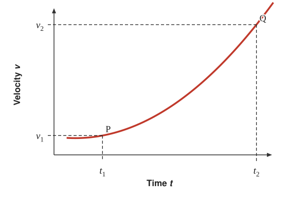
{: #Figure11}

:::

::: solution

**Strategy**

Use the slope of the velocity–time curve, which measures the change of velocity per unit time.

**Solution**

**(a)** The acceleration is $$a_x=dv_x/dt$$, the instantaneous tangent slope. The slope of the secant joining P and Q instead gives the average acceleration $$\overline a_x=(v_2-v_1)/(t_2-t_1)$$ over that interval.

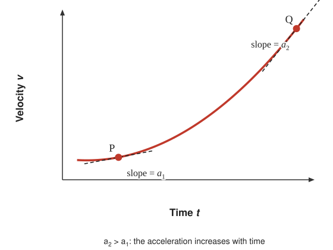

**(b)** Both tangents slope upward, and the later tangent is steeper. The acceleration is therefore positive and increases over the illustrated interval; it is not constant. For a numerical illustration of the units, a velocity change of $$6.0\ms$$ in $$2.0\s$$ gives $$\overline a_x=(6.0\ms)/(2.0\s)=3.0\mss$$. That example is not a reading from this unnumbered graph.

Acceleration is the slope of the velocity–time curve, so Figure 11 shows positive acceleration that increases as the curve becomes steeper.

:::

::: problem

(a) Sketch a graph of acceleration versus time corresponding to the graph of velocity versus time given in [Figure 12](#Figure12).
(b) Identify the time or times ( $$ t_{a} $$, $$ t_{b} $$, $$ t_{c} $$, etc.) at which the acceleration is greatest.
(c) At which times is it zero?
(d) At which times is it negative?

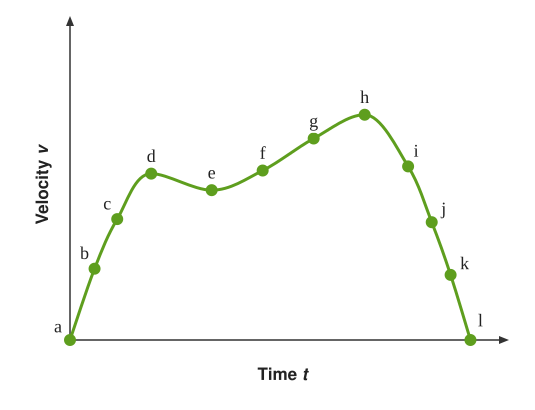
{: #Figure12}

:::

::: solution

**Strategy**

Differentiate the velocity curve qualitatively: acceleration follows its slope, not its value.

**Solution**

**(a)** Since $$a_x=dv_x/dt$$, the initially increasing velocity gives positive acceleration, the small dip from d to e gives negative acceleration, the next rise gives positive acceleration, and the final decrease after h gives negative acceleration.

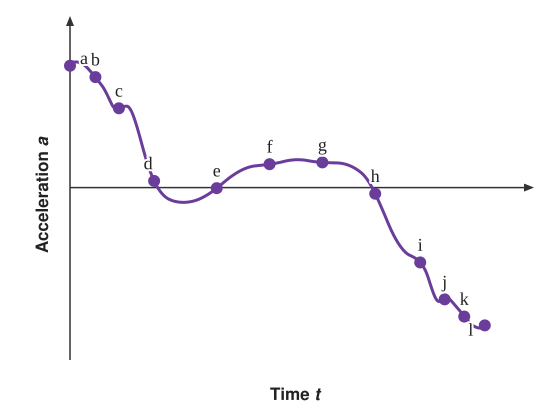

**(b)** The greatest acceleration among the marked times is at $$t_a$$, where velocity has its steepest positive slope.

**(c)** The horizontal velocity tangents at $$t_d,t_e,t_h$$ give zero acceleration.

**(d)** The marked negative accelerations are $$t_i,t_j,t_k,t_l$$; acceleration is also negative between $$t_d$$ and $$t_e$$. In particular, zero velocity at $$t_l$$ does not imply zero acceleration. Acceleration has units such as $$( -3.0\ms)/(1.0\s)=-3.0\mss$$; the sketch itself supplies no numerical scale.

The acceleration graph is the velocity slope, greatest at tₐ, zero at t_d, t_e, and t_h, and negative at t_i through t_l as well as between t_d and t_e.

:::

::: problem

Consider the velocity vs. time graph of a person in an elevator
shown in [Figure 13](#Figure13). Suppose the elevator is initially at rest.
It then accelerates for 3 seconds, maintains that velocity for 15 seconds,
then decelerates for 5 seconds until it stops. The acceleration for the entire trip is
not constant so we cannot use the equations of motion from
[Motion Equations for Constant Acceleration in One Dimension](./ch2MotionEquationsForConstantAccelerationInOneDimension) for the complete trip.
(We could, however, use them in the three individual sections where acceleration is a constant.)
Sketch graphs of (a) position vs. time and (b) acceleration vs. time for this trip.

{: #Figure13}

:::

::: solution

**Strategy**

Integrate the three velocity segments for position and take their slopes for acceleration.

**Solution**

Choose the elevator’s initial position as $$y=0\m$$ and $$+y$$ upward, matching the positive velocity in Figure 13. The three accelerations are

$$a_1=\frac{3.0\ms-0\ms}{3.0\s}=1.0\mss,\qquad a_2=0\mss,\qquad
a_3=\frac{0\ms-3.0\ms}{5.0\s}=-0.60\mss.$$

**(a)** With $$t$$ measured from departure, the position is

$$y(t)=\begin{cases}
\tfrac12(1.0\mss)t^2,&0\le t\le3.0\s,\\
4.5\m+(3.0\ms)(t-3.0\s),&3.0\s\le t\le18\s,\\
49.5\m+(3.0\ms)(t-18\s)-\tfrac12(0.60\mss)(t-18\s)^2,&18\s\le t\le23\s.
\end{cases}$$

The successive displacements are $$\tfrac12(3.0\s)(3.0\ms)=4.5\m$$, $$(15\s)(3.0\ms)=45\m$$, and $$\tfrac12(5.0\s)(3.0\ms)=7.5\m$$, giving a total of $$57\m$$. Position is continuous and always increases, becoming horizontal at the stop.

**(b)** The acceleration graph has constant levels $$+1.0\mss$$, $$0\mss$$, and $$-0.60\mss$$ over the respective intervals; it is zero before departure and after arrival. Instantaneous jumps between those levels idealize short transitions in a real elevator.

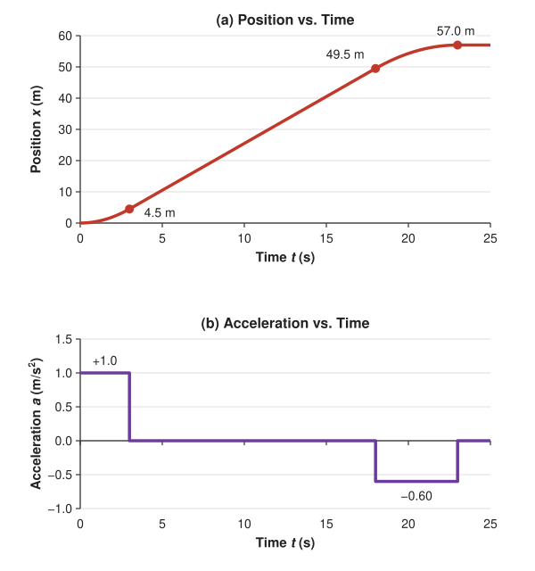

The elevator’s position rises smoothly to 57 m, while its acceleration is +1.0 m/s² for the first 3 s, zero for the next 15 s, and −0.60 m/s² for the final 5 s.

:::

::: problem

A cylinder is given a push and then rolls up an inclined plane.
If the origin is the starting point, sketch the position, velocity, and acceleration of the cylinder vs.
time as it goes up and then down the plane.

:::

::: solution

**Strategy**

Choose an axis along the incline and use one constant downslope acceleration on both parts of the motion.

**Solution**

Set $$x=0\m$$ at release and choose $$+x$$ uphill. Assume a fixed incline, rolling without slipping, and negligible rolling resistance. Gravity and static friction then give a constant center-of-mass acceleration $$a_x=-a_0$$ downhill. The sign does not change at the turning point. For a uniform solid cylinder, rotational dynamics gives $$a_0=(2/3)g\sin\theta$$; only constancy and direction are needed for these sketches.

For illustration, choose $$v_0=2.0\ms$$ and $$a_0=1.0\mss$$:

$$x=(2.0\ms)t-\tfrac12(1.0\mss)t^2,\quad v_x=2.0\ms-(1.0\mss)t,\quad a_x=-1.0\mss.$$

The position graph is concave down, reaching $$x=2.0\m$$ at $$t=2.0\s$$ and returning to $$x=0\m$$ at $$t=4.0\s$$. Velocity decreases linearly through zero at the top, and acceleration is a horizontal negative line.

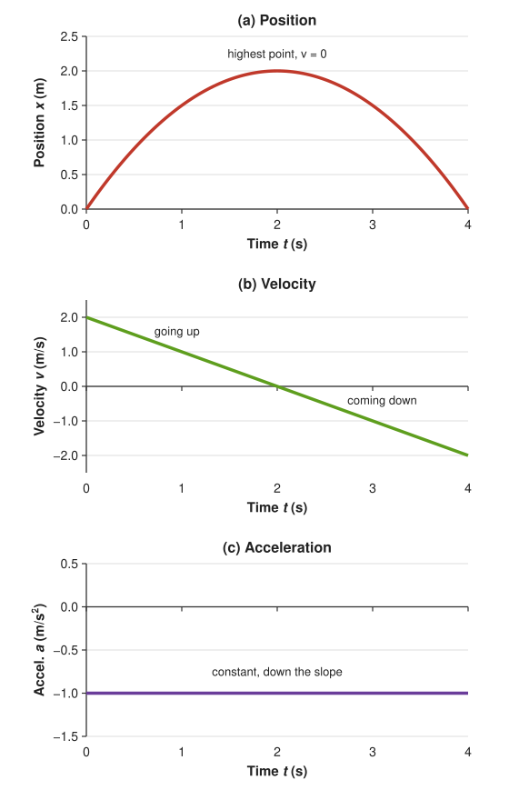

The cylinder’s position is a concave-down parabola, its velocity decreases linearly from positive to negative, and its acceleration remains constant and downhill throughout the ascent and descent.

:::

### Problems &amp; Exercises

Note: There is always uncertainty in numbers taken from graphs. If your answers
differ from expected values, examine them to see if they are within data
extraction uncertainties estimated by you.

::: problem

(a) By taking the slope of the curve in [Figure 14](#Figure14), verify that the velocity of the jet car is 115 m/s at $$ t=20 \s $$.
(b) By taking the slope of the curve at any point
in [Figure 15](#Figure15), verify that the jet car’s acceleration is
$$ 5.0 \mss $$.

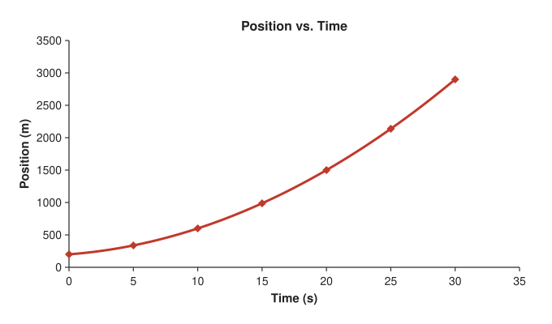
{: #Figure14}

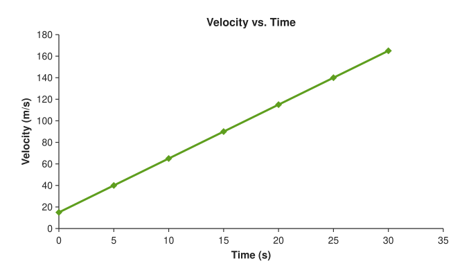
{: #Figure15}

:::

::: solution

**Strategy**

For part (a), we find the velocity by calculating the slope of the position-time graph at $$ t = 20 \s $$. For part (b), we find the acceleration by calculating the slope of the velocity-time graph, which should give a constant value since Figure 15 appears to be a straight line. The slope is calculated using $$ \text{slope} = \frac{\Delta y}{\Delta x} $$, where the axes represent position and time for velocity, and velocity and time for acceleration.

**Solution**

**(a) Finding velocity from the position-time graph:**

1. To find the instantaneous velocity at $$ t = 20 \s $$, we need to find the slope of the position-time curve in Figure 14 at that point.

2. From Figure 14, we can estimate the slope by drawing a tangent line or by choosing two points on the curve near $$ t = 20 \s $$. Looking at the graph, we can estimate points approximately:
   - At $$ t_1 \approx 15 \s $$: $$ x_1 \approx 1000 \m $$
   - At $$ t_2 \approx 25 \s $$: $$ x_2 \approx 2150 \m $$

3. Calculate the slope:

$$ v = \frac{\Delta x}{\Delta t} = \frac{x_2 - x_1}{t_2 - t_1} = \frac{2150 \m - 1000 \m}{25 \s - 15 \s} = \frac{1150 \m}{10 \s} = 115 \ms $$

**(b) Finding acceleration from the velocity-time graph:**

1. The acceleration is the slope of the velocity-time graph in Figure 15.

2. Since Figure 15 is a straight line, the slope is constant. From the graph, we can read approximate values (note that the line does not start at the origin; its intercept is about 15 m/s):
   - At $$ t_1 = 0 \s $$: $$ v_1 \approx 15 \ms $$
   - At $$ t_2 = 20 \s $$: $$ v_2 \approx 115 \ms $$

3. Calculate the slope:

$$ a = \frac{\Delta v}{\Delta t} = \frac{v_2 - v_1}{t_2 - t_1} = \frac{115 \ms - 15 \ms}{20 \s - 0} = \frac{100 \ms}{20 \s} = 5.0 \mss $$

**Discussion**

These calculations demonstrate the fundamental relationships in kinematics: velocity is the slope of the position-time graph, and acceleration is the slope of the velocity-time graph. The jet car's velocity of 115 m/s at $$ t = 20 \s $$ represents an extremely high speed (about 410 km/h or 257 mph), consistent with a jet-powered vehicle. The constant acceleration of $$ 5.0 \mss $$ shown in the straight-line velocity graph indicates that the jet car is accelerating uniformly. This acceleration is about half of gravitational acceleration, which is substantial for maintaining over an extended period. The parabolic shape of the position-time curve in Figure 14 is characteristic of constant acceleration motion.

**Answer**

(a) The velocity of the jet car at $$ t = 20 \s $$ is 115 m/s, verified by taking the slope of the position-time curve in Figure 14.

(b) The jet car's acceleration is $$ 5.0 \mss $$, verified by taking the slope of the velocity-time graph in Figure 15.

:::

::: problem

Using approximate values, calculate the slope of the curve
in [Figure 16](#Figure16) to verify that the velocity at $$ t=10.0 \s $$
is 0.208 m/s. Assume all values are known to 3 significant figures.

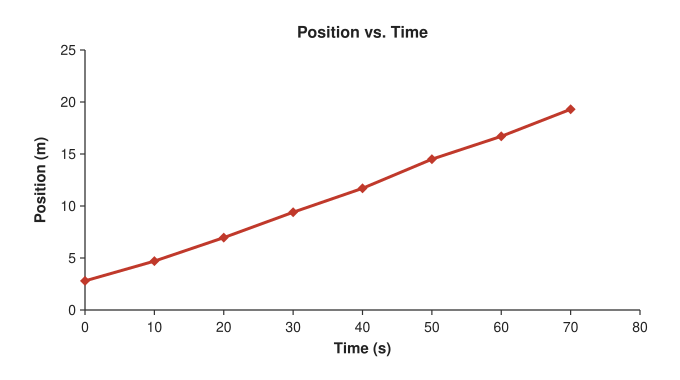
{: #Figure16}

:::

::: solution

**Strategy**

The slope of a position vs. time graph gives the velocity. To find the instantaneous velocity at $$ t = 10.0 \s $$, we need the slope of the curve at that point. The graph is nearly straight near $$ t = 10.0 \s $$, so we can estimate the slope using two points on either side of that time, at $$ t = 0 \s $$ and $$ t = 20.0 \s $$, and calculate $$ v = \frac{\Delta x}{\Delta t} $$.

**Solution**

Reading approximate values from Figure 16 (note that the position axis is in meters):

At $$ t_1 = 0 \s $$, the position is approximately $$ x_1 = 2.80 \m $$.

At $$ t_2 = 20.0 \s $$, the position is approximately $$ x_2 = 6.96 \m $$.

Now calculate the slope:

$$ v = \frac{\Delta x}{\Delta t} = \frac{x_2 - x_1}{t_2 - t_1} = \frac{6.96 \m - 2.80 \m}{20.0 \s - 0 \s} = \frac{4.16 \m}{20.0 \s} = 0.208 \ms $$

**Discussion**

The positive slope indicates that the object is moving in the positive direction. Because the values are read from a graph, a slightly different reading gives a slightly different slope; any value close to 0.21 m/s is a good estimate. The graph is not perfectly straight, so the velocity at other times differs a little from this value.

**Answer**

The velocity at $$ t = 10.0 \s $$ is approximately 0.208 m/s, which verifies the given value.

:::

::: problem

Using approximate values, calculate the slope of the curve in [Figure 16](#Figure16) to verify that the velocity at $$ t=30.0 \s $$
is approximately 0.24 m/s.

:::

::: solution

**Strategy**

To find the instantaneous velocity at $$ t = 30.0 \s $$, we need to find the slope of the position-time graph at that point. Since Figure 16 shows a curve (not a straight line), we draw a tangent line at $$ t = 30.0 \s $$ or use nearby points to estimate the slope. The velocity is calculated using $$ v = \frac{\Delta x}{\Delta t} $$.

**Solution**

1. To find the velocity at $$ t = 30.0 \s $$, examine Figure 16 near that time and identify two points on the curve that we can use to estimate the slope.

2. From the graph (position axis in **meters**), choosing points on either side of $$ t = 30.0 \s $$:
   - At $$ t_1 = 20.0 \s $$: $$ x_1 \approx 6.95 \m $$
   - At $$ t_2 = 40.0 \s $$: $$ x_2 \approx 11.7 \m $$

3. Calculate the slope:

$$ v = \frac{\Delta x}{\Delta t} = \frac{x_2 - x_1}{t_2 - t_1} = \frac{11.7 \m - 6.95 \m}{40.0 \s - 20.0 \s} $$

$$ v = \frac{4.75 \m}{20.0 \s} = 0.238 \ms \approx 0.24 \ms $$

**Discussion**

The slope near $$ t = 30.0 \s $$ is about 0.24 m/s, consistent with the value to be verified. Figure 16 plots position in meters, so the velocity has units of m/s. Because the curve is nearly straight in this region, readings from nearby points give a stable estimate of the instantaneous velocity.

**Answer**

The velocity at $$ t = 30.0 \s $$ is approximately $$ 0.24 \ms $$, verified by calculating the slope of the position-time curve in Figure 16.

:::

::: problem

Use the slope of the velocity graph in [Figure 17](#Figure17) to estimate the acceleration near $$ t=10 \s $$. Treat the connected data points as samples of a smooth motion and check that the estimate is about $$ 3.2 \mss $$.

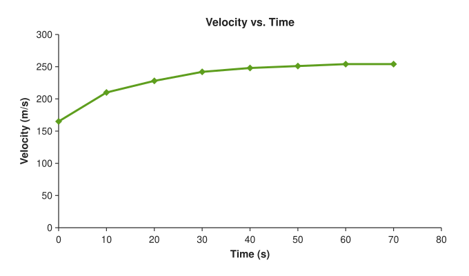
{: #Figure17}

:::

::: solution

**Strategy**

Acceleration is the slope of a velocity-time graph. Estimate the slope near $$ t = 10 \s $$ using data points on either side of that time.

**Solution**

From Figure 17, the velocity is about $$ 165 \ms $$ at $$ t = 0 \s $$ and $$ 228 \ms $$ at $$ t = 20 \s $$. The average acceleration over this interval is

$$ a_{\text{avg}} = \frac{228 \ms - 165 \ms}{20 \s - 0 \s} = 3.15 \mss \approx 3.2 \mss. $$

This gives an estimate of the acceleration near the midpoint, $$ t = 10 \s $$.

**Discussion**

The graph joins the data points with straight segments. Treating these as samples of a smooth motion gives an acceleration estimate of about $$ 3 \mss $$ near 10 s. The corner itself has no single tangent, so $$ 3.2 \mss $$ is an estimate rather than an exact instantaneous value. The positive slope means the object is speeding up; the decreasing slope later in the graph means it speeds up more slowly.

**Answer**

The estimated acceleration near $$ t = 10 \s $$ is about $$ 3.2 \mss $$.

:::

::: problem

Construct the velocity and acceleration history implied by the subway
shuttle train’s position graph in [Figure 18](#Figure18), which shows
position in kilometers from $$ t = 0 $$ to $$ 20 \s $$.
(Assume constant velocity for the first 10 s and constant acceleration for
the next 10 s, with continuous velocity at $$ t = 10 \s $$.)
Your discussion should confirm that a change in acceleration alone does
not produce a discontinuous “kink” in slope on the position graph.

:::

::: solution

**Strategy**

Velocity is the slope of the position graph, and acceleration is the rate of change of velocity. Read three points from the supplied position graph, then use the stated assumptions (constant velocity for 0–10 s, constant acceleration for 10–20 s, continuous velocity at 10 s) to find the velocity and acceleration in each phase.

**Solution**

Read the plotted points from [Figure 18](#Figure18) (position in kilometers vs. time in seconds):

- $$ t = 0 \s $$: $$ x = 4.70 \text{ km} $$
- $$ t = 10 \s $$: $$ x = 4.72 \text{ km} $$
- $$ t = 20 \s $$: $$ x = 4.80 \text{ km} $$

**Phase 1 (0 to 10 s): constant velocity**

The displacement is $$ \Delta x = 0.02 \text{ km} = 20 \m $$, so

$$ v = \frac{20 \m}{10 \s} = 2.0 \ms $$

Position increases linearly from 4.70 km: $$ x = 4.70 \text{ km} + (2.0 \ms)t $$ (with $$ t $$ in seconds and the term in km when converted).

**Phase 2 (10 to 20 s): constant acceleration**

From 10 s to 20 s the train moves another $$ 0.08 \text{ km} = 80 \m $$ with initial speed $$ v_0 = 2.0 \ms $$:

$$ 80 \m = (2.0 \ms)(10 \s) + \frac{1}{2}a(10 \s)^2 = 20 \m + (50 \s^2)a $$

$$ a = \frac{2(80 \m - 20 \m)}{(10 \s)^2} = \frac{120 \m}{100 \s^2} = 1.2 \mss $$

**Velocity and acceleration histories:**

- For $$ 0 < t < 10 \s $$: $$ v = 2.0 \ms $$ (constant) and $$ a = 0 $$.
- For $$ 10 \s < t < 20 \s $$: $$ v = 2.0 \ms + (1.2 \mss)(t - 10 \s) $$, rising linearly from 2.0 m/s to 14 m/s, and $$ a = 1.2 \mss $$.
- The velocity graph is therefore a horizontal line at 2.0 m/s followed by a straight line of slope 1.2 m/s². The acceleration graph is a step: 0 for the first 10 s, then 1.2 m/s².
- At $$ t = 10 \s $$ the **velocity** is continuous (2.0 m/s on both sides); only the **acceleration** jumps. Because the slope of the position graph (the velocity) does not jump, the position graph bends smoothly rather than forming a slope discontinuity (“kink”).

**Discussion**

This history matches the subway context in the Acceleration module (motion along a track in kilometers), but the numerical history here is fixed by Figure 18: 20 m in the first 10 s, then 80 m in the next 10 s while speeding up at $$ 1.2 \mss $$. Total displacement from $$ t = 0 $$ to $$ 20 \s $$ is $$ 0.10 \text{ km} $$, from 4.70 km to 4.80 km.

**Answer**

For $$ 0 < t < 10 \s $$: $$ v = 2.0 \ms $$ and $$ a = 0 $$. For $$ 10 \s < t < 20 \s $$: $$ v = 2.0 \ms + (1.2 \mss)(t - 10 \s) $$ (reaching 14 m/s at 20 s) and $$ a = 1.2 \mss $$. The velocity is continuous at $$ t = 10 \s $$, so the position graph has no kink there even though the acceleration changes abruptly.

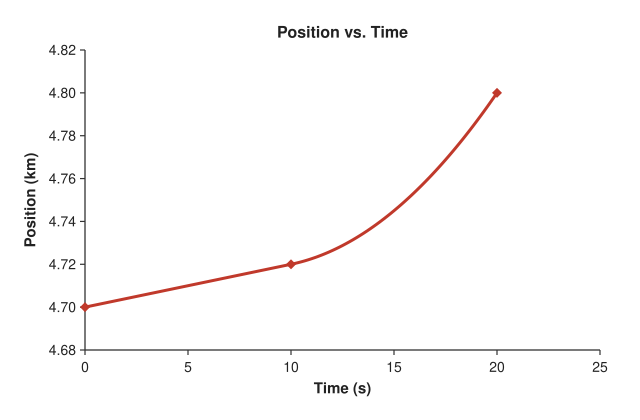
{: #Figure18}

:::

::: problem

(a) Take the slope of the curve in [Figure 19](#Figure19) to find the jogger's velocity at $$ t=2.5 \s $$.
(b) Repeat at 7.5 s. These values must be consistent with the graph
in [Figure 20](#Figure20).

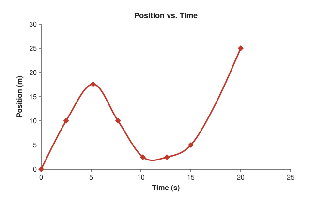
{: #Figure19}

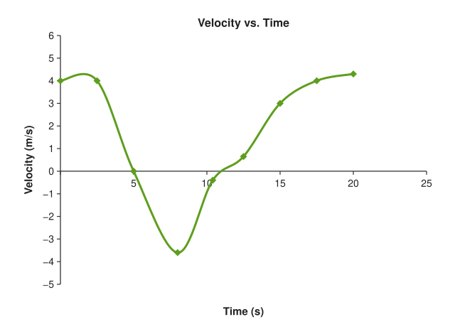
{: #Figure20}

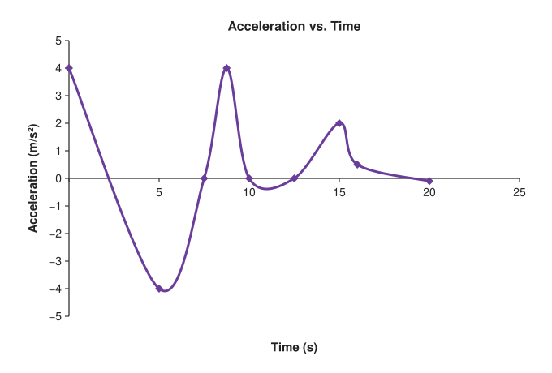
{: #Figure21}

:::

::: solution

**Strategy**

The slope of a position vs. time graph at any point gives the instantaneous velocity at that time. Since Figure 19 shows a curved line with changing slope, we need to draw tangent lines at $$ t = 2.5 \s $$ and $$ t = 7.5 \s $$ and calculate their slopes. The results should be consistent with the corresponding velocity values shown in Figure 20.

**Solution**

**(a) Velocity at $$ t = 2.5 \s $$:**

Draw a tangent line to the position curve at $$ t = 2.5 \s $$. From the tangent line, we can identify two points:

At $$ t_1 \approx 0 \s $$, the tangent gives $$ x_1 \approx 0 \m $$

At $$ t_2 \approx 5 \s $$, the tangent gives $$ x_2 \approx 20 \m $$

Calculate the slope:

$$ v = \frac{\Delta x}{\Delta t} = \frac{x_2 - x_1}{t_2 - t_1} = \frac{20 \m - 0 \m}{5 \s - 0 \s} = \frac{20 \m}{5 \s} = 4 \ms $$

Checking Figure 20, at $$ t = 2.5 \s $$, the velocity graph shows approximately $$ 4 \ms $$. ✓

**(b) Velocity at $$ t = 7.5 \s $$:**

Draw a tangent line to the position curve at $$ t = 7.5 \s $$, where Figure 19 shows $$ x \approx 10 \m $$. This section of the curve slopes downward, indicating negative velocity. From the tangent line, which passes through $$ (7.5 \s,\ 10 \m) $$:

At $$ t_1 \approx 5 \s $$, the tangent gives $$ x_1 \approx 18 \m $$

At $$ t_2 \approx 10 \s $$, the tangent gives $$ x_2 \approx 2 \m $$

Calculate the slope:

$$ v = \frac{\Delta x}{\Delta t} = \frac{x_2 - x_1}{t_2 - t_1} = \frac{2 \m - 18 \m}{10 \s - 5 \s} = \frac{-16 \m}{5 \s} \approx -3 \ms $$

Checking Figure 20, at $$ t = 7.5 \s $$, the velocity graph shows approximately $$ -3.5 \ms $$, consistent with our estimate given that tangent lines drawn by eye are only good to about $$ \pm 0.5 \ms $$. ✓

**Discussion**

The results demonstrate the fundamental relationship between position and velocity graphs. At $$ t = 2.5 \s $$, the position graph has a positive slope, meaning the jogger is moving in the positive direction at $$ 4 \ms $$. At $$ t = 7.5 \s $$, the position graph has a negative slope, indicating the jogger is moving in the negative direction (running back) at about $$ -3 \ms $$. Tangents drawn by eye limit these readings to roughly one significant figure, but within that precision the values extracted from the position-time graph agree with the velocity-time graph in Figure 20.

**Answer**

(a) The jogger's velocity at $$ t = 2.5 \s $$ is approximately $$ 4 \ms $$.

(b) The jogger's velocity at $$ t = 7.5 \s $$ is approximately $$ -3 \ms $$ (Figure 20 shows about $$ -3.5 \ms $$).

:::

::: problem

A graph of $$ v\left(t\right) $$ is shown for a world-class track sprinter
in a 100-m race. (See [Figure 22](#Figure22)).
(a) What is his average velocity for the
first 4 s?
(b) What is his instantaneous velocity at $$ t=5 \s $$ ?
(c) What is his average acceleration between 0 and 4 s?
(d) What is his time for the race?

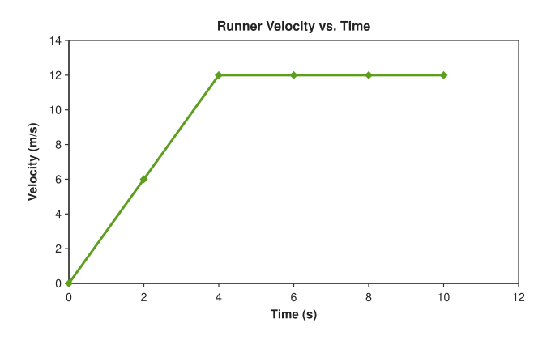
{: #Figure22}

:::

::: solution

**Strategy**

Figure 22 shows a velocity-time graph with two distinct segments: an accelerating phase and a constant velocity phase. For part (a), average velocity equals displacement divided by time, which is the area under the velocity curve divided by time. For part (b), instantaneous velocity is read directly from the graph. For part (c), average acceleration is the slope of the velocity curve. For part (d), the race time is when the total displacement (area under curve) equals 100 m.

**Solution**

**(a) Average velocity for the first 4 s:**

The average velocity is:

$$ \bar{v} = \frac{\Delta x}{\Delta t} $$

From Figure 22, the velocity increases linearly from 0 to 12 m/s during the first 4 seconds. The displacement is the area under the velocity curve:

$$ \Delta x = \frac{1}{2}(v_0 + v)(t) = \frac{1}{2}(0 + 12 \ms)(4 \s) = 24 \m $$

Therefore:

$$ \bar{v} = \frac{24 \m}{4 \s} = 6 \ms $$

**(b) Instantaneous velocity at $$ t = 5 \s $$:**

From Figure 22, at $$ t = 5 \s $$, the sprinter has reached the constant velocity phase. Reading directly from the graph:

$$ v(5 \s) = 12 \ms $$

**(c) Average acceleration between 0 and 4 s:**

The average acceleration is:

$$ \bar{a} = \frac{\Delta v}{\Delta t} = \frac{v_f - v_0}{t_f - t_0} $$

$$ \bar{a} = \frac{12 \ms - 0 \ms}{4 \s - 0 \s} = \frac{12 \ms}{4 \s} = 3 \mss $$

**(d) Time for the 100-m race:**

The total displacement must equal 100 m. The graph shows two phases:

**Phase 1 (0 to 4 s): Acceleration**
- Displacement: $$ x_1 = \frac{1}{2}(12 \ms)(4 \s) = 24 \m $$

**Phase 2 (4 s to $$ t_f $$): Constant velocity of 12 m/s**
- Remaining distance: $$ 100 \m - 24 \m = 76 \m $$
- Time for remaining distance: $$ t_2 = \frac{76 \m}{12 \ms} = 6.33 \s $$

Total time:

$$ t_{\text{total}} = 4 \s + 6.33 \s = 10.33 \s $$

By $$ t = 10 \s $$ the graph’s plateau has covered only $$ 24 \m + (12 \ms)(6 \s) = 96 \m $$, so the plotted motion alone does not reach 100 m until about 10.33 s if the 12 m/s speed continues.

**Discussion**

This velocity-time graph illustrates a world-class sprinter's race strategy. The sprinter accelerates at $$ 3 \mss $$ for 4 seconds, reaching a maximum velocity of 12 m/s (about 43 km/h or 27 mph). During acceleration, the average velocity is only 6 m/s because the sprinter starts from rest. After reaching maximum velocity, the sprinter maintains it for the remainder of the race. The total race time of 10.33 s is consistent with world-class 100-m sprint times. The acceleration phase covers only 24 m (less than a quarter of the race), while the constant velocity phase covers 76 m. This demonstrates that even elite sprinters spend most of the race at constant maximum velocity rather than accelerating.

**Answer**

(a) The average velocity for the first 4 s is 6 m/s.

(b) The instantaneous velocity at $$ t = 5 \s $$ is 12 m/s.

(c) The average acceleration between 0 and 4 s is $$ 3 \mss $$.

(d) The time for the 100-m race is approximately 10.33 s.

:::

::: problem

[Figure 23](#Figure23) shows the position graph for a particle from $$ t = 0 $$ to $$ t = 6 \s $$ (the problem statement’s “5 s” refers to the main motion interval before the final short segment). Draw the corresponding velocity and acceleration graphs.

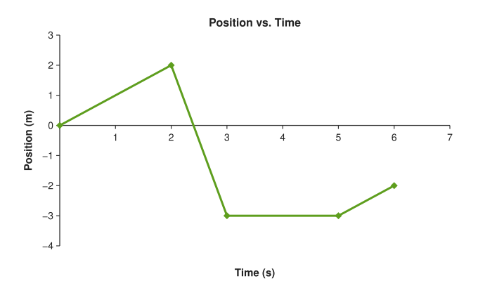
{: #Figure23}

:::

::: solution

**Strategy**

To construct the velocity graph from the position graph, we calculate the slope of each segment, since velocity equals the slope of the position-time graph. To construct the acceleration graph from the velocity graph, we calculate the slope of the velocity-time graph, since acceleration equals the slope of velocity vs. time. We analyze each distinct segment where the slope is constant.

**Solution**

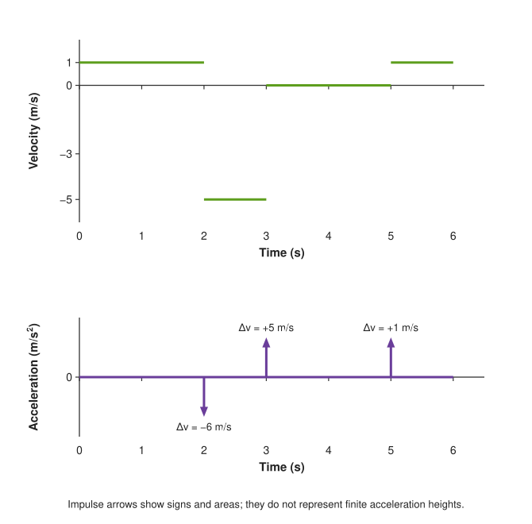

**Analyzing the Position Graph (Figure 23):**

The position graph has four distinct linear segments (Figure 23 passes through (0, 0), (2, 2), (3, −3), (5, −3), and (6, −2)):

**Segment 1 (0 to 2 s):** Positive slope
- $$ v_1 = \frac{2 \m - 0}{2 \s - 0} = +1 \ms $$

**Segment 2 (2 to 3 s):** Negative slope
- $$ v_2 = \frac{-3 \m - 2 \m}{3 \s - 2 \s} = -5 \ms $$

**Segment 3 (3 to 5 s):** Zero slope (horizontal line)
- Velocity: $$ v_3 = 0 \ms $$

**Segment 4 (5 to 6 s):** Positive slope
- $$ v_4 = \frac{-2 \m - (-3 \m)}{6 \s - 5 \s} = +1 \ms $$

**Velocity Graph:**

The velocity graph is a series of horizontal line segments at:
- $$ v = +1 \ms $$ from $$ t = 0 $$ to $$ 2 \s $$
- $$ v = -5 \ms $$ from $$ t = 2 $$ to $$ 3 \s $$
- $$ v = 0 \ms $$ from $$ t = 3 $$ to $$ 5 \s $$
- $$ v = +1 \ms $$ from $$ t = 5 $$ to $$ 6 \s $$

**Analyzing the Velocity Graph for Acceleration:**

On each straight position segment the velocity is constant, so $$ a = 0 $$. At the segment boundaries the idealized graph has step changes in velocity (vertical jumps in the $$ v(t) $$ plot). A finite force would round those corners over short intervals; representing the jumps as impulses is part of the same idealization as the piecewise-linear $$ x(t) $$ graph.

- **0 to 2 s, 2 to 3 s, 3 to 5 s, 5 to 6 s:** $$ a = 0 $$
- **At $$ t = 2 \s $$, $$ 3 \s $$, and $$ 5 \s $$:** instantaneous velocity changes (impulsive idealization)

**Acceleration Graph:**

The acceleration graph shows $$ a = 0 $$ on each open interval between transitions, with vertical spikes at $$ t = 2 \s $$, $$ 3 \s $$, and $$ 5 \s $$ where the velocity changes abruptly in this model.

**Discussion**

The position graph shows a particle that moves forward, then backward quickly, then rests, then moves forward again. Each straight segment has constant velocity, so acceleration is zero there. The corners in $$ x(t) $$ correspond to abrupt velocity changes in this idealized description; real motion would smooth those transitions over short times.

**Answer**

The velocity graph consists of horizontal segments at +1 m/s (0–2 s), −5 m/s (2–3 s), 0 m/s (3–5 s), and +1 m/s (5–6 s). The acceleration graph is zero on each interval between those steps, with impulses at $$ t = 2 \s $$, $$ 3 \s $$, and $$ 5 \s $$ in the idealized model.

:::

::: glossary

### Glossary
{: class="glossary-title"}

independent variable
: the variable that the dependent variable is measured with respect to; usually
plotted along the $$ x $$ -axis

dependent variable
: the variable that is being measured; usually plotted along the $$ y $$ -axis

slope
: the difference in $$ y $$ -value (the rise) divided by the difference in $$ x $$-value (the run) of two points on a straight line

y-intercept
: the $$ y\text{-} $$ value when $$ x = 0 $$, or when the graph crosses the $$ y $$ -axis

:::
