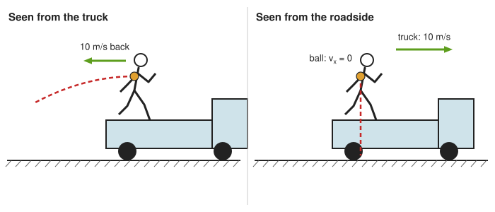
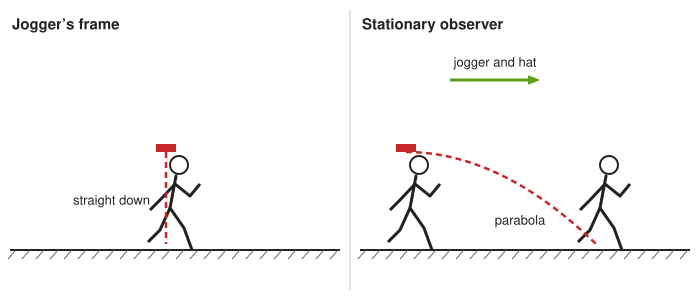
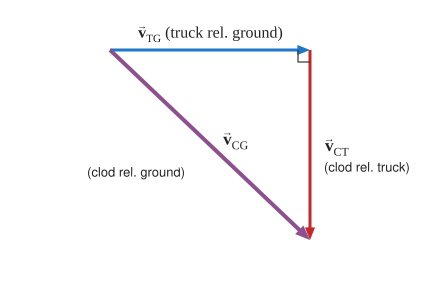
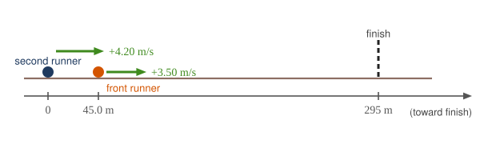
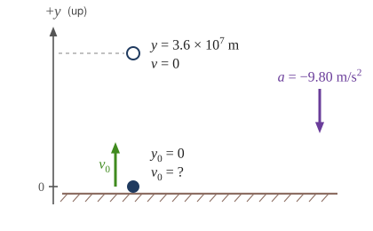

:::: abstract

* Apply principles of vector addition to determine relative velocity.
* Explain the significance of the observer in the measurement of velocity.

::::

### Relative Velocity

If a person rows a boat across a rapidly flowing river and tries to head
directly for the other shore, the boat instead moves **diagonally** relative to
the shore, as in [Figure 1](#Figure1). The boat does not move in the direction in
which it is pointed. The reason, of course, is that the river carries the boat
downstream. Similarly, if a small airplane flies overhead in a strong crosswind,
you can sometimes see that the plane is not moving in the direction in which it
is pointed, as illustrated in [Figure 2](#Figure2). The plane is moving straight
ahead relative to the air, but the movement of the air mass relative to the
ground carries it sideways.

 relative to the shore is the sum of its velocity relative to the river plus the velocity of the river relative to the shore.')
{: #Figure1}

.')
{: #Figure2}

In each of these situations, an object has a **velocity**
relative to a medium (such as a river) and that medium has a velocity relative
to an observer on solid ground. The velocity of the object **relative to the
observer** is the sum of these velocity vectors, as indicated
in [Figure 1](#Figure1)
and [Figure 2](#Figure2). These situations are only two of many in which it is
useful to add velocities. In this module, we first re-examine how to add
velocities and then consider certain aspects of what relative velocity means.

How do we add velocities? Velocity is a vector (it has both magnitude and
direction); the rules of **vector addition** discussed
in [Vector Addition and Subtraction: Graphical Methods](./ch3VectorAdditionAndSubtractionGraphicalMethods)
and [Vector Addition and Subtraction: Analytical Methods](./ch3VectorAdditionAndSubtractionAnalyticalMethods)
apply to the addition of velocities, just as they do for any other vectors. In
one-dimensional motion, the addition of velocities is simple—they add like
ordinary numbers. For example, if a field hockey player is moving at $$ 5 \ms $$
straight toward the goal and drives the ball in the same direction with a
velocity of $$ 30 \ms $$ relative to her body, then the velocity of the ball is
$$ 35 \ms $$ relative to the stationary, profusely sweating goalkeeper standing
in front of the goal.

In two-dimensional motion, either graphical or analytical techniques can be used
to add velocities. We will concentrate on analytical techniques. The following
equations give the relationships between the magnitude and direction of
velocity ( $$ v $$ and $$ \theta $$ ) and its components ( $$ v_{x} $$ and $$ v_{y} $$ ) along the **x**- and **y**-axes of an appropriately chosen coordinate
system:

 $$ v_{x}=v\cos{\theta} $$

 $$ v_{y}=v\sin{\theta} $$

 $$ v=\sqrt{ v_{x}^{2}+v_{y}^{2}} $$

 $$ \theta ={\tan}^{-1}\left(v_{y}/v_{x}\right). $$

 of an object traveling at an angle \( \theta \) to the horizontal axis is the sum of component vectors .')
{: #Figure3}

These equations are valid for any vectors and are adapted specifically for
velocity. The first two equations are used to find the components of a velocity
when its magnitude and direction are known. The last two are used to find the
magnitude and direction of velocity when its components are known.

:::: note {"class":"note","data-label":""}

Take-Home Experiment: Relative Velocity of a Boat

Fill a bathtub half-full of water. Take a toy boat or some other object that floats in water. Unplug the drain so water starts to drain. Try pushing the boat from one side of the tub to the other and perpendicular to the flow of water. Which way do you need to push the boat so that it ends up immediately opposite? Compare the directions of the flow of water, heading of the boat, and actual velocity of the boat.

::::

:::: example

Adding Velocities: A Boat on a River

{: #Figure4}

Refer to [Figure 4](#Figure4), which shows a boat trying to go straight across the
river. Let us calculate the magnitude and direction of the boat’s velocity
relative to an observer on the shore, $$ \vb{v}_{\text{tot}} $$. The velocity of the boat, $$ \vb{v}_{\text{boat}} $$, is 0.75
m/s in the $$ y $$ -direction relative to the river and the velocity of the
river, $$ \vb{v}_{\text{river}} $$, is 1.20 m/s to the right.

**Strategy**

We start by choosing a coordinate system with its $$ x $$ -axis parallel to the
velocity of the river, as shown in [Figure 4](#Figure4). Because the boat is
directed straight toward the other shore, its velocity relative to the water is
parallel to the $$ y $$ -axis and perpendicular to the velocity of the river.
Thus, we can add the two velocities by using the equations $$ v_{\text{tot}}=\sqrt{ v_{x}^{2}+v_{y}^{2}} $$ and $$ \theta ={\tan}^{-1}\left(v_{y}/v_{x}\right) $$ directly. 

**Solution**

The magnitude of the total velocity is

 $$ v_{\text{tot}}=\sqrt{ v_{x}^{2}+v_{y}^{2}}, $$

where

 $$ v_{x}=v_{\text{river}}=1.20 \ms $$

and

 $$ v_{y}=v_{\text{boat}}=0.750 \ms . $$

Thus,

$$ v_{\text{tot}}=\sqrt{
\left( 1.20 \ms \right)^{2}+
\left( 0.750 \ms \right)^{2}
} $$

yielding

 $$ v_{\text{tot}}=1.42 \ms . $$

The direction of the total velocity $$ \theta $$ is given by:

 $$ \theta ={\tan}^{-1}\left(v_{y}/v_{x}\right)={\tan}^{-1}\left(\frac{0.750 \ms}{1.20 \ms}\right). $$

This equation gives

 $$ \theta =32.0^\circ . $$

**Discussion**

Both the magnitude $$ v $$ and the direction $$ \theta $$ of the total velocity
are consistent with [Figure 4](#Figure4). Note that because the velocity of the
river is large compared with the velocity of the boat, it is swept rapidly
downstream. This result is evidenced by the small angle (only $$ 32.0^\circ $$)
the total velocity has relative to the riverbank.

::::

:::: example

Calculating Velocity: Wind Velocity Causes an Airplane to Drift

Calculate the wind velocity for the situation shown in [Figure 5](#Figure5). The plane is known to be moving at 45.0 m/s due north relative to the air mass, while its velocity relative to the
ground (its total velocity) is 38.0 m/s in a direction $$20.0^\circ $$ west of north.

{: #Figure5}

**Strategy**

In this problem, somewhat different from the previous example, we know the total
velocity $$ \vb{v}_{\text{tot}} $$ and that it is the sum of two other
velocities, $$ \vb{v}_{\text{w}} $$
(the wind) and $$ \vb{v}_{\text{p}} $$
(the plane relative to the air mass). The quantity $$ \vb{v}_{\text{p}} $$ is known, and we are asked to find $$ \vb{v}_{\text{w}} $$. None of the velocities are perpendicular, but it is possible to find their components along a common set of perpendicular axes. If we can find the components of $$ \vb{v}_{\text{w}} $$, then we can combine them to solve for
its magnitude and direction. As shown in [Figure 5](#Figure5), we choose a
coordinate system with its
*x*-axis due east and its *y*-axis due north (parallel to $$ \vb{v}_{\text{p}} $$).
(You may wish to look back at the discussion of the addition of vectors using
perpendicular components
in [Vector Addition and Subtraction: Analytical Methods](./ch3VectorAdditionAndSubtractionAnalyticalMethods)
.)

**Solution**

Because $$ \vb{v}_{\text{tot}} $$ is the vector sum of the $$ \vb{v}_{\text{w}} $$ and $$ \vb{v}_{\text{p}} $$, its *x*- and *y*-components are the sums of
the *x*- and *y*-components of the wind and plane velocities. Note that the
plane only has vertical component of velocity so $$ v_{px}=0 $$ and $$ v_{py}=v_{\text{p}} $$. That is,

 $$ v_{\text{tot}x}=v_{\text{w}x} $$

and

 $$ v_{\text{tot}y}=v_{\text{w}y}+v_{\text{p}}. $$

We can use the first of these two equations to find $$ v_{\text{w}x} $$:

 $$ v_{\text{w}x}=v_{\text{tot}x}=v_{\text{tot}}\cos{110^\circ }. $$

Because $$ v_{\text{tot}}=38.0 \ms $$ and $$ \cos{110^\circ }=-0.342 $$
we have

 $$ v_{\text{w}x}=\left(38.0 \ms \right)\left(-0.342 \right)=-13 \ms . $$

The minus sign indicates motion west which is consistent with the diagram.

Now, to find $$ v_{\text{w}\text{y}} $$ we note that

 $$ v_{\text{tot}y}=v_{\text{w}y}+v_{\text{p}} $$

Here $$ v_{\text{tot}y}=v_{\text{tot}}\sin{110^\circ } $$; thus,

 $$ v_{\text{w}y}=\left(38.0 \ms \right) \left(0.940 \right)-45.0 \ms = -9.29 \ms . $$ 

This minus sign indicates motion south which is consistent with the diagram.

Now that the perpendicular components of the wind velocity $$ v_{\text{w}x} $$
and $$ v_{\text{w}y} $$ are known, we can find the magnitude and direction of $$ \vb{v}_{\text{w}} $$. First, the magnitude is

$$ \begin{array}{lll}
v_\text{w}&=& \sqrt{ v_{\text{w}x}^{2}+v_{\text{w}y}^{2}}\\
v_\text{w}&=& \sqrt{\left(-13.0 \ms \right)^{2}+\left(-9.29 \ms \right)^{2}}
\end{array} $$

so that

 $$ v_{\text{w}}=16.0 \ms . $$

The direction is:

 $$ \theta ={\tan}^{-1}\left(v_{\text{w}y}/v_{\text{w}x}\right)={\tan}^{-1}\left(\frac{-9.29 \ms}{-13.0 \ms}\right) $$

giving

 $$ \theta =35.6^\circ . $$

Because both components are negative, the wind points into the third quadrant:
it blows $$ 35.6^\circ $$ south of west (a direction of $$ 215.6^\circ $$
measured counterclockwise from east).

**Discussion**

The wind’s speed and direction are consistent with the significant effect the
wind has on the total velocity of the plane, as seen in [Figure 5](#Figure5).
Because the plane is fighting a strong combination of crosswind and head-wind,
it ends up with a total velocity significantly less than its velocity relative
to the air mass as well as heading in a different direction.

::::

Note that in both of the last two examples, we were able to make the mathematics
easier by choosing a coordinate system with one axis parallel to one of the
velocities. We will repeatedly find that choosing an appropriate coordinate
system makes problem solving easier. For example, in projectile motion we always
use a coordinate system with one axis parallel to gravity.

### Relative Velocities and Classical Relativity

When adding velocities, we have been careful to specify that the **velocity is
relative to some reference frame**. These velocities are called **relative
velocities**. For example, the velocity of an airplane relative to an air mass
is different from its velocity relative to the ground. Both are quite different
from the velocity of an airplane relative to its passengers (which should be
close to zero). Relative velocities are one aspect of **relativity**, which is
defined to be the study of how different observers moving relative to each other
measure the same phenomenon.

Nearly everyone has heard of relativity and immediately associates it with
Albert Einstein (1879–1955), the greatest physicist of the 20th century.
Einstein revolutionized our view of nature with his **modern** theory of
relativity, which we shall study in later chapters. The relative velocities in
this section are actually aspects of classical relativity, first discussed
correctly by Galileo and Isaac Newton. **Classical relativity** is an excellent
approximation when speeds are much less than the speed of light; as a rough
guide, below about 1% of the speed of light (3000 km/s). Most things we
encounter in daily life move far slower than this.

Let us consider an example of what two different observers see in a situation
analyzed long ago by Galileo. Suppose a sailor at the top of a mast on a moving
ship drops his binoculars. Where will it hit the deck? Will it hit at the base
of the mast, or will it hit behind the mast because the ship is moving forward?
The answer is that if air resistance is negligible and the ship moves at
constant velocity, the binoculars will hit at
the base of the mast at a point directly below its point of release. Now let us
consider what two different observers see when the binoculars drop. One observer
is on the ship and the other on shore. The binoculars have no horizontal
velocity relative to the observer on the ship, and so he sees them fall straight
down the mast. (See [Figure 6](#Figure6).) To the observer on shore, the binoculars
and the ship have the **same** horizontal velocity, so both move the same
distance forward while the binoculars are falling. This observer sees the curved
path shown in [Figure 6](#Figure6). Although the paths look different to the
different observers, each sees the same result—the binoculars hit at the base of
the mast and not behind it. To get the correct description, it is crucial to
correctly specify the velocities relative to the observer.

')
{: #Figure6}

:::: example {"class":"example","id":"example3"}

Calculating Relative Velocity: An Airline Passenger Drops a Coin

An airline passenger drops a coin while the plane is moving at 260 m/s. What is the velocity of the coin when it strikes the floor 1.50 m below its point of release: (a) Measured relative to the plane?
(b) Measured relative to the Earth?

 An observer in the plane sees the coin fall straight down.
(b) An observer on the ground sees the coin move almost horizontally.')
{: #Figure7 height="350"}

**Strategy**

Both problems can be solved with the techniques for falling objects and
projectiles. In part (a), the initial velocity of the coin is zero relative to
the plane, so the motion is that of a falling object (one-dimensional). In
part (b), the initial velocity is 260 m/s horizontal relative to the Earth and
gravity is vertical, so this motion is a projectile motion. In both parts, it is
best to use a coordinate system with vertical and horizontal axes.

**Solution for (a)**

Using the given information, we note that the initial velocity and position are
zero, and the final position is 1.50 m. The final velocity can be found using
the equation:

 $$ v_{y}^{2}=v_{0y}^{2}-2g\left(y-y_{0}\right). $$

Substituting known values into the equation, we get

 $$ v_{y}^{2}=0^{2}-2\left(9.80\mss \right) \left(-1.50\m -0 \m \right)=29.4 \mmss $$ 

yielding

 $$ v_{y}=-5.42 \ms . $$

We know that the square root of 29.4 has two roots: 5.42 and -5.42. We choose
the negative root because we know that the velocity is directed downwards, and we
have defined the positive direction to be upwards. There is no initial horizontal
velocity relative to the plane and no horizontal acceleration, and so the motion
is straight down relative to the plane.

**Solution for (b)**

Because the initial vertical velocity is zero relative to the ground and
vertical motion is independent of horizontal motion, the final vertical velocity
for the coin relative to the ground is $$ v_{y}=-5.42 \ms $$, the same as found
in part (a). In contrast to part (a), there now is a horizontal component of the
velocity. However, since there is no horizontal acceleration, the initial and
final horizontal velocities are the same and $$ v_{x}=260 \ms $$. The _x_- and
_y_-components of velocity can be combined to find the magnitude of the final
velocity:

 $$ v=\sqrt{ v_{x}^{2}+ v_{y}^{2} }. $$

Thus,

 $$ v=\sqrt{\left(260 \ms \right)^{2}+\left(-5.42 \ms \right)^{2} } $$

yielding

 $$ v=260.06 \ms . $$

The direction is given by:

 $$ \theta ={\tan}^{-1}\left(v_{y}/v_{x}\right)={\tan}^{-1}\left(\frac{-5.42 \ms}{260 \ms}\right) $$

so that

 $$ \theta ={\tan}^{-1}\left(-0.0208\right)=-1.19^\circ. $$

**Discussion**

In part (a), the final velocity relative to the plane is the same as it would be
if the coin were dropped from rest on the Earth and fell 1.50 m. This result
fits our experience; objects in a plane fall the same way when the plane is
flying at constant velocity as when it is at rest on the ground. This result is
also true in cars moving at constant velocity. In part (b), an observer on the ground sees a much
different motion for the coin. The plane is moving so fast horizontally to begin
with that its final velocity is barely greater than the initial velocity. Once
again, we see that in two dimensions, vectors do not add like ordinary
numbers—the final velocity v in part (b) is **not** $$ \left(260 - 5.42\right) \ms $$; rather, it is $$ 260.06 \ms $$. The velocity’s magnitude had to be
calculated to five digits to see any difference from that of the airplane. The
motions as seen by different observers (one in the plane and one on the ground)
in this example are analogous to those discussed for the binoculars dropped from
the mast of a moving ship, except that the velocity of the plane is much larger,
so that the two observers see **very** different paths. (See [Figure 7](#Figure7).)
In addition, both observers see the coin fall 1.50 m vertically, but the one on
the ground also sees it move forward 144 m (this calculation is left for the
reader). Thus, one observer sees a vertical path, the other a nearly horizontal
path.

::::

:::: note {"class":"note","data-label":""}

Making Connections: Relativity and Einstein

Because Einstein was able to clearly define how measurements are made (some involve light) and because the speed of light is the same for all observers, the outcomes are spectacularly unexpected. Time varies with observer, mass and energy are equivalent ( $$ E=mc^{2} $$ ), and more surprises await.

::::

:::: note {"class":"note","data-label":"OpenLyceum Exploration"}

 Ladybug Motion 2D

Learn about position, velocity, and acceleration vectors. Move the ladybug with the mouse or use the remote control to set its position, velocity, or acceleration. Compare linear, circular, and elliptical motion.

::: figure {}

<figcaption>
Ladybug Motion 2D
</figcaption>
<iframe loading="lazy" src="https://openlyceum.github.io/LadyBug/" width="600" height="450"  allowfullscreen></iframe>

:::

::::

### Summary

- Velocities in two dimensions are added using the same analytical vector
  techniques, which are rewritten as
  

  $$ v_{x}=v\cos{\theta} $$
  

  

  $$ v_{y}=v\sin{\theta} $$
  

  

  $$ v=\sqrt{ v_{x}^{2}+v_{y}^{2}} $$
  

  

  $$ \theta ={\tan}^{-1}\left(v_{y}/v_{x}\right). $$
  

- Relative velocity is the velocity of an object as observed from a particular
  reference frame, and it varies dramatically with reference frame.
- **Relativity** is the study of how different observers measure the same
  phenomenon, particularly when the observers move relative to one another.
  **Classical relativity** is an excellent approximation when speeds are much
  less than the speed of light (as a rough guide, below about 1% of it, or
  3000 km/s).

### Conceptual Questions

:::: problem

What frame or frames of reference do you instinctively use when driving a car? When flying in a commercial jet airplane?

::::

:::: solution

**Strategy**

State velocity relative to the observer or surroundings that matter for the activity.

**Solution**

When driving, one usually judges motion relative to the road and nearby cars. A car moving at $$20\ms$$ relative to the road overtakes another moving the same way at $$15\ms$$ with relative speed $$20\ms-15\ms=5\ms$$.

Inside an airplane, the cabin is the natural frame for walking or observing other passengers. A seated passenger has velocity $$0\ms$$ relative to the aircraft but, if it moves east at $$230\ms$$ relative to Earth, the passenger also moves east at $$230\ms$$ relative to Earth. Pilots additionally distinguish velocity relative to the air from velocity relative to the ground because wind connects the two.

Drivers usually use the road and other vehicles as reference frames, while airline passengers usually use the cabin and pilots also use air-relative and ground-relative frames.

::::

:::: problem

A basketball player dribbling down the court usually keeps his eyes fixed on
the players around him. He is moving fast. Why doesn’t he need to keep his eyes on the ball?

::::

:::: solution

**Strategy**

Compare the ball’s horizontal motion in the player’s moving frame and in the court frame.

**Solution**

If a player runs at nearly constant velocity and gives the ball the same horizontal velocity, the ball keeps that component while it is airborne. Gravity changes its vertical velocity, not its horizontal velocity, when drag is negligible. For an illustrative running speed $$v=4.0\ms$$ and airborne time $$0.50\s$$, both travel

$$\Delta x=(4.0\ms)(0.50\s)=2.0\m$$

along the court. In the player’s frame the ball’s horizontal velocity is approximately $$4.0\ms-4.0\ms=0\ms$$, so it mainly bounces vertically near the hand. Floor contact and changes in running speed require control and practice; the argument does not imply that the ball automatically follows an accelerating player.

The player need not continuously track the ball because, during approximately steady running and controlled dribbling, the ball shares the player’s horizontal motion and moves mainly up and down relative to the player.

::::

:::: problem

If someone is riding in the back of a pickup truck and throws a softball
straight backward, is it possible for the ball to fall straight down as viewed
by a person standing at the side of the road? Under what condition would this
occur? How would the motion of the ball appear to the person who threw it?

::::

:::: solution

**Strategy**

Add the backward velocity relative to the truck to the truck’s forward velocity relative to the road.

**Solution**

Choose $$+x$$ along the truck’s motion and $$+y$$ upward, treating the truck as moving at constant speed and neglecting drag. Then

$$v_{x,\text{ball/ground}}=v_{x,\text{ball/truck}}+v_{x,\text{truck/ground}}.$$

For example, if the truck moves at $$+10\ms$$ and the ball is thrown horizontally at $$-10\ms$$ relative to it, the ground-frame horizontal velocity is $$-10\ms+10\ms=0\ms$$. A roadside observer sees a vertical fall. The thrower sees the ball move backward while accelerating downward, along a parabola if its initial vertical velocity is zero. A larger or smaller backward throwing speed would make the ball move horizontally backward or forward in the ground frame.

The ball can fall straight down in the ground frame if its backward horizontal speed relative to the truck equals the truck’s forward ground speed, while the thrower sees it travel backward and downward.

::::

:::: problem

The hat of a jogger running at constant velocity falls off the back of
his head. Draw a sketch showing the path of the hat in the jogger’s
frame of reference. Draw its path as viewed by a stationary observer.

::::

:::: solution

**Strategy**

Use a constant-velocity jogger frame and assume the hat loses contact without a horizontal impulse.

**Solution**

Choose $$+x$$ along the jogger’s motion and $$+y$$ upward. Neglect drag. Relative to the jogger, the hat starts with zero horizontal velocity and falls vertically from its release point. In the ground frame it retains the jogger’s horizontal speed and follows a parabola:

$$x=x_0+ut,\qquad y=h-\tfrac12gt^2.$$

For assumed $$u=3.0\ms$$ and $$h=1.8\m$$, the fall time is $$t=\sqrt{2(1.8\m)/(9.80\mss)}=0.61\s$$ and the horizontal ground displacement is approximately $$(3.0\ms)(0.61\s)=1.8\m$$. A real hat that is blown backward by air need not keep pace; that is an additional force, not a change of reference frame.

With no horizontal impulse or air resistance, the hat falls straight down in the jogger’s frame and follows a forward parabola in the stationary observer’s frame.

::::

:::: problem

A clod of dirt falls from the bed of a moving truck. It strikes the
ground directly below the end of the truck. What is the direction of
its velocity relative to the truck just before it hits? Is this the
same as the direction of its velocity relative to ground just before
it hits? Explain your answers.

::::

:::: solution

**Strategy**

Use velocity addition for a clod released from a truck moving at constant velocity, with negligible drag.

**Solution**

Choose $$+x$$ along the truck’s motion and $$+y$$ upward. The clod initially shares the truck’s horizontal velocity and keeps it during its fall, explaining why it lands below the moving truck’s rear end. Relative to the truck it has no horizontal velocity and points straight down just before impact.

For an example, take $$v_{x,\text{truck/ground}}=10\ms$$ and a fall lasting $$0.50\s$$. Then $$v_y=-(9.80\mss)(0.50\s)=-4.90\ms$$, so

$$\vb v_{\text{clod/truck}}=(0\ms,-4.90\ms),\qquad
\vb v_{\text{clod/ground}}=(10\ms,-4.90\ms).$$

The ground-frame direction is $$\tan^{-1}(4.90/10)=26°$$ below forward horizontal, rather than straight down.

The clod’s velocity is vertically downward relative to a constant-speed truck but forward and downward relative to the ground, so the directions are different.

::::

### Problems &amp; Exercises

:::: problem

Bryan Allen pedaled a human-powered aircraft across the English Channel
from the cliffs of Dover to Cap Gris-Nez on June 12, 1979.
(a) He flew for 169 min at an average velocity of 3.53 m/s in a direction $$ 45^\circ $$
south of east. What was his total displacement?
(b) Allen encountered a headwind averaging 2.00 m/s almost precisely in the opposite direction of his motion
relative to the Earth. What was his average velocity relative to the air?
(c) What was his total displacement relative to the air mass?

::::

:::: solution

**Strategy**

For part (a), use velocity and time to find displacement. For part (b), subtract the air's velocity relative to the Earth from the plane's velocity relative to the Earth; because the wind points opposite to the motion, this adds the headwind's magnitude. For part (c), use the air velocity and time to find displacement relative to air.

**Sketch and coordinate system**

{: .sketch}

Take $$ +x $$ east and $$ +y $$ north. Because the headwind is exactly opposite to the motion, both velocities lie on one line, so part (b) can be done in one dimension with the positive direction along the motion ($$ 45^\circ $$ south of east): $$ v_{\text{plane/Earth}} = +3.53 \ms $$ and $$ v_{\text{air/Earth}} = -2.00 \ms $$.

**Solution**

**Given:**

- Time: $$ t = 169 \text{ min} = 169 \text{ min} \times \frac{60 \s}{1 \text{ min}} = 10140 \s $$
- Velocity relative to Earth: $$ v_{ground} = 3.53 \ms $$ at $$ 45° $$ south of east
- Headwind: $$ v_{wind} = 2.00 \ms $$ (opposite to motion, so 45° north of west)

**(a) Total displacement relative to Earth:**

$$ d = v \cdot t = (3.53 \ms)(10140 \s) = 35,794 \m = 35.8 \text{ km} $$

Direction: $$ 45° $$ south of east (same as velocity direction)

**(b) Average velocity relative to the air:**

The plane's velocity relative to the Earth is its velocity relative to the air plus the air's velocity relative to the Earth, $$ \vec{v}_{\text{plane/Earth}} = \vec{v}_{\text{plane/air}} + \vec{v}_{\text{air/Earth}} $$. Solving for the velocity relative to the air:

$$ \vec{v}_{\text{plane/air}} = \vec{v}_{\text{plane/Earth}} - \vec{v}_{\text{air/Earth}} $$

Take the direction of motion (45° south of east) as positive. The headwind points the opposite way, so $$ v_{\text{air/Earth}} = -2.00 \ms $$:

$$ v_{\text{plane/air}} = 3.53 \ms - (-2.00 \ms) = 3.53 \ms + 2.00 \ms = 5.53 \ms $$

Direction: $$ 45° $$ south of east (same direction as ground velocity)

**(c) Total displacement relative to the air mass:**

$$ d_{air} = v_{air} \cdot t = (5.53 \ms)(10140 \s) = 56,074 \m = 56.1 \text{ km} $$

Direction: $$ 45° $$ south of east

**Discussion**

This remarkable feat took Bryan Allen 169 minutes (about 2.8 hours) of continuous pedaling. The headwind of 2.00 m/s meant he had to pedal harder to overcome the wind resistance. While he only covered 35.8 km relative to the ground, he actually moved 56.1 km through the air mass - a difference of over 20 km!

This demonstrates how wind affects flight:

- Ground speed (3.53 m/s) is what matters for navigation
- Airspeed (5.53 m/s) is what the pilot experiences and determines lift
- The headwind reduced his ground speed by about 36% compared to his airspeed

The Gossamer Albatross, the aircraft used, weighed only 55 pounds (25 kg) and had a wingspan of 96 feet (29 m), making this one of the greatest achievements in human-powered flight.

**Answer**

(a) Total displacement relative to Earth: **35.8 km** at **45° south of east**

(b) Average velocity relative to air: **5.53 m/s** at **45° south of east**

(c) Total displacement relative to air: **56.1 km** at **45° south of east**

::::

:::: problem

A seagull flies at a velocity of 9.00 m/s straight into the wind.
(a) If it takes the bird 20.0 min to travel 6.00 km relative to the Earth,
what is the velocity of the wind?
(b) If the bird turns around and flies with the wind, how long will he take to return 6.00 km?
(c) Discuss how the wind affects the
total round-trip time compared to what it would be with no wind.

::::

:::: solution

**Strategy**

The seagull's velocity relative to the Earth is its velocity relative to the air minus the wind velocity (when flying into the wind). Use distance and time to find the ground velocity, then solve for wind velocity.

**Sketch and coordinate system**

{: .sketch}

Take $$ +x $$ in the direction the gull first flies (into the wind). Then the gull's velocity relative to the air is $$ +9.00 \ms $$, relative to the Earth $$ +5.00 \ms $$, and the wind's velocity is negative; the solution works with its magnitude, $$ v_{\text{wind}} $$. On the way back the gull flies toward $$ -x $$, but the wind keeps the same velocity, $$ -4.00 \ms $$. Its return ground velocity is therefore $$ -9.00 \ms - 4.00 \ms = -13.0 \ms $$; below we use the speed, $$ 13.0 \ms $$, to find the travel time.

**Solution**

**(a) Wind velocity:**

1. Calculate the seagull's velocity relative to the Earth:

$$ v_{ground} = \frac{d}{t} = \frac{6.00 \text{ km}}{20.0 \text{ min}} = \frac{6000 \m}{1200 \s} = 5.00 \ms $$

2. When flying into the wind: $$ v_{ground} = v_{bird} - v_{wind} $$

$$ v_{wind} = v_{bird} - v_{ground} = 9.00 \ms - 5.00 \ms = 4.00 \ms $$

**(b) Time to return with the wind:**

1. When flying with the wind: $$ v_{return} = v_{bird} + v_{wind} = 9.00 \ms + 4.00 \ms = 13.0 \ms $$

2. Calculate time:

$$ t_{return} = \frac{d}{v_{return}} = \frac{6000 \m}{13.0 \ms} = 462 \s = 7.69 \text{ min} $$

**(c) Effect of wind on total round-trip time:**

- With wind: $$ t_{total} = 20.0 \text{ min} + 7.69 \text{ min} = 27.7 \text{ min} $$
- Without wind: $$ t_{no wind} = \frac{2 \times 6000 \m}{9.00 \ms} = 1333 \s = 22.2 \text{ min} $$

**Discussion**

The wind increases the total round-trip time by about 5.5 minutes (25% longer). Although the bird gains time flying with the wind, this doesn't compensate for the time lost flying against it. This is because the bird spends more time fighting the headwind than benefiting from the tailwind.

(a) The wind velocity is $$ 4.00 \ms $$.

(b) The return trip takes $$ 7.69 \text{ min} $$ (or about 7 min 41 s).

(c) The round-trip takes longer with wind (27.7 min) than without wind (22.2 min).

::::

:::: problem

Near the end of a marathon race, the first two runners are separated by a
distance of 45.0 m. The front runner has a velocity of 3.50 m/s, and
the second a velocity of 4.20 m/s.
(a) What is the velocity of the second runner relative to the first?
(b) If the front runner is 250 m from the finish
line, who will win the race, assuming they run at constant velocity?
(c) What distance ahead will the winner be when she crosses the finish line?

::::

:::: solution

**Strategy**

For part (a), find the relative velocity by subtracting velocities (both in same direction). For part (b), calculate the time each runner takes to reach the finish line. For part (c), determine how far the loser still has to go when the winner finishes.

**Sketch and coordinate system**

{: .sketch}

Take $$ +x $$ toward the finish line, with the origin at the second runner. Then both velocities are positive, the front runner starts at $$ x = 45.0 \m $$, and the finish line is at $$ x = 295 \m $$.

**Solution**

**Given:**

- Initial separation: 45.0 m (second runner is behind)
- Front runner velocity: $$ v_1 = 3.50 \ms $$
- Second runner velocity: $$ v_2 = 4.20 \ms $$
- Distance to finish (front runner): 250 m

**(a) Relative velocity:**

Since both run in the same direction, the relative velocity is:

$$ v_{rel} = v_2 - v_1 = 4.20 \ms - 3.50 \ms = 0.70 \ms $$

The second runner is closing the gap at **0.70 m/s**.

**(b) Who wins?**

Time for front runner to finish:

$$ t_1 = \frac{250 \m}{3.50 \ms} = 71.4 \s $$

Distance the second runner must cover:

$$ d_2 = 250 \m + 45.0 \m = 295 \m $$

Time for second runner to finish:

$$ t_2 = \frac{295 \m}{4.20 \ms} = 70.2 \s $$

Since $$ t_2 < t_1 $$, the **second runner wins**.

**(c) Distance ahead at finish:**

When the second runner finishes, the elapsed time is $$ t_2 = 295\m/(4.20\ms) $$. In that time the front runner covers $$ v_1t_2 $$. Retaining the unrounded time, the distance still to go is

$$ d_{\text{remaining}} = 250\m-(3.50\ms)\left(\frac{295\m}{4.20\ms}\right) \approx 4.17\m. $$

**Discussion**

This dramatic finish showcases the importance of maintaining speed in endurance races. Even though the second runner started 45 m behind, her 20% faster pace (4.20 m/s vs 3.50 m/s) allowed her to close the gap and win by about 4 meters.

The race times would be:

- Second runner: 70.2 seconds for the final 295 m
- Front runner: 71.4 seconds for the final 250 m

This corresponds to pace of about 3:57 per kilometer for the second runner and 4:45 per kilometer for the front runner - both strong finishing speeds for a marathon.

**Answer**

(a) The second runner's velocity relative to the first is **0.70 m/s faster** (or 0.70 m/s in the forward direction).

(b) The **second runner wins** the race.

(c) The winner will be **4.17 m** (approximately 4.2 m) ahead when crossing the finish line.

::::

:::: problem

Verify that the coin dropped by the airline passenger in [Example 3](#example3)
travels 144 m horizontally while falling 1.50 m in the frame of reference of the Earth.

::::

:::: solution

**Strategy**

Calculate the time it takes the coin to fall 1.50 m, then use that time and the horizontal velocity (plane's velocity) to find the horizontal distance.

**Sketch and coordinate system**

{: .sketch}

In the Earth's frame, take $$ +x $$ in the airplane's direction of motion and $$ +y $$ up, with the origin at the release point. The coin starts with the plane's velocity, $$ v_{0x} = +260 \ms $$, and $$ v_{0y} = 0 $$; the floor is $$ 1.50 \m $$ below the origin.

**Solution**

1. Find the time to fall 1.50 m using free-fall equation (starting from rest vertically):

$$ \Delta y = -\frac{1}{2}gt^{2}, \quad \Delta y = -1.50 \m, \quad t = \sqrt{\frac{-2\Delta y}{g}} = \sqrt{\frac{2(1.50 \m)}{9.80 \mss}} = \sqrt{0.306 \s^2} = 0.553 \s $$

2. Calculate horizontal distance using the plane's velocity:

$$ x = v_x \cdot t = (260 \ms)(0.553 \s) = 144 \m $$

**Discussion**

This confirms the statement in Example 3. To an observer on the ground, the coin travels 144 m horizontally while falling just 1.50 m vertically, making its trajectory appear nearly horizontal. To the passenger on the plane, the coin simply falls straight down.

The coin travels $$ 144 \m $$ horizontally while falling 1.50 m, as stated in the example.

::::

:::: problem

A football quarterback is moving straight backward at a speed of 2.00 m/s when
he throws a pass to a player 18.0 m straight downfield. The ball is thrown at
an angle of $$ 25.0^\circ $$ relative to the ground and is caught at the
same height as it is released. What
is the initial velocity of the ball
*relative to the quarterback* ?

::::

:::: solution

**Strategy**

The ball's velocity relative to the quarterback equals the ball's velocity relative to the ground minus the quarterback's velocity relative to the ground. First find the ball's initial speed relative to the ground using projectile motion, then apply vector subtraction.

**Sketch and coordinate system**

{: .sketch}

Take $$ +x $$ downfield and $$ +y $$ up, with axes fixed to the ground. The quarterback moves backward, so $$ v_{\text{QB}} = -2.00 \ms $$ along $$ x $$; the ball's velocity relative to him is $$ \vec{v}_{\text{ball,QB}} = \vec{v}_{\text{ball,ground}} - \vec{v}_{\text{QB,ground}} $$.

**Solution**

**Given:**

- Quarterback's velocity: $$ v_{QB} = 2.00 \ms $$ backward (negative forward direction)
- Range: R = 18.0 m
- Launch angle (relative to ground): $$ \theta_{g} = 25.0° $$

**Step 1: Find ball's initial speed relative to ground**

The ball is caught at release height, so the range equation applies (this is the same situation as the quarterback problem in [Projectile Motion](./ch3ProjectileMotion)):

$$ v_{0,ground} = \sqrt{\frac{Rg}{\sin 2\theta_g}} = \sqrt{\frac{(18.0 \m)(9.80 \mss)}{\sin 50.0°}} = 15.17 \ms $$ at $$ 25.0° $$

**Step 2: Find velocity components relative to ground**

Horizontal component:

$$ v_{0x,g} = v_{0,ground} \cos(25.0°) = 15.17 \ms \times 0.9063 = 13.75 \ms $$

Vertical component:

$$ v_{0y,g} = v_{0,ground} \sin(25.0°) = 15.17 \ms \times 0.4226 = 6.413 \ms $$

**Step 3: Find velocity relative to quarterback**

The quarterback is moving backward at 2.00 m/s, so his velocity is -2.00 m/s in the forward direction.

Ball's velocity relative to QB:

$$ \vec{v}_{ball,QB} = \vec{v}_{ball,ground} - \vec{v}_{QB,ground} $$

Horizontal component:

$$ v_{x,QB} = v_{0x,g} - v_{QB} = 13.75 \ms - (-2.00 \ms) = 13.75 \ms + 2.00 \ms = 15.75 \ms $$

Vertical component (unchanged):

$$ v_{y,QB} = v_{0y,g} = 6.413 \ms $$

**Step 4: Find magnitude and direction**

Magnitude:

$$ v_{0,QB} = \sqrt{v_{x,QB}^2 + v_{y,QB}^2} = \sqrt{(15.75 \ms)^2 + (6.413 \ms)^2} = \sqrt{248.2 \mmss + 41.1 \mmss} = \sqrt{289.3 \mmss} = 17.0 \ms $$

Direction:

$$ \theta_{QB} = \tan^{-1}\left(\frac{v_{y,QB}}{v_{x,QB}}\right) = \tan^{-1}\left(\frac{6.413 \ms}{15.75 \ms}\right) = \tan^{-1}(0.4071) = 22.2° $$

**Discussion**

The ball's velocity relative to the quarterback (17.0 m/s at 22.2°) is different from its velocity relative to the ground (15.2 m/s at 25.0°). This is because the quarterback is moving backward, which adds to the forward component of the ball's velocity from his perspective.

From the quarterback's viewpoint:

- He throws the ball at about 17.0 m/s
- At an angle of about 22° (shallower than the 25° ground angle)

From a ground observer's viewpoint:

- The ball moves at 15.2 m/s
- At 25° above horizontal

The quarterback's backward motion reduces the ball's ground speed but increases its speed relative to him. The angle is also different because the reference frames are different.

**Answer**

The initial velocity of the ball relative to the quarterback is **17.0 m/s** at **22.2°** above horizontal.

::::

:::: problem

A ship sets sail from Rotterdam, The Netherlands, heading due north at 7.00 m/s relative to the water. The local ocean current is 1.50 m/s in a direction $$ 40.0^\circ $$ north of east. What is the velocity of the ship relative to the Earth?

::::

:::: solution

**Strategy**

The ship's velocity relative to Earth is the vector sum of its velocity relative to water and the water's velocity (current) relative to Earth. Break both velocities into components, add them, then find the magnitude and direction of the resultant.

**Sketch and coordinate system**

{: .sketch}

Take $$ +x $$ east and $$ +y $$ north. The velocity relative to the Earth is the head-to-tail sum $$ \vec{v}_{\text{s/E}} = \vec{v}_{\text{s/w}} + \vec{v}_{\text{w/E}} $$, and both the current's components are positive.

**Solution**

**Given:**

- Ship velocity relative to water: $$ v_{ship,water} = 7.00 \ms $$ due north
- Current velocity: $$ v_{current} = 1.50 \ms $$ at $$ 40.0° $$ north of east

**Step 1: Set up coordinate system**

Let north be the positive y-axis and east be the positive x-axis.

**Step 2: Find components of ship's velocity relative to water**

$$ v_{ship,x} = 0 $$ (heading due north)

$$ v_{ship,y} = 7.00 \ms $$

**Step 3: Find components of current velocity**

$$ v_{current,x} = 1.50 \ms \cos(40.0°) = 1.50 \ms \times 0.766 = 1.15 \ms $$

$$ v_{current,y} = 1.50 \ms \sin(40.0°) = 1.50 \ms \times 0.643 = 0.965 \ms $$

**Step 4: Add velocity components**

The ship's velocity relative to Earth:

$$ v_{Earth,x} = v_{ship,x} + v_{current,x} = 0 \ms + 1.15 \ms = 1.15 \ms $$

$$ v_{Earth,y} = v_{ship,y} + v_{current,y} = 7.00 \ms + 0.965 \ms = 7.97 \ms $$

**Step 5: Find magnitude and direction**

Magnitude:

$$ v_{Earth} = \sqrt{v_{Earth,x}^2 + v_{Earth,y}^2} = \sqrt{(1.15 \ms)^2 + (7.97 \ms)^2} = \sqrt{1.32 \mmss + 63.5 \mmss} = \sqrt{64.8 \mmss} = 8.05 \ms $$

Direction (angle from north toward east):

$$ \theta = \tan^{-1}\left(\frac{v_{Earth,x}}{v_{Earth,y}}\right) = \tan^{-1}\left(\frac{1.15 \ms}{7.97 \ms}\right) = \tan^{-1}(0.144) = 8.21° $$

**Discussion**

The ocean current pushes the ship slightly eastward while it tries to go north. The ship's actual velocity relative to Earth is 8.05 m/s at 8.21° east of north. This is faster than the ship's speed through the water (7.00 m/s) because the current has a northward component that adds to the ship's northward motion.

The ship's captain would need to adjust the heading slightly west of north if they wanted to travel due north relative to the Earth. This is a common navigation problem for ships and aircraft dealing with currents and winds.

**Answer**

The velocity of the ship relative to the Earth is **8.05 m/s** at **8.21° east of north** (or equivalently, **81.8° north of east**).

::::

:::: problem

(a) A jet airplane flying from Darwin, Australia, has an air speed of 260
m/s in a direction $$ 5.0^\circ $$ south of west. It is in the jet stream, which is blowing at 35.0 m/s in a
direction $$ 15^\circ $$ south of east. What is the velocity of the airplane
relative to the Earth?
(b) Discuss whether your answers are consistent with your expectations for the
effect of the wind on the plane's path.

::::

:::: solution

**Strategy**

The plane's velocity relative to Earth equals its velocity relative to air (airspeed) plus the wind velocity. Break both into components, add, then find magnitude and direction.

**Sketch and coordinate system**

{: .sketch}

This solution uses a less common but perfectly valid choice: $$ +x $$ points **west** and $$ +y $$ points **south**, because the airplane moves mostly west and slightly south. With these axes the airplane's components are positive, and the eastward part of the wind is a *negative* $$ x $$-component.

**Solution**

**Given:**

- Airspeed: $$ v_{air} = 260 \ms $$ at $$ 5.0° $$ south of west
- Wind velocity: $$ v_{wind} = 35.0 \ms $$ at $$ 15° $$ south of east

**(a) Velocity relative to Earth:**

**Step 1: Set up coordinate system**

Let west be positive x-axis and south be positive y-axis.

**Step 2: Components of plane's velocity relative to air**

$$ v_{plane,x} = 260 \ms \cos(5.0°) = 260 \ms \times 0.996 = 259 \ms $$ (west)

$$ v_{plane,y} = 260 \ms \sin(5.0°) = 260 \ms \times 0.0872 = 22.7 \ms $$ (south)

**Step 3: Components of wind velocity**

Wind is 15° south of east, which is 15° south of the negative x-direction (or 180° - 15° = 165° from west toward south):

$$ v_{wind,x} = -35.0 \ms \cos(15°) = -35.0 \ms \times 0.966 = -33.8 \ms $$ (east, or negative west)

$$ v_{wind,y} = 35.0 \ms \sin(15°) = 35.0 \ms \times 0.259 = 9.07 \ms $$ (south)

**Step 4: Add components**

$$ v_{Earth,x} = v_{plane,x} + v_{wind,x} = 259 \ms + (-33.8 \ms) = 225 \ms $$ (west)

$$ v_{Earth,y} = v_{plane,y} + v_{wind,y} = 22.7 \ms + 9.07 \ms = 31.8 \ms $$ (south)

**Step 5: Find magnitude and direction**

Magnitude:

$$ v_{Earth} = \sqrt{(225 \ms)^2 + (31.8 \ms)^2} = \sqrt{50625 \mmss + 1011 \mmss} = \sqrt{51636 \mmss} = 227 \ms \approx 230 \ms $$

Direction:

$$ \theta = \tan^{-1}\left(\frac{31.8 \ms}{225 \ms}\right) = \tan^{-1}(0.141) = 8.03° \approx 8.0° $$ south of west

**(b) Discussion of consistency:**

The results are consistent with expectations:

1. **Speed reduction**: The plane's ground speed (230 m/s) is less than its airspeed (260 m/s). This makes sense because the wind has a strong eastward component, which opposes the plane's westward motion, creating a significant headwind.

2. **Southward deviation**: The plane's path is deflected more southward (8.0° south of west) compared to its heading (5.0° south of west). Both the plane and wind have southward components, so they add up to increase the southward motion.

3. **Magnitude of effect**: The 35 m/s wind opposing the 260 m/s airspeed reduces ground speed by about 30 m/s, which is reasonable for the geometry involved.

This is a common situation for flights where jet streams oppose the direction of travel, significantly increasing flight time and fuel consumption.

**Answer**

(a) The airplane's velocity relative to Earth is **230 m/s** at **8.0° south of west**.

(b) The wind makes the plane travel slower (reduced from 260 m/s to 230 m/s) and more southward (increased from 5° to 8° south of west), which matches the expected effects of the opposing wind.

::::

:::: problem

(a) In what direction would the ship in the previous [Exercise](#exerciseShip)
have to
travel in order to have a velocity straight north relative to the Earth, assuming its speed relative to the water remains $$ 7.00 \ms $$ ?
(b) What would its speed be relative to the Earth?

::::

:::: solution

**Strategy**

To travel straight north relative to Earth, the ship must aim at an angle that compensates for the eastward component of the current. The ship's velocity relative to water and the current velocity must add vectorially to produce a resultant pointing due north.

**Sketch and coordinate system**

{: .sketch}

Take $$ +x $$ east and $$ +y $$ north. The condition \"straight north relative to the Earth\" becomes the equation $$ v_{\text{Earth},x} = 0 $$, which fixes the ship's heading angle $$ \theta $$ west of north.

**Solution**

**Given:**

- Ship speed relative to water: $$ v_{ship,water} = 7.00 \ms $$
- Current velocity: $$ v_{current} = 1.50 \ms $$ at $$ 40.0° $$ north of east
- From previous exercise: $$ v_{current,x} = 1.15 \ms $$ (east), $$ v_{current,y} = 0.965 \ms $$ (north)

**(a) Direction to travel:**

For the ship's velocity relative to Earth to be due north, the x-component (east-west) must be zero:

$$ v_{Earth,x} = v_{ship,x} + v_{current,x} = 0 $$

Therefore:

$$ v_{ship,x} = -v_{current,x} = -1.15 \ms $$ (west)

The ship must have a westward component to cancel the current's eastward push.

Using the Pythagorean theorem:

$$ v_{ship,y} = \sqrt{v_{ship,water}^2 - v_{ship,x}^2} = \sqrt{(7.00 \ms)^2 - (1.15 \ms)^2} = \sqrt{49.0 \mmss - 1.32 \mmss} = \sqrt{47.7 \mmss} = 6.91 \ms $$

The angle west of north is:

$$ \theta = \tan^{-1}\left(\frac{v_{ship,x}}{v_{ship,y}}\right) = \tan^{-1}\left(\frac{1.15 \ms}{6.91 \ms}\right) = \tan^{-1}(0.166) = 9.44° $$

**(b) Speed relative to Earth:**

Since the ship travels due north:

$$ v_{Earth} = v_{Earth,y} = v_{ship,y} + v_{current,y} = 6.91 \ms + 0.965 \ms = 7.87 \ms $$

**Discussion**

The ship must aim about 9.4° west of north to compensate for the eastward push of the current. Interestingly, by angling into the current, the ship's speed relative to Earth (7.87 m/s) is actually greater than its speed through the water (7.00 m/s). This is because the current has a northward component that adds to the ship's northward motion.

This is a common navigation problem - sailors and pilots must constantly adjust their heading to account for currents and winds to reach their intended destination.

**Answer**

(a) The ship must travel at **9.44° west of north** (or **9.4° west of north**).

(b) The ship's speed relative to Earth would be **7.87 m/s** (or **7.9 m/s**).

::::

:::: problem

(a) Another airplane is flying in a jet stream that is blowing at 45.0 m/s
in a direction $$ 20^\circ $$ south of east (as in [Figure 5](#Figure5)). Its direction of motion relative to
the Earth is $$ 45.0^\circ $$ south of west, while its direction of travel
relative to the air is $$ 5.00^\circ $$ south of west. What is the airplane’s
speed relative to the air mass?
(b) What is the airplane’s speed relative to the Earth?

::::

:::: solution

**Strategy**

This is a relative velocity problem in two dimensions. The airplane's velocity relative to Earth equals the airplane's velocity relative to air plus the air's (wind's) velocity relative to Earth. We need to set up vector equations and solve for the unknowns.

**Sketch and coordinate system**

{: .sketch}

Take $$ +x $$ east and $$ +y $$ north. Both unknown speeds are magnitudes; their directions are known, so each velocity's components carry signs set by those directions (west and south negative).

**Solution**

**Given:**
- Wind (jet stream) velocity relative to Earth: $$ v_{wind} = 45.0 \ms $$ at 20° south of east
- Airplane's direction relative to Earth: 45.0° south of west
- Airplane's direction relative to air: 5.00° south of west

Let's set up a coordinate system with east as +x and north as +y.

**Wind velocity components:**

$$ v_{wind,x} = 45.0 \ms \cos(20°) = 45.0 \ms(0.940) = 42.3 \ms $$ (east)

$$ v_{wind,y} = -45.0 \ms \sin(20°) = -45.0 \ms(0.342) = -15.4 \ms $$ (south)

**Vector equation:**

$$ \vec{v}_{plane/Earth} = \vec{v}_{plane/air} + \vec{v}_{wind/Earth} $$

Let $$ v_{p/a} $$ = airplane's speed relative to air (unknown)
Let $$ v_{p/E} $$ = airplane's speed relative to Earth (unknown)

**Airplane velocity relative to air** (5.00° south of west):

$$ v_{p/a,x} = -v_{p/a} \cos(5.00°) = -0.996 v_{p/a} $$

$$ v_{p/a,y} = -v_{p/a} \sin(5.00°) = -0.0872 v_{p/a} $$

**Airplane velocity relative to Earth** (45.0° south of west):

$$ v_{p/E,x} = -v_{p/E} \cos(45.0°) = -0.707 v_{p/E} $$

$$ v_{p/E,y} = -v_{p/E} \sin(45.0°) = -0.707 v_{p/E} $$

**Setting up equations from vector addition:**

x-component: $$ -0.707 v_{p/E} = -0.996 v_{p/a} + 42.3 \ms $$

y-component: $$ -0.707 v_{p/E} = -0.0872 v_{p/a} - 15.4 \ms $$

Since both left sides are equal:

$$ -0.996 v_{p/a} + 42.3 \ms = -0.0872 v_{p/a} - 15.4 \ms $$

$$ -0.996 v_{p/a} + 0.0872 v_{p/a} = -15.4 \ms - 42.3 \ms $$

$$ -0.909 v_{p/a} = -57.7 \ms $$

$$ v_{p/a} = \frac{57.7 \ms}{0.909} = 63.5 \ms $$

**(b) Airplane's speed relative to Earth:**

Substituting back:

$$ -0.707 v_{p/E} = -0.0872(63.5 \ms) - 15.4 \ms = -5.54 \ms - 15.4 \ms = -20.9 \ms $$

$$ v_{p/E} = \frac{20.9 \ms}{0.707} = 29.6 \ms $$

**Discussion**

The airplane must fly at 63.5 m/s relative to the air mass (its airspeed) to achieve a ground track of 45° south of west. Due to the jet stream blowing from 20° north of west (approximately west-northwest), the airplane's ground speed (29.6 m/s) is much less than its airspeed. This illustrates how headwinds can significantly reduce an aircraft's speed over the ground, leading to longer flight times when flying into the wind.

**Answer**

(a) The airplane's speed relative to the air mass is **63.5 m/s**.

(b) The airplane's speed relative to the Earth is **29.6 m/s**.

::::

:::: problem

A sandal is dropped from the top of a 15.0-m-high mast on a ship moving at 1.75 m/s due south. Calculate the velocity of the sandal when it hits the deck of the ship:
(a) relative to the ship and
(b) relative to a stationary observer on shore.
(c) Discuss how the answers give a consistent result for the position at which the sandal hits the deck.

::::

:::: solution

**Strategy**

This is analogous to Example 3 (coin dropped in airplane). Relative to the ship, the sandal has no horizontal velocity and falls straight down. Relative to shore, it has both horizontal (ship's velocity) and vertical (falling) components.

**Sketch and coordinate system**

{: .sketch}

Take $$ +x $$ horizontal in the ship's direction of motion (south) and $$ +y $$ up, with the origin on the deck at the foot of the mast. In both frames the sandal falls $$ 15.0 \m $$ with $$ a_y = -9.80 \mss $$; only $$ v_{0x} $$ differs ($$ 0 $$ relative to the ship, $$ +1.75 \ms $$ relative to the shore). The solution reports the magnitude of the downward $$ v_y $$.

**Solution**

**Given:**

- Height of mast: $$ h = 15.0 \m $$
- Ship's velocity: $$ v_{ship} = 1.75 \ms $$ due south
- Initial velocity of sandal relative to ship: 0 m/s

**(a) Velocity relative to the ship:**

Since the sandal has no velocity relative to the ship initially and no horizontal acceleration, it falls straight down.

Using the kinematic equation:

$$ v_y^2 = v_{0y}^2 + 2gh $$

With $$ v_{0y} = 0 $$:

$$ v_y = \sqrt{2gh} = \sqrt{2(9.80 \mss)(15.0 \m)} = \sqrt{294 \mmss} = 17.1 \ms $$

The velocity is **17.1 m/s downward** relative to the ship.

**(b) Velocity relative to a stationary observer on shore:**

The vertical component is the same as in part (a): $$ v_y = 17.1 \ms $$ (downward)

The horizontal component equals the ship's velocity: $$ v_x = 1.75 \ms $$ (south)

Magnitude:

$$ v = \sqrt{v_x^2 + v_y^2} = \sqrt{(1.75 \ms)^2 + (17.1 \ms)^2} = \sqrt{3.06 \mmss + 292 \mmss} = \sqrt{295 \mmss} = 17.2 \ms $$

Direction below horizontal (south):

$$ \theta = \tan^{-1}\left(\frac{v_y}{v_x}\right) = \tan^{-1}\left(\frac{17.1 \ms}{1.75 \ms}\right) = \tan^{-1}(9.77) = 84.1° $$

The velocity is **17.2 m/s** at **84.1° below the horizontal** (or 5.9° from vertical).

**(c) Discussion of consistency:**

Both observers see the sandal hit the deck at the base of the mast:

- **Observer on ship:** Sees the sandal fall straight down from the top of the mast, traveling 15.0 m vertically in time:
  

  $$ t = \sqrt{\frac{2h}{g}} = \sqrt{\frac{2(15.0 \m)}{9.80 \mss}} = 1.75 \s $$
  

  During this time, horizontal displacement relative to ship = 0

- **Observer on shore:** Sees the sandal move:
  - Vertically: 15.0 m (same as ship observer)
  - Horizontally: $$ d = v_{ship} \times t = (1.75 \ms)(1.75 \s) = 3.06 \m $$ south

  But the ship (and therefore the base of the mast) also moves 3.06 m south during this time, so the sandal still lands at the base of the mast.

Both observers agree on where the sandal lands, demonstrating the consistency of relative motion. The difference is in the path: straight down (ship) versus a parabolic curve (shore).

**Answer**

(a) Relative to the ship: **17.1 m/s downward**

(b) Relative to shore: **17.2 m/s** at **84.1° below horizontal** (southward and downward)

(c) Both observers see the sandal land at the base of the mast because both the sandal and the mast move with the same horizontal velocity (1.75 m/s south) relative to the shore.

::::

:::: problem

The velocity of the wind relative to the water is crucial to sailboats.
Suppose a sailboat is in an ocean current that has a velocity of 2.20 m/s in a direction $$ 30.0^\circ $$ east of north relative to the Earth. It encounters a wind that has a velocity of
4.50 m/s in a direction of $$ 50.0^\circ $$ south of west relative to the Earth.
What is the velocity of the wind relative to the water?

::::

:::: solution

**Strategy**

To find the velocity of the wind relative to the water (ocean current), we use the relative velocity relationship:

$$ \vec{v}_{wind/water} = \vec{v}_{wind/Earth} - \vec{v}_{water/Earth} $$

We'll break each velocity into components, subtract, then find the magnitude and direction.

**Sketch and coordinate system**

{: .sketch}

Take $$ +x $$ east and $$ +y $$ north. The wind relative to the water is $$ \vec{v}_{\text{wind/Earth}} + (-\vec{v}_{\text{water/Earth}}) $$: reverse the water's velocity and add it head to tail.

**Solution**

**Given:**
- Ocean current velocity: $$ v_{water} = 2.20 \ms $$ at 30.0° east of north
- Wind velocity relative to Earth: $$ v_{wind} = 4.50 \ms $$ at 50.0° south of west

Set up coordinates with east as +x and north as +y.

**Ocean current (water) components:**

$$ v_{water,x} = 2.20 \ms \sin(30.0°) = 2.20 \ms(0.500) = 1.10 \ms $$ (east)

$$ v_{water,y} = 2.20 \ms \cos(30.0°) = 2.20 \ms(0.866) = 1.90 \ms $$ (north)

**Wind velocity relative to Earth components:**

50.0° south of west means 180° + 50° = 230° from east (or in the third quadrant).

$$ v_{wind,x} = -4.50 \ms \cos(50.0°) = -4.50 \ms(0.643) = -2.89 \ms $$ (west)

$$ v_{wind,y} = -4.50 \ms \sin(50.0°) = -4.50 \ms(0.766) = -3.45 \ms $$ (south)

**Wind velocity relative to water:**

$$ v_{wind/water,x} = v_{wind,x} - v_{water,x} = -2.89 \ms - 1.10 \ms = -3.99 \ms $$

$$ v_{wind/water,y} = v_{wind,y} - v_{water,y} = -3.45 \ms - 1.90 \ms = -5.35 \ms $$

**Magnitude:**

$$ v_{wind/water} = \sqrt{(-3.99 \ms)^2 + (-5.35 \ms)^2} = \sqrt{15.9 \mmss + 28.6 \mmss} = \sqrt{44.5 \mmss} = 6.67 \ms \approx 6.68 \ms $$

**Direction:**

$$ \theta = \tan^{-1}\left(\frac{|v_{wind/water,y}|}{|v_{wind/water,x}|}\right) = \tan^{-1}\left(\frac{5.35 \ms}{3.99 \ms}\right) = \tan^{-1}(1.34) = 53.3° $$

Since both components are negative (southwest quadrant), the direction is 53.3° south of west.

**Discussion**

The wind velocity relative to the water is different from the wind velocity relative to Earth because the ocean current is also moving. The current is moving northeast (30° east of north), so from the water's reference frame, there's an additional apparent wind component from the northeast. This makes the wind relative to the water faster (6.68 m/s vs. 4.50 m/s relative to Earth) and at a slightly different angle. Sailors must account for this: the wind relative to the water, not the wind relative to land, is what a boat drifting with the current would feel. A sailboat that is also moving through the water feels a wind that differs again: the wind relative to the boat is the wind relative to the water minus the boat's velocity through the water.

**Answer**

The velocity of the wind relative to the water is **6.68 m/s** at **53.3° south of west**.

::::

:::: problem

The great astronomer Edwin Hubble discovered that all distant galaxies are
receding from our Milky Way Galaxy with velocities proportional to their
distances. It appears to an observer on the Earth that we are at the center of an expanding universe. [Figure 9](#Figure9) illustrates this for five galaxies lying along a straight line, with the Milky Way Galaxy at the center. Using the data from the figure, calculate the velocities:
(a) relative to galaxy 2 and
(b) relative to galaxy 5. The results mean that observers on all galaxies will see themselves at the center of the expanding universe, and they would likely be aware of relative velocities, concluding that it is not possible to locate the center of expansion with the given information.

 Galaxy. The distances are in millions of light years (Mly), where a light year is the distance light travels in one year. The velocities are nearly proportional to the distances. The sizes of the galaxies are greatly exaggerated; an average galaxy is about 0.1 Mly across.')
{: #Figure9}

::::

:::: solution

**Strategy**

To find velocities relative to a different galaxy, subtract that galaxy's velocity from all other galaxies' velocities. This is a simple application of relative velocity in one dimension.

**Solution**

**Data from Figure 9 (velocities relative to Milky Way):**

- Galaxy 1: distance = 300 Mly, $$ v_1 = -4500 \text{ km/s} $$
- Galaxy 2: distance = 150 Mly, $$ v_2 = -2200 \text{ km/s} $$
- Milky Way (MW): distance = 0, $$ v_{MW} = 0 \text{ km/s} $$
- Galaxy 4: distance = 190 Mly, $$ v_4 = 2830 \text{ km/s} $$
- Galaxy 5: distance = 450 Mly, $$ v_5 = 6700 \text{ km/s} $$

**(a) Velocities relative to Galaxy 2:**

Subtract Galaxy 2's velocity from each galaxy:

$$ v_{rel} = v_{galaxy} - v_2 $$

- Galaxy 1: $$ v_{1,rel} = -4500 \text{ km/s} - (-2200 \text{ km/s}) = -2300 \text{ km/s} $$
- Milky Way: $$ v_{MW,rel} = 0 \text{ km/s} - (-2200 \text{ km/s}) = 2200 \text{ km/s} $$
- Galaxy 4: $$ v_{4,rel} = 2830 \text{ km/s} - (-2200 \text{ km/s}) = 5030 \text{ km/s} $$
- Galaxy 5: $$ v_{5,rel} = 6700 \text{ km/s} - (-2200 \text{ km/s}) = 8900 \text{ km/s} $$

Distances from Galaxy 2:

- Galaxy 1: $$ 300 \text{Mly} - 150 \text{Mly} = 150 \text{ Mly} $$ (to the left)
- Milky Way: $$ 150 \text{ Mly} $$ (to the right)
- Galaxy 4: $$ 150 \text{Mly} + 190 \text{Mly} = 340 \text{ Mly} $$ (to the right)
- Galaxy 5: $$ 150 \text{Mly} + 450 \text{Mly} = 600 \text{ Mly} $$ (to the right)

**(b) Velocities relative to Galaxy 5:**

Subtract Galaxy 5's velocity from each galaxy:

$$ v_{rel} = v_{galaxy} - v_5 $$

- Galaxy 1: $$ v_{1,rel} = -4500 \text{ km/s} - 6700 \text{ km/s} = -11200 \text{ km/s} $$
- Galaxy 2: $$ v_{2,rel} = -2200 \text{ km/s} - 6700 \text{ km/s} = -8900 \text{ km/s} $$
- Milky Way: $$ v_{MW,rel} = 0 \text{ km/s} - 6700 \text{ km/s} = -6700 \text{ km/s} $$
- Galaxy 4: $$ v_{4,rel} = 2830 \text{ km/s} - 6700 \text{ km/s} = -3870 \text{ km/s} $$

Distances from Galaxy 5:

- Galaxy 1: $$ 300 \text{Mly} + 450 \text{Mly} = 750 \text{ Mly} $$ (to the left)
- Galaxy 2: $$ 150 \text{Mly} + 450 \text{Mly} = 600 \text{ Mly} $$ (to the left)
- Milky Way: $$ 450 \text{ Mly} $$ (to the left)
- Galaxy 4: $$ 450 \text{Mly} - 190 \text{Mly} = 260 \text{ Mly} $$ (to the left)

**Discussion**

The key insight is that observers on any galaxy see themselves at the center of an expanding universe:

**From Galaxy 2's perspective:**

- Galaxies to the left (Galaxy 1) are receding at -2300 km/s
- Galaxies to the right (MW, Galaxy 4, Galaxy 5) are all receding with positive velocities
- The velocities are approximately proportional to distance, just as observed from the Milky Way

**From Galaxy 5's perspective:**

- All other galaxies are to the left and receding (negative velocities)
- Again, velocities are roughly proportional to distance

This demonstrates a fundamental principle of cosmology: in a uniformly expanding universe, every observer sees themselves at the center. There is no preferred reference frame, and the expansion looks the same from every location. This is consistent with the **Cosmological Principle**, which states that the universe is homogeneous and isotropic on large scales.

**Answer**

**(a) Relative to Galaxy 2:**

- Galaxy 1: -2300 km/s at 150 Mly away
- Milky Way: +2200 km/s at 150 Mly away
- Galaxy 4: +5030 km/s at 340 Mly away
- Galaxy 5: +8900 km/s at 600 Mly away

**(b) Relative to Galaxy 5:**

- Galaxy 1: -11200 km/s at 750 Mly away
- Galaxy 2: -8900 km/s at 600 Mly away
- Milky Way: -6700 km/s at 450 Mly away
- Galaxy 4: -3870 km/s at 260 Mly away

::::

:::: problem

(a) Use the distance and velocity data in [Figure 9](#Figure9) to find the rate 
of expansion as a function of distance.
(b) If you extrapolate back in time, how long ago would all of the galaxies have
been at approximately the same position? The two parts of this problem give you
some idea of how the Hubble constant for universal expansion and the time back
to the Big Bang are determined, respectively.

::::

:::: solution

**Strategy**

(a) The Hubble constant represents the rate of expansion of the universe, expressed as velocity per unit distance. Calculate this by dividing each galaxy's velocity by its distance, then average.

(b) If all galaxies were once at the same position, the time since the Big Bang can be estimated by dividing the distance by velocity (or equivalently, by taking the inverse of the Hubble constant).

**Solution**

**Data from Figure 9:**
- Galaxy 1: distance = 300 Mly, velocity = 4500 km/s
- Galaxy 2: distance = 150 Mly, velocity = 2200 km/s
- Galaxy 4: distance = 190 Mly, velocity = 2830 km/s
- Galaxy 5: distance = 450 Mly, velocity = 6700 km/s

**(a) Rate of expansion (Hubble constant):**

Calculate the ratio of velocity to distance for each galaxy:

$$ H_1 = \frac{4500 \text{ km/s}}{300 \text{ Mly}} = 15.0 \frac{\text{km/s}}{\text{Mly}} $$

$$ H_2 = \frac{2200 \text{ km/s}}{150 \text{ Mly}} = 14.7 \frac{\text{km/s}}{\text{Mly}} $$

$$ H_4 = \frac{2830 \text{ km/s}}{190 \text{ Mly}} = 14.9 \frac{\text{km/s}}{\text{Mly}} $$

$$ H_5 = \frac{6700 \text{ km/s}}{450 \text{ Mly}} = 14.9 \frac{\text{km/s}}{\text{Mly}} $$

Average Hubble constant:

$$ H_{average} = \frac{15.0 \frac{\text{km/s}}{\text{Mly}} + 14.7 \frac{\text{km/s}}{\text{Mly}} + 14.9 \frac{\text{km/s}}{\text{Mly}} + 14.9 \frac{\text{km/s}}{\text{Mly}}}{4} = \frac{59.5 \frac{\text{km/s}}{\text{Mly}}}{4} = 14.9 \frac{\text{km/s}}{\text{Mly}} $$

**(b) Time since the Big Bang:**

If galaxies have been moving apart at constant velocity since the Big Bang, the time elapsed is:

$$ t = \frac{1}{H} = \frac{1}{14.9 \text{ km/s per Mly}} $$

First, convert units. One million light years (Mly) in km:

$$ 1 \text{ Mly} = (10^6 \text{ years}) \times (3.00 \times 10^8 \text{ m/s}) \times (3.156 \times 10^7 \text{ s/year}) $$

$$ 1 \text{ Mly} = 10^6 \times 9.47 \times 10^{15} \text{ m} = 9.47 \times 10^{21} \text{ m} = 9.47 \times 10^{18} \text{ km} $$

Now calculate the time:

$$ t = \frac{1 \text{ Mly}}{14.9 \text{ km/s}} = \frac{9.47 \times 10^{18} \text{ km}}{14.9 \text{ km/s}} = 6.36 \times 10^{17} \text{ s} $$

Convert to years:

$$ t = \frac{6.36 \times 10^{17} \text{ s}}{3.156 \times 10^{7} \text{ s/year}} = 2.02 \times 10^{10} \text{ years} = 20.2 \text{ billion years} $$

**Discussion**

The Hubble constant is remarkably consistent across different galaxies, supporting Hubble's discovery that the universe is expanding uniformly. The value of about 15 km/s per Mly means that for every million light years of distance, galaxies recede 15 km/s faster.

The estimated 20.2 billion years is the **Hubble time**, found by assuming that the galaxies have moved at constant velocities. It is a rough extrapolation, not a precise age of the universe.

Using $$ 1 \text{ Mpc} \approx 3.26 \text{ Mly} $$, the value from this figure is $$ 14.9 \times 3.26 \approx 48.6 \text{ km/s per Mpc} $$. These illustrative data and the constant-velocity assumption limit the estimate.

**Answer**

(a) The rate of expansion (Hubble constant) is $$ H_{average} = 14.9 \frac{\text{km/s}}{\text{Mly}} $$

(b) Extrapolating backward, all galaxies would have been at the same position about **20.2 billion years** ago.

::::

:::: problem

An athlete crosses a 25-m-wide river by swimming perpendicular to the water current at a speed of 0.5 m/s relative to the water. He reaches the opposite side at a distance 40 m downstream from his starting point. How fast is the water in the river flowing with respect to the ground? What is the speed of the swimmer with respect to a friend at rest on the ground?

::::

:::: solution

**Strategy**

The swimmer moves perpendicular to the current relative to the water. Use the time to cross and the downstream displacement to find the current speed. Then use vector addition to find the swimmer's speed relative to the ground.

**Sketch and coordinate system**

{: .sketch}

Take $$ +x $$ downstream (along the current) and $$ +y $$ straight across, with the origin at the starting point. The swimmer's velocity relative to the water is along $$ +y $$, the current is along $$ +x $$, and the far bank is at $$ y = 25 \m $$.

**Solution**

**Given:**

- River width (perpendicular distance): $$ w = 25 \m $$
- Swimming speed (perpendicular to current): $$ v_{swim} = 0.5 \ms $$
- Downstream displacement: $$ d = 40 \m $$

**Step 1: Find time to cross the river**

The swimmer crosses 25 m at 0.5 m/s perpendicular to the current:

$$ t = \frac{w}{v_{swim}} = \frac{25 \m}{0.5 \ms} = 50 \s $$

**Step 2: Find current speed**

During this time, the current carries the swimmer 40 m downstream:

$$ v_{current} = \frac{d}{t} = \frac{40 \m}{50 \s} = 0.8 \ms $$

**Step 3: Find swimmer's speed relative to ground**

The swimmer's velocity has two perpendicular components:

- Perpendicular to shore (across river): $$ v_{\perp} = 0.5 \ms $$
- Parallel to shore (downstream): $$ v_{\parallel} = 0.8 \ms $$

Magnitude:

$$ v_{ground} = \sqrt{v_{\perp}^2 + v_{\parallel}^2} = \sqrt{(0.5 \ms)^2 + (0.8 \ms)^2} = \sqrt{0.25 \mmss + 0.64 \mmss} = \sqrt{0.89 \mmss} = 0.94 \ms $$

Direction:

$$ \theta = \tan^{-1}\left(\frac{v_{\parallel}}{v_{\perp}}\right) = \tan^{-1}\left(\frac{0.8 \ms}{0.5 \ms}\right) = \tan^{-1}(1.6) = 58° $$

This angle is measured from the perpendicular to the shore (or 32° from the shoreline).

**Discussion**

The current (0.8 m/s) is actually faster than the swimmer's speed relative to water (0.5 m/s), which explains why the swimmer is carried so far downstream (40 m while only crossing 25 m). To a friend on shore, the swimmer appears to move at 0.94 m/s at an angle of 58° from the perpendicular direction.

This swimmer cannot reach the point directly across from the starting point. Aiming upstream at an angle would cancel the downstream drift only if the swimmer's speed through the water (0.5 m/s) exceeded the current's speed (0.8 m/s); since it does not, no heading eliminates the downstream component. Reaching the opposite point would require a faster swimmer or a slower current.

**Answer**

The water is flowing at **0.8 m/s** with respect to the ground.

The swimmer's speed with respect to the ground is **0.94 m/s** (at about 58° downstream from the perpendicular).

::::

:::: problem

A ship sailing in the Gulf Stream is heading $$ 25.0^\circ $$
west of north at a speed of 4.00 m/s relative to the water. Its velocity
relative to the Earth is $$ 4.80 \ms $$, $$ 5.00^\circ $$ west of north. What is
the velocity of the Gulf Stream? (The velocity obtained is typical for the Gulf
Stream a few hundred kilometers off the east coast of the United States.)

::::

:::: solution

**Strategy**

The ship's velocity relative to Earth equals its velocity relative to water plus the water's velocity (Gulf Stream) relative to Earth. We can rearrange to find the Gulf Stream velocity: $$ \vb{v}_{\text{stream}} = \vb{v}_{\text{Earth}} - \vb{v}_{\text{water}} $$. Break both known velocities into components, subtract, then find magnitude and direction.

**Sketch and coordinate system**

{: .sketch}

Take $$ +x $$ east and $$ +y $$ north. Both of the ship's velocities point west of north, so their $$ x $$-components are negative; the stream's velocity is the difference $$ \vb{v}_{\text{ship/Earth}} - \vb{v}_{\text{ship/water}} $$.

**Solution**

**Given:**

- Ship's velocity relative to water: $$ v_{\text{ship/water}} = 4.00 \ms $$ at $$ 25.0° $$ west of north
- Ship's velocity relative to Earth: $$ v_{\text{ship/Earth}} = 4.80 \ms $$ at $$ 5.00° $$ west of north

**Step 1: Set up coordinate system**

Let north be the positive y-axis and east be the positive x-axis.

**Step 2: Components of ship's velocity relative to water**

$$ v_{\text{ship/water},x} = -4.00 \ms \sin(25.0°) = -4.00 \ms \times 0.423 = -1.69 \ms $$ (west)

$$ v_{\text{ship/water},y} = 4.00 \ms \cos(25.0°) = 4.00 \ms \times 0.906 = 3.63 \ms $$ (north)

**Step 3: Components of ship's velocity relative to Earth**

$$ v_{\text{ship/Earth},x} = -4.80 \ms \sin(5.00°) = -4.80 \ms \times 0.0872 = -0.419 \ms $$ (west)

$$ v_{\text{ship/Earth},y} = 4.80 \ms \cos(5.00°) = 4.80 \ms \times 0.996 = 4.78 \ms $$ (north)

**Step 4: Find Gulf Stream velocity components**

Since $$ \vb{v}_{\text{ship/Earth}} = \vb{v}_{\text{ship/water}} + \vb{v}_{\text{stream}} $$, we have:

$$ v_{\text{stream},x} = v_{\text{ship/Earth},x} - v_{\text{ship/water},x} = -0.419 \ms - (-1.69 \ms) = 1.27 \ms $$ (east)

$$ v_{\text{stream},y} = v_{\text{ship/Earth},y} - v_{\text{ship/water},y} = 4.78 \ms - 3.63 \ms = 1.15 \ms $$ (north)

**Step 5: Find magnitude and direction**

Magnitude:

$$ v_{\text{stream}} = \sqrt{(1.27 \ms)^2 + (1.15 \ms)^2} = \sqrt{1.61 \mmss + 1.32 \mmss} = \sqrt{2.93 \mmss} = 1.71 \ms \approx 1.72 \ms $$

Direction (measured from east toward north):

$$ \theta = \tan^{-1}\left(\frac{v_{\text{stream},y}}{v_{\text{stream},x}}\right) = \tan^{-1}\left(\frac{1.15 \ms}{1.27 \ms}\right) = \tan^{-1}(0.906) = 42.2° \approx 42.3° $$ north of east

**Discussion**

The Gulf Stream velocity of 1.72 m/s at 42.3° north of east is very reasonable for this major ocean current. The Gulf Stream flows generally northeastward along the U.S. east coast, which matches our calculated direction. The magnitude is typical for the Gulf Stream's velocity a few hundred kilometers offshore. Notice that even though the ship is heading west of north, its actual path over the Earth is closer to due north (only 5° west of north) because the eastward component of the Gulf Stream partially cancels the ship's westward component. This demonstrates how ocean currents significantly affect maritime navigation—sailors must account for these currents when plotting their course to reach their intended destination.

**Answer**

The Gulf Stream velocity is **1.72 m/s** at **42.3° north of east**.

::::

:::: problem

An ice hockey player is moving at 8.00 m/s when he hits the puck toward the goal. The speed of the puck relative to the player is 29.0 m/s. The line between the center of the goal and the player makes a $$ 90.0^\circ $$
angle relative to his path as shown in [Figure 10](#Figure10). What
angle must the puck's velocity make relative to the player (in his frame of
reference) to hit the center of the goal?

{: #Figure10}

::::

:::: solution

**Strategy**

The puck must reach the goal, which is perpendicular to the player's path. The puck's velocity relative to the ice equals the puck's velocity relative to the player plus the player's velocity. Set up a coordinate system and use vector addition to find the required angle.

**Sketch and coordinate system**

{: .sketch}

Take $$ +y $$ along the player's motion (\"north\") and $$ +x $$ toward the goal (\"east\"), with $$ \theta $$ measured from $$ +y $$. The puck must move along $$ +x $$ relative to the ice, so its $$ y $$-component relative to the ice must be zero.

**Solution**

**Given:**

- Player velocity: $$ v_{player} = 8.00 \ms $$ (assume moving north)
- Puck speed relative to player: $$ v_{puck,player} = 29.0 \ms $$
- Goal direction: 90° to player's path (east)

**Step 1: Set up coordinate system**

Let north be the y-axis and east be the x-axis.

- Player velocity: $$ \vec{v}_{player} = (0, 8.00) \ms $$
- Goal is due east, so puck's velocity relative to ice must be purely eastward: $$ \vec{v}_{puck,ice} = (v_x, 0) $$

**Step 2: Use vector addition**

$$ \vec{v}_{puck,ice} = \vec{v}_{puck,player} + \vec{v}_{player} $$

Let the puck's velocity relative to player make angle $$ \theta $$ measured from the player's direction of motion (north, positive y-axis). In this coordinate system:

$$ \vec{v}_{puck,player} = (29.0 \ms \sin\theta, 29.0 \ms \cos\theta) $$

**Step 3: Apply vector addition**

x-component (east):

$$ v_{puck,x} = 29.0 \ms \sin\theta + 0 = 29.0 \ms \sin\theta $$

y-component (north):

$$ 0 = 29.0 \ms \cos\theta + 8.00 \ms $$

**Step 4: Solve for angle**

From the y-component equation:

$$ 29.0 \ms \cos\theta = -8.00 \ms $$

$$ \cos\theta = -\frac{8.00 \ms}{29.0 \ms} = -0.276 $$

$$ \theta = \cos^{-1}(-0.276) = 106° $$

**Discussion**

The angle is 106° from the player's forward direction (north), which means the player must shoot 16° backward from perpendicular to their motion. This makes sense because:

1. The player is moving north at 8.00 m/s
2. The goal is due east
3. To make the puck go purely east (relative to the ice), the player must give it a southward component to cancel their northward motion
4. The puck's velocity relative to the player must be mostly eastward but also slightly backward (south)

From the ice's reference frame, the puck moves purely eastward. From the player's reference frame, the puck appears to move at 29.0 m/s at 106° from their forward direction (or 16° behind perpendicular).

**Answer**

The puck's velocity must make an angle of **106°** relative to the player's forward direction (or **16° backward from the perpendicular** direction to the player's motion).

::::

:::: problem

**Unreasonable Results**
Suppose you wish to shoot supplies straight up to astronauts in an orbit 36 000
km above the surface of the Earth.
(a) At what velocity must the supplies be launched?
(b) What is unreasonable about this velocity?
(c) Is there a problem with the relative velocity between the supplies and the
astronauts when the supplies reach their maximum height?
(d) Is the premise unreasonable or is the available equation inapplicable?
Explain your answer.

::::

:::: solution

**Strategy**

Use kinematic equations to find the launch velocity needed for the supplies to reach the given height. Then analyze whether this result is reasonable.

**Sketch and coordinate system**

{: .sketch}

Neglect Earth's rotation and measure velocities in a frame centered on Earth that does not rotate. Take $$ +y $$ up, with the origin at the launch point. Then $$ v = 0 $$ at $$ y = h = 3.6 \times 10^{7} \m $$ and $$ a = -9.80 \mss $$, assuming (unreasonably, as the problem asks you to notice) that $$ g $$ stays constant all the way up.

**Solution**

**(a) Required launch velocity:**

Using the kinematic equation (assuming constant g, which is an approximation):

$$ v^2 = v_0^2 - 2gh $$

At maximum height, $$ v = 0 $$, so:

$$ v_0 = \sqrt{2gh} = \sqrt{2(9.80 \mss)(36{,}000{,}000 \m)} $$

$$ v_0 = \sqrt{7.056 \times 10^8 \mmss} = 26{,}600 \ms = 26.6 \text{ km/s} $$

**(b) What is unreasonable about this velocity?**

This velocity is **extremely high**:

- It's about 79 times the speed of sound (Mach 79)
- It's about 95,700 km/h (59,500 mph)
- It far exceeds the **escape velocity** from Earth (11.2 km/s)
- No projectile could survive the atmospheric friction at this speed
- The kinetic energy required would be enormous

**(c) Problem with relative velocity:**

Yes, there's a **major problem**. When the supplies reach maximum height (36,000 km):

- The supplies will have **zero velocity** in this nonrotating frame at the top of their straight-up path
- The astronauts are in **orbit** at this altitude, moving at orbital velocity

Orbital velocity at this altitude:

$$ v_{orbit} = \sqrt{\frac{GM}{r}} = \sqrt{\frac{GM}{R_E + h}} $$

where $$ R_E = 6.37 \times 10^6 \m $$ and $$ h = 36 \times 10^6 \m $$

$$ v_{orbit} \approx 3{,}080 \ms = 3.08 \text{ km/s} $$

The **relative velocity** between the stationary supplies and the orbiting astronauts would be about **3.08 km/s** - the astronauts would zoom past the supplies at over 11,000 km/h! The supplies would be impossible to catch.

**(d) Is the premise unreasonable or is the equation inapplicable?**

**Both the premise and the equation have problems:**

1. **The premise is unreasonable** because:
   - You cannot simply shoot supplies "straight up" to astronauts in orbit
   - Astronauts are moving at orbital velocity; stationary supplies at that altitude would fall back down
   - The supplies need horizontal velocity (orbital velocity), not just vertical velocity
   - Reaching orbit requires achieving the right speed and direction, not just altitude

2. **The equation is inapplicable** because:
   - We used $$ g = 9.80 \mss $$ as constant, but gravity decreases significantly at 36,000 km
   - At this altitude, $$ g \approx 0.22 \mss $$ (about 2% of surface gravity)
   - Using variable gravity, the required velocity would be different (though still unreasonable)

**Discussion**

This problem illustrates a common misconception about spaceflight: **orbit is not just about altitude; it's about having the right velocity**. To reach astronauts in orbit, you must:

1. Reach the correct altitude
2. Match their orbital velocity (horizontal speed)
3. Be at the right place at the right time

Simply shooting something straight up won't work, even ignoring practical limitations like atmospheric drag and material strength.

**Answer**

(a) Approximately **26.6 km/s** (using constant g approximation)

(b) This velocity is unreasonable because it's far too high to be practical, exceeds escape velocity, and would cause atmospheric burnup

(c) Yes - the supplies would have zero horizontal velocity while astronauts orbit at ~3 km/s, making rendezvous impossible

(d) Both the premise (shooting straight up to orbit) and the constant-g equation are problematic. Orbit requires horizontal velocity, not just vertical altitude.

::::

:::: problem

**Unreasonable Results**

A commercial airplane has an air speed of $$ 280 \ms $$ due east and flies with
a strong tailwind. It travels 3000 km in a direction $$ 5^\circ $$ south of east
in 1.50 h.
(a) What was the velocity of the plane relative to the ground?
(b) Calculate the magnitude and direction of the tailwind's velocity.
(c) What is unreasonable about both of these velocities?
(d) Which premise is unreasonable?

::::

:::: solution

**Strategy**

Calculate the ground velocity from distance and time. Then find the wind velocity using vector subtraction. Analyze whether the results are reasonable.

**Sketch and coordinate system**

{: .sketch}

Take $$ +x $$ east and $$ +y $$ north. The wind is the difference $$ \vec{v}_{\text{ground}} - \vec{v}_{\text{plane}} $$, the vector from the tip of the airspeed vector to the tip of the ground-velocity vector.

**Solution**

**(a) Velocity relative to the ground:**

$$ v_{ground} = \frac{distance}{time} = \frac{3000 \text{ km}}{1.50 \text{ h}} = 2000 \text{ km/h} $$

Converting to m/s:

$$ v_{ground} = 2000 \text{ km/h} \times \frac{1000 \m}{\text{km}} \times \frac{1 \text{ h}}{3600 \s} = 556 \ms $$

Direction: $$ 5° $$ south of east

**(b) Tailwind velocity:**

The velocity relationship is:

$$ \vec{v}_{ground} = \vec{v}_{plane} + \vec{v}_{wind} $$

Therefore:

$$ \vec{v}_{wind} = \vec{v}_{ground} - \vec{v}_{plane} $$

**Components:**

Plane (due east):

- $$ v_{plane,x} = 280 \ms $$ (east)
- $$ v_{plane,y} = 0 \ms $$

Ground (5° south of east):

- $$ v_{ground,x} = 556 \ms \cos(5°) = 556 \ms \times 0.996 = 554 \ms $$ (east)
- $$ v_{ground,y} = -556 \ms \sin(5°) = -556 \ms \times 0.0872 = -48.5 \ms $$ (south)

Wind:

- $$ v_{wind,x} = v_{ground,x} - v_{plane,x} = 554 \ms - 280 \ms = 274 \ms $$ (east)
- $$ v_{wind,y} = v_{ground,y} - v_{plane,y} = -48.5 \ms - 0 \ms = -48.5 \ms $$ (south)

Magnitude:

$$ v_{wind} = \sqrt{(274 \ms)^2 + (-48.5 \ms)^2} = \sqrt{75{,}076 \mmss + 2{,}352 \mmss} = \sqrt{77{,}428 \mmss} = 278 \ms $$

Direction:

$$ \theta = \tan^{-1}\left(\frac{48.5 \ms}{274 \ms}\right) = \tan^{-1}(0.177) = 10.0° \text{ south of east} $$

**(c) What is unreasonable about these velocities?**

The ground speed of 556 m/s can be reconciled with the given airspeed of 280 m/s only by a wind of about 278 m/s (1000 km/h). Such a tailwind is unreasonable for an ordinary commercial flight.

Aerodynamic effects depend on speed relative to the air. A tailwind increases ground speed without increasing airspeed, so a high ground speed alone does not imply supersonic flight.

**(d) Which premise is unreasonable?**

The combination of traveling 3000 km in 1.50 h and an airspeed of 280 m/s requires the unreasonable wind found above. A longer travel time or a shorter distance would make the scenario more realistic.

**Discussion**

The vector addition is consistent, but the required wind makes the scenario unrealistic. This illustrates how a correct calculation can reveal a problem with the starting assumptions.

**Answer**

(a) The velocity relative to the ground is **556 m/s** (2000 km/h) at **5° south of east**

(b) The tailwind velocity is **278 m/s** (1000 km/h) at **10° south of east**

(c) The ground speed requires an unreasonably large tailwind of about 278 m/s. Ground speed alone does not determine whether flight is supersonic.

(d) The unreasonable premise is the distance-time relationship (3000 km in 1.50 h) combined with the extreme tailwind needed to reconcile it with the given airspeed—not a prohibition on ground speed exceeding the speed of sound when a tailwind is present.

::::

:::: problem

**Construct Your Own Problem**

Consider an airplane headed for a runway in a cross wind. Construct a problem in
which you calculate the angle the airplane must fly relative to the air mass in
order to have a velocity parallel to the runway. Among the things to consider
are the direction of the runway, the wind speed and direction (its velocity) and
the speed of the plane relative to the air mass. Also calculate the speed of the
airplane relative to the ground. Discuss any last minute maneuvers the pilot
might have to perform in order for the plane to land with its wheels pointing
straight down the runway.

::::

:::: solution

**Strategy**

Use the relative-velocity relation $$ \vec{v}_{\text{plane/ground}} = \vec{v}_{\text{plane/air}} + \vec{v}_{\text{air/ground}} $$. Require the plane's ground velocity to point along the runway: the component of its air velocity perpendicular to the runway must cancel the crosswind.

**Sample Problem Construction**

A runway points due north. A steady wind blows from the west at 15.0 m/s (that is, toward the east). The plane approaches at an airspeed of 70.0 m/s. (a) In what direction must the pilot point the plane (relative to the air mass) so that its ground velocity is along the runway? (b) What is the plane's speed relative to the ground?

**Solution**

**(a)** To cancel the 15.0-m/s eastward wind, the plane must head partly west, at angle $$ \theta $$ west of north, with

$$ v_{\text{air}}\sin\theta = v_{\text{wind}} \quad \Rightarrow \quad \sin\theta = \frac{15.0 \ms}{70.0 \ms} = 0.214, \quad \theta = 12.4° \text{ west of north} $$

**(b)** The remaining (northward) component is the ground speed:

$$ v_{\text{ground}} = v_{\text{air}}\cos\theta = \sqrt{(70.0 \ms)^2 - (15.0 \ms)^2} = 68.4 \ms \text{ due north} $$

**Discussion**

The plane flies "crabbed," with its nose pointed 12.4° into the wind while it moves straight along the runway. A pure crosswind always reduces the ground speed along the runway slightly, because part of the airspeed is used to cancel the wind. The construction requires the wind speed to be less than the airspeed; otherwise no heading can cancel the crosswind.

Just before touchdown, the pilot must line the wheels up with the runway, because landing while crabbed would push the tires sideways. Common techniques are to "de-crab" by using the rudder to yaw the nose into line with the runway just before the wheels touch, or to fly a sideslip, lowering the upwind wing so that a sideways component of lift cancels the wind's push while the nose stays aligned with the runway.

::::

:::: glossary

### Glossary
{: class="glossary-title"}

classical relativity
: the study of relative velocities in situations where speeds are much less
than the speed of light (as a rough guide, below about 1% of it)

relative velocity
: the velocity of an object as observed from a particular reference frame

relativity
: the study of how different observers moving relative to each other measure the
same phenomenon

velocity
: speed in a given direction

vector addition
: the rules that apply to adding vectors together

::::
