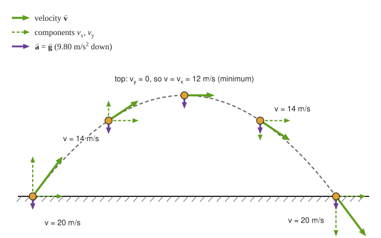
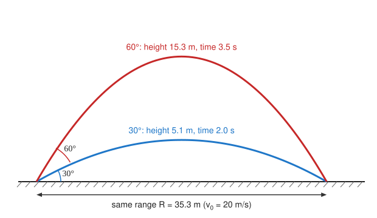
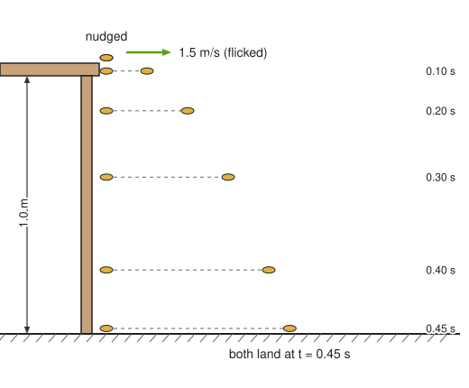
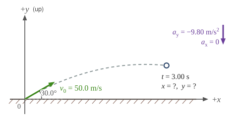
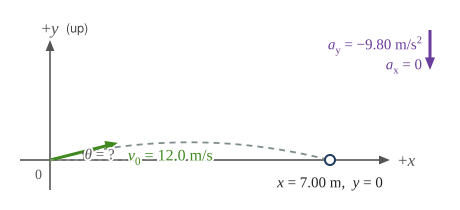
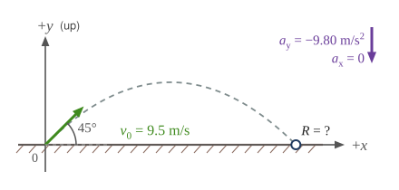
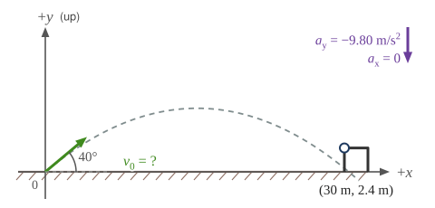
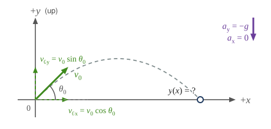

:::: abstract

* Identify and explain the properties of a projectile, such as acceleration due to gravity, range, maximum height, and trajectory.
* Determine the location and velocity of a projectile at different points in its trajectory.
* Apply the principle of independence of motion to solve projectile motion problems.

::::

**Projectile motion** is the
**motion** of an object thrown or projected into the air, subject to only the
acceleration of gravity. The object is called a **projectile**, and its path is
called its
**trajectory**. The motion of falling objects, as covered
in [Falling Objects](./ch2FallingObjects)
, is a simple one-dimensional type of projectile motion in which there is no
horizontal movement. In this section, we consider two-dimensional projectile
motion, such as that of a football or other object for which
**air resistance**
**is negligible**.

The most important fact to remember here is that **horizontal and vertical
motions are independent when air resistance is negligible** and thus can be
analyzed separately. This fact was
discussed
in [Kinematics in Two Dimensions: An Introduction](./ch3KinematicsInTwoDimensionsAnIntroduction)
, where vertical and horizontal motions were seen to be independent. The key to
analyzing two-dimensional projectile motion is to break it into two motions, one
along the horizontal axis and the other along the vertical. (This choice of axes
is the most sensible, because acceleration due to gravity is vertical—thus,
there will be no acceleration along the horizontal axis when air resistance is
negligible.) As is customary, we call the horizontal axis the **x**-axis and the
vertical axis the **y**-axis. [Figure 1](#Figure1) illustrates the notation for
displacement, where $$ \vb{s} $$ is defined to be the total displacement and $$ \vb{x} $$ and $$ \vb{y} $$ are its components along the horizontal and vertical
axes, respectively. The magnitudes of these vectors are $$\mag{s}$$,
$$\mag{x}$$, and $$\mag{y}$$.
(Note that in the last section we used the notation $$ \vb{A} $$ to represent a
vector with components $$ \vb{A}_{x} $$ and $$ \vb{A}_{y} $$. If we continued
this format, we would call displacement $$ \vb{s} $$ with components $$ \vb{s}_{x} $$ and $$ \vb{s}_{y} $$. However, to simplify the notation, we will simply
represent the components as $$ x $$ and $$ y $$.)

Of course, to describe motion we must deal with velocity and acceleration, as
well as with displacement. We must find their components along the **x**- and
**y**-axes, too. We will assume all forces except gravity (such as air
resistance and friction, for example) are negligible. The components of
acceleration are then very simple: $$ a_{y}=-g=-9.80 \mss $$. (Note that this
definition assumes that the upwards direction is defined as the positive
direction. If you arrange the coordinate system instead such that the downwards
direction is positive, then acceleration due to gravity takes a positive value.)
Because gravity is vertical, $$ a_{x}=0 $$. Both accelerations are constant, so
the kinematic equations can be used.

Review of Kinematic Equations (constant \( a \) )

 $$ x=x_{0}+\overline{v}t $$

 $$ \overline{v}=\frac{ v_{0}+v}{2} $$

 $$ v=v_{0}+a t $$

 $$ x=x_{0}+v_{0}t+\frac{1}{2}a t^{2} $$

 $$ v^{2}=v_{0}^{2}+2a\left(x-x_{0}\right). $$

 of a soccer ball at a point along its path. The vector \( \vb{s} \) has components \( x \) and \( y \) along the horizontal and vertical axes. Its magnitude is \( \mag{s} \) , and it makes an angle \( \theta \) with the horizontal.')
{: #Figure1}

Given these assumptions, the following steps are then used to analyze projectile
motion:

**_Step 1._** _Resolve or break the motion into horizontal and vertical
components along the x- and y-axes._ These axes are perpendicular, so $$ A_{x}=A\cos{\theta} $$ and $$ A_{y}=A\sin{\theta} $$ are used. The signed
components of displacement $$ \vb{s} $$ along these axes are $$ x $$ and $$ y $$. The signed components of the velocity $$ \vb{v} $$ are $$ v_{x}=v\cos{\theta} $$ and $$ v_{y}=v\sin{\theta}$$, where $$ v $$ is the
magnitude of the velocity and $$ \theta $$ is its direction, as shown
in [Figure 2](#Figure2). Initial values are denoted with a subscript 0, as usual.

**_Step 2._** _Treat the motion as two independent one-dimensional motions, one
horizontal and the other vertical._ The kinematic equations for horizontal and
vertical motion take the following forms:

 $$ \text{Horizontal Motion}\left(a_{x}=0\right) $$

 $$ x=x_{0}+v_{x}t $$

 $$ v_{x}=v_{0x}=v_{x}=\text{velocity is a constant.} $$

 $$ \text{Vertical Motion}\left(\text{assuming positive is up}a_{y}=-g=-9.80\mss \right) $$

 $$ y=y_{0}+\frac{1}{2}\left(v_{0y}+v_{y}\right)t $$

 $$ v_{y}= v_{0y}- g t $$

 $$ y=y_{0}+v_{0y}t-\frac{1}{2} g t^{2} $$

 $$ v_{y}^{2}= v_{0y}^{2}-2g \left( y-y_{0} \right) . $$

**_Step 3._** _Solve for the unknowns in the two separate motions—one horizontal
and one vertical._ Note that the only common variable between the motions is
time $$ t $$. The problem solving procedures here are the same as for
one-dimensional **kinematics** and are illustrated in the solved examples below.

**_Step 4._** _Recombine the two motions to find the total displacement_ $$ \vb{s} $$ _and velocity_ $$ \vb{v} $$. Because the *x*- and *y*-motions are
perpendicular, we determine these vectors by using the techniques outlined in
the [Vector Addition and Subtraction: Analytical Methods](./ch3VectorAdditionAndSubtractionAnalyticalMethods)
and employing $$ A=\sqrt{ A_x^2+ A_y^2} $$ and $$ \theta ={\tan}^{-1}\left( \frac{A_y}{A_x}\right) $$ in the following form, where $$ \theta $$ is the
direction of the displacement $$ \vb{s} $$ and $$\theta_{v} $$ is the direction
of the velocity $$ \vb{v} $$.

**Total displacement and velocity**

 $$ s=\sqrt{ x^{2}+{y}^{2}} $$

 $$ \theta ={\tan}^{-1}\left(\frac{y}{x} \right) $$

 $$ v=\sqrt{ v_{x}^{2}+v_{y}^{2}} $$

 $$\theta_{v}={\tan}^{-1}\left( \frac{v_{y}}{v_{x}}\right). $$

![In part a the figure shows projectile motion of a ball with initial velocity of v zero at an angle of theta zero with the horizontal x axis. The horizontal component v x and the vertical component v y at various positions of ball in the projectile path is shown. In part b only the horizontal velocity component v sub x is shown whose magnitude is constant at various positions in the path. In part c only vertical velocity component v sub y is shown. The vertical velocity component v sub y is upwards till it reaches the maximum point and then its direction changes to downwards. In part d resultant v of horizontal velocity component v sub x and downward vertical velocity component v sub y is found which makes an angle theta with the horizontal x axis. The direction of resultant velocity v is towards south east.](../resources/Figure_03_04_02.svg '(a) We analyze two-dimensional projectile motion by breaking it into two independent one-dimensional motions along the vertical and horizontal axes.
(b) The horizontal motion is simple, because \( a_x=0 \) and \( v_x \) is thus constant.
(c) The velocity in the vertical direction begins to decrease as the object rises; at its highest point, the vertical velocity is zero. As the object falls towards the Earth again, the vertical velocity increases again in magnitude but points in the opposite direction to the initial vertical velocity. (d) The x - and y -motions are recombined to give the total velocity at any given point on the trajectory.')
{: #Figure2 height="600"}

:::: example {"class":"example","id":"fireworks"}

A Fireworks Projectile Explodes High and Away

During a fireworks display, a shell is shot into the air with an initial speed of
70.0 m/s at an angle of <!-- physics: eq-0 -->$$ 75.0^\circ $$
above the horizontal, as illustrated in [Figure 3](#Figure3). The
fuse is timed to ignite the shell just as it reaches its highest point above the
ground.
(a) Calculate the height at which the shell explodes.
(b) How much time passed between the launch of the shell and the explosion?
(c) What is the horizontal displacement of the shell when it explodes?

**Strategy**

Because air resistance is negligible for the unexploded shell, the analysis
method outlined above can be used. The motion can be broken into horizontal and
vertical motions in which $$ a_{x}=0 $$ and $$ a_{y}=-g $$. We can then define
$$ x_{0} $$ and $$ y_{0} $$ to be zero and solve for the desired quantities.

**Solution for (a)**

By “height” we mean the altitude or vertical position $$ y $$ above the starting
point. The highest point in any trajectory, called the apex, is reached when $$ v_{y}=0 $$. Since we know the initial and final velocities as well as the
initial position, we use the following equation to find $$ y $$:

 $$ v_{y}^{2}=v_{0y}^{2}-2g\left(y-y_{0}\right). $$

{: #Figure3 height="250"}

Because $$ y_{0} $$ and $$ v_{y} $$ are both zero, the equation simplifies to

 $$ 0=v_{0y}^{2}-2\text{gy.} $$

Solving for $$ y $$ gives

 $$ y=\frac{ v_{0y}^{2}}{2g}. $$

Now we must find $$ v_{0y} $$, the component of the initial velocity in the *y*-direction. It is given by $$ v_{0y}=v_{0} \sin{\theta} $$, where $$ v_{0} $$ is the initial velocity of
70.0 m/s, and $$ \theta_{0}=75.0^\circ $$ is the initial angle. Thus,

 <!-- physics: eq-18 -->
 $$ v_{0y}=v_{0}\sin{\theta_{0}}= \left(70.0 \ms \right)\left(\sin{75^\circ }\right) =67.6 \ms . $$

and $$ y $$ is

 $$ y=\frac{ \left(67.6 \ms \right)^{2}}{2\left(9.80 \mss \right)}, $$

so that

 <!-- physics: eq-21 -->
 $$ y=233 \m . $$

**Discussion for (a)**

Note that because up is positive, the initial velocity is positive, as is the
maximum height, but the acceleration due to gravity is negative. Note also that
the maximum height depends only on the vertical component of the initial
velocity, so that any projectile with a 67.6 m/s initial vertical component of
velocity will reach a maximum height of 233 m (neglecting air resistance). The
numbers in this example are reasonable for large fireworks displays, the shells
of which do reach such heights before exploding. In practice, air resistance is
not completely negligible, and so the initial velocity would have to be somewhat
larger than that given to reach the same height.

**Solution for (b)**

As in many physics problems, there is more than one way to solve for the time to
the highest point. In this case, the easiest method is to use $$ y=y_{0}+\frac{1}{2}\left(v_{0y}+v_{y}\right)t $$. Because $$ y_{0} $$ is zero, this
equation reduces to simply

 $$ y=\frac{1}{2}\left(v_{0y}+v_{y}\right)t. $$

Note that the final vertical velocity, $$ v_{y} $$, at the highest point is zero. Thus,

<!-- physics: eq-26 -->
$$ \begin{array}{lll}
t&=& \frac{2y}{\left(v_{0y}+v_{y}\right)}=\frac{2\left(233 \m \right)}{\left(67.6 \ms \right)}\\
t&=& 6.90 \s .
\end{array} $$

**Discussion for (b)**

This time is also reasonable for large fireworks. When you are able to see the
launch of fireworks, you will notice several seconds pass before the shell
explodes. (Another way of finding the time is by using $$ y=y_{0}+v_{0y}t-\frac{1}{2}g t^{2} $$, and solving the quadratic equation for $$ t $$.)

**Solution for (c)**

Because air resistance is negligible, $$ a_{x}=0 $$ and the horizontal velocity
is constant, as discussed above. The horizontal displacement is horizontal
velocity multiplied by time as given by $$ x=x_{0}+v_{x}t $$, where $$ x_{0} $$
is equal to zero:

 $$ x=v_{x}t, $$

where $$ v_{x} $$ is the **x**-component of the velocity, which is given by $$ v_{x}=v_{0}\cos{\theta_{0}}$$. Now,

 <!-- physics: eq-35 -->
 $$ v_{x}=v_{0}\cos{\theta_{0}}=\left(70.0 \ms \right)\left(\cos {75.0^\circ }\right)=18.1 m/s. $$

The time $$ t $$ for both motions is the same, and so $$ x $$ is

 <!-- physics: eq-38 -->
 $$ x=\left(18.1 \ms \right)\left(6.90 \s \right)=125 \m . $$

**Discussion for (c)**

The horizontal motion is a constant velocity in the absence of air resistance.
The horizontal displacement found here could be useful in keeping the fireworks
fragments from falling on spectators. Once the shell explodes, air resistance
has a major effect, and many fragments will land directly below.

::::

In solving part (a) of the preceding example, the expression we found for $$ y $$

gives the rise above the launch point for a projectile launched upward when
air resistance is negligible. Taking the launch point as $$ y_{0}=0 $$ and
calling the maximum height $$ y=h $$, we obtain

 $$ h=\frac{ v_{0y}^{2}}{2g}. $$

This equation defines the **maximum height of a projectile** and depends only on
the vertical component of the initial velocity.

:::: note {"class":"note","data-label":""}

Defining a Coordinate System

It is important to set up a coordinate system when analyzing projectile motion.
One part of defining the coordinate system is to define an origin for the $$ x $$
and $$ y $$ positions. Often, it is convenient to choose the initial position of
the object as the origin such that $$ x_{0}=0 $$ and $$ y_{0}=0 $$. It is also
important to define the positive and negative directions in the $$ x $$ and $$ y $$ directions. Typically, we define the positive vertical direction as upwards,
and the positive horizontal direction is usually the direction of the object’s
motion. When this is the case, the vertical acceleration is
$$ a_{y}=-g $$, a negative value (since it is directed downwards towards the
Earth). Here $$ g=9.80\mss $$ is always a positive number; the sign goes on the
acceleration component. However, it
is occasionally useful to define the coordinates differently. For example, if
you are analyzing the motion of a ball thrown downwards from the top of a cliff,
it may make sense to define the positive direction downwards since the motion of
the ball is solely in the downwards direction. If this is the case,
$$ a_{y}=+g $$.

::::

:::: example {"class":"example","id":"hot-rock"}

Calculating Projectile Motion: Hot Rock Projectile

Kīlauea in Hawaii is one of the world’s most active volcanoes. Its runny basaltic magma usually erupts as
red-hot rocks and lava rather than explosive clouds of ash.
Suppose a large rock is ejected from the volcano with a speed of 25.0 m/s and
at an angle <!-- physics: eq-0 -->$$ 35.0^\circ $$
above the horizontal, as shown in [Figure 4](#Figure4). The rock
strikes the side of the volcano at an altitude 20.0 m lower than its starting
point.
(a) Calculate the time it takes the rock to follow this path.
(b) What are the magnitude and direction of the rock’s velocity at impact?

{: #Figure4}

**Strategy**

Again, resolving this two-dimensional motion into two independent
one-dimensional motions will allow us to solve for the desired quantities. The
time a projectile is in the air is governed by its vertical motion alone. We
will solve for $$ t $$ first. While the rock is rising and falling vertically,
the horizontal motion continues at a constant velocity. This example asks for
the final velocity. Thus, the vertical and horizontal results will be recombined
to obtain $$ v $$ and $$\theta_{v} $$ at the final time $$ t $$ determined in
the first part of the example.

**Solution for (a)**

While the rock is in the air, it rises and then falls to a final position 20.0 m
lower than its starting altitude. We can find the time for this by using

 $$ y=y_{0}+v_{0y}t-\frac{1}{2}g t^{2} . $$

If we take the initial position $$ y_{0} $$ to be zero, then the final position is
$$ y=-20.0 \m $$. Now the initial vertical velocity is the vertical component of the initial velocity,
found from <!-- physics: eq-8 -->$$ v_{0y}=v_{0}\sin{\theta_{0}} = ( 25.0 \ms  )( \sin{35.0^\circ } ) = 14.3 \ms $$. Substituting known values yields

 $$ -20.0 \m =\left(14.3 \ms \right)t-\left(4.90 \mss \right){t}^{2}. $$

Rearranging terms gives a quadratic equation in $$ t $$:

 $$ \left(4.90 \mss \right) t^{2}-\left(14.3 \ms \right)t-\left(20.0 \m \right)=0. $$

This expression is a quadratic equation of the form $$ a t^{2} + b t+c=0 $$,
where the constants are $$ a=4.90 $$, $$ b=-14.3 $$, and $$ c=-20.0. $$
Its solutions are given by the quadratic formula:

 $$ t=\frac{-b \pm \sqrt{ b^{2}-4 a c }} {2a}. $$

This equation yields two solutions: $$ t=3.96 $$
and $$ t=-1.03 $$. (It is left as an exercise for the reader to verify these solutions.) The time
is $$ t=3.96\s $$ or $$ -1.03\s $$. The negative value of time implies an event before the start of
motion, and so
we discard it. Thus,

 <!-- physics: eq-21 -->
 $$ t=3.96 \s . $$

**Discussion for (a)**

The time for projectile motion is completely determined by the vertical motion.
So any projectile that has an initial vertical velocity of 14.3 m/s and lands
20.0 m below its starting altitude will spend 3.96 s in the air.

**Solution for (b)**

From the information now in hand, we can find the final horizontal and vertical
velocities $$ v_{x} $$ and $$ v_{y} $$ and combine them to find the magnitude of
the velocity $$ \mag{v} $$ and the angle $$ \theta_{v} $$ it makes with the
horizontal. Of course, $$ v_{x} $$ is constant so we can solve for it at any
horizontal location. In this case, we chose the starting point since we know
both the initial velocity and initial angle. Therefore:

 <!-- physics: eq-27 -->
 $$ v_{x}=v_{0}\cos{\theta_{0}}=\left(25.0 \ms \right)\left(\cos{35^\circ }\right)=20.5 \ms $$

The final vertical velocity is given by the following equation:

 $$ v_{y}=v_{0y}-gt, $$

where $$ v_{0y} $$ was found in part (a) to be $$ 14.3 \ms $$. Thus,

 $$ v_{y}=14.3 \ms -\left(9.80 \mss \right)\left(3.96 \s \right) $$

so that

 <!-- physics: eq-32 -->
 $$ v_{y}=-24.5 \ms $$

To find the magnitude of the final velocity $$ \mag{v} $$, we combine its
perpendicular components, using the following equation:

 $$ \mag{v}=\sqrt{ v_{x}^{2}+v_{y}^{2}}=\sqrt{\left(20.5 \ms \right)^{2}+\left (-24.5 \ms \right)^{2}}, $$ 

which gives

 <!-- physics: eq-35 -->
 $$ \mag{v}=31.9 \ms $$

The direction $$\theta_{v} $$ is found from the equation:

 $$\theta_{v}={\tan}^{-1}\left(v_{y}/v_{x}\right) $$

so that

 $$\theta_{v}={\tan}^{-1}\left(\frac{-24.5 \ms}{20.5 \ms}\right)={\tan}^{-1}\left(-1.19\right). $$

Thus,

 <!-- physics: eq-39 -->
 $$\theta_{v}=-50.1^\circ . $$

**Discussion for (b)**

The negative angle means that the velocity is $$ 50.1^\circ $$ below the
horizontal. This result is consistent with the fact that the final vertical
velocity is negative and hence downward—as you would expect because the final
altitude is 20.0 m lower than the initial altitude. (
See [Figure 4](#Figure4).)

::::

One of the most important things illustrated by projectile motion is that
vertical and horizontal motions are independent of each other. Galileo was the
first person to fully comprehend this characteristic. He used it to predict the
range of a projectile. On level ground, we define **range** to be the horizontal
distance $$ R $$ traveled by a projectile. Galileo and many others were
interested in the range of projectiles primarily for military purposes—such as
aiming cannons. However, investigating the range of projectiles can shed light
on other interesting phenomena, such as the orbits of satellites around the
Earth. Let us consider projectile range further.

 The greater the initial speed \( v_0 \), the greater the range for a given initial angle.
(b) The effect of initial angle \( \theta_0 \) on the range of a projectile with a given initial speed. Note that the range is the same for 15 degrees and 75 degrees, although the maximum heights of those paths are different.'){: #Figure5 .figure-full-width}

How does the initial velocity of a projectile affect its range? Obviously, the
greater the initial speed $$ v_{0} $$, the greater the range, as shown
in [Figure 5](#Figure5)(a). The initial angle $$ \theta_{0} $$ also has a dramatic
effect on the range, as illustrated in [Figure 5](#Figure5)(b). For a fixed initial
speed, such as might be produced by a cannon, the maximum range is obtained with

$$ \theta_{0}=45^\circ $$. This is true only for conditions neglecting air resistance. If
air resistance is considered, the angle for maximum range is smaller; for many
sports balls it is somewhere around $$ 35^\circ $$ to $$ 40^\circ $$, but the
exact value depends on the object, its speed, and other conditions.
Interestingly, for every initial angle except $$ 45^\circ $$, there are two
angles that give the same range—the sum of those angles is $$ 90^\circ $$. The
range also depends on the value of the acceleration of gravity $$ g $$. The
lunar astronaut Alan Shepard hit golf balls on the Moon in 1971; for a given
launch speed and angle, a ball travels about six times farther there because
gravity is weaker. The range $$ R $$ of a projectile
on **level ground** for which air resistance is negligible is given by

 $$ R=\frac{ v_0^2\sin{ 2\theta_{0} }}{g}, $$

where $$ v_{0} $$ is the initial speed and $$\theta_{0} $$ is the initial angle
relative to the horizontal. The proof of this equation is left as an
end-of-chapter problem (hints are given), but it does fit the major features of
projectile range as described.

When we speak of the range of a projectile on level ground, we assume that $$ R $$ is very small compared with the circumference of the Earth. If, however, the
range is large, the Earth curves away below the projectile and acceleration of
gravity changes direction along the path. The range is larger than predicted by
the range equation given above because the projectile has farther to fall than
it would on level ground. (
See [Figure 6](#Figure6).) If the initial speed is great enough, the projectile
goes into orbit. This possibility was recognized centuries before it could be
accomplished. When an object is in orbit, the Earth curves away from underneath
the object at the same rate as it falls. The object thus falls continuously but
never hits the surface. These and other aspects of orbital motion, such as the
rotation of the Earth, will be covered analytically and in greater depth later
in this text.

Once again we see that thinking about one topic, such as the range of a
projectile, can lead us to others, such as the Earth orbits.
In [Addition of Velocities](./ch3AdditionOfVelocities), we will
examine the addition of velocities, which is another important aspect of
two-dimensional kinematics and will also yield insights beyond the immediate
topic.

{: #Figure6}

:::: note {"class":"note","data-label":"PhET Exploration"}

 Projectile Motion

Blast a Buick out of a cannon! Learn about projectile motion by firing various objects. Set the angle, initial speed, and mass. Add air resistance. Make a game out of this simulation by trying to hit a target.

::: figure {}

<iframe loading="lazy" src="https://phet.colorado.edu/sims/html/projectile-motion/latest/projectile-motion_en.html" width="600" height="450"  allowfullscreen></iframe>
<figcaption>
Projectile Motion
</figcaption>

:::

::::

### Summary

* Projectile motion is the motion of an object through the air that is subject
  only to the acceleration of gravity.
* To solve projectile motion problems, perform the following steps:
    1. Determine a coordinate system. Then, resolve the position and/or velocity
       of the object in the horizontal and vertical components. The components
       of position $$ \vb{s} $$ are given by the quantities $$ x $$ and $$ y $$,
       and the components of the velocity $$ \vb{v} $$ are given by $$ v_{x}=v\cos{\theta} $$ and $$ v_{y}=v\sin{\theta} $$, where $$ v $$ is the
       magnitude of the velocity and $$ \theta $$ is its direction.
    2. Analyze the motion of the projectile in the horizontal direction using
       the following equations:
       

         $$ \text{Horizontal motion}\left(a_{x}=0\right) $$
       

       

            $$ x=x_{0}+v_{x}t $$
       

       

        $$ v_{x}=v_{0x}=\vb{v}_{\text{x}}=\text{velocity is a constant.} $$
       

    3. Analyze the motion of the projectile in the vertical direction using the
       following equations:
       

       $$ \text{Vertical motion}\left(\text{Assuming positive direction is up;}a_{y}=-g=-9.80 \mss \right) $$ 

       

       

       $$ y=y_{0}+\frac{1}{2}\left(v_{0y}+v_{y}\right)t $$
       

       

       $$ v_{y}=v_{0y}-g t $$
       

       

        $$ y=y_{0}+v_{0y}t-\frac{1}{2} g t^{2} $$
       

       

       $$ v_{y}^{2}=v_{0y}^{2}-2g\left(y-y_{0}\right). $$
       

    4. Recombine the horizontal and vertical components of location and/or
       velocity using the following equations:
       

        $$ s=\sqrt{ x^{2}+{y}^{2}} $$
       

       

        $$ \theta =\tan^{-1}\left(\frac{y}{x}\right) $$
       

       

        $$ v=\sqrt{ v_{x}^{2}+v_{y}^{2}} $$
        

       

        $$ \theta_{\text{v}}={\tan}^{-1} \left( \frac{v_{y}}{v_{x}} \right) .$$
        

- The maximum height $$ h $$ of a projectile launched with initial vertical
  velocity $$ v_{0y} $$ is given by
  

    $$ h=\frac{ v_{0y}^{2}}{2g}. $$
  

- The horizontal distance a projectile travels on level ground is called the
  **range**. The range $$ R $$ of a projectile on level ground launched at an
  angle $$\theta_{0} $$ above the horizontal with initial speed $$ v_{0} $$ is
  given by
  

    $$ R=\frac{ v_0^2 \sin{2\theta_{0}} }{g}. $$
  

### Conceptual Questions

:::: problem

Answer the following questions for projectile motion on level ground assuming negligible air resistance
(the initial angle being neither $$ 0^\circ $$ nor $$ 90^\circ $$ ):

(a) Is the velocity ever zero?

(b) When is the speed (the magnitude of the velocity) a minimum? A maximum?

(c) Can the velocity ever be the same as the initial velocity at a time other
than at $$ t=0 $$?

(d) Can the speed ever be the same as the initial speed at a time other than at
$$ t=0 $$ ?

::::

:::: solution

**Strategy**

Separate the constant horizontal velocity from the changing vertical velocity, with +x horizontal and +y upward.

**Solution**

For launch speed $$v_0$$ and angle $$0<\theta<90°$$, $$v_x=v_0\cos\theta>0$$ and $$v_y=v_0\sin\theta-gt$$.

**(a)** Velocity is never zero during flight because $$v_x$$ remains nonzero, even when $$v_y=0$$ at the top.

**(b)** Speed $$\sqrt{v_x^2+v_y^2}$$ is smallest at the top and greatest at launch and just before landing on the same level. For the illustrated $$v_0=20\ms$$ and horizontal component $$v_x=12\ms$$, the minimum speed is $$12\ms$$; the vertical launch component is $$\sqrt{(20\ms)^2-(12\ms)^2}=16\ms$$ and both endpoint speeds are $$20\ms$$.

**(c)** The initial velocity vector never recurs during uninterrupted flight: $$v_y=v_{0y}$$ would require $$gt=0\ms$$ and hence $$t=0\s$$.

**(d)** The initial **speed** does recur at landing, where $$v_y=-v_{0y}$$ and $$v_x$$ is unchanged.

The velocity never vanishes or repeats its initial vector after launch, while speed is minimum at the top and returns to its maximum initial value upon landing at the launch height.

::::

:::: problem

Answer the following questions for projectile motion on level ground assuming negligible air resistance
(the initial angle being neither $$ 0^\circ $$ nor $$ 90^\circ $$):

(a) Is the acceleration ever zero?

(b) Is the acceleration ever in the same direction as a component of velocity?

(c) Is the acceleration ever opposite in direction to a component of velocity?

::::

:::: solution

**Strategy**

Compare the fixed downward acceleration with the directions of the two velocity components.

**Solution**

Choose $$+x$$ horizontally along the launch and $$+y$$ upward. Ignoring drag, $$\vb a=-(9.80\mss)\hat{\mathbf{y}}$$ throughout flight.

**(a)** Acceleration is never zero, including at the top where only $$v_y$$ is zero.

**(b)** On descent, the vertical velocity component is downward and is in the same direction as acceleration. For instance, $$v_y=-3.0\ms$$ becomes $$-3.98\ms$$ after $$0.10\s$$ because $$\Delta v_y=(-9.80\mss)(0.10\s)=-0.98\ms$$.

**(c)** On ascent, $$v_y>0$$ and acceleration is opposite that vertical component. It is always perpendicular to the horizontal component. At the top the vertical component is zero, so it has no direction to compare.

Projectile acceleration is always downward and nonzero, aligns with the vertical velocity on descent, and opposes the vertical velocity on ascent.

::::

:::: problem

For a fixed initial speed, the range of a projectile is determined by the angle at which it is fired. For all but the maximum, there are two angles that give the same range. Considering factors that might affect the ability of an archer to hit a target, such as wind, explain why the smaller angle (closer to the horizontal) is preferable. When would it be necessary for the archer to use the larger angle? Why does the punter in a football game use the higher trajectory?

::::

:::: solution

**Strategy**

Compare the flight times for two equal-range launch angles and consider clearance and the intended use of the projectile.

**Solution**

For equal launch and landing heights, $$R=v_0^2\sin(2\theta)/g$$ and $$T=2v_0\sin\theta/g$$. Complementary angles have the same range but different flight times. With assumed $$v_0=20\ms$$, the $$30°$$ and $$60°$$ shots both have

$$R=\frac{(20\ms)^2\sin60°}{9.80\mss}=35\m,$$

while $$T_{30}=2(20\ms)\sin30°/(9.80\mss)=2.0\s$$ and $$T_{60}=3.5\s$$.

The lower trajectory gives wind and target motion less time to affect the shot and is often easier to aim. The larger angle is useful when an obstacle must be cleared or a target must be approached steeply from above. A football punter deliberately seeks hang time so teammates can run downfield before the receiver catches the ball; maximum targeting speed is not the only objective.

An archer usually prefers the shorter flight of the lower angle, uses a higher angle when clearance or approach geometry requires it, and a punter uses a high trajectory to give teammates time to reach the receiver.

::::

:::: problem

During a lecture demonstration, a professor places two coins on the edge of a table. She then flicks one of the coins horizontally off the table, simultaneously nudging the other over the edge. Describe the subsequent motion of the two coins, in particular discussing whether they hit the floor at the same time.

::::

:::: solution

**Strategy**

Apply the same vertical equation to both coins and keep horizontal motion independent.

**Solution**

Take the table edge as $$y=0\m$$ and $$+y$$ upward. Assume both coins begin falling simultaneously with $$v_{0y}=0\ms$$ and negligible air resistance. Their vertical motions are identical:

$$y=-\tfrac12gt^2.$$

For the illustrated table height $$h=1.0\m$$, both reach the floor at

$$t=\sqrt{\frac{2h}{g}}=\sqrt{\frac{2(1.0\m)}{9.80\mss}}=0.45175\s\approx0.45\s.$$

The coin released without horizontal speed falls vertically. With the illustrated $$v_{0x}=1.5\ms$$, the flicked coin travels $$(1.5\ms)(0.45175\s)=0.6776\m\approx0.68\m$$ horizontally while following a parabola. This horizontal motion does not change its fall time.

The coins hit the floor simultaneously because they have identical initial vertical motion and gravitational acceleration, although the flicked coin also travels horizontally.

::::

### Problems &amp; Exercises

:::: problem

A projectile is launched at ground level with an initial speed of 50.0 m/s at an angle of
$$ 30.0^\circ $$ above the horizontal. It strikes a target above the ground 3.00 seconds later.
What are the $$ x $$ and $$ y $$
distances from where the projectile was launched to where it lands?

::::

:::: solution

**Strategy**

Resolve the initial velocity into horizontal and vertical components. Use the kinematic equations for each direction separately, with time as the common variable.

**Sketch and coordinate system**

{: .sketch}

Take $$ +x $$ horizontal in the direction of motion and $$ +y $$ up. With the origin at the launch point, $$ x_0 = y_0 = 0 $$, $$ a_x = 0 $$, and $$ a_y = -9.80 \mss $$; a positive $$ y $$ at 3.00 s means the target is above the launch point.

**Solution**

1. Find the initial velocity components:

$$ v_{0x} = v_0 \cos\theta_{0} = (50.0 \ms)(\cos 30.0°) = (50.0 \ms)(0.866) = 43.3 \ms $$

$$ v_{0y} = v_0 \sin\theta_{0} = (50.0 \ms)(\sin 30.0°) = (50.0 \ms)(0.500) = 25.0 \ms $$

2. Calculate the horizontal distance (no acceleration horizontally):

$$ x = v_{0x} \cdot t = (43.3 \ms)(3.00 \s) = 130 \m = 1.30 \times 10^2 \m $$

3. Calculate the vertical distance (using $$ a_y = -g $$):

$$ y = v_{0y}t - \frac{1}{2}gt^{2} = (25.0 \ms)(3.00 \s) - \frac{1}{2}(9.80 \mss)(3.00 \s)^2 $$

$$ y = 75.0 \m - 44.1 \m = 30.9 \m $$

**Discussion**

The positive value for y indicates the target is above the launch point. The projectile travels 130 m horizontally and is 30.9 m above ground when it strikes the target.

The projectile lands at a horizontal distance of $$ x = 1.30 \times 10^{2} \m $$ and a vertical height of $$ y = 30.9 \m $$ above the launch point.

::::

:::: problem

A ball is kicked with an initial velocity of 16 m/s in the horizontal direction and 12 m/s in the vertical direction.
(a) At what speed does the ball hit the ground?
(b) For how long does the ball remain in the air?
(c) What maximum height is attained by the ball?

::::

:::: solution

**Strategy**

The horizontal and vertical velocity components are given directly. Use projectile motion equations to find the time of flight, maximum height, and final velocity.

**Sketch and coordinate system**

{: .sketch}

Take $$ +x $$ horizontal in the direction of motion and $$ +y $$ up. With the origin at the kick, $$ v_{0x} = +16 \ms $$, $$ v_{0y} = +12 \ms $$, and $$ a_y = -9.80 \mss $$. The ball lands when $$ y = 0 $$ again, with $$ v_y $$ negative (downward).

**Solution**

Given: $$ v_{0x} = 16 \ms $$, $$ v_{0y} = 12 \ms $$, $$ a_y = -g = -9.80 \mss $$

**(a) Speed when the ball hits the ground:**

When the ball returns to ground level (same height as launch), by symmetry, the vertical speed has the same magnitude but opposite direction: $$ v_y = -12 \ms $$

The horizontal velocity remains constant: $$ v_x = 16 \ms $$

Calculate the total speed:

$$ v = \sqrt{v_x^2 + v_y^2} = \sqrt{(16 \ms)^2 + (-12 \ms)^2} = \sqrt{256 \mmss + 144 \mmss} = \sqrt{400 \mmss} = 20 \ms $$

**(b) Time in the air:**

The ball rises until $$ v_y = 0 $$, then falls back. Using $$ v_y = v_{0y} - gt $$:

Time to reach maximum height:

$$ t_{up} = \frac{v_{0y}}{g} = \frac{12 \ms}{9.80 \mss} = 1.22 \s $$

Total time in air (by symmetry):

$$ t_{total} = 2 \times t_{up} = 2 \times 1.22 \s = 2.45 \s $$

**(c) Maximum height:**

At maximum height, $$ v_y = 0 $$. Using $$ v_y^2 = v_{0y}^2 - 2gy $$:

$$ 0 = (12 \ms)^2 - 2(9.80 \mss)y_{max} $$

$$ y_{max} = \frac{(12 \ms)^2}{2(9.80 \mss)} = \frac{144 \mmss}{19.6 \mss} = 7.35 \m $$

**Discussion**

Note that the initial and final speeds are equal (20 m/s) because the ball lands at the same height from which it was kicked. This is a consequence of energy conservation.

(a) The ball hits the ground at a speed of $$ 20 \ms $$.

(b) The ball remains in the air for $$ 2.45 \s $$.

(c) The maximum height attained is $$ 7.35 \m $$.

::::

:::: problem

A ball is thrown horizontally from the top of a 60.0-m building and lands 100.0 m from the base of the building. Ignore air resistance.
(a) How long is the ball in the air?
(b) What must have been the initial horizontal component of the velocity?
(c) What is the vertical component of the velocity just before the ball hits the ground?
(d) What is the velocity (including both the horizontal and vertical components) of the ball just before it hits the ground?

::::

:::: solution

**Strategy**

Since the ball is thrown horizontally, $$ v_{0y} = 0 $$. The vertical motion determines the time of flight, which then determines the required horizontal velocity.

**Sketch and coordinate system**

{: .sketch}

Take $$ +x $$ horizontal, away from the building, and $$ +y $$ up, with the origin on the ground at the base of the building. Then $$ y_0 = +60.0 \m $$, the ball lands at $$ y = 0 $$, $$ v_{0y} = 0 $$, and $$ a_y = -9.80 \mss $$; a negative $$ v_y $$ means downward.

**Solution**

Given: $$ y_0 = 60.0 \m $$, $$ y = 0 $$, $$ x = 100.0 \m $$, $$ v_{0y} = 0 $$

**(a) Time in the air:**

Using the vertical motion equation with $$ v_{0y} = 0 $$ (upward positive, so the displacement to the ground is $$ y - y_0 = -60.0 \m $$):

$$ y - y_0 = v_{0y}t + \frac{1}{2}a_y t^{2} $$

$$ -60.0 \m = 0 + \frac{1}{2}(-9.80 \mss)t^2 $$

$$ t^2 = \frac{2(60.0 \m)}{9.80 \mss} = 12.24 \s^2 $$

$$ t = 3.50 \s $$

**(b) Initial horizontal velocity:**

Since horizontal velocity is constant:

$$ v_{0x} = \frac{x}{t} = \frac{100.0 \m}{3.50 \s} = 28.6 \ms $$

**(c) Vertical velocity at impact:**

$$ v_y = v_{0y} - gt = 0 - (9.80 \mss)(3.50 \s) = -34.3 \ms $$

The magnitude is $$ 34.3 \ms $$ (downward).

**(d) Total velocity at impact:**

The horizontal component remains: $$ v_x = 28.6 \ms $$

Magnitude (using unrounded velocity components):

$$ v = \sqrt{v_x^2+v_y^2} \approx 44.6 \ms $$

Direction (angle below horizontal):

$$ \theta = \tan^{-1}\left(\frac{|v_y|}{v_x}\right) = \tan^{-1}\left(\frac{34.3 \ms}{28.6 \ms}\right) = 50.2° $$

**Discussion**

The ball accelerates only in the vertical direction, so it falls faster and faster while maintaining its horizontal speed. The final velocity is directed at an angle below horizontal because the vertical component has grown larger than the horizontal component.

(a) The ball is in the air for $$ 3.50 \s $$.

(b) The initial horizontal velocity was $$ 28.6 \ms $$.

(c) The vertical velocity just before impact is $$ 34.3 \ms $$ downward.

(d) The total velocity is $$ 44.6 \ms $$ at $$ 50.2° $$ below horizontal.

::::

:::: problem

(a) A daredevil is attempting to jump his motorcycle over a line of buses parked end to end by driving up a $$ 32^\circ $$
ramp at a speed of $$ 40.0 \ms \left(144 \text{km/h}\right) $$. How many
buses can he clear if the top of the takeoff ramp is at the same height as the
bus tops and the buses are 20.0 m long?
(b) Discuss what your answer implies
about the margin of error in this act—that is, consider how much greater the
range is than the horizontal distance he must travel to miss the end of the last
bus. (Neglect air resistance.)

::::

:::: solution

**Strategy**

Since the takeoff and landing heights are equal, use the range equation for level ground. Calculate the range and determine how many 20.0 m buses fit within it.

**Sketch and coordinate system**

{: .sketch}

Take $$ +x $$ horizontal in the direction of motion and $$ +y $$ up. With the origin at the top of the ramp, the landing point (the bus roofs) is also at $$ y = 0 $$, so the level-ground range equation applies.

**Solution**

Given: $$ v_0 = 40.0 \ms $$, $$ \theta_{0} = 32° $$, bus length = 20.0 m

**(a) Number of buses:**

1. Calculate the range using the range equation:

$$ R = \frac{v_0^2 \sin(2\theta_{0})}{g} = \frac{(40.0 \ms)^2 \sin(64°)}{9.80 \mss} $$

$$ R = \frac{1600 \mmss \times 0.899}{9.80 \mss} = \frac{1438 \mmss}{9.80 \mss} = 147 \m $$

2. Calculate the number of buses:

$$ \text{Number of buses} = \frac{147 \m}{20.0 \m} = 7.35 $$

He can safely clear **7 buses**.

**(b) Margin of error:**

The margin is the extra distance beyond 7 buses:

$$ \text{Margin} = 147 \m - 7 \times 20.0 \m = 147 \m - 140 \m = 7 \m $$

**Discussion**

The margin of error is only 7 m out of a total range of 147 m, which is about 5% of the range. This is a relatively small margin for such a dangerous stunt. Any slight reduction in speed, headwind, or error in the ramp angle could result in landing on the last bus. The stunt is risky because the actual conditions (air resistance, exact speed, ramp angle) may vary from the ideal calculated values.

(a) The daredevil can clear **7 buses**.

(b) The margin of error is only **7 m**, which is quite small for such a dangerous stunt, implying this act has little room for error.

::::

:::: problem

An archer shoots an arrow at a 75.0 m distant target; the bull's-eye of the target is at the same height as the release height of the arrow.
(a) At what angle must the arrow be released to hit the bull’s-eye if its initial speed is 35.0 m/s? In this part of the problem, explicitly show how you follow the steps involved in solving projectile motion problems.
(b) There is a large tree halfway between the archer and the target with an overhanging horizontal branch 3.50 m above the release height of the arrow. Will the arrow go over or under the branch?

::::

:::: solution

**Strategy**

For part (a), use the range equation to find the launch angle. Since the arrow lands at the same height as release, we can use $$ R = \frac{v_0^2 \sin(2\theta)}{g} $$. For part (b), calculate the arrow's height at the midpoint (37.5 m horizontally) and compare it to 3.50 m.

**Sketch and coordinate system**

{: .sketch}

Take $$ +x $$ horizontal toward the target and $$ +y $$ up, with the origin at the release point. The bull's-eye is at $$ (75.0 \m, 0) $$, and the branch is at $$ y = +3.50 \m $$ when $$ x = 37.5 \m $$. Heights computed below are measured from this origin.

**Solution**

Given: R = 75.0 m, $$ v_0 = 35.0 \ms $$, g = 9.80 m/s²

**(a) Finding the launch angle:**

**Step 1: Identify knowns and unknowns**

- Range: R = 75.0 m
- Initial speed: $$ v_0 = 35.0 \ms $$
- Launch angle: θ = ? (unknown)

**Step 2: Choose the appropriate equation**

Since launch and landing heights are equal, use the range equation:

$$ R = \frac{v_0^2 \sin(2\theta)}{g} $$

**Step 3: Solve for θ**

$$ \sin(2\theta) = \frac{Rg}{v_0^2} = \frac{(75.0 \m)(9.80 \mss)}{(35.0 \ms)^2} = \frac{735 \mmss}{1225 \mmss} = 0.600 $$

$$ 2\theta = \sin^{-1}(0.600) = 36.87° $$

$$ \theta = \frac{36.87°}{2} = 18.4° $$

Note: There are two possible angles: **18.4°** and **90° − 18.4° = 71.6°**. Both give the same range on level ground. In archery the smaller angle is usually chosen for a flatter, faster trajectory, but either angle is mathematically valid.

**(b) Height at the tree (x = 37.5 m):**

Both launch angles clear the branch. Measure height **above the release height** (the bull's-eye level).

**Low trajectory (θ = 18.4°):**

$$ v_{0x} = v_0 \cos\theta = 35.0 \ms \times \cos(18.4°) = 35.0 \ms \times 0.949 = 33.2 \ms $$

$$ t = \frac{x}{v_{0x}} = \frac{37.5 \m}{33.2 \ms} = 1.13 \s $$

$$ v_{0y} = v_0 \sin\theta = 35.0 \ms \times \sin(18.4°) = 35.0 \ms \times 0.316 = 11.1 \ms $$

$$ y = v_{0y}t - \frac{1}{2}gt^{2} = (11.1 \ms)(1.13 \s) - \frac{1}{2}(9.80 \mss)(1.13 \s)^2 = 6.25 \m $$

**High trajectory (θ = 71.6°):**

$$ v_{0x} = 35.0 \ms \cos(71.6°) = 11.0 \ms, \quad t = \frac{37.5 \m}{11.0 \ms} = 3.41 \s $$

$$ v_{0y} = 35.0 \ms \sin(71.6°) = 33.2 \ms $$

$$ y = (33.2 \ms)(3.41 \s) - \frac{1}{2}(9.80 \mss)(3.41 \s)^2 = 56.3 \m $$

Since 6.25 m > 3.50 m (and 56.3 m > 3.50 m), the arrow **will go over the branch** for either launch angle.

**Discussion**

At the midpoint, the low trajectory is about **6.25 m** above the release height and the high trajectory is about **56.3 m** above release—both well above the 3.50 m branch. The low angle is preferred in archery for accuracy and shorter flight time; the high angle would also hit the target but with a much longer time of flight.

**Answer**

(a) The arrow may be released at **18.4°** or **71.6°** above horizontal.

(b) The arrow will go over the branch. At the tree it is about **6.25 m** above release height for 18.4° (or about **56.3 m** for 71.6°).

::::

:::: problem

A rugby player passes the ball 7.00 m across the field, where it is caught at the same height as it left his hand.
(a) At what angle was the ball thrown if its initial speed was 12.0 m/s, assuming that the smaller of the two possible angles was used?
(b) What other angle gives the same range, and why would it not be used?
(c) How long did this pass take?

::::

:::: solution

**Strategy**

Since the ball is caught at the same height as it was thrown, we can use the range equation for level ground. The range equation gives two possible angles that produce the same range. The smaller angle gives a flatter, faster trajectory.

**Sketch and coordinate system**

{: .sketch}

Take $$ +x $$ horizontal in the direction of motion and $$ +y $$ up. With the origin at the release point, the catch is at $$ (7.00 \m, 0) $$, so the level-ground range equation applies.

**Solution**

Given: R = 7.00 m, $$ v_0 = 12.0 \ms $$

**(a) Finding the smaller launch angle:**

Use the range equation:

$$ R = \frac{v_0^2 \sin(2\theta)}{g} $$

Solve for $$ \sin(2\theta) $$:

$$ \sin(2\theta) = \frac{Rg}{v_0^2} = \frac{(7.00 \m)(9.80 \mss)}{(12.0 \ms)^2} = \frac{68.6 \mmss}{144 \mmss} = 0.476 $$

$$ 2\theta = \sin^{-1}(0.476) = 28.4° $$

$$ \theta = \frac{28.4°}{2} = 14.2° $$

**(b) The other angle:**

Since $$ \sin(2\theta) = \sin(180° - 2\theta) $$, the other solution is:

$$ 2\theta = 180° - 28.4° = 151.6° $$

$$ \theta = \frac{151.6°}{2} = 75.8° $$

This angle would not be used because:

1. The ball would take much longer to reach the receiver (longer hang time)
2. The high, arcing trajectory makes the pass easier for opponents to intercept
3. The ball is harder to catch when falling nearly vertically
4. Wind and other factors have more time to affect the trajectory

**(c) Time of flight:**

Use the horizontal motion to find the flight time for the smaller angle:

$$ t = \frac{R}{v_0\cos\theta} = \frac{7.00\m}{(12.0\ms)\cos\theta} \approx 0.602\s. $$

Here the unrounded value of $$ \theta = \frac{1}{2}\sin^{-1}(Rg/v_0^2) $$ is used in the calculation.

**Discussion**

The short flight time (0.602 s) confirms that the smaller angle produces a quick, flat pass that minimizes the opportunity for interception. The complementary angle (75.8°) would result in a much longer flight time of about 2.4 s, which would be impractical in a fast-paced rugby match.

**Answer**

(a) The ball was thrown at an angle of **14.2°** above horizontal.

(b) The other angle is **75.8°**. This angle would not be used because it results in a much longer flight time, making the pass easier to intercept and harder to catch.

(c) The pass took **0.602 s**.

::::

:::: problem

Verify the ranges for the projectiles in [Figure 5](#Figure5)(a) for $$ \theta =45^\circ $$
and the given initial velocities.

::::

:::: solution

**Strategy**

Use the range equation for projectile motion on level ground. For an angle of 45°, the range equation simplifies because $$ \sin(2 \times 45°) = \sin(90°) = 1 $$. Calculate the range for each given initial velocity.

**Solution**

The range equation is:

$$ R = \frac{v_0^2 \sin(2\theta)}{g} $$

For $$ \theta = 45° $$:

$$ \sin(2\theta) = \sin(90°) = 1 $$

Therefore, the range simplifies to:

$$ R = \frac{v_0^2}{g} $$

**For** $$ v_0 = 30 \ms $$:

$$ R = \frac{(30 \ms)^2}{9.80 \mss} = \frac{900 \mmss}{9.80 \mss} = 91.8 \m $$

**For** $$ v_0 = 40 \ms $$:

$$ R = \frac{(40 \ms)^2}{9.80 \mss} = \frac{1600 \mmss}{9.80 \mss} = 163 \m $$

**For** $$ v_0 = 50 \ms $$:

$$ R = \frac{(50 \ms)^2}{9.80 \mss} = \frac{2500 \mmss}{9.80 \mss} = 255 \m $$

**Discussion**

These calculations confirm the ranges shown in Figure 5(a). Notice that the range is proportional to the square of the initial velocity. This means doubling the initial velocity quadruples the range. For instance, increasing from 30 m/s to 60 m/s would increase the range from 91.8 m to about 367 m (four times as much).

The angle of 45° produces the maximum range for a given initial speed when air resistance is negligible and the launch and landing heights are equal. This is because $$ \sin(2\theta) $$ reaches its maximum value of 1 when $$ 2\theta = 90° $$, which occurs at $$ \theta = 45° $$.

**Answer**

The ranges are verified:

- For $$ v_0 = 30 \ms $$ at 45°: **R = 91.8 m**
- For $$ v_0 = 40 \ms $$ at 45°: **R = 163 m**
- For $$ v_0 = 50 \ms $$ at 45°: **R = 255 m**

::::

:::: problem

Verify the ranges shown for the projectiles in [Figure 5](#Figure5)(b) for an initial velocity of 50 m/s at the given initial angles.

::::

:::: solution

**Strategy**

Use the range equation $$ R = \frac{v_0^2 \sin(2\theta)}{g} $$ to calculate the range for each angle shown in Figure 5(b). The figure shows trajectories for angles of 15°, 45°, and 75°. We should verify that complementary angles (15° and 75°) give the same range.

**Solution**

Given: $$ v_0 = 50 \ms $$, $$ g = 9.80 \mss $$

The range equation is:

$$ R = \frac{v_0^2 \sin(2\theta)}{g} = \frac{(50 \ms)^2 \sin(2\theta)}{9.80 \mss} = \frac{2500 \mmss}{9.80 \mss} \sin(2\theta) $$

**For** $$ \theta = 15° $$:

$$ \sin(2 \times 15°) = \sin(30°) = 0.500 $$

$$ R = \frac{2500 \mmss}{9.80 \mss} \times 0.500 = 255 \m \times 0.500 = 128 \m $$

**For** $$ \theta = 45° $$:

$$ \sin(2 \times 45°) = \sin(90°) = 1.000 $$

$$ R = \frac{2500 \mmss}{9.80 \mss} \times 1.000 = 255 \m $$

**For** $$ \theta = 75° $$:

$$ \sin(2 \times 75°) = \sin(150°) = 0.500 $$

$$ R = \frac{2500 \mmss}{9.80 \mss} \times 0.500 = 255 \m \times 0.500 = 128 \m $$

**Discussion**

These calculations verify the ranges shown in Figure 5(b). Notice that:

1. **Complementary angles give equal ranges**: The angles 15° and 75° are complementary (they sum to 90°) and both produce the same range of 128 m. This occurs because $$ \sin(30°) = \sin(150°) = 0.500 $$.

2. **Maximum range at 45°**: The 45° angle produces the maximum range of 255 m, which is exactly twice the range of the complementary angles.

3. **Different trajectories, same range**: Although 15° and 75° give the same horizontal range, their trajectories are very different. The 15° trajectory is low and fast, while the 75° trajectory is high and slow. In practice, the lower angle is usually preferred because it's faster and less affected by wind.

**Answer**

The ranges are verified for $$ v_0 = 50 \ms $$:

- For $$ \theta = 15° $$: **R = 128 m**
- For $$ \theta = 45° $$: **R = 255 m** (maximum range)
- For $$ \theta = 75° $$: **R = 128 m** (same as 15°)

::::

:::: problem

The cannon on a battleship can fire a shell a maximum distance of 32.0 km.
(a) Calculate the initial velocity of the shell.
(b) What maximum height does it reach? (At its highest, the shell is above 60% of the atmosphere—but air resistance is not really negligible as assumed to make this problem easier.) (c) The ocean is not flat,
because the Earth is curved. Assume that the radius of the Earth is $$ 6.37\times 10^{3}\text{km} $$. How many meters lower will its surface be 32.0 km from the ship along a
horizontal line parallel to the surface at the ship? Does your answer imply that
error introduced by the assumption of a flat Earth in projectile motion is
significant here?

::::

:::: solution

**Strategy**

For part (a), use the range equation. Maximum range occurs at 45°. For part (b), calculate the maximum height using the vertical component of initial velocity. For part (c), use geometry to find the Earth's curvature over the horizontal distance.

**Sketch and coordinate system**

{: .sketch}

Take $$ +x $$ horizontal in the direction of motion and $$ +y $$ up. With the origin at the cannon, the shell lands at $$ y = 0 $$ (flat-ocean model for parts a and b); $$ h $$ is the $$ y $$-coordinate at the top.

**Solution**

**(a) Initial velocity for maximum range:**

Maximum range occurs at $$ \theta = 45° $$, where $$ \sin(2 \times 45°) = \sin(90°) = 1 $$.

The range equation becomes:

$$ R_{max} = \frac{v_0^2}{g} $$

Solving for $$ v_0 $$:

$$ v_0 = \sqrt{Rg} = \sqrt{(32.0 \times 10^3 \m)(9.80 \mss)} = \sqrt{313600 \mmss} = 560 \ms $$

**(b) Maximum height:**

At 45°, the vertical component of initial velocity is:

$$ v_{0y} = v_0 \sin(45°) = 560 \ms \times \frac{1}{\sqrt{2}} = 560 \ms \times 0.707 = 396 \ms $$

The maximum height is:

$$ h = \frac{v_{0y}^2}{2g} = \frac{(396 \ms)^2}{2(9.80 \mss)} = \frac{156816 \mmss}{19.6 \mss} = 8.00 \times 10^3 \m = 8.00 \text{ km} $$

**(c) Earth's curvature effect:**

For a sphere, the drop of the surface below the horizontal tangent line at the ship can be found with the Pythagorean theorem. If $$ R_E $$ is Earth's radius and $$ d $$ is the horizontal distance along the tangent line, a surface point a distance $$ d $$ from the vertical through the ship lies $$ h $$ below the tangent line, where:

$$ (R_E - h)^2 + d^2 = R_E^2 $$

For small $$ h $$ compared to $$ R_E $$, this simplifies to:

$$ h \approx \frac{d^2}{2R_E} $$

Substituting values:

$$ h = \frac{(32.0 \times 10^3 \m)^2}{2(6.37 \times 10^6 \m)} = \frac{1.024 \times 10^9 \m^2}{1.274 \times 10^7 \m} = 80.4 \m $$

To three significant figures, **h = 80.4 m**. (The exact relation gives $$ h = R_E - \sqrt{R_E^2 - d^2} = 80.4 \m $$ as well; the approximation is excellent because $$ d \ll R_E $$.)

Comparing to the maximum height of 8000 m:

$$ \frac{80.4 \m}{8000 \m} = 0.01 = 1\% $$

**Discussion**

The shell reaches an impressive height of 8 km, which is above 60% of Earth's atmosphere (the troposphere extends to about 11 km). At this altitude, air resistance would actually be significantly less than at sea level, making our simplified calculation somewhat more reasonable than it might first appear.

The Earth's curvature causes an 80.4 m drop over the 32 km range. This is only 1% of the maximum height, so the flat Earth approximation introduces minimal error for this problem. However, for intercontinental ballistic missiles traveling thousands of kilometers, Earth's curvature would be crucial.

**Answer**

(a) The initial velocity of the shell is **560 m/s** (about 1.6 times the speed of sound).

(b) The maximum height reached is **8.00 × 10³ m** or **8.00 km**.

(c) The Earth's surface drops **80.4 m** over the 32 km distance. This is only 1% of the maximum height, so the flat Earth assumption does not introduce significant error for this problem.

::::

:::: problem

An arrow is shot from a height of 1.5 m toward a cliff of height $$ H $$. It is shot with a velocity of 30 m/s at an angle of $$ 60^\circ $$
above the horizontal. It lands on the top edge of the cliff 4.0 s later.
(a) What is the height of the cliff?
(b) What is the maximum height reached by the arrow along its trajectory?
(c) What is the arrow's impact speed just before hitting the cliff?

::::

:::: solution

**Strategy**

For part (a), use the vertical motion equation to find the final height. For part (b), calculate the maximum height using the vertical component of initial velocity. For part (c), find the velocity components at impact time and combine them.

**Sketch and coordinate system**

{: .sketch}

Take $$ +x $$ horizontal toward the cliff and $$ +y $$ up, with the origin on the ground below the archer. Then $$ y_0 = +1.5 \m $$, and the $$ y $$-coordinate of the arrow at $$ t = 4.0 \s $$ is the cliff height $$ H $$.

**Solution**

Given $$ y_0 = 1.5\m $$, $$ v_0 = 30\ms $$, $$ \theta = 60° $$, and $$ t = 4.0\s $$, the initial components are $$ v_{0x} = v_0\cos60° = 15\ms $$ and $$ v_{0y} = v_0\sin60° \approx 26\ms $$. Keep the unrounded components in the calculations.

**(a) Height of the cliff:**

$$ H = y_0 + v_0\sin60°\,t - \frac{1}{2}gt^2 = 1.5\m + (30\ms)\sin60°(4.0\s) - \frac{1}{2}(9.80\mss)(4.0\s)^2 \approx 27\m. $$

**(b) Maximum height:**

At the top, $$ v_y = 0 $$. Therefore,

$$ y_{\max} = y_0 + \frac{(v_0\sin60°)^2}{2g} \approx 36\m. $$

**(c) Impact speed:**

At $$ t = 4.0\s $$, $$ v_x = 15\ms $$ and $$ v_y = v_0\sin60°-gt \approx -13\ms $$. Thus,

$$ v = \sqrt{v_x^2+v_y^2} \approx 20\ms. $$

**Discussion**

The negative vertical velocity means the arrow is falling when it strikes the cliff. Its impact speed is less than its launch speed because the cliff top is above the launch point.

**Answer**

(a) The height of the cliff is **27 m**.

(b) The maximum height reached by the arrow is **36 m** above the ground.

(c) The arrow's impact speed is **20 m/s**.

::::

:::: problem

In the standing broad jump, one squats and then pushes off with the legs to see how far one can jump. Suppose the extension of the legs from the crouch position is 0.600 m and
the acceleration achieved from this position is 1.25 times the acceleration due to gravity, $$ g $$. How far can they jump? State your assumptions. (Increased range can be
achieved by swinging the arms in the direction of the jump.)

::::

:::: solution

**Strategy**

First, find the launch velocity using kinematics during the acceleration phase. Then use the range equation to find the horizontal distance. Assume the optimal launch angle of 45° for maximum range.

**Sketch and coordinate system**

{: .sketch}

Take $$ +x $$ horizontal in the direction of motion and $$ +y $$ up. With the origin at takeoff, and assuming a $$ 45^\circ $$ takeoff and landing at the same height, the range equation applies.

**Solution**

**Assumptions:**

1. Launch angle is 45° (optimal for maximum range)
2. Launch and landing heights are equal
3. Air resistance is negligible

**Step 1: Find the launch velocity**

During the leg extension, the jumper accelerates over a distance of 0.600 m with acceleration $$ a = 1.25g $$.

Using the kinematic equation:

$$ v_0^2 = v_i^2 + 2ad $$

Starting from rest ($$ v_i = 0 $$):

$$ v_0^2 = 0 + 2(1.25g)(0.600 \m) = 2(1.25)(9.80 \mss)(0.600 \m) $$

$$ v_0^2 = 2 \times 12.25 \mss \times 0.600 \m = 14.7 \mmss $$

$$ v_0 = \sqrt{14.7 \mmss} = 3.83 \ms $$

**Step 2: Calculate the range**

For a 45° launch angle, $$ \sin(2 \times 45°) = \sin(90°) = 1 $$, so:

$$ R = \frac{v_0^2}{g} = \frac{14.7 \mmss}{9.80 \mss} = 1.50 \m $$

**Discussion**

The calculated range of 1.50 m is reasonable for a standing broad jump without arm swing. Elite athletes can achieve standing broad jumps of over 3 meters, but they use techniques like:

- Vigorous arm swing (adding momentum)
- Greater leg power (higher acceleration)
- Optimized body positioning

The 45° launch angle assumption is reasonable for maximum horizontal distance. In practice, jumpers might use a slightly lower angle (around 40°) because they're launching from a crouch position rather than from standing height, and they want to maximize forward velocity.

**Answer**

The jumper can achieve a range of **1.50 m**, assuming a launch angle of 45° and the given conditions.

::::

:::: problem

The world long jump record is 8.95 m (Mike Powell, USA, 1991). Treated as a projectile, what is
the maximum range obtainable by a person if he has a take-off speed of 9.5 m/s? State your assumptions.

::::

:::: solution

**Strategy**

Use the range equation for projectile motion. Maximum range occurs at a 45° launch angle. Compare the calculated maximum to the actual world record.

**Sketch and coordinate system**

{: .sketch}

Take $$ +x $$ horizontal in the direction of motion and $$ +y $$ up. With the origin at takeoff and landing at the same height, the range equation applies.

**Solution**

**Assumptions:**

1. Launch angle is 45° (for maximum range)
2. Launch and landing heights are equal
3. Air resistance is negligible
4. The athlete is treated as a point mass

Given: $$ v_0 = 9.5 \ms $$

For maximum range at 45°:

$$ R_{max} = \frac{v_0^2}{g} = \frac{(9.5 \ms)^2}{9.80 \mss} = \frac{90.25 \mmss}{9.80 \mss} = 9.21 \m $$

**Discussion**

The calculated maximum range of 9.21 m is remarkably close to the actual world record of 8.95 m, showing that this simple model gives a comparable distance. The slight difference (0.26 m or about 3%) can be attributed to several factors:

1. **Launch angle**: Long jumpers typically use angles of 20-25° rather than 45°. This is because:
   - They want to maximize horizontal velocity
   - Their center of mass is already elevated during takeoff
   - They can extend their body forward during flight

2. **Launch vs. landing height**: The athlete's center of mass is higher at takeoff than at landing, which would increase the range beyond the equal-height calculation

3. **Air resistance**: At 9.5 m/s, air resistance would slightly reduce the range

4. **Body extension**: Athletes extend their legs forward during landing, effectively increasing the measured range

The fact that the actual record is slightly less than our calculated maximum suggests that the lower launch angle (which reduces theoretical maximum range) is roughly offset by the higher launch position and body extension techniques.

**Answer**

With a takeoff speed of 9.5 m/s and a 45° launch angle, the maximum theoretical range is **9.21 m**, assuming equal launch and landing heights and negligible air resistance. This is very close to the actual world record of 8.95 m.

::::

:::: problem

Serving at a speed of 170 km/h, a tennis player hits the ball at a height of
2.5 m and an angle $$ \theta $$ below the horizontal. The base line is 11.9
m from the net, which is 0.91 m high.
What is the angle $$ \theta $$ such that the ball just crosses the net?
Will the ball land in the service box, whose service line is 6.40 m from the
net?

::::

:::: solution

**Strategy**

Convert the speed to m/s. Find the angle that makes the ball just clear the net at x = 11.9 m. Then find where the ball lands (y = 0) to check if it's within 6.40 m from the net.

**Sketch and coordinate system**

{: .sketch}

Take $$ +x $$ horizontal toward the net and $$ +y $$ up, with the origin on the court below the point of contact. Then $$ y_0 = +2.5 \m $$, the net top is at $$ (11.9 \m, 0.91 \m) $$, and because the ball is hit *below* the horizontal, $$ v_{0y} = -v_0 \sin\theta $$ is negative.

**Solution**

**Given:**

- Initial speed: $$ v_0 = 170 \text{ km/h} = \frac{(170 \text{ km/h})(1000 \m/\text{km})}{3600 \s/\text{h}} = 47.2 \ms $$
- Initial height: $$ y_0 = 2.5 \m $$
- Net distance: $$ x_{net} = 11.9 \m $$
- Net height: $$ y_{net} = 0.91 \m $$
- Service line distance from net: 6.40 m

**Part 1: Find the angle to just clear the net**

The velocity components are (with $$ \theta $$ below horizontal, so $$ v_{0y} $$ is negative):

$$ v_{0x} = v_0 \cos\theta = 47.2 \ms \cos\theta $$

$$ v_{0y} = -v_0 \sin\theta = -47.2 \ms \sin\theta $$

Time to reach the net:

$$ t_{net} = \frac{x_{net}}{v_{0x}} = \frac{11.9 \m}{47.2 \ms \cos\theta} $$

Height at the net:

$$ y_{net} = y_0 + v_{0y}t - \frac{1}{2}gt^{2} $$

$$ 0.91 \m = 2.5 \m - 47.2 \ms\sin\theta \left(\frac{11.9 \m}{47.2 \ms\cos\theta}\right) - \frac{1}{2}(9.80 \mss)\left(\frac{11.9 \m}{47.2 \ms\cos\theta}\right)^2 $$

$$ 0.91 \m = 2.5 \m - 11.9 \m\tan\theta - 4.9 \mss\left(\frac{11.9 \m}{47.2 \ms\cos\theta}\right)^2 $$

For small angles, $$ \cos\theta \approx 1 $$:

$$ 0.91 \m = 2.5 \m - 11.9 \m\tan\theta - 4.9 \mss\left(\frac{11.9 \m}{47.2 \ms}\right)^2 $$

$$ 0.91 \m = 2.5 \m - 11.9 \m\tan\theta - 4.9 \mss(0.252 \s)^2 = 2.5 \m - 11.9 \m\tan\theta - 0.31 \m $$

$$ 11.9 \m\tan\theta = 2.5 \m - 0.91 \m - 0.31 \m = 1.28 \m $$

$$ \tan\theta = \frac{1.28 \m}{11.9 \m} = 0.1076 $$

$$ \theta = \tan^{-1}(0.1076) = 6.1° $$

**Part 2: Where does the ball land?**

Using $$ \theta = 6.1° $$:

$$ v_{0x} = 47.2 \ms\cos(6.1°) = 47.2 \ms \times 0.994 = 46.9 \ms $$

$$ v_{0y} = -47.2 \ms\sin(6.1°) = -47.2 \ms \times 0.106 = -5.00 \ms $$

Find when y = 0:

$$ 0 = 2.5 \m - (5.00 \ms)t - \frac{1}{2}(9.80 \mss)t^2 $$

$$ (4.90 \mss)t^2 + (5.00 \ms)t - 2.5 \m = 0 $$

Using the quadratic formula:

$$ t = \frac{-5.00 \ms + \sqrt{25.0 \mmss + 49.0 \mmss}}{9.80 \mss} = \frac{-5.00 \ms + 8.60 \ms}{9.80 \mss} = 0.367 \s $$

Horizontal distance:

$$ x = v_{0x}t = 46.9 \ms \times 0.367 \s = 17.2 \m $$

Distance from net:

$$ x - x_{net} = 17.2 \m - 11.9 \m = 5.3 \m $$

Since 5.3 m < 6.40 m, the ball lands **inside** the service box.

**Discussion**

The relatively small angle of 6.1° below horizontal is typical for tennis serves. The server wants to hit the ball hard (high speed) while still getting it over the net and into the service box. At fixed speed and release height, a steeper downward angle lowers the ball's height at the net and shortens the landing distance: clearing the net becomes harder, while overshooting the far service line becomes less likely. A shallower angle does the opposite.

The ball lands 5.3 m from the net, well within the 6.40 m service line, with a margin of 1.1 m. This is a good serve.

**Answer**

The angle below horizontal is **θ = 6.1°**.

Yes, the ball lands in the service box at **5.3 m from the net**, which is within the 6.40 m service line.

::::

:::: problem

A football quarterback is moving straight backward at a speed of 2.00 m/s
when he throws a pass to a player 18.0 m straight downfield.
(a) If the ball is thrown at an angle of $$ 25^\circ $$ relative to the ground and is
caught at the same height as it is released, what is its initial speed relative to the ground?
(b) How long does it take to get to the receiver?
(c) What is its maximum height above its point of release?

::::

:::: solution

**Strategy**

The question gives launch speed and angle **relative to the ground**. With equal launch and landing heights, use the range equation directly for the ground-frame speed. The quarterback's backward motion matters only when finding the ball's velocity relative to the quarterback, not in this ground-frame range calculation.

**Sketch and coordinate system**

{: .sketch}

Take $$ +x $$ horizontal downfield and $$ +y $$ up, with the origin at the release point and the axes fixed to the ground (not to the moving quarterback). The given angle and the speed found are relative to the ground.

**Solution**

**Given:**

- Range: R = 18.0 m
- Launch angle (relative to ground): $$ \theta = 25° $$
- Launch and catch at the same height

**(a) Initial speed relative to the ground:**

$$ R = \frac{v_0^2 \sin(2\theta)}{g} $$

$$ v_0^2 = \frac{Rg}{\sin(2\theta)} = \frac{(18.0 \m)(9.80 \mss)}{\sin(50°)} = \frac{176.4 \mmss}{0.766} = 230 \text{ m}^2\text{/s}^2 $$

$$ v_0 = \sqrt{230 \mmss} = 15.2 \ms $$

**(b) Time to reach the receiver:**

$$ t = \frac{2v_0\sin(25°)}{g} = \frac{2(15.2 \ms)(0.423)}{9.80 \mss} = \frac{12.9 \ms}{9.80 \mss} = 1.31 \s $$

**(c) Maximum height above the release point:**

$$ h = \frac{[v_0\sin(25°)]^2}{2g} = \frac{[(15.2 \ms)(0.423)]^2}{2(9.80 \mss)} = \frac{(6.43 \ms)^2}{19.6 \mss} = 2.10 \m $$

**Discussion**

Because the stated angle is already measured from the ground, no correction for the quarterback's 2.00 m/s backward motion enters parts (a)–(c). That relative motion would appear in a separate question about the ball's speed in the quarterback's frame.

The relatively low maximum height of 2.10 m follows from the shallow 25° launch angle—typical for football passes that reach receivers quickly.

**Answer**

(a) The ball's initial speed relative to the ground is **15.2 m/s**.

(b) The ball takes **1.31 s** to reach the receiver.

(c) The maximum height above the release point is **2.10 m**.

::::

:::: problem

Gun sights are adjusted to aim high to compensate for the effect of gravity, effectively making the gun accurate only for a specific range.
(a) If a gun is sighted to hit targets that are at the same height as the gun and 100.0 m away, how low will the bullet hit if aimed directly at a target 150.0 m away? The muzzle velocity of the bullet is 275 m/s.
(b) Discuss qualitatively how a larger muzzle velocity would affect this problem and what would be the effect of air resistance.

::::

:::: solution

**Strategy**

First, find the launch angle needed to hit a target 100.0 m away. Then calculate where the bullet lands vertically when aimed at this same angle but for a horizontal distance of 150.0 m.

**Sketch and coordinate system**

{: .sketch}

Take $$ +x $$ horizontal toward the target and $$ +y $$ up, with the origin at the muzzle. The sight angle $$ \theta $$ makes $$ y = 0 $$ at $$ x = 100.0 \m $$; at $$ x = 150.0 \m $$ the bullet's $$ y $$ comes out negative, meaning below the aiming line.

**Solution**

**Given:**

- Muzzle velocity: $$ v_0 = 275 \ms $$
- Target range (calibrated): $$ R_1 = 100.0 \m $$
- Actual target range: $$ R_2 = 150.0 \m $$

**(a) Vertical deviation at 150.0 m:**

**Step 1: Find the sight angle for 100.0 m range**

Using the range equation:

$$ R = \frac{v_0^2 \sin(2\theta)}{g} $$

$$ 100.0 \m = \frac{(275 \ms)^2 \sin(2\theta)}{9.80 \mss} $$

$$ \sin(2\theta) = \frac{100.0 \m \times 9.80 \mss}{75625 \mmss} = \frac{980 \mmss}{75625 \mmss} = 0.01296 $$

$$ 2\theta = \sin^{-1}(0.01296) = 0.743° $$

$$ \theta = 0.372° $$

**Step 2: Find time to reach 150.0 m**

$$ v_{0x} = v_0\cos\theta = 275 \ms\cos(0.372°) = 275 \ms \times 0.99998 = 275.0 \ms $$

$$ t = \frac{x}{v_{0x}} = \frac{150.0 \m}{275.0 \ms} = 0.545 \s $$

**Step 3: Find vertical position at 150.0 m**

$$ v_{0y} = v_0\sin\theta = 275 \ms\sin(0.372°) = 275 \ms \times 0.00649 = 1.786 \ms $$

$$ y = v_{0y}t - \frac{1}{2}gt^{2} = (1.786 \ms)(0.545 \s) - \frac{1}{2}(9.80 \mss)(0.545 \s)^2 $$

$$ y = 0.974 \m - \frac{1}{2}(9.80 \mss)(0.297 \text{s}^2) = 0.974 \m - 1.46 \m = -0.486 \m $$

The bullet hits **0.486 m below** the target (or -0.486 m).

**(b) Effects of higher muzzle velocity and air resistance:**

**Higher muzzle velocity:**

- A larger muzzle velocity means the bullet travels faster horizontally
- The time to reach any given distance is reduced
- Less time means gravity has less time to pull the bullet downward
- Therefore, the vertical deviation would be **smaller**
- The gun would need less upward angle adjustment for a given range

**Air resistance:**

- Air resistance slows the horizontal velocity, increasing flight time
- Longer flight time means more time for gravity to act
- This **increases** the vertical deviation (bullet drops more)
- Air resistance also reduces the effective range of the weapon
- The bullet would hit even lower than -0.486 m with air resistance

**Discussion**

The very small sight angle (0.372°) shows that high-velocity rifles need minimal adjustment for relatively short ranges. However, even this tiny angle causes about half a meter deviation when the target is 50% farther away than the calibrated distance.

In real scenarios with air resistance, marksmen must account for:

- Range (distance to target)
- Bullet velocity and ballistics
- Wind speed and direction
- Temperature and air density

Modern scopes often have range-finding reticles with multiple aiming points for different distances.

**Answer**

(a) The bullet will hit **0.486 m below** the target (or -0.486 m).

(b) A larger muzzle velocity would **decrease** the vertical deviation because the bullet spends less time in flight, giving gravity less time to act. Air resistance would **increase** the vertical deviation by slowing the bullet and prolonging its flight time.

::::

:::: problem

An eagle is flying horizontally at a speed of 3.00 m/s when the fish in her talons wiggles loose and falls into the lake 5.00 m below. Calculate the velocity of the fish relative to the water when it hits the water.

::::

:::: solution

**Strategy**

The fish initially has the same horizontal velocity as the eagle (3.00 m/s) and zero vertical velocity. Use kinematic equations to find the vertical velocity component when the fish has fallen 5.00 m, then combine with the horizontal component to find the total velocity.

**Sketch and coordinate system**

{: .sketch}

Take $$ +x $$ horizontal in the eagle's direction of flight and $$ +y $$ up, with the origin at the release point. Then the water is at $$ \Delta y = -5.00 \m $$, $$ v_{0x} = +3.00 \ms $$, $$ v_{0y} = 0 $$, and $$ a_y = -9.80 \mss $$.

**Solution**

**Given:**

- Initial horizontal velocity: $$ v_{0x} = 3.00 \ms $$ (same as eagle)
- Initial vertical velocity: $$ v_{0y} = 0 $$ (released, not thrown)
- Vertical distance: $$ \Delta y = -5.00 \m $$ (taking down as negative)

**Step 1: Find the vertical velocity component at impact**

Taking up as positive, the acceleration is $$ a_y = -g $$ and $$ \Delta y = -5.00 \m $$. Using the kinematic equation:

$$ v_y^2 = v_{0y}^2 - 2g\Delta y = 0^2 - 2(9.80 \mss)(-5.00 \m) = 98.0 \mmss $$

$$ v_y = -\sqrt{98.0 \mmss} = -9.90 \ms $$ (downward)

**Step 2: Find horizontal velocity component**

The horizontal velocity remains constant (no horizontal acceleration):

$$ v_x = v_{0x} = 3.00 \ms $$

**Step 3: Calculate the magnitude of velocity**

$$ v = \sqrt{v_x^2 + v_y^2} = \sqrt{(3.00 \ms)^2 + (9.90 \ms)^2} = \sqrt{9.00 \mmss + 98.0 \mmss} = \sqrt{107 \mmss} = 10.3 \ms $$

**Step 4: Find the direction**

The angle below horizontal is:

$$ \theta = \tan^{-1}\left(\frac{|v_y|}{v_x}\right) = \tan^{-1}\left(\frac{9.90 \ms}{3.00 \ms}\right) = \tan^{-1}(3.30) = 73.1° $$

**Discussion**

The fish hits the water at 10.3 m/s at an angle of 73.1° below horizontal. Notice that the vertical velocity component (9.90 m/s) is much larger than the horizontal component (3.00 m/s), which is why the angle is so steep.

The fish essentially falls straight down while maintaining its initial horizontal speed. After falling 5.00 m, gravity has accelerated it to nearly 10 m/s vertically, while it still moves horizontally at 3 m/s.

**Answer**

The fish hits the water with a velocity of **10.3 m/s** at an angle of **73.1° below horizontal**, or equivalently, the velocity vector is $$ \vec{v} = (3.00 \ms, -9.90 \ms) $$.

::::

:::: problem

An owl is carrying a mouse to the chicks in its nest.
Its position at that time is 4.00 m west and 12.0 m above
the center of the 30.0 cm diameter nest.
The owl is flying east at 3.50 m/s at an angle $$ 30.0^\circ $$
below the horizontal when it accidentally drops the mouse. Is the owl lucky
enough to have the mouse hit the nest? To answer this question, calculate the
horizontal position of the mouse when it has fallen 12.0 m.

::::

:::: solution

**Strategy**

The mouse initially has the same velocity as the owl: 3.50 m/s at 30° below horizontal. Find the velocity components, then determine the time to fall 12.0 m. Use this time to calculate the horizontal distance traveled.

**Sketch and coordinate system**

{: .sketch}

This solution takes $$ +x $$ east and $$ +y $$ **downward**, with the origin where the mouse is dropped. With this choice, the downward initial velocity component and the acceleration are both positive: $$ v_{0y} = +1.75 \ms $$, $$ a_y = +9.80 \mss $$, and the nest is at $$ y = +12.0 \m $$.

**Solution**

**Given:**

- Initial position: 4.00 m west of nest center, 12.0 m above ground
- Owl's speed: $$ v_0 = 3.50 \ms $$
- Angle: $$ 30.0° $$ below horizontal
- Vertical distance to fall: $$ \Delta y = 12.0 \m $$
- Nest diameter: 30.0 cm = 0.300 m

**Step 1: Find initial velocity components**

Taking east as positive x and down as positive y:

$$ v_{0x} = v_0 \cos(30°) = 3.50 \ms \times 0.866 = 3.03 \ms $$ (eastward)

$$ v_{0y} = v_0 \sin(30°) = 3.50 \ms \times 0.500 = 1.75 \ms $$ (downward)

**Step 2: Find the time to fall 12.0 m**

Using the vertical motion equation (taking down as positive):

$$ y = v_{0y}t + \frac{1}{2}gt^{2} $$

$$ 12.0 \m = (1.75 \ms)t + \frac{1}{2}(9.80 \mss)t^2 $$

$$ (4.90 \mss)t^2 + (1.75 \ms)t - 12.0 \m = 0 $$

Using the quadratic formula:

$$ t = \frac{-1.75 \ms + \sqrt{(1.75 \ms)^2 + 4(4.90 \mss)(12.0 \m)}}{2(4.90 \mss)} $$

$$ t = \frac{-1.75 \ms + \sqrt{3.06 \mmss + 235.2 \mmss}}{9.80 \mss} = \frac{-1.75 \ms + \sqrt{238.3 \mmss}}{9.80 \mss} = \frac{-1.75 \ms + 15.44 \ms}{9.80 \mss} = \frac{13.69 \ms}{9.80 \mss} = 1.397 \s $$

**Step 3: Calculate horizontal distance traveled**

$$ x = v_{0x}t = 3.03 \ms \times 1.397 \s = 4.23 \m $$

**Step 4: Determine if mouse hits the nest**

The mouse travels 4.23 m east from its release point. Since it was released 4.00 m west of the nest center:

Distance from nest center:

$$ d = 4.23 \m - 4.00 \m = 0.23 \m = 23 \text{ cm} $$

The nest has a radius of 15.0 cm (diameter 30.0 cm). Since 23 cm > 15 cm, the mouse **misses the nest**.

**Discussion**

The owl is unlucky! The mouse lands 23 cm east of the nest center, which is 8 cm beyond the edge of the nest (23 - 15 = 8 cm).

If the owl had dropped the mouse slightly earlier (when it was farther west), or if it had been flying more slowly, the mouse would have landed in the nest. The owl's downward velocity component caused the mouse to fall faster than it would have if dropped from a horizontally flying bird, reducing the time available for horizontal travel.

**Answer**

The mouse lands **4.23 m** east of its release point, which is **0.23 m (23 cm) east of the nest center**. Since the nest has a radius of only 15 cm, the owl is **not lucky** — the mouse misses the nest by about 8 cm.

::::

:::: problem

Suppose a soccer player kicks the ball from a distance 30 m toward the goal.
Find the initial speed of the ball if it just passes over the goal,
2.4 m above the ground, given the initial direction to be $$ 40^\circ $$
above the horizontal.

::::

:::: solution

**Strategy**

Use the projectile motion equations to relate the horizontal distance (30 m), vertical height (2.4 m), and launch angle (40°) to find the initial speed. Use the horizontal and vertical equations simultaneously.

**Sketch and coordinate system**

{: .sketch}

Take $$ +x $$ horizontal in the direction of motion and $$ +y $$ up. With the origin at the kick, the ball must pass the point $$ (30 \m, 2.4 \m) $$.

**Solution**

**Given:**

- Horizontal distance: $$ x = 30 \m $$
- Vertical height: $$ y = 2.4 \m $$
- Launch angle: $$ \theta = 40° $$
- Initial speed: $$ v_0 = ? $$

**Step 1: Express velocity components in terms of** $$ v_0 $$

$$ v_{0x} = v_0 \cos(40°) = 0.766 v_0 $$

$$ v_{0y} = v_0 \sin(40°) = 0.643 v_0 $$

**Step 2: Find time from horizontal motion**

Since horizontal velocity is constant:

$$ t = \frac{x}{v_{0x}} = \frac{30 \m}{0.766 v_0} = \frac{39.2 \m}{v_0} $$

**Step 3: Use vertical motion equation**

$$ y = v_{0y}t - \frac{1}{2}gt^{2} $$

Substituting known values:

$$ 2.4 \m = (0.643 v_0)\left(\frac{39.2 \m}{v_0}\right) - \frac{1}{2}(9.80 \mss)\left(\frac{39.2 \m}{v_0}\right)^2 $$

$$ 2.4 \m = 0.643(39.2 \m) - 4.90 \mss\left(\frac{1536 \mm}{v_0^2}\right) $$

$$ 2.4 \m = 25.2 \m - \frac{7526 \text{m}^3/\text{s}^2}{v_0^2} $$

$$ \frac{7526 \text{m}^3/\text{s}^2}{v_0^2} = 25.2 \m - 2.4 \m = 22.8 \m $$

$$ v_0^2 = \frac{7526 \text{m}^3/\text{s}^2}{22.8 \m} = 330 \mmss $$

$$ v_0 = \sqrt{330 \mmss} = 18.2 \ms $$

**Verification:**

Let's verify this answer:

- Time: $$ t = \frac{39.2 \m}{18.2 \ms} = 2.15 \s $$
- Vertical position: $$ y = (0.643)(18.2 \ms)(2.15 \s) - \frac{1}{2}(9.80 \mss)(2.15 \s)^2 = 25.1 \m - 22.7 \m = 2.4 \m $$ ✓

**Discussion**

The initial speed of 18.2 m/s (about 65 km/h or 40 mph) is reasonable for a strong soccer kick. The 40° launch angle is quite steep, which explains why the ball just barely clears the 2.4 m height at a horizontal distance of 30 m.

If the angle were lower, the ball would need a higher initial speed to reach the same height at that distance. Conversely, if the angle were higher (closer to 45°), the ball might go over the goal entirely or require a lower initial speed.

**Answer**

The initial speed of the ball must be **18.2 m/s** (approximately 65 km/h or 40 mph).

::::

:::: problem

Can a goalkeeper at their goal kick a soccer ball into the opponent's goal without the ball touching the ground? The distance will be about 95 m. A goalkeeper can give the ball a speed of 30 m/s.

::::

:::: solution

**Strategy**

Calculate the maximum range achievable with an initial speed of 30 m/s. Maximum range occurs at a 45° launch angle. Compare this to the required distance of 95 m.

**Sketch and coordinate system**

{: .sketch}

Take $$ +x $$ horizontal in the direction of motion and $$ +y $$ up. With the origin at the kick and the ball landing at $$ y = 0 $$, the maximum range occurs at $$ 45^\circ $$.

**Solution**

**Given:**

- Initial speed: $$ v_0 = 30 \ms $$
- Required distance: 95 m
- Maximum range angle: $$ \theta = 45° $$

**Calculate maximum range:**

At 45°, $$ \sin(2 \times 45°) = \sin(90°) = 1 $$, so the range equation simplifies to:

$$ R_{max} = \frac{v_0^2}{g} = \frac{(30 \ms)^2}{9.80 \mss} = \frac{900 \mmss}{9.80 \mss} = 91.8 \m $$

Rounding to two significant figures: **R = 92 m**

**Discussion**

The maximum range of 92 m is less than the required 95 m, so the goalkeeper **cannot** kick the ball into the opponent's goal without it touching the ground.

The goalkeeper falls short by:

$$ 95 \m - 92 \m = 3 \m $$

To reach 95 m, the goalkeeper would need an initial speed of:

$$ v_0 = \sqrt{Rg} = \sqrt{95 \m \times 9.80 \mss} = \sqrt{931 \mmss} = 30.5 \ms $$

So the goalkeeper would need to kick just 0.5 m/s faster (about 2% harder) to reach the opponent's goal.

In reality, air resistance would reduce the actual range significantly below the calculated 92 m. A typical soccer ball experiences substantial air drag, which could reduce the range by 20-30% or more. This makes the feat even more impossible under real conditions.

Additionally, regulations and field dimensions vary, but a typical soccer field is 90-120 m long, so 95 m represents kicking almost the full length of the field.

**Answer**

**No**, the goalkeeper cannot kick the ball into the opponent's goal. The maximum range with a 30 m/s kick is approximately **92 m**, which is **3 m short** of the required 95 m distance.

::::

:::: problem

The free throw line in basketball is 4.57 m (15 ft) from the basket, which is 3.05 m (10 ft) above the floor. A player standing on the free throw line throws the ball with an initial speed of 8.15 m/s, releasing it at a height of 2.44 m (8 ft) above the floor. At what angle above the horizontal must the ball be thrown to exactly hit the basket? Note that most players will use a large initial angle rather than a flat shot because it allows for a larger margin of error. Explicitly show how you follow the steps involved in solving projectile motion problems.

::::

:::: solution

**Strategy**

Follow the standard projectile motion problem-solving steps: identify knowns and unknowns, set up coordinate system, break into horizontal and vertical components, apply kinematic equations, and solve for the unknown angle.

**Sketch and coordinate system**

{: .sketch}

Take $$ +x $$ horizontal toward the basket and $$ +y $$ up, with the origin at the release point. The basket is then at $$ (4.57 \m, +0.61 \m) $$ and the floor at $$ y = -2.44 \m $$.

**Solution**

**Step 1: Identify knowns and unknowns**

**Knowns:**

- Horizontal distance: $$ x = 4.57 \m $$
- Initial height: $$ y_0 = 2.44 \m $$
- Final height: $$ y = 3.05 \m $$
- Vertical displacement: $$ \Delta y = 3.05 \m - 2.44 \m = 0.61 \m $$
- Initial speed: $$ v_0 = 8.15 \ms $$
- Acceleration: $$ a_y = -g = -9.80 \mss $$ (taking up as positive)

**Unknown:**

- Launch angle: $$ \theta = ? $$

**Step 2: Set up coordinate system**

Origin at release point, x-axis horizontal (toward basket), y-axis vertical (up is positive).

**Step 3: Break motion into components**

Horizontal component (constant velocity):

$$ v_{0x} = v_0 \cos\theta = 8.15 \ms\cos\theta $$

Vertical component (constant acceleration):

$$ v_{0y} = v_0 \sin\theta = 8.15 \ms\sin\theta $$

**Step 4: Apply kinematic equations**

**Horizontal motion:**

$$ x = v_{0x}t $$

$$ 4.57 \m = 8.15 \ms\cos\theta \cdot t $$

Solving for time:

$$ t = \frac{4.57 \m}{8.15 \ms\cos\theta} $$

**Vertical motion:**

$$ \Delta y = v_{0y}t - \frac{1}{2}gt^{2} $$

$$ 0.61 \m = 8.15 \ms\sin\theta \cdot t - \frac{1}{2}(9.80 \mss)t^2 $$

**Step 5: Substitute and solve for θ**

Substituting the horizontal flight time into the vertical equation gives

$$ \Delta y = x\tan\theta - \frac{gx^2}{2v_0^2}(1+\tan^2\theta). $$

Let $$ u = \tan\theta $$ and $$ K = gx^2/(2v_0^2) $$. Then

$$ Ku^2-xu+(K+\Delta y)=0, \qquad u=\frac{x\pm\sqrt{x^2-4K(K+\Delta y)}}{2K}. $$

Using $$ x=4.57\m $$, $$ v_0=8.15\ms $$, and $$ \Delta y=0.61\m $$, and retaining guard digits, the two angles are $$ 30.4° $$ and $$ 67.2° $$.

**Discussion**

There are two possible angles: **30.4°** (flatter trajectory) and **67.2°** (higher arc). Players typically use the larger angle (around 50-55° in practice) because:

1. **Larger target area**: The basket appears larger from above
2. **Margin for error**: Small variations in speed or angle are more forgiving
3. **Softer landing**: The ball enters more vertically, bouncing less if it hits the rim
4. **Less likely to be blocked**: The high arc goes over defenders' hands

The 67.2° angle is closer to the preferred technique, though in practice, players often use angles around 50-55°.

**Answer**

The ball can be thrown at either **30.4°** or **67.2°** above horizontal. Most players use the larger angle because it allows for a larger margin of error and a better chance of the ball going in even if it hits the rim.

::::

:::: problem

Suppose a shot-putter releases the shot at a height of 2.10 m and throws it at an angle of $$ 38.0^\circ $$
above the horizontal, and it lands 24.77 m away (neglect air resistance). What was the initial speed of the shot? (Although the maximum distance for a projectile on level
ground is achieved at $$ 45^\circ $$ when air resistance is neglected, a positive release height lowers the optimum angle below $$ 45^\circ $$; for a given speed, whether a particular angle such as $$ 38^\circ $$ outranges $$ 45^\circ $$ must be checked numerically.)

::::

:::: solution

**Strategy**

Since the shot is released above ground level and lands on the ground, we cannot use the simple range equation. Instead, use the projectile motion equations with the release height of 2.10 m and landing height of 0 m.

**Sketch and coordinate system**

{: .sketch}

Take $$ +x $$ horizontal in the direction of the throw and $$ +y $$ up, with the origin on the ground below the release point. Then $$ y_0 = +2.10 \m $$ and the shot lands at $$ y = 0 $$, so the level-ground range equation does not apply.

**Solution**

**Given:**

- Range: $$ R = 24.77 \m $$
- Launch angle: $$ \theta = 38.0° $$
- Release height: $$ y_0 = 2.10 \m $$
- Landing height: $$ y = 0 \m $$
- Initial speed: $$ v_0 = ? $$

**Step 1: Express velocity components**

$$ v_{0x} = v_0 \cos(38.0°) = 0.788 v_0 $$

$$ v_{0y} = v_0 \sin(38.0°) = 0.616 v_0 $$

**Step 2: Find time from horizontal motion**

$$ t = \frac{R}{v_{0x}} = \frac{24.77 \m}{0.788 v_0} = \frac{31.4 \m}{v_0} $$

**Step 3: Apply vertical motion equation**

$$ y = y_0 + v_{0y}t - \frac{1}{2}gt^{2} $$

At landing, $$ y = 0 $$:

$$ 0 = 2.10 \m + (0.616 v_0)\left(\frac{31.4 \m}{v_0}\right) - \frac{1}{2}(9.80 \mss)\left(\frac{31.4 \m}{v_0}\right)^2 $$

$$ 0 = 2.10 \m + 0.616(31.4 \m) - 4.90 \mss\left(\frac{986 \mm}{v_0^2}\right) $$

$$ 0 = 2.10 \m + 19.34 \m - \frac{4831 \text{m}^3/\text{s}^2}{v_0^2} $$

$$ \frac{4831 \text{m}^3/\text{s}^2}{v_0^2} = 21.44 \m $$

$$ v_0^2 = \frac{4831 \text{m}^3/\text{s}^2}{21.44 \m} = 225.3 \mmss $$

$$ v_0 = \sqrt{225.3 \mmss} = 15.0 \ms $$

**Discussion**

The initial speed of 15.0 m/s is reasonable for a world-class shot putter. This is about 54 km/h or 34 mph, which represents tremendous power given that the men's shot weighs 7.26 kg (16 pounds).

A release height of 2.10 m lowers the optimum launch angle below 45°. For this speed, the optimum is about **42.6°**; at **45°** the range is roughly **25.0 m**, slightly farther than the **24.77 m** achieved at 38°. So 38° is not the maximum-range angle here, though real shot putters often use angles in the 35–40° range for biomechanical reasons and because air resistance (neglected here) also favors somewhat lower trajectories.

**Answer**

The initial speed of the shot was **15.0 m/s** (approximately 54 km/h or 34 mph).

::::

:::: problem

A basketball player is running at $$ 5.00 \ms $$
directly toward the basket when he jumps into the air to dunk the ball. He
maintains his horizontal velocity.
(a) What vertical velocity does he need to rise 0.750 m above the floor?
(b) How far from the basket (measured in the
horizontal direction) must he start his jump to reach his maximum height at the
same time as he reaches the basket?

::::

:::: solution

**Strategy**

For part (a), use the kinematic equation relating velocity and displacement for vertical motion. For part (b), find the time to reach maximum height, then use horizontal motion to find the starting distance.

**Sketch and coordinate system**

{: .sketch}

Take $$ +x $$ horizontal toward the basket and $$ +y $$ up, with the origin at the takeoff point on the floor. Then $$ v_x = +5.00 \ms $$ (constant), $$ a_y = -9.80 \mss $$, and the top of the jump is at $$ y = +0.750 \m $$, where $$ v_y = 0 $$.

**Solution**

**Given:**

- Horizontal velocity: $$ v_x = 5.00 \ms $$ (constant)
- Vertical rise: $$ \Delta y = 0.750 \m $$

**(a) Vertical velocity needed:**

At maximum height, the vertical velocity is zero. Using:

$$ v_y^2 = v_{0y}^2 - 2g\Delta y $$

At the top, $$ v_y = 0 $$:

$$ 0 = v_{0y}^2 - 2(9.80 \mss)(0.750 \m) $$

$$ v_{0y}^2 = 2(9.80 \mss)(0.750 \m) = 14.7 \mmss $$

$$ v_{0y} = \sqrt{14.7 \mmss} = 3.83 \ms $$

**(b) Starting distance from basket:**

First, find the time to reach maximum height:

$$ v_y = v_{0y} - gt $$

At maximum height, $$ v_y = 0 $$:

$$ 0 = 3.83 \ms - (9.80 \mss)t $$

$$ t = \frac{3.83 \ms}{9.80 \mss} = 0.391 \s $$

Horizontal distance traveled during this time:

$$ x = v_x t = (5.00 \ms)(0.391 \s) = 1.96 \m $$

**Discussion**

The player needs to jump with an upward velocity of 3.83 m/s to rise 0.750 m. This is a reasonable vertical jump velocity for an athlete.

The player must start the jump about 2.0 m from the basket. This timing is crucial for a successful dunk:

- Too close: The player reaches the rim before reaching maximum height, while still rising and below the peak
- Too far: The player reaches the rim after maximum height, while already descending, making it harder to dunk

The calculation assumes the player maintains exactly 5.00 m/s horizontal velocity during the jump, which is reasonable for skilled athletes. The total jump time would be about 0.78 s (up and down), during which the player travels about 3.9 m horizontally.

**Answer**

(a) The player needs a vertical velocity of **3.83 m/s** to rise 0.750 m.

(b) The player must start the jump **1.96 m** (approximately 2.0 m) from the basket.

::::

:::: problem

A football player punts the ball at a $$ 45.0^\circ $$
angle. Without an effect from the wind, the ball would travel 60.0 m
horizontally.
(a) What is the initial speed of the ball?
(b) When the ball is near its maximum height it experiences a brief gust of wind that reduces its
horizontal velocity by 1.50 m/s. What distance does the ball travel
horizontally?

::::

:::: solution

**Strategy**

For part (a), use the range equation to find the initial speed. For part (b), find the time to maximum height, calculate distance before and after the wind gust, then sum them.

**Sketch and coordinate system**

{: .sketch}

Take $$ +x $$ horizontal in the direction of motion and $$ +y $$ up. With the origin at the kick, the gust changes only $$ v_x $$ at the top of the path; $$ v_y $$ and the time to fall are unchanged.

**Solution**

**Given:**

- Launch angle: $$ \theta = 45.0° $$
- Range without wind: $$ R = 60.0 \m $$
- Wind effect: reduces $$ v_x $$ by 1.50 m/s at maximum height

**(a) Initial speed:**

At 45°, $$ \sin(2 \times 45°) = \sin(90°) = 1 $$, so:

$$ R = \frac{v_0^2}{g} $$

$$ v_0 = \sqrt{Rg} = \sqrt{(60.0 \m)(9.80 \mss)} = \sqrt{588 \mmss} = 24.2 \ms $$

**(b) Range with wind gust:**

First, find the velocity components, keeping extra digits to avoid rounding error:

$$ v_{0x} = v_{0y} = v_0 \cos(45°) = (24.249 \ms)(0.70711) = 17.146 \ms $$

Time to reach maximum height:

$$ t_{up} = \frac{v_{0y}}{g} = \frac{17.146 \ms}{9.80 \mss} = 1.7496 \s $$

Horizontal distance to maximum height (half the no-wind range):

$$ x_1 = v_{0x} \times t_{up} = 17.146 \ms \times 1.7496 \s = 30.0 \m $$

After the wind gust, horizontal velocity becomes:

$$ v_x' = 17.146 \ms - 1.50 \ms = 15.646 \ms $$

Time to fall from maximum height (by symmetry, same as time to rise):

$$ t_{down} = t_{up} = 1.7496 \s $$

Horizontal distance during descent:

$$ x_2 = v_x' \times t_{down} = 15.646 \ms \times 1.7496 \s = 27.375 \m $$

Total horizontal distance:

$$ R_{total} = x_1 + x_2 = 30.000 \m + 27.375 \m = 57.4 \m $$

Equivalently, the gust shortens the range by $$ (1.50 \ms)\,t_{down} $$, so $$ R' = 60.0 \m - (1.50 \ms)\sqrt{\frac{30.0 \m}{9.80 \mss}} = 57.3755 \m \approx 57.4 \m $$.

**Discussion**

The initial speed of 24.2 m/s (about 87 km/h or 54 mph) is reasonable for a punted football. The 45° angle gives maximum range when air resistance is neglected.

The wind gust reduces the horizontal velocity from 17.1 m/s to 15.6 m/s (about a 9% reduction). This causes the ball to land about 2.6 m shorter than it would have without wind, reducing the range from 60.0 m to 57.4 m.

The effect is relatively modest because:

1. The wind only affects the ball during the second half of its flight
2. The reduction in horizontal velocity (1.5 m/s) is small compared to the initial horizontal velocity (17.1 m/s)

In real football games, wind can have a much larger effect, especially on high, "hang-time" punts that stay airborne longer.

**Answer**

(a) The initial speed of the ball is **24.2 m/s**.

(b) With the wind gust, the ball travels **57.4 m** horizontally (a reduction of about 2.6 m from the original 60.0 m).

::::

:::: problem

Prove that the trajectory of a projectile is parabolic, having the form $$ y=a x +b x^{2} $$. To obtain this expression, solve the equation
$$ x=v_{0x}t $$ for $$ t $$
and substitute it into the expression for $$ y=v_{0y}t-\left(1/2\right)g t^{2} $$
(These equations describe the $$ x $$ and $$ y $$
positions of a projectile that starts at the origin.) You should obtain an
equation of the form $$ y=a x+b x^{2} $$
where $$ a $$ and $$ b $$ are constants.

::::

:::: solution

**Strategy**

Start with the parametric equations for projectile motion (x and y as functions of time), eliminate time by solving for t from the x-equation, then substitute into the y-equation to get y as a function of x.

**Sketch and coordinate system**

{: .sketch}

Take $$ +x $$ horizontal in the direction of launch and $$ +y $$ up, with the origin at the launch point, so $$ x_0 = y_0 = 0 $$, $$ a_x = 0 $$, and $$ a_y = -g $$. These are the assumptions behind the given equations for $$ x $$ and $$ y $$.

**Solution**

**Given equations:**

$$ x = v_{0x}t $$

$$ y = v_{0y}t - \frac{1}{2}gt^{2} $$

**Step 1: Solve for t from the x-equation:**

$$ t = \frac{x}{v_{0x}} $$

**Step 2: Substitute into the y-equation:**

$$ y = v_{0y}\left(\frac{x}{v_{0x}}\right) - \frac{1}{2}g\left(\frac{x}{v_{0x}}\right)^2 $$

**Step 3: Simplify:**

$$ y = \frac{v_{0y}}{v_{0x}}x - \frac{g}{2v_{0x}^2}x^2 $$

**Step 4: Identify constants:**

This is in the form $$ y = ax + bx^{2} $$ where:

$$ a = \frac{v_{0y}}{v_{0x}} = \tan\theta_{0} $$

$$ b = -\frac{g}{2v_{0x}^2} $$

Since $$ v_{0x} = v_0\cos\theta_{0} $$ and $$ v_{0y} = v_0\sin\theta_{0} $$:

$$ y = (\tan\theta_{0})x - \frac{g}{2v_0^2\cos^{2}\theta_{0}}x^2 $$

**Discussion**

This equation has the form $$ y = ax + bx^{2} $$, which is a parabola. The coefficient $$ a $$ represents the initial slope (tangent of launch angle), while $$ b $$ is always negative (since g is positive), causing the parabola to open downward. This mathematical form confirms what we observe: projectiles follow parabolic paths. The shape depends on initial velocity and launch angle—shallow angles give wide, flat parabolas; steep angles give narrow, tall parabolas.

**Answer**

The trajectory equation $$ y = \frac{v_{0y}}{v_{0x}}x - \frac{g}{2v_{0x}^2}x^2 $$ is in the form **y = ax + bx²**, proving that projectile motion follows a **parabolic path**.

::::

:::: problem

Derive $$ R=\frac{ v_{0}^{2}\sin{2\theta }_{0}}{g} $$
for the range of a projectile on level ground by finding the time $$ t $$ at
which $$ y $$ becomes zero and substituting this value of $$ t $$ into the
expression for $$ x-x_{0} $$, noting that $$ R=x-x_{0} $$

::::

:::: solution

**Strategy**

Use the nonzero time at which the projectile returns to launch height, then substitute it into the horizontal displacement equation.

**Sketch and coordinate system**

{: .sketch}

Take $$ +x $$ horizontal in the direction of launch and $$ +y $$ up, with the origin at the launch point on level ground. The projectile lands when $$ y $$ returns to zero, and the range is $$ R = x - x_0 $$ at that time.

**Solution**

For a projectile launched on level ground, we find when it returns to the ground (y = 0) and calculate the horizontal distance traveled.

**Step 1: Find the time when the projectile lands**

Starting with the vertical position equation:

$$ y - y_0 = v_{0y}t - \frac{1}{2}gt^{2} $$

When the projectile returns to ground level, $$ y - y_0 = 0 $$. Also, $$ v_{0y} = v_0\sin{\theta_{0}} $$, so:

$$ 0 = \left(v_0\sin{\theta_{0}}\right)t - \frac{1}{2}gt^{2} = t\left(v_0\sin{\theta_{0}} - \frac{1}{2}gt\right) $$

This gives two solutions: $$ t = 0 $$ (launch) and $$ t = \frac{2v_0\sin{\theta_{0}}}{g} $$ (landing).

**Step 2: Find the horizontal range**

The horizontal distance traveled is:

$$ R = x - x_0 = v_{0x}t = \left(v_0\cos{\theta_{0}}\right)t $$

Substituting the landing time:

$$ R = v_0\cos{\theta_{0}} \cdot \frac{2v_0\sin{\theta_{0}}}{g} = \frac{2v_0^2\sin{\theta_{0}}\cos{\theta_{0}}}{g} $$

**Step 3: Simplify using trigonometric identity**

Using the double-angle identity $$ 2\sin{\theta}\cos{\theta} = \sin{2\theta} $$:

$$ R = \frac{v_0^2\sin{2\theta_{0}}}{g} $$

**Discussion**

This formula reveals several important insights about projectile motion. First, the range depends on the square of the initial velocity, meaning doubling the launch speed quadruples the range. Second, the $$ \sin{2\theta_{0}} $$ term explains why the maximum range occurs at $$ \theta_{0} = 45° $$ (since $$ \sin{90°} = 1 $$ is the maximum value of sine). Third, complementary angles (e.g., 30° and 60°) produce the same range because $$ \sin{2 \times 30°} = \sin{60°} = \sin{120°} = \sin{2 \times 60°} $$. This symmetry is characteristic of projectile motion on level ground. Finally, the inverse relationship with g explains why projectiles travel much farther on the Moon (where g ≈ 1.6 m/s²) than on Earth. This formula is fundamental for applications ranging from artillery to sports to planetary science, though it assumes negligible air resistance.

**Answer**

The range formula is derived as: $$ R = \frac{v_0^2\sin{2\theta_{0}}}{g} $$

::::

:::: problem

**Unreasonable Results**

(a) Find the maximum range of a super cannon that has a muzzle velocity of 4.0
km/s.
(b) What is unreasonable about the range you found?
(c) Is the premise unreasonable or is the available equation inapplicable?
Explain your answer.
(d) If such a muzzle velocity could be obtained, discuss the effects of air
resistance, thinning air with altitude, and the curvature of the Earth on the
range of the super cannon.

::::

:::: solution

**Strategy**

Use the range formula for projectile motion, then analyze whether the result is physically reasonable. Consider factors like Earth's curvature, atmosphere, and the validity of the projectile motion equations.

**Sketch and coordinate system**

{: .sketch}

Take $$ +x $$ horizontal in the direction of motion and $$ +y $$ up. With the origin at the cannon, the range equation assumes level ground, constant $$ g $$, and no air resistance; parts (b)–(d) examine those assumptions.

**Solution**

**(a) Maximum range:**

The range formula is:

$$ R = \frac{v_0^2\sin(2\theta_{0})}{g} $$

Maximum range occurs at $$ \theta_{0} = 45° $$, where $$ \sin(2\theta_{0}) = \sin(90°) = 1 $$:

Given: $$ v_0 = 4.0 \text{ km/s} = 4000 \ms $$, $$ g = 9.80 \mss $$

$$ R_{\text{max}} = \frac{v_0^2}{g} = \frac{(4000 \ms)^2}{9.80 \mss} = \frac{16{,}000{,}000 \mmss}{9.80 \mss} = 1{,}633{,}000 \m \approx 1630 \text{ km} $$

**(b) What is unreasonable:**

The range of **1630 km** is unreasonable for several reasons:
1. Earth's radius is only 6371 km, so 1630 km represents a significant fraction of Earth's circumference
2. The curvature of Earth becomes important over such distances
3. The projectile would reach extreme altitudes where air is extremely thin or absent
4. At 4 km/s, the projectile approaches orbital velocity (7.9 km/s)

**(c) Is the premise or equation inappropriate:**

Both are problematic:
- **The equation**: The standard range formula assumes a flat Earth and constant g. Over 1630 km, Earth's curvature is significant, and the equation is invalid
- **The premise**: While 4 km/s is theoretically achievable (rockets exceed this), the premise of using projectile motion equations is unreasonable at this scale

**(d) Effects if such velocity were obtained:**

1. **Air resistance**: At 4 km/s (Mach 12), air resistance would be enormous, creating intense heating and drag. The projectile would likely burn up or be destroyed
2. **Thinning air**: The projectile would quickly reach altitudes above most of the atmosphere (>100 km), reducing drag but also invalidating constant-g assumptions
3. **Earth's curvature**: The projectile would follow a curved path relative to Earth's surface. At 4 km/s, it's halfway to orbital velocity, so it would travel in an elliptical orbit rather than a parabolic trajectory
4. **Coriolis effect**: Earth's rotation would deflect the projectile significantly over such distances

**Discussion**

This problem illustrates the limits of simple projectile motion models. The equations $$ R = \frac{v_0^2\sin(2\theta)}{g} $$ work well for everyday projectiles (balls, arrows, bullets) but break down for extreme velocities and ranges. At 4 km/s, we need orbital mechanics, not projectile motion. The calculated range ignores that the projectile would actually enter a suborbital trajectory.

**Answer**

**(a)** The calculated maximum range is **1630 km** (or **1.63 × 10³ km**).

**(b)** This range is unreasonable because it ignores Earth's curvature, atmospheric effects, and the fact that the projectile approaches orbital velocity.

**(c)** The **equation is inapplicable** at this scale—orbital mechanics, not projectile motion, governs such high-speed trajectories.

**(d)** Air resistance would cause intense heating and deceleration; the thinning atmosphere would reduce drag at altitude; Earth's curvature would cause the projectile to follow an orbital path rather than a parabolic trajectory.

::::

:::: problem

**Construct Your Own Problem**

Consider a ball tossed over a fence. Construct a problem in which you calculate
the ball’s needed initial velocity to just clear the fence. Among the things to
determine are; the height of the fence, the distance to the fence from the point
of release of the ball, and the height at which the ball is released. You should
also consider whether it is possible to choose the initial speed for the ball
and just calculate the angle at which it is thrown. Also examine the possibility
of multiple solutions given the distances and heights you have chosen.

::::

:::: solution

**Strategy**

Design a realistic scenario with specific values for fence height, distance, and release height. Then demonstrate the solution process, including checking for multiple solutions and discussing the physics involved.

**Solution**

**Problem Construction:**

A baseball player throws a ball to clear a 3.0 m high fence. The fence is 20.0 m away horizontally, and the ball is released from a height of 2.0 m.

**Given values:**
- Fence height: $$ h_f = 3.0 \m $$
- Horizontal distance to fence: $$ x_f = 20.0 \m $$
- Release height: $$ y_0 = 2.0 \m $$
- Height ball must reach: $$ y_f = 3.0 \m $$
- Net vertical distance: $$ \Delta y = 3.0 \m - 2.0 \m = 1.0 \m $$

**Approach:** Choose an initial speed (say $$ v_0 = 15.0 \ms $$) and find the launch angle(s) needed.

**Trajectory equation:**

$$ y - y_0 = x\tan\theta - \frac{gx^{2}}{2v_0^2\cos^{2}\theta} $$

At the fence ($$ x = 20.0 \m $$, $$ y - y_0 = 1.0 \m $$):

$$ 1.0 \m = 20.0 \m\tan\theta - \frac{(9.80 \mss)(20.0 \m)^2}{2(15.0 \ms)^2\cos^{2}\theta} $$

$$ 1.0 \m = 20.0 \m\tan\theta - \frac{3920 \text{m}^3/\text{s}^2}{450 \mmss\cos^{2}\theta} $$

$$ 1.0 \m = 20.0 \m\tan\theta - \frac{8.71 \m}{\cos^{2}\theta} $$

Using $$ \sec^{2}\theta = 1 + \tan^{2}\theta $$:

$$ 1.0 \m = 20.0 \m\tan\theta - 8.71 \m(1 + \tan^{2}\theta) $$

$$ 8.71 \m\tan^{2}\theta - 20.0 \m\tan\theta + 9.71 \m = 0 $$

**Using quadratic formula** with $$ a = 8.71 $$, $$ b = -20.0 \m $$, $$ c = 9.71 \m $$:

$$ \tan\theta = \frac{20.0 \m \pm \sqrt{400 \mm - 338 \mm}}{17.4 \m} = \frac{20.0 \m \pm \sqrt{62 \mm}}{17.4 \m} = \frac{20.0 \m \pm 7.87 \m}{17.4 \m} $$

**Two solutions:**

$$ \tan\theta_{1} = \frac{27.9 \m}{17.4 \m} = 1.60 \quad \Rightarrow \quad \theta_{1} = 58.0° $$

$$ \tan\theta_{2} = \frac{12.1 \m}{17.4 \m} = 0.695 \quad \Rightarrow \quad \theta_{2} = 34.8° $$

**Discussion**

This problem demonstrates several key concepts:

1. **Multiple solutions**: Most projectile problems have two launch angles that work—one steep ($$ 58.0° $$), one shallow ($$ 34.8° $$). Both clear the fence at exactly 3.0 m.

2. **Choosing vs. calculating**: We chose $$ v_0 = 15.0 \ms $$ and calculated angles. Alternatively, we could choose an angle and calculate the required speed. However, we cannot independently choose both—they're constrained by the trajectory equation.

3. **Minimum speed**: There exists a minimum initial speed below which no angle works; it occurs when the two angle solutions merge (the discriminant of the quadratic in $$ \tan\theta $$ equals zero). For horizontal distance $$ x $$ and height increase $$ \Delta y $$, the result is $$ v_0^{\text{min}} = \sqrt{g\left(\Delta y + \sqrt{x^2 + \Delta y^2}\right)} $$, at the angle $$ \tan\theta_{\text{opt}} = \frac{\Delta y + \sqrt{x^2 + \Delta y^2}}{x} $$. For $$ x = 20.0 \m $$ and $$ \Delta y = 1.0 \m $$, this gives $$ v_0^{\text{min}} = 14.35 \ms $$ at $$ \theta_{\text{opt}} = 46.43° $$. The optimum angle is 45° only when the target is at release height ($$ \Delta y = 0 $$); a target above the release point requires a slightly steeper launch.

4. **Physical reasonableness**: Both angles are realistic for throwing. The steeper angle gives a higher arc that takes longer to reach the fence; the shallower angle gives a flatter trajectory with a shorter flight time to the same point.

**Answer**

For a ball released at 2.0 m height to clear a 3.0 m fence 20.0 m away with initial speed 15.0 m/s, two launch angles work: **58.0°** (steep) or **34.8°** (shallow). This demonstrates that projectile problems often have two solutions—one high arc, one low arc—both reaching the same point.

::::

:::: glossary

### Glossary
{: class="glossary-title"}

air resistance
: a frictional force that slows the motion of objects as they travel through the
air; when solving basic physics problems, air resistance is assumed to be zero

kinematics
: the study of motion without regard to mass or force

motion
: displacement of an object as a function of time

projectile
: an object that travels through the air and experiences only acceleration due
to gravity

projectile motion
: the motion of an object that is subject only to the acceleration of gravity

range
: the horizontal distance a projectile travels on level ground before returning to its launch height

trajectory
: the path of a projectile through the air

::::
