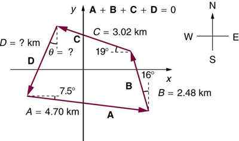

:::: abstract

* Understand the rules of vector addition and subtraction using analytical methods.
* Apply analytical methods to determine vertical and horizontal component vectors.
* Apply analytical methods to determine the magnitude and direction of a resultant vector.

::::

**Analytical methods** of vector addition and subtraction employ geometry and
simple trigonometry rather than the ruler and protractor of graphical methods.
Part of the graphical technique is retained, because vectors are still
represented by arrows for easy visualization. However, analytical methods are
more concise, accurate, and precise than graphical methods, which are limited by
the accuracy with which a drawing can be made. Analytical methods are limited
only by the accuracy and precision with which physical quantities are known.

### Resolving a Vector into Perpendicular Components

Analytical techniques and right triangles go hand-in-hand in physics because
vectors can be resolved into perpendicular components. We
very often need to separate a vector into perpendicular components. For example,
given a vector like $$ \vb{A} $$ in [Figure 1](#Figure1), we may wish to find which
two perpendicular vectors, $$ \vb{A}_{x} $$ and $$ \vb{A}_{y} $$, add to produce
it.

 , with its tail at the origin of an x, y-coordinate system, is shown together with its x- and y-components, \( A_x \) and \( A_y \) . These vectors form a right triangle. The analytical relationships among these vectors are summarized below.')
{: #Figure1 height="200"}

$$ \vb{A}_{x} $$ and $$ \vb{A}_{y} $$ are defined to be the components of $$ \vb{A} $$ along the **x**- and **y**-axes. The three vectors $$ \vb{A} $$, $$ \vb{A}_{x} $$, and $$ \vb{A}_{y} $$ form a right triangle:

 $$ \vb{A}_{x}+ \vb{A}_{y} = \vb{A}. $$

Note that this relationship between vector components and the resultant vector
holds only for vector quantities (which include both magnitude and direction).
The relationship does not apply for the magnitudes alone. For example, if $$ \vb{A}_{x}=3 \m $$ east, $$ \vb{A}_{y}=4 \m $$ north, and $$ \vb{A}=5 \m $$
north-east, then it is true that the vectors $$ \vb{A}_{x} +\vb{A}_{y} =\vb{A} $$

. However, it is
**not** true that the sum of the magnitudes of the vectors is also equal. That
is,

 $$ 3 \m + 4 \m \ne 5 \m $$

Thus,

 $$ A_x+A_y \neq A $$

If the vector $$ \vb{A} $$ is known, then its magnitude $$ A $$
(its length) and its angle $$ \theta $$
(its direction) are known. To find $$ A_{x} $$ and $$ A_{y} $$, its **x**-
and **y**-components, we use the following relationships for a right triangle.
Here $$ \theta $$ is measured counterclockwise from the positive *x*-axis. With
that convention, these scalar components include signs: a negative component
points opposite the positive direction of its axis. If a direction is given
another way, such as $$ 68^\circ $$ south of east, convert it first (here, to
$$ -68^\circ $$).

 $$ A_{x}=A\cos{\theta} $$

and

 $$ A_{y}=A\sin{\theta} . $$

![\]A dotted vector A sub x whose magnitude is equal to A cosine theta is drawn from the origin along the x axis. From the head of the vector A sub x another vector A sub y whose magnitude is equal to A sine theta is drawn in the upward direction. Their resultant vector A is drawn from the tail of the vector A sub x to the head of the vector A-y at an angle theta from the x axis. Therefore vector A is the sum of the vectors A sub x and A sub y.](../resources/Figure_03_03_02.jpg "The magnitudes of the vector components \( A_x \) and \( A_y \) can be related to the resultant vector \( A \) and the angle \( \theta \) with trigonometric identities. Here we see that \( A_x = A \cos{\theta } \) and \( A_y=A \sin{\theta} \) .")
{: #Figure2 height="225"}

Suppose, for example, that $$ \vb{A} $$ is the vector representing the total
displacement of the person walking in a city considered
in [Kinematics in Two Dimensions: An Introduction](./ch3KinematicsInTwoDimensionsAnIntroduction)
and [Vector Addition and Subtraction: Graphical Methods](./ch3VectorAdditionAndSubtractionGraphicalMethods)
.

![In the given figure a vector A of magnitude ten point three blocks is inclined at an angle twenty nine point one degrees to the positive x axis. The horizontal component A sub x of vector A is equal to A cosine theta which is equal to ten point three blocks multiplied to cosine twenty nine point one degrees which is equal to nine blocks east. Also the vertical component A sub y of vector A is equal to A sin theta is equal to ten point three blocks multiplied to sine twenty nine point one degrees, which is equal to five point zero blocks north.](../resources/Figure_03_03_03.jpg "We can use the relationships \( A_x=A \cos{ \theta} \) and \( A_y=A \sin{ \theta } \) to determine the magnitude of the horizontal and vertical component vectors in this example.")
{: #Figure3}

Then $$ A=10.3 $$ blocks and $$ \theta =29.1^\circ $$, so that

 $$ A_{x}=\mag{A} \cos{\theta} =\left(10.3 \text{blocks}\right)\left(\cos{29.1^\circ }\right)=9.0 \text{blocks} $$

 $$ A_{y} = \mag{A} \sin{\theta} =\left(10.3 \text{ blocks}\right)\left(\sin{29.1^\circ }\right)=5.0 \text{blocks}. $$

### Calculating a Resultant Vector

If the perpendicular components $$ \vb{A}_{x} $$ and $$ \vb{A}_{y} $$ of a
vector $$ \vb{A} $$ are known, then $$ \vb{A} $$ can also be found analytically.
To find the magnitude $$ A $$ and direction $$ \theta $$ of a vector from its
perpendicular components $$ \vb{A}_{x} $$ and $$ \vb{A}_{y} $$, we use the
following relationships:

 $$ A=\sqrt{ A_x^2+ A_y^2} $$

 $$ \theta ={\tan}^{-1} \left( \frac{ A_{y}}{ A_{x}} \right). $$

 and \( \vb{A}_y \) have been determined.")
{: #Figure4}

Note that the equation $$ A=\sqrt{ A_{x}^{2}+ A_{y}^{2}} $$ is just the
Pythagorean theorem relating the legs of a right triangle to the length of the
hypotenuse. For example, if $$ A_{x} $$ and $$ A_{y} $$ are 9 and 5 blocks,
respectively, then $$ A=\sqrt{ 9^{2}+5^{2}}=10.3 $$ blocks, again consistent
with the example of the person walking in a city. Finally, the direction is

$$ \theta ={\tan}^{-1}\left(5/9 \right) =29.1^\circ $$, as before.

Be careful: a calculator's inverse tangent always returns an angle between
$$ -90^\circ $$ and $$ +90^\circ $$. If $$ A_{x} $$ is negative, the vector
points into the second or third quadrant, and you must add $$ 180^\circ $$ to
the calculator's result. For example, a vector with $$ A_{x}=-1 $$ and
$$ A_{y}=+1 $$ points at $$ 135^\circ $$, not $$ -45^\circ $$. A quick sketch
of the components will always tell you which quadrant the vector is in.

:::: note {"class":"note","data-label":""}

Determining Vectors and Vector Components with Analytical Methods

Equations $$ A_{x}=A\cos{\theta} $$ and $$ A_{y}=A\sin{\theta} $$
are used to find the perpendicular components of a vector—that is, to go from
$$ A $$ and $$ \theta $$ to $$ A_{x} $$ and $$ A_{y} $$.
Equations $$ A=\sqrt{ A_{x}^{2}+ A_{y}^{2}} $$
and $$ \theta ={\tan}^{-1} \left( \frac{ A_{y}}{ A_{x}} \right) $$
are used to find a vector from its perpendicular components—that is, to go from
$$ A_{x} $$ and $$ A_{y} $$ to $$ A $$ and $$ \theta $$.
Both processes are crucial to analytical methods of vector addition and
subtraction.

::::

### Adding Vectors Using Analytical Methods

To see how to add vectors using perpendicular components,
consider [Figure 5](#Figure5), in which the vectors $$ \vb{A} $$ and $$ \vb{B} $$
are added to produce the resultant $$ \vb{R} $$.

 and \( B \) are two legs of a walk, and \( R \) is the resultant or total displacement. You can use analytical methods to determine the magnitude and direction of \( R \) .')
{: #Figure5}

If $$ \vb{A} $$ and $$ \vb{B} $$ represent two legs of a walk (two
displacements), then $$ \vb{R} $$ is the total displacement. The person taking
the walk ends up at the tip of $$ \vb{R}$$. There are many ways to arrive at the
same point. In particular, the person could have walked first in the *x*
-direction and then in the *y*-direction. Those paths are the *x*- and
*y*-components of the resultant, $$ \vb{R}_{x} $$ and $$ \vb{R}_{y} $$. If we
know $$ \vb{R}_{x} $$ and $$ \vb{R}_{y} $$, we can find $$ R $$ and $$ \theta $$
using the equations $$ A=\sqrt{ A_{x}^{2}+ A_{y}^{2}} $$ and $$ \theta ={\tan}^{-1}\left( A_{y}/ A_{x}\right) $$. When you
use the analytical method of vector addition, you can determine the components
or the magnitude and direction of a vector.

**_Step 1._** _Identify the x- and y-axes that will be used in the problem.
Then, find the components of each vector to be added along the chosen
perpendicular axes._ Use the equations $$ A_{x}=A\cos{\theta} $$ and $$ A_{y}=A\sin{\theta} $$ to find the components. In [Figure 6](#Figure6), these
components are $$ A_{x} $$, $$ A_{y} $$, $$ B_{x} $$, and $$ B_{y} $$. The
angles that vectors $$ \vb{A} $$ and $$ \vb{B} $$ make with the **x**-axis are
$$ \theta_{\text{A}} $$ and $$ \theta_{\text{B}} $$, respectively.

![Two vectors A and B are shown. The tail of the vector B is at the head of vector A and the tail of the vector A is at origin. Both the vectors are in the first quadrant. The resultant R of these two vectors extending from the tail of vector A to the head of vector B is also shown. The horizontal and vertical components of the vectors A and B are shown with the help of dotted lines. The vectors labeled as A sub x and A sub y are the components of vector A, and B sub x and B sub y as the components of vector B..](../resources/Figure_03_03_06.jpg 'To add vectors \( A \) and \( B \) , first determine the horizontal and vertical components of each vector. These are the dotted vectors \( A_x \) , \( A_y \) , \( B_x \) and \( B_y \) shown in the image.')
{: #Figure6}

**_Step 2._** _Find the components of the resultant along each axis by adding
the components of the individual vectors along that axis._ That is, as shown
in [Figure 7](#Figure7),

 $$ R_{x}= A_{x}+B_{x} $$

and

 $$ R_{y}= A_{y}+B_{y}. $$

![Two vectors A and B are shown. The tail of vector B is at the head of vector A and the tail of the vector A is at origin. Both the vectors are in the first quadrant. The resultant R of these two vectors extending from the tail of vector A to the head of vector B is also shown. The vectors A and B are resolved into the horizontal and vertical components shown as dotted lines parallel to x axis and y axis respectively. The horizontal components of vector A and vector B are labeled as A sub x and B sub x and the horizontal component of the resultant R is labeled at R sub x and is equal to A sub x plus B sub x. The vertical components of vector A and vector B are labeled as A sub y and B sub y and the vertical components of the resultant R is labeled as R sub y is equal to A sub y plus B sub y.](../resources/Figure_03_03_07.jpg 'The signed components \( A_x \) and \( B_x \) add to give \( R_x \), the horizontal component of the resultant. Similarly, \( A_y \) and \( B_y \) add to give \( R_y \), its vertical component.')
{: #Figure7}

Components along the same axis, say the **x**-axis, are vectors along the same
line and, thus, can be added to one another like ordinary numbers. The same is
true for components along the **y**-axis. (For example, a 9-block eastward walk
could be taken in two legs, the first 3 blocks east and the second 6 blocks
east, for a total of 9, because they are along the same direction.) So resolving
vectors into components along common axes makes it easier to add them. Now that
the components of $$ \vb{R} $$ are known, its magnitude and direction can be
found.

**_Step 3._** _To get the magnitude $$ R $$ of the resultant, use the
Pythagorean theorem:_

$$ R=\sqrt{ R_{x}^{2}+R_{y}^{2}}. $$

**_Step 4._** _To get the direction of the resultant:_

$$ \theta ={\tan}^{-1} \left( R_{y}/R_{x} \right). $$

The following example illustrates this technique for adding vectors using
perpendicular components.

:::: example

Adding Vectors Using Analytical Methods

Add the vector $$ \vb{A} $$ to the vector $$ \vb{B} $$
shown in [Figure 8](#Figure8), using perpendicular
components along the **x**- and **y**-axes. The **x**- and **y**-axes are along
the east–west and north–south directions, respectively. Vector $$ \vb{A}$$ represents the first leg of a walk in which a person walks $$ 53.0 \m$$
in a direction $$ 20.0^\circ $$
north of east. Vector $$ \vb{B} $$
represents the second leg, a displacement of $$ 34.0 \m  $$
in a direction $$ 63.0^\circ $$
north of east.

 has magnitude 53.0 m and direction 20.0 degrees north of the x-axis. Vector \( B \) has magnitude 34.0 m and direction 63.0 degrees north of the x-axis. You can use analytical methods to determine the magnitude and direction of \( R \) .')
{: #Figure8}

**Strategy**

The components of $$ \vb{A} $$ and $$ \vb{B} $$ along the **x**- and
**y**-axes represent walking due east and due north to get to the same ending
point. Once found, they are combined to produce the resultant.

**Solution**

Following the method outlined above, we first find the components of $$ \vb{A} $$ and $$ \vb{B} $$ along the **x**- and **y**-axes. Note that $$ A=53.0 \m $$,
$$ \theta_{\text{A}}=20.0^\circ $$, $$ B=34.0 \m $$, and $$ \theta_{\text{B}}=63.0^\circ $$. We find the **x**-components by using $$ A_{x}=A\cos{\theta} $$, which gives

$$ \begin{array}{lll}
A_{x}&=& A\cos{\theta_{A}}=\left(53.0 \m \right) \left(\cos{20.0^\circ}\right)\\
A_{x}&=& \left(53.0 \m \right)\left(0.940 \right)=49.8 \m
\end{array} $$

and

$$ \begin{array}{lll}
B_{x}&=& B\cos{\theta_{B}}=\left(34.0 \m \right) \left(\cos{63.0^\circ}\right)\\
B_{x}&=& \left(34.0 \m \right)\left(0.454\right)=15.4 \m .
\end{array} $$

Similarly, the *y*-components are found using $$ A_{y}=A\sin{\theta_{A}} $$:

$$ \begin{array}{lll}
A_{y}&=& A\sin{\theta_{A}}=\left(53.0 \m \right) \left(\sin{20.0^\circ }\right)\\
A_{y}&=& \left(53.0 \m \right)\left(0.342\right)=18.1 \m
\end{array} $$

and

$$ \begin{array}{lll}
B_{y}&=& B\sin{\theta_{B}}=\left(34.0 \m \right)\left(\sin{ 63.0^\circ}\right)\\
B_{y}&=&\left(34.0 \m \right)\left(0.891\right)=30.3 \m .
\end{array} $$

The **x**- and **y**-components of the resultant are thus

 $$ R_{x}= A_{x}+B_{x}=49.8 \m +15.4 \m =65.2 \m $$

and

 $$ R_{y}= A_{y}+B_{y}=18.1 \m  +30.3 \m =48.4  \m . $$

Now we can find the magnitude of the resultant by using the Pythagorean theorem:

 $$ R=\sqrt{ R_{x}^{2}+R_{y}^{2} }= \sqrt{ \left( 65.2 \m \right)^{2}+\left(48.4 \m \right)^{2} } $$ 

so that

 $$ R=81.2 \m $$

Finally, we find the direction of the resultant:

 $$ \theta ={\tan}^{-1}\left( \frac{ R_{y}}{R_{x}} \right)= +{\tan}^{-1}\left( \frac{48.4 \m}{65.2\m}\right) . $$

Thus,

 $$ \theta ={\tan}^{-1}\left(0.742\right)=36.6^\circ . $$

![The addition of two vectors A and B is shown. Vector A is of magnitude fifty three units and is inclined at an angle of twenty degrees to the horizontal. Vector B is of magnitude thirty four units and is inclined at angle sixty three degrees to the horizontal. The components of vector A are shown as dotted vectors A X is equal to forty nine point eight meters along x axis and A Y is equal to eighteen point one meters along Y axis. The components of vector B are also shown as dotted vectors B X is equal to fifteen point four meters and B Y is equal to thirty point three meters. The horizontal component of the resultant R X is equal to A X plus B X is equal to sixty five point two meters. The vertical component of the resultant R Y is equal to A Y plus B Y is equal to forty eight point four meters. The magnitude of the resultant of two vectors is eighty one point two meters. The direction of the resultant R is in thirty six point six degrees from the vector A in counterclockwise direction.](../resources/Figure_03_03_09.jpg 'Using analytical methods, we see that the magnitude of  \( R \)  is 81.2 m and its direction is 36.6 degrees north of east.'){: #Figure9}

**Discussion**

This example illustrates the addition of vectors using perpendicular components.
Vector subtraction using perpendicular components is very similar—it is just the
addition of a negative vector.

Subtraction of vectors is accomplished by the addition of a negative vector.
That is, $$ \vb{A}-\vb{B}\equiv \vb{A}+\left( -\vb{B} \right) $$. Thus, *the
method for the subtraction of vectors using perpendicular components is
identical to that for addition*. The components of $$ -\vb{B} $$ are the
negatives of the components of $$ \vb{B} $$. The *x*- and **y**-components of
the resultant $$ \vb{A}-\vb{B} = \vb{R} $$ are thus

 $$ R_{x}= A_{x}+\left(- B_{x}\right) $$

and

 $$ R_{y}= A_{y}+\left(- B_{y}\right) $$

and the rest of the method outlined above is identical to that for addition. (See [Figure 10](#Figure10).)

::::

Analyzing vectors using perpendicular components is very useful in many areas of
physics, because perpendicular quantities are often independent of one another.
The next module, [Projectile Motion](./ch3ProjectileMotion), is one
of many in which using perpendicular components helps make the picture clear and
simplifies the physics.

![In this figure, the subtraction of two vectors A and B is shown. A red colored vector A is inclined at an angle theta A to the positive of x axis. From the head of vector A a blue vector negative B is drawn. Vector B is in west of south direction. The resultant of the vector A and vector negative B is shown as a black vector R from the tail of vector A to the head of vector negative B. The resultant R is inclined to x axis at an angle theta below the x axis. The components of the vectors are also shown along the coordinate axes as dotted lines of their respective colors.](../resources/Figure_03_03_10.jpg 'The subtraction of the two vectors shown in <a href="#Figure8">Figure 8</a>. The components of &#x2013; \( B \) are the negatives of the components of \( B \) . The method of subtraction is the same as that for addition.')
{: #Figure10}

:::: note {"class":"note","data-label":"PhET Exploration"}

 Vector Addition

Learn how to add vectors. Drag vectors onto a graph, change their length and angle, and sum them together. The magnitude, angle, and components of each vector can be displayed in several formats.

::: figure {}

<iframe loading="lazy" src="https://phet.colorado.edu/sims/html/vector-addition/latest/vector-addition_en.html" width="600" height="450"  allowfullscreen></iframe>
<figcaption>
Vector Addition
</figcaption>

:::

::::

### Summary

- The analytical method of vector addition and subtraction involves using the
  Pythagorean theorem and trigonometric identities to determine the magnitude
  and direction of a resultant vector.
- The steps to add vectors $$ \vb{A} $$ and $$ \vb{B} $$ using the analytical
  method are as follows:
  Step 1: Determine the coordinate system for the vectors. Then, determine the
  horizontal and vertical components of each vector using the equations

  

  $$ \begin{array}{lll} A_{x}&=& A\cos{\theta_{\text{A}}} \\ B_{x}&=& B\cos{\theta_{\text{B}}} \end{array} $$
  

and

  

  $$ \begin{array}{lll}
  A_{y}&=& A\sin{\theta_{\text{A}}} \\
  B_{y}&=& B\sin{\theta_{\text{B}}} .
  \end{array} $$
  

Step 2: Add the horizontal and vertical components of each vector to determine
the components $$ R_{x} $$ and $$ R_{y} $$ of the resultant vector, $$ \vb{R} $$
:

  

  $$ R_{x}= A_{x}+B_{x} $$
  

and

  

  $$ R_{y}= A_{y}+B_{y} . $$
  

Step 3: Use the Pythagorean theorem to determine the magnitude, $$ R $$, of the
resultant vector $$ \vb{R} $$:

  

  $$ R=\sqrt{ R_{x}^{2}+R_{y}^{2}}. $$
  

Step 4: Use a trigonometric identity to determine the direction, $$ \theta $$,
of $$ \vb{R} $$:

  

  $$ \theta ={\tan}^{-1}\left( R_{y}/ R_{x}\right). $$
  

### Conceptual Questions

:::: problem

Suppose you add two vectors $$ \vb{A} $$ and $$ \vb{B} $$. What relative direction between them produces the resultant with the greatest
magnitude? What is the maximum magnitude? What relative direction between them
produces the resultant with the smallest magnitude? What is the minimum
magnitude?

::::

:::: problem

Give an example of a nonzero vector that has a component of zero.

::::

:::: problem

Explain why a vector cannot have a component greater than its own magnitude.

::::

:::: problem

If the vectors $$ \vb{A} $$ and $$ \vb{B} $$
are perpendicular, what is the component of $$ \vb{A} $$
along the direction of $$ \vb{B} $$
? What is the component of $$ \vb{B} $$
along the direction of $$ \vb{A} $$
?

::::

### Problems &amp; Exercises

:::: problem

Find the following for path C in [Figure 11](#Figure11): (a) the total distance traveled and (b) the magnitude and direction of the displacement from start to finish. In this part of the problem, explicitly show how you follow the steps of the analytical method of vector addition.

![A map of city is shown. The houses are in form of square blocks of side one hundred and twenty meter each. Four paths A B C and D are shown in different colors. The path c shown as blue extends to one block towards north, then five blocks towards east and then two blocks towards south then one block towards west and one block towards north and finally three blocks towards west. It is asked to find out the total distance traveled the magnitude and the direction of the displacement from start to finish for path C.](../resources/Figure_03_03_11.jpg "The various lines represent paths taken by different people walking in a city. All blocks are 120 m on a side.")
{: #Figure11}

::::

:::: solution

**Strategy**

For part (a), add up the lengths of all individual segments. For part (b), use the analytical method of vector addition: break the path into east-west and north-south components, sum each component separately, then find the magnitude and direction of the resultant displacement.

**Solution**

**(a) Total distance traveled:**

From Figure 11, path C consists of:
- 1 block north: 120 m
- 5 blocks east: 5 × 120 = 600 m
- 2 blocks south: 2 × 120 = 240 m
- 1 block west: 120 m
- 1 block north: 120 m
- 3 blocks west: 3 × 120 = 360 m

Total distance:

$$ d = 120 + 600 + 240 + 120 + 120 + 360 = 1560 \m = 1.56 \text{ km} $$

**(b) Displacement using analytical method:**

**Step 1: Break path into components**

East-West components (taking east as positive):
- 5 blocks east: +600 m
- 1 block west: -120 m
- 3 blocks west: -360 m
- Total: $$ E = 600 - 120 - 360 = 120 \m $$ east

North-South components (taking north as positive):
- 1 block north: +120 m
- 2 blocks south: -240 m
- 1 block north: +120 m
- Total: $$ N = 120 - 240 + 120 = 0 \m $$

**Step 2: Calculate magnitude**

$$ R = \sqrt{E^2 + N^2} = \sqrt{(120)^2 + 0^2} = 120 \m $$

**Step 3: Calculate direction**

Since the north component is zero and the east component is positive, the displacement is directly east.

**Discussion**

Despite traveling 1560 m along a winding path, the person ends up only 120 m from where they started! This demonstrates the difference between distance (total path length) and displacement (straight-line distance from start to finish). The analytical method shows clearly why: the north and south movements exactly cancel (120 + 120 - 240 = 0), while the eastward movements exceed westward movements by exactly one block (600 - 120 - 360 = 120 m). This is a beautiful example of how vectors add: you can take any complicated path, but the net displacement depends only on the vector sum of all the individual displacements.

**Answer**

(a) The total distance traveled along path C is 1.56 km.

(b) The displacement is 120 m directed due east.

::::

:::: problem

Find the following for path D in [Figure 11](#Figure11): (a) the total distance traveled and (b) the magnitude and direction of the displacement from start to finish. In this part of the problem, explicitly show how you follow the steps of the analytical method of vector addition.

::::

:::: solution

**Strategy**

Path D consists of multiple straight-line segments. For (a), sum the lengths of all segments. For (b), break each segment into components, sum components, then find resultant magnitude and direction using the analytical method.

**Solution**

From Figure 11, Path D consists of (reading the figure), with each block 120 m on a side:

- Segment 1: South (2 blocks)
- Segment 2: East (6 blocks)
- Segment 3: North (4 blocks)
- Segment 4: West (1 block)

**(a) Total distance:**

$$ d_{\text{total}} = 240 + 720 + 480 + 120 = 1560 \m $$

**(b) Displacement using analytical method:**

**Step 1: Identify components of each segment**
- Segment 1: East = 0 m, North = −240 m
- Segment 2: East = 720 m, North = 0 m
- Segment 3: East = 0 m, North = 480 m
- Segment 4: East = −120 m, North = 0 m

**Step 2: Sum the components**

$$ R_{\text{east}} = 0 + 720 + 0 + (-120) = 600 \m $$

$$ R_{\text{north}} = -240 + 0 + 480 + 0 = 240 \m $$

**Step 3: Calculate magnitude**

$$ R = \sqrt{R_{\text{east}}^2 + R_{\text{north}}^2} = \sqrt{(600)^2 + (240)^2} = \sqrt{360{,}000 + 57{,}600} = \sqrt{417{,}600} = 646 \m $$

**Step 4: Calculate direction**

$$ \theta = \tan^{-1}\left(\frac{R_{\text{north}}}{R_{\text{east}}}\right) = \tan^{-1}\left(\frac{240}{600}\right) = \tan^{-1}(0.400) = 21.8° $$

Since both components are positive, the direction is 21.8° north of east.

**Discussion**

The total distance (1560 m) is much greater than the displacement magnitude (646 m) because the path includes backtracking—going south then north, and east then partially west. The displacement represents the straight-line distance and direction from start to finish.

**Answer**

**(a)** The total distance traveled is **1560 m** (or **1.56 km**).

**(b)** The displacement is **646 m** (or **0.646 km**) at **21.8° north of east**.

::::

:::: problem

Find the north and east components of the displacement from San Francisco to Sacramento shown in [Figure 12](#Figure12).

{: #Figure12}

::::

:::: solution

**Strategy**

The displacement from San Francisco to Sacramento is 123 km at 45° north of east. We'll use trigonometry to find the north and east components: east component = R cos θ, north component = R sin θ, where θ is measured from the east direction.

**Solution**

Given:
- Magnitude of displacement: R = 123 km
- Direction: θ = 45° north of east

**East component:**

$$ R_{\text{east}} = R \cos\theta = 123 \times \cos(45^\circ) $$

$$ R_{\text{east}} = 123 \times 0.707 = 87.0 \text{ km} $$

**North component:**

$$ R_{\text{north}} = R \sin\theta = 123 \times \sin(45^\circ) $$

$$ R_{\text{north}} = 123 \times 0.707 = 87.0 \text{ km} $$

**Discussion**

At 45°, the displacement is equally divided between the north and east directions, which is why both components are equal (87.0 km each). This makes sense geometrically: a 45° angle bisects the right angle between north and east, so the components must be equal. We can verify: $$ \sqrt{(87.0)^2 + (87.0)^2} = \sqrt{7569 + 7569} = \sqrt{15,138} = 123 \text{ km} $$ ✓. This confirms our component calculations are correct. The fact that Sacramento is northeast of San Francisco at exactly 45° creates this symmetric result.

**Answer**

The north component of the displacement is 87.0 km, and the east component is 87.0 km.

::::

:::: problem

Solve the following problem using analytical techniques: Suppose you walk 18.0 m straight west and then 25.0 m straight north. How far are you from your starting point, and what is the compass direction of a line connecting your starting point to your final position?
(If you represent the two legs of the walk as vector displacements $$ \vb{A} $$ and $$ \vb{B} $$, as in [Figure 13](#Figure13), then this problem asks you to
find their sum

$$ \vb{R}=\vb{A}+\vb{B} $$.)

 and \( B \) add to give a total displacement \( R \) having magnitude \( R \) and direction \( \theta \) .')
{: #Figure13}

Note that you can also solve this graphically. Discuss why the analytical
technique for solving this problem is potentially more accurate than the
graphical technique.

::::

:::: solution

**Strategy**

Use the analytical method: identify components of each displacement vector, sum the components, then calculate the resultant magnitude and direction. Compare this to graphical methods.

**Solution**

**Vector A** (18.0 m west):

- East component: $$ A_E = -18.0 \m $$ (west is negative east)
- North component: $$ A_N = 0 \m $$

**Vector B** (25.0 m north):

- East component: $$ B_E = 0 \m $$
- North component: $$ B_N = 25.0 \m $$

**Resultant R = A + B:**

$$ R_E = A_E + B_E = -18.0 + 0 = -18.0 \m $$

$$ R_N = A_N + B_N = 0 + 25.0 = 25.0 \m $$

**Magnitude:**

$$ R = \sqrt{R_E^2 + R_N^2} = \sqrt{(-18.0)^2 + (25.0)^2} = \sqrt{324 + 625} = \sqrt{949} = 30.8 \m $$

**Direction:**

$$ \theta = \tan^{-1}\left(\frac{|R_E|}{R_N}\right) = \tan^{-1}\left(\frac{18.0}{25.0}\right) = \tan^{-1}(0.720) = 35.8° $$

Since RE is negative (west) and RN is positive (north), the compass direction is **35.8° west of north** (or equivalently, N35.8°W).

**Discussion**

**Why analytical is more accurate than graphical:**

1. **Precision**: Analytical calculations use exact trigonometric values, while graphical methods depend on drawing accuracy and measurement precision
2. **No scale errors**: Graphical methods require choosing and maintaining a consistent scale
3. **Measurement limitations**: Rulers and protractors have limited resolution (typically ±0.5 mm or ±0.5°)
4. **No rounding until final answer**: Analytical methods maintain full precision throughout calculations

The graphical method would involve drawing vectors to scale, measuring with a ruler, and using a protractor—each step introduces potential error.

**Answer**

You are **30.8 m** from your starting point, in a compass direction of **35.8° west of north**. The analytical technique is more accurate because it eliminates drawing and measurement errors inherent in graphical solutions.

::::

:::: problem

Repeat the [18.0 m west, 25.0 m north walk problem](#problemWestNorthWalk) using analytical techniques, but reverse the order of the two legs of the walk and show that you get the same final result.
(This problem shows that adding them in reverse order gives the same result—that is,
$$ \vb{B} + \vb{A} = \vb{A} + \vb{B} $$.) Discuss how taking another path to reach the same point might help to
overcome an obstacle blocking your other path.

::::

:::: solution

**Strategy**

We'll solve this problem by reversing the order: first walk 25.0 m north (**B**), then 18.0 m west (**A**). Using the analytical method, we'll find the components, sum them, and calculate the resultant. The result should match the previous problem, demonstrating that vector addition is commutative: **A** + **B** = **B** + **A**.

**Solution**

**Vector B** (25.0 m north):

- East component: $$ B_E = 0 \m $$
- North component: $$ B_N = 25.0 \m $$

**Vector A** (18.0 m west):

- East component: $$ A_E = -18.0 \m $$ (west is negative)
- North component: $$ A_N = 0 \m $$

**Resultant R = B + A:**

$$ R_E = B_E + A_E = 0 + (-18.0) = -18.0 \m $$

$$ R_N = B_N + A_N = 25.0 + 0 = 25.0 \m $$

**Magnitude:**

$$ R = \sqrt{R_E^2 + R_N^2} = \sqrt{(-18.0)^2 + (25.0)^2} = \sqrt{324 + 625} = \sqrt{949} = 30.8 \m $$

**Direction:**

$$ \theta = \tan^{-1}\left(\frac{|R_E|}{R_N}\right) = \tan^{-1}\left(\frac{18.0}{25.0}\right) = \tan^{-1}(0.720) = 35.8^\circ $$

Since the east component is negative and the north component is positive, the direction is 35.8° west of north.

**Discussion**

As expected, we get exactly the same result as the previous problem: 30.8 m at 35.8° west of north. This confirms the commutative property of vector addition: the order doesn't matter. Whether you walk west then north, or north then west, you end up at the same location.

Regarding obstacles: if one path is blocked, you can take another path to reach the same destination. For example, if you can't walk directly west (maybe there's a building), you could first go north to get around the obstacle, then west. The final displacement is identical—only the path differs. This flexibility is useful in navigation: as long as the vector sum is the same, any combination of movements in the component directions will get you to the same endpoint.

**Answer**

The displacement is 30.8 m at 35.8° west of north, confirming that **B** + **A** = **A** + **B**.

::::

:::: problem

You drive $$ 7.50 \text{km} $$ in a straight line in a direction $$ 15^\circ $$
east of north.
(a) Find the distances you would have to drive straight east and
then straight north to arrive at the same point. (This determination is
equivalent to find the components of the displacement along the east and north
directions.)
(b) Show that you still arrive at the same point if the east and
north legs are reversed in order.

::::

:::: solution

**Strategy**

Resolve the displacement into east and north components using trigonometry. The angle is 15° east of north, meaning we measure 15° from the north axis toward the east.

**Solution**

Given:

- Total displacement: $$ R = 7.50 \text{ km} $$
- Direction: $$ 15° $$ east of north

**(a) Finding components:**

**North component:**

$$ R_{\text{north}} = R\cos(15°) = 7.50 \times 0.966 = 7.24 \text{ km} $$

**East component:**

$$ R_{\text{east}} = R\sin(15°) = 7.50 \times 0.259 = 1.94 \text{ km} $$

**(b) Reversed order:**

If we first drive east, then north:

- East: 1.94 km
- North: 7.24 km

If we first drive north, then east:

- North: 7.24 km
- East: 1.94 km

The final position is the same in both cases because vector addition is commutative.

**Discussion**

The angle is measured from north toward east, so we use cosine for the north component (adjacent to the angle from north) and sine for the east component (opposite to the angle from north). The north component (7.24 km) is much larger than the east component (1.94 km) because the direction is only slightly east of due north.

**Answer**

**(a)** To arrive at the same point, you would drive **1.94 km east** and **7.24 km north**.

**(b)** Reversing the order (north then east, or east then north) results in the same final position, confirming the commutative property of vector addition.

::::

:::: problem

Do the [18.0 m west, 25.0 m north walk problem](#problemWestNorthWalk) again using analytical techniques and change the second leg of the walk to $$ 25.0 \m  $$
straight south. (This is equivalent to subtracting $$ \vb{B} $$
from $$ \vb{A} $$
—that is, finding $$ \vb{R}^\prime =\vb{A} - \vb{B} $$)

(b) Repeat again, but now you first walk $$ 25.0 \m $$ north and then $$ 18.0 \m $$ east. (This is equivalent to subtract $$ \vb{A} $$ from $$ \vb{B} $$ —that
is, to find $$ \vb{R}^{\prime\prime}=\vb{B}-\vb{A}=-\vb{R}^{\prime} $$. Confirm that $$ \vb{R}^{\prime\prime} $$ has the same magnitude as $$ \vb{R}^{\prime} $$ but the opposite direction.)

::::

:::: solution

**Strategy**

In the original problem, $$ \vb{A} $$ is 18.0 m west and $$ \vb{B} $$ is 25.0 m north. For part (a), we find $$ \vb{R}^\prime = \vb{A} - \vb{B} = \vb{A} + (-\vb{B}) $$, where $$ -\vb{B} $$ is 25.0 m south. For part (b), we reverse the order to find $$ \vb{B} - \vb{A} $$, which should give the opposite result.

**Solution**

**(a) Finding R' = A − B:**

Take east and north as positive.

**Vector A** (18.0 m west): $$ A_E = -18.0 \m $$, $$ A_N = 0 \m $$

**Vector B** (25.0 m north): $$ B_E = 0 \m $$, $$ B_N = 25.0 \m $$

**Resultant R' = A − B:**

$$ R'_E = A_E - B_E = -18.0 - 0 = -18.0 \m $$

$$ R'_N = A_N - B_N = 0 - 25.0 = -25.0 \m $$

**Magnitude:**

$$ R' = \sqrt{(-18.0)^2 + (-25.0)^2} = \sqrt{324 + 625} = \sqrt{949} = 30.8 \m $$

**Direction:** Both components are negative (west and south), so the vector points southwest. Measured from the west axis,

$$ \theta = \tan^{-1}\left(\frac{25.0}{18.0}\right) = 54.2^\circ \text{ south of west}. $$

**(b) Finding B - A (walking 25.0 m north then 18.0 m east):**

**Vector B** (25.0 m north):

- East component: $$ B_E = 0 \m $$
- North component: $$ B_N = 25.0 \m $$

**Vector A-like** (18.0 m east):

- East component: $$ 18.0 \m $$
- North component: $$ 0 \m $$

**Resultant:**

$$ R_E = 0 + 18.0 = 18.0 \m $$

$$ R_N = 25.0 + 0 = 25.0 \m $$

**Magnitude:**

$$ R = \sqrt{(18.0)^2 + (25.0)^2} = 30.8 \m $$

**Direction:**
$$ 54.2^\circ $$ north of east (or $$ 35.8^\circ $$ east of north).

**Discussion**

Part (a) gives $$ \vb{R}^{\prime}=\vb{A}-\vb{B} $$, pointing southwest. Part (b) gives $$ \vb{R}^{\prime\prime}=\vb{B}-\vb{A}=-\vb{R}^{\prime} $$, pointing northeast. The magnitudes are equal (30.8 m) and the directions are exactly opposite, as required for the negative of a vector.

**Answer**

(a) Walking 18.0 m west then 25.0 m south gives a displacement of 30.8 m at 54.2° south of west.

(b) Walking 25.0 m north then 18.0 m east gives $$ \vb{R}^{\prime\prime}=\vb{B}-\vb{A}=-\vb{R}^{\prime} $$: 30.8 m at 54.2° north of east.

::::

:::: problem

A new landowner has a triangular piece of flat land she wishes to fence. Starting at the west corner, she measures the first side to be 80.0 m long and the next to be 105 m. These sides are represented as displacement vectors $$ \vb{A} $$ from $$ \vb{B} $$
in [Figure 14](#Figure14). She then correctly calculates the length and
orientation of the third side $$ \text{C} $$. What is her result?

![In the given figure the sides of a triangular piece of land are shown in vector form. West corner is at origin. A vector starts from the origin towards south east direction and makes an angle twenty-one degrees with the horizontal. Then from the head of this vector another vector B making an angle eleven degrees with the vertical is drawn upwards. Then another vector C from the head of the vector B to the tail of the initial vector is drawn. The length and orientation of side C is indicated as unknown, represented by a question mark.](../resources/Figure_03_03_14.jpg)
{: #Figure14}

::::

:::: solution

**Strategy**

The three sides form a closed triangle: A + B + C = 0, so C = -(A + B). Find components of A and B, sum them, then find the magnitude and direction of -C.

**Solution**

**Vector A** (80.0 m at 21° south of east):

$$ A_E = 80.0\cos(21°) = 80.0(0.934) = 74.7 \m $$

$$ A_N = -80.0\sin(21°) = -80.0(0.358) = -28.6 \m $$

**Vector B** (105 m at 11° west of north):

$$ B_E = -105\sin(11°) = -105(0.191) = -20.1 \m $$

$$ B_N = 105\cos(11°) = 105(0.982) = 103 \m $$

**Sum A + B:**

$$ (A+B)_E = 74.7 + (-20.1) = 54.6 \m $$

$$ (A+B)_N = -28.6 + 103 = 74.4 \m $$

**Vector C = -(A + B):**

$$ C_E = -54.6 \m $$

$$ C_N = -74.4 \m $$

**Magnitude:**

$$ C = \sqrt{(-54.6)^2 + (-74.4)^2} = \sqrt{2981 + 5535} = \sqrt{8516} = 92.3 \m $$

**Direction:**

$$ \theta = \tan^{-1}\left(\frac{74.4}{54.6}\right) = \tan^{-1}(1.36) = 53.7° $$

Since both components are negative, the direction is 53.7° south of west (or equivalently, W53.7°S).

**Discussion**

The third side closes the triangle by connecting the end of B back to the start of A. Its direction (southwest) makes sense geometrically: A goes southeast, B goes mostly north with a slight westward component, so C must go back southwest to complete the triangle.

**Answer**

The third side **C** is **92.3 m** long at **53.7° south of west**.

::::

:::: problem

You fly $$ 32.0 \text{km} $$ in a straight line in still air in the direction $$ 35.0^\circ $$
south of west.
(a) Find the distances you would have to fly straight south and
then straight west to arrive at the same point. (This determination is
equivalent to finding the components of the displacement along the south and
west directions.)
(b) Find the distances you would have to fly first in a direction $$ 45.0^\circ $$
south of west and then in a direction $$ 45.0^\circ $$
west of north. These are the components of the displacement along a different
set of axes—one rotated $$ 45^\circ $$.

::::

:::: solution

**Strategy**

For part (a), resolve the 32.0 km displacement into south and west components. For part (b), resolve into components along axes rotated 45°.

**Solution**

Given: $$ R = 32.0 \text{ km} $$ at $$ 35.0° $$ south of west

**(a) South and west components:**

**West component:**

$$ R_W = R\cos(35.0°) = 32.0(0.819) = 26.2 \text{ km} $$

**South component:**

$$ R_S = R\sin(35.0°) = 32.0(0.574) = 18.4 \text{ km} $$

**(b) Components along rotated axes (45° south of west and 45° west of north):**

The displacement is 35° south of west. The new axes are at 45° south of west (x') and 45° west of north (y'). The displacement makes an angle of 45° − 35° = 10° with the x'-axis, rotated toward the y'-axis (that is, toward the north side of the x'-axis).

**Component along 45° south of west:**

$$ R_{x'} = R\cos(10°) = 32.0(0.985) = 31.5 \text{ km} $$

**Component along 45° west of north:**

$$ R_{y'} = R\sin(10°) = 32.0(0.174) = 5.56 \text{ km} $$

Both components are positive: the displacement lies between the 45° south of west axis and the 45° west of north axis.

**Discussion**

Part (a) gives standard components. Part (b) shows that the same vector has different component values when described in a rotated coordinate system. The first component (31.5 km) is nearly equal to the total displacement because the new x'-axis is nearly aligned with the displacement direction.

**Answer**

**(a)** You would fly **18.4 km south**, then **26.2 km west**.

**(b)** In the rotated axes: **31.5 km at 45.0° south of west**, then **5.56 km at 45.0° west of north**.

::::

:::: problem

A farmer wants to fence off their four-sided plot of flat land.
They measure the first three sides, shown as $$ \vb{A}, $$
$$ \vb{B}, $$ and $$ \vb{C} $$ in [Figure 15](#Figure15), and then correctly calculate the length and orientation of the fourth side $$ \vb{D} $$. What is their result?

{: #Figure15}

::::

:::: solution

**Strategy**

For a closed quadrilateral, A + B + C + D = 0, so D = -(A + B + C). Calculate components of A, B, and C, sum them, then find -D.

**Solution**

**Vector A** (4.70 km at 7.5° below horizontal, toward the east):

$$ A_E = 4.70\cos(7.5°) = 4.70(0.991) = 4.66 \text{ km} $$

$$ A_N = -4.70\sin(7.5°) = -4.70(0.131) = -0.616 \text{ km} $$

**Vector B** (2.48 km at 16° west of north):

$$ B_E = -2.48\sin(16°) = -2.48(0.276) = -0.684 \text{ km} $$

$$ B_N = 2.48\cos(16°) = 2.48(0.961) = 2.38 \text{ km} $$

**Vector C** (3.02 km at 19° north of west):

$$ C_E = -3.02\cos(19°) = -3.02(0.946) = -2.86 \text{ km} $$

$$ C_N = 3.02\sin(19°) = 3.02(0.326) = 0.984 \text{ km} $$

**Sum A + B + C:**

$$ (A+B+C)_E = 4.66 + (-0.684) + (-2.86) = 1.12 \text{ km} $$

$$ (A+B+C)_N = -0.616 + 2.38 + 0.984 = 2.75 \text{ km} $$

**Vector D = -(A + B + C):**

$$ D_E = -1.12 \text{ km} $$

$$ D_N = -2.75 \text{ km} $$

**Magnitude:**

$$ D = \sqrt{(-1.12)^2 + (-2.75)^2} = \sqrt{1.25 + 7.56} = \sqrt{8.81} = 2.97 \text{ km} $$

**Direction:**

$$ \theta = \tan^{-1}\left(\frac{2.75}{1.12}\right) = \tan^{-1}(2.46) = 67.9° $$

Since both components are negative, direction is 67.9° south of west.

**Discussion**

The fourth side closes the quadrilateral, connecting C back to the start. Side A points east and slightly downward, while B and C have predominantly westward components; D must point southwest to return to the origin.

**Answer**

The fourth side **D** is **2.97 km** long at **67.9° south of west**.

::::

:::: problem

In an attempt to escape his island, Gilligan builds a raft and sets to sea.
The wind shifts a great deal during the day, and he is blown along the following straight lines: $$ 2.50 \text{km} $$,
$$ 45.0^\circ $$ north of west; then $$ 4.70 \text{km} $$, $$ 60.0^\circ $$ south
of east; then $$ 1.30\text{km} $$, $$ 25.0^\circ $$ south of west; then $$ 5.10 \text{km} $$ straight east; then $$ 1.70\text{km} $$, $$ 5.00^\circ $$ east of
north; then $$ 7.20 \text{km} $$, $$ 55.0^\circ $$ south of west; and finally $$ 2.80 \text{km} $$, $$ 10.0^\circ $$ north of east. What is his final position
relative to the island?

::::

:::: solution

**Strategy**

Add all seven displacement vectors using components. Sum east-west and north-south components separately, then find the resultant magnitude and direction.

**Solution**

**Breaking down each displacement:**

Keep four digits in each component so that rounding errors do not accumulate over seven terms (all in km):

1. 2.50 km, 45° N of W: $$ E_1 = -2.50\cos(45°) = -1.768 $$, $$ N_1 = 2.50\sin(45°) = 1.768 $$
2. 4.70 km, 60° S of E: $$ E_2 = 4.70\cos(60°) = 2.350 $$, $$ N_2 = -4.70\sin(60°) = -4.070 $$
3. 1.30 km, 25° S of W: $$ E_3 = -1.30\cos(25°) = -1.178 $$, $$ N_3 = -1.30\sin(25°) = -0.5494 $$
4. 5.10 km, E: $$ E_4 = 5.100 $$, $$ N_4 = 0 $$
5. 1.70 km, 5° E of N: $$ E_5 = 1.70\sin(5°) = 0.1482 $$, $$ N_5 = 1.70\cos(5°) = 1.694 $$
6. 7.20 km, 55° S of W: $$ E_6 = -7.20\cos(55°) = -4.130 $$, $$ N_6 = -7.20\sin(55°) = -5.898 $$
7. 2.80 km, 10° N of E: $$ E_7 = 2.80\cos(10°) = 2.757 $$, $$ N_7 = 2.80\sin(10°) = 0.4862 $$

**Sum of components:**

$$ R_E = -1.768 + 2.350 - 1.178 + 5.100 + 0.1482 - 4.130 + 2.757 = 3.280 \text{ km} $$

$$ R_N = 1.768 - 4.070 - 0.5494 + 0 + 1.694 - 5.898 + 0.4862 = -6.570 \text{ km} $$

**Magnitude:**

$$ R = \sqrt{(3.280)^2 + (-6.570)^2} = \sqrt{10.76 + 43.16} = \sqrt{53.92} = 7.343 \text{ km} \approx 7.34 \text{ km} $$

**Direction:**

$$ \theta = \tan^{-1}\left(\frac{6.570}{3.280}\right) = \tan^{-1}(2.003) = 63.47° \approx 63.5° $$

Since east is positive and north is negative, the direction is 63.5° south of east.

**Discussion**

After seven displacements totaling 25.3 km of travel, Gilligan ends up only 7.34 km from his starting point—less than 30% of the distance traveled. The shifting winds caused him to zigzag considerably. His final position is southeast of the island, despite significant westward movements.

**Answer**

Gilligan's final position is **7.34 km** at **63.5° south of east** from the island.

::::

:::: problem

Suppose a pilot flies $$ 40.0 \text{km} $$ in a direction $$ 60^\circ $$
north of east and then flies $$ 30.0 \text{km} $$
in a direction $$ 15^\circ $$
north of east as shown in [Figure 16](#Figure16). Find her total
distance $$ R $$
from the starting point and the direction $$ \theta $$
of the straight-line path to the final position. Discuss qualitatively how this
flight would be altered by a wind from the north and how the effect of the wind
would depend on both wind speed and the speed of the plane relative to the air
mass.

{: #Figure16}

::::

:::: solution

**Strategy**

Find components of both flight segments, sum them, then calculate the resultant magnitude and direction. Discuss how wind affects the flight path.

**Solution**

**Vector A** (40.0 km at 60° north of east):

$$ A_E = 40.0\cos(60°) = 40.0(0.500) = 20.0 \text{ km} $$

$$ A_N = 40.0\sin(60°) = 40.0(0.866) = 34.6 \text{ km} $$

**Vector B** (30.0 km at 15° north of east):

$$ B_E = 30.0\cos(15°) = 30.0(0.966) = 29.0 \text{ km} $$

$$ B_N = 30.0\sin(15°) = 30.0(0.259) = 7.77 \text{ km} $$

**Resultant R = A + B:**

$$ R_E = 20.0 + 29.0 = 49.0 \text{ km} $$

$$ R_N = 34.6 + 7.77 = 42.4 \text{ km} $$

**Magnitude:**

$$ R = \sqrt{(49.0)^2 + (42.4)^2} = \sqrt{2401 + 1798} = \sqrt{4199} = 64.8 \text{ km} $$

**Direction:**

$$ \theta = \tan^{-1}\left(\frac{42.4}{49.0}\right) = \tan^{-1}(0.865) = 40.9° $$

The direction is 40.9° north of east.

**Wind effect discussion:**

A wind from the north would blow southward, affecting the flight as follows:

1. **Drift**: The plane would be pushed south, reducing the northward component of ground velocity
2. **Speed dependence**:
   - Stronger wind = greater southward drift
   - Faster plane = less time exposed to wind = less drift
3. **Path alteration**: To reach the intended destination, the pilot would need to aim more northward to compensate for southward drift
4. **Ground speed**: The southward wind component would reduce the northward ground speed but not affect the eastward component

The ratio of plane speed to wind speed determines the severity. If the plane flies at 200 km/h and the wind is 20 km/h, the drift is relatively small. But if the wind is 100 km/h, the drift becomes significant.

**Discussion**

The total displacement (64.8 km) is less than the sum of individual displacements (70.0 km) because the pilot doesn't fly in a straight line. The final direction (40.9°) lies between the two segment directions (60° and 15°), weighted toward the longer first segment.

**Answer**

The pilot's total distance from the starting point is **64.8 km** at **40.9° north of east**. A wind from the north would push the plane southward, requiring the pilot to aim more northward to compensate, with the effect depending on the ratio of wind speed to airspeed.

::::

:::: glossary

### Glossary
{: class="glossary-title"}

analytical method
: the method of determining the magnitude and direction of a resultant vector
using the Pythagorean theorem and trigonometric identities

::::
