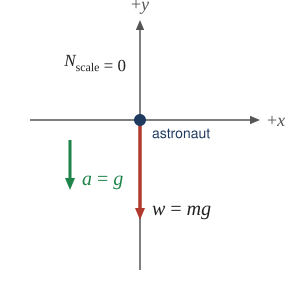
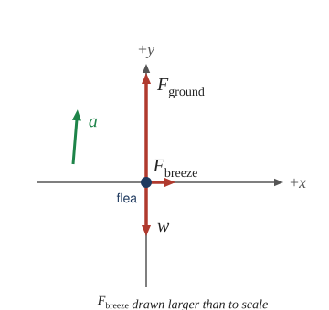
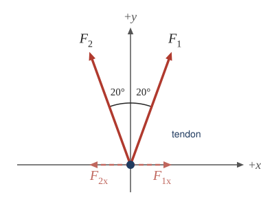
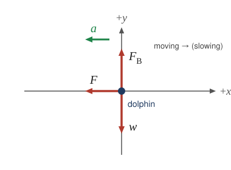
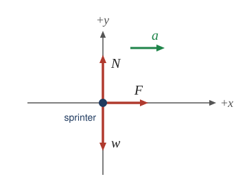
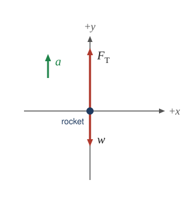
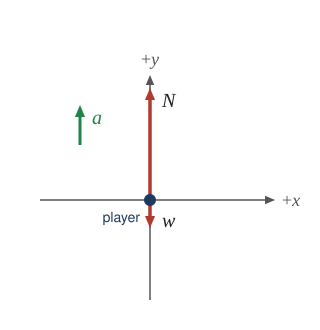
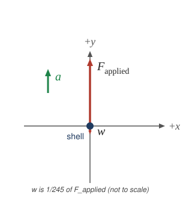
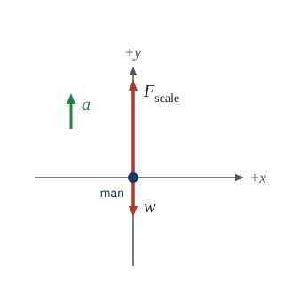

::: abstract

* Apply problem-solving techniques to solve for quantities in more complex systems of forces.
* Integrate concepts from kinematics to solve problems using Newton\'s laws of motion.

:::

There are many interesting applications of Newton’s laws of motion, a few more
of which are presented in this section. These serve also to illustrate some
further subtleties of physics and to help build problem-solving skills.

::: example

Drag Force on a Barge

Suppose two tugboats push on a barge at different angles, as shown in [Figure 1](#Figure1).
The first tugboat exerts a force of $$ 2.7\times 10^{5}\N $$
in the *x*-direction, and the second tugboat exerts a force of $$ 3.6\times 10^{5}\N $$ in the *y*-direction.

![(a) A view from above two tugboats pushing on a barge. One tugboat is pushing with the force F sub x equal to two point seven multiplied by ten to the power five newtons, shown by a vector arrow acting toward the right in the x direction. Another tugboat is pushing with a force F sub y equal to three point six multiplied by ten to the power five newtons acting upward in the positive y direction. Acceleration of the barge, a, is shown by a vector arrow directed fifty-three point one degree angle above the x axis. In the free-body diagram, F sub y is acting on a point upward, F sub x is acting toward the right, and F sub D is acting approximately southwest. (b) A right triangle is made by the vectors F sub x and F sub y. The base vector is shown by the force vector F sub x. and the perpendicular vector is shown by the force vector F sub y. The resultant is the hypotenuse of this triangle, making a fifty-three point one degree angle from the base, shown by the vector force F sub net pointing up the inclination. A vector F sub D points down the incline. ](../resources/Figure_04_07_01.jpg '(a) A view from above of two tugboats pushing on a barge. (b) The free-body diagram for the ship contains only forces acting in the plane of the water. It omits the two vertical forces—the weight of the barge and the buoyant force of the water supporting it cancel and are not shown. Since the applied forces are perpendicular, the x- and y-axes are in the same direction as \( \vb{F}_x \) and \( \vb{F}_y \) . The problem quickly becomes a one-dimensional problem along the direction of \( \vb{F}_{\text{app}} \), since friction is in the direction opposite to \( \vb{F}_{\text{app}} \). ')
{: #Figure1}

If the mass of the barge is $$ 5.0\times 10^{6}\kg $$ and its acceleration is
observed to be $$ 7.5 \times 10^{-2}\mss $$ in the direction shown, what is the
drag force of the water on the barge resisting the motion? (Note:
drag force is a frictional force exerted by fluids, such as air or water. The
drag force opposes the motion of the object.)

**Strategy**

The directions and magnitudes of acceleration and the applied forces are given
in [Figure 1](#Figure1)**(a)**. We will define the total force of the tugboats on
the barge as $$ \vb{F}_{\text{app}} $$ so that:

 $$ \vb{F}_{\text{app}}=\vb{F}_{x}+\vb{F}_{y} $$

Since the barge is flat bottomed, the drag of the water $$ \vb{F}_{\text{D}} $$
will be in the direction opposite to $$ \vb{F}_{\text{app}} $$, as
shown in the free-body diagram in [Figure 1](#Figure1)(b). The
system of interest here is the barge, since the forces on *it* are given
as well as its acceleration. Our strategy is to find the magnitude and direction
of the net applied force $$ \vb{F}_{\text{app}} $$, and then apply
Newton’s second law to solve for the drag force $$ \vb{F}_{\text{D}} $$.

**Solution**

Since $$ \vb{F}_{x} $$ and $$ \vb{F}_{y} $$ are perpendicular, the magnitude and
direction of $$ \vb{F}_{\text{app}} $$ are easily found. First, the resultant
magnitude is given by the Pythagorean theorem:

$$ \begin{array}{lll}
F_{\text{app}}&=& \sqrt{ F_{x}^{2}+F_{y}^{2}} \\
F_{\text{app}}&=& \sqrt{\left(2.7\times 10^{5}\N \right)^{2}+\left(3.6\times 10^{5}\N \right)^{2}}
F_{\text{app}}&=& 4.5\times 10^{5}\N .
\end{array} $$

The angle is given by

$$ \begin{array}{lll}
\theta &=& {\tan}^{-1}\left(\frac{ F_{y}}{ F_{x}}\right)\\
\theta &=& {\tan}^{-1}\left(\frac{3.6\times 10^{5}\N }{2.7\times 10^{5}\N }\right)=53^\circ,
\end{array} $$

which we know, because of Newton’s first law, is the same direction
as the acceleration. $$ \vb{F}_{\text{D}} $$
is in the opposite direction of $$ \vb{F}_{\text{app}} $$, since it
acts to slow down the acceleration. Therefore, the net external force is in the
same direction as $$ \vb{F}_{\text{app}} $$, but its magnitude is
slightly less than $$ \vb{F}_{\text{app}} $$. The problem is now
one-dimensional. From [Figure 1](#Figure1)**(b)**, we can see that

$$ F_{\text{net}}=F_{\text{app}}-F_{\text{D}}. $$

But Newton’s second law states that

$$ F_{\text{net}}=ma . $$

Thus,

$$ F_{\text{app}}-F_{\text{D}}=ma . $$

This can be solved for the magnitude of the drag force of the water $$ F_{\text{D}} $$
in terms of known quantities:

$$ F_{\text{D}}=F_{\text{app}}-ma . $$

Substituting known values gives

 $$ F_{\text{D}}=\left(4.5 \times 10^{5}\N \right)-\left(5.0 \times 10^{6}\kg \right)\left(7.5 \times 10^{-2}\mss \right)=7.5 \times 10^{4}\N . $$

The direction of $$ \vb{F}_{\text{D}} $$
has already been determined to be in the direction opposite to $$ \vb{F}_{\text{app}} $$, or at an angle of $$ 53^\circ $$ south of west.

**Discussion**

The numbers used in this example are reasonable for a moderately large barge. It
is certainly difficult to obtain larger accelerations with tugboats, and small
speeds are desirable to avoid running the barge into the docks. Drag is
relatively small for a well-designed hull at low speeds, consistent with the
answer to this example, where $$ F_{\text{D}} $$ is less than 1/600th of the
weight of the ship.

:::

In the earlier example of a tightrope walker we noted that the tensions in wires
supporting a mass were equal only because the angles on either side were equal.
Consider the following example, where the angles are not equal; slightly more
trigonometry is involved.

::: example

Different Tensions at Different Angles

Consider the traffic light (mass 15.0 kg) suspended from two wires as shown in [Figure 2](#Figure2). Find the tension in each wire, neglecting the masses of the wires.

![A sketch of a traffic light suspended from two wires supported by two poles is shown. (b) Some forces are shown in this system. Tension T sub one pulling the top of the left-hand pole is shown by the vector arrow along the left wire from the top of the pole, and an equal but opposite tension T sub one is shown by the arrow pointing up along the left-hand wire where it is attached to the light; the wire makes a thirty-degree angle with the horizontal. Tension T sub two is shown by a vector arrow pointing downward from the top of the right-hand pole along the right-hand wire, and an equal but opposite tension T sub two is shown by the arrow pointing up along the right-hand wire, which makes a forty-five degree angle with the horizontal. The traffic light is suspended at the lower end of the wires, and its weight W is shown by a vector arrow acting downward. (c) The traffic light is the system of interest. Tension T sub one starting from the traffic light is shown by an arrow along the wire making an angle of thirty degrees with the horizontal. Tension T sub two starting from the traffic light is shown by an arrow along the wire making an angle of forty-five degrees with the horizontal. The weight W is shown by a vector arrow pointing downward from the traffic light. A free-body diagram is shown with three forces acting on a point. Weight W acts downward; T sub one and T sub two act at an angle with the vertical. (d) Forces are shown with their components T sub one y and T sub two y pointing vertically upward. T sub one x points along the negative x direction, T sub two x points along the positive x direction, and weight W points vertically downward. (e) Vertical forces and horizontal forces are shown separately. Vertical forces T sub one y and T sub two y are shown by vector arrows acting along a vertical line pointing upward, and weight W is shown by a vector arrow acting downward. The net vertical force is zero, so T sub one y plus T sub two y is equal to W. On the other hand, T sub two x is shown by an arrow pointing toward the right, and T sub one x is shown by an arrow pointing toward the left. The net horizontal force is zero, so T sub one x is equal to T sub two x.](../resources/Figure_04_07_02.jpg 'A traffic light is suspended from two wires. (b) Some of the forces involved. (c) Only forces acting on the system are shown here. The free-body diagram for the traffic light is also shown. (d) The forces projected onto vertical (y) and horizontal (x) axes. The horizontal components of the tensions must cancel, and the sum of the vertical components of the tensions must equal the weight of the traffic light. (e) The free-body diagram shows the vertical and horizontal forces acting on the traffic light.')
{: #Figure2}

**Strategy**

The system of interest is the traffic light, and its free-body diagram is shown
in [Figure 2](#Figure2)(c). The three forces involved are not parallel, and so they
must be projected onto a coordinate system. The most convenient coordinate
system has one axis vertical and one horizontal, and the vector projections on
it are shown in part (d) of the figure. There are two unknowns in this problem (
$$ T_{1} $$ and $$ T_{2} $$), so two equations are needed to find them. These
two equations come from applying Newton’s second law along the vertical and
horizontal axes, noting that the net external force is zero along each axis
because acceleration is zero.

**Solution**

First consider the horizontal or _x_-axis:

$$ F_{\text{net}x}=T_{2x}-T_{1x}=0. $$

Thus, as you might expect,

 $$ T_{1x}=T_{2x}. $$

This gives us the following relationship between $$ T_{1} $$ and $$ T_{2} $$:

 $$ T_{1}\cos\left(30^\circ\right)=T_{2}\cos\left(45^\circ\right). $$

Thus,

 $$ T_{2}=\left(1.225\right) T_{1}. $$

Note that $$ T_{1} $$ and $$ T_{2} $$ are not equal in this case, because the angles on either side
are not equal. It is reasonable that $$ T_{2} $$ ends up being greater than $$ T_{1} $$, because it is exerted more vertically than $$ T_{1} $$.

Now consider the force components along the vertical or _y_-axis:

$$ F_{\text{net}y}=T_{1y}+T_{2y}-w=0. $$

This implies

 $$ T_{1y}+T_{2y}=w. $$

Substituting the expressions for the vertical components gives

 $$ T_{1}\sin\{\left(30^{\circ} \right)\}+T_{2}\sin\left(45^\circ\right)=w. $$

There are two unknowns in this equation, but substituting the expression for $$ T_{2} $$
in terms of $$ T_{1} $$ reduces this to one equation with one unknown:

 $$ T_{1}\left(0.500\right)+\left(1.225 T_{1}\right)\left(0.707\right)=w=mg , $$

which yields

 $$ \left(1.366\right) T_{1}=\left(15.0 \kg \right)\left(9.80 \mss \right). $$

Solving this last equation gives the magnitude of $$ T_{1} $$ to be

 $$ T_{1}=108 \N . $$

Finally, the magnitude of $$ T_{2} $$ is determined using
the relationship between them, $$ T_{2} $$ = 1.225 $$ T_{1} $$,
found above. Thus we obtain

 $$ T_{2}=132 \N . $$

**Discussion**

Both tensions would be larger if both wires were more horizontal, and they will
be equal if and only if the angles on either side are the same (as they were in
the earlier example of a tightrope walker).

:::

The bathroom scale is an excellent example of a normal force acting on a body.
It provides a quantitative reading of how much it must push upward to support
the weight of an object. But can you predict what you would see on the dial of a
bathroom scale if you stood on it during an elevator ride? Will you see a value
greater than your weight when the elevator starts up? What about when the
elevator moves upward at a constant speed: will the scale still read more than
your weight at rest? Consider the following example.

::: example

What Does the Bathroom Scale Read in an Elevator?

[Figure 3](#Figure3) shows a 75.0-kg man (weight of about 165 lb) standing on a bathroom scale in an elevator. Calculate the scale reading:
(a) if the elevator accelerates upward at a rate of $$ 1.20 \mss $$, and
(b) if the elevator moves upward at a constant speed of 1 m/s.

![A person is standing on a bathroom scale in an elevator. His weight w is shown by an arrow pointing downward. F sub s is the force of the scale on the person, shown by a vector starting from his feet pointing vertically upward. W sub s is the weight of the scale pointing vertically downward. W sub e is the weight of the elevator, shown by the broken arrow pointing vertically downward. F sub p is the force of the person on the scale, acting vertically downward. F sub t is the force of the scale on the floor of the elevator, pointing vertically downward, and N is the normal force of the floor on the scale, pointing upward. (b) The same person is shown on the scale in the elevator, but only a few forces are shown acting on the person, which is our system of interest. W is shown by an arrow acting downward, and F sub s is the force of the scale on the person, shown by a vector starting from his feet pointing vertically upward. The free-body diagram is also shown, with two forces acting on a point. F sub s acts vertically upward, and w acts vertically downward.](../resources/Figure_04_07_03.jpg '(a) The various forces acting when a person stands on a bathroom scale in an elevator. The arrows are approximately correct for when the elevator is accelerating upward—broken arrows represent forces too large to be drawn to scale. \( \vb{T} \) is the tension in the supporting cable, \( \vb{w} \) is the weight of the person, \( \vb{w}_s \) is the weight of the scale, \( \vb{w}_e \) is the weight of the elevator, \( \vb{F}_s \) is the force of the scale on the person, \( \vb{F}_p \) is the force of the person on the scale, \( \vb{F}_t \) is the force of the scale on the floor of the elevator, and \( \vb{N} \) is the force of the floor upward on the scale.
(b) The free-body diagram shows only the external forces acting on the designated system of interest—the person.')
{: #Figure3}

**Strategy**

If the scale is accurate, its reading will equal $$ F_{\text{p}} $$, the
magnitude of the force the person exerts downward on it. [Figure 3](#Figure3)(a)
shows the numerous forces acting on the elevator, scale, and person. It makes
this one-dimensional problem look much more formidable than if the person is
chosen to be the system of interest and a free-body diagram is drawn as
in [Figure 3](#Figure3)(b). Analysis of the free-body diagram using Newton’s laws
can produce answers to both parts
(a) and (b) of this example, as well as some other questions that might arise.
The only forces acting on the person are his weight $$ \vb{w} $$ and the upward
force of the scale $$ \vb{F}_{\s} $$. According to Newton’s third law $$ \vb{F}_{\text{p}} $$ and $$ \vb{F}_{\s} $$ are equal in magnitude and opposite in
direction, so that we need to find $$ F_{\s} $$ in order to find what the scale
reads. We can do this, as usual, by applying Newton’s second law,

$$ F_{\text{net}}=ma . $$

From the free-body diagram we see that $$ F_{\text{net}}=F_{\s}-w $$,
so that

$$ F_{\s}-w=ma . $$

Solving for $$ F_{\s} $$ gives an equation with only one unknown:

$$ F_{\s}=ma +w, $$

or, because $$ w=mg $$, simply

$$ F_{\s}=ma +mg . $$

No assumptions were made about the acceleration, and so this solution should be valid for a variety of accelerations in addition to the ones in this exercise.

**Solution for (a)**

In this part of the problem, $$ a=1.20\mss $$, so that

$$ F_{\s}=\left(75.0 \kg \right)\left(1.20 \mss \right)+\left(75.0 \kg \right)\left(9.80 \mss \right), $$

yielding

$$ F_{\s}=825 \N . $$

**Discussion for (a)**

This is about 185 lb. What would the scale have read if he were stationary?
Since his acceleration would be zero, the force of the scale would be equal to
his weight:

$$ \begin{array}{lll}
F_{\text{net}}&=& ma =0=F_{\s}-w\\
F_{\s}&=& w=mg \\
F_{\s}&=& \left(75.0 \kg \right)\left(9.80 \mss \right)\\
F_{\s}&=& 735 \N .
\end{array} $$

So, the scale reading in the elevator is greater than his 735-N (165 lb) weight. This means that the scale is pushing up on the person with a force greater than his weight, as it must in order to accelerate him upward. Clearly, the greater the acceleration of the elevator, the greater the scale reading, consistent with what you feel in rapidly accelerating versus slowly accelerating elevators.

**Solution for (b)**

Now, what happens when the elevator reaches a constant upward velocity? Will the
scale still read more than his weight? For any constant velocity—up, down, or
stationary—acceleration is zero because $$ a=\frac{ \Delta v}{\Delta t} $$, and
$$ \Delta v=0 $$.

Thus,

$$ F_{\s}=ma +mg =0+mg . $$

Now

$$ F_{\s}=\left(75.0 \kg \right)\left(9.80 \mss \right), $$

which gives

$$ F_{\s}=735 \N . $$

**Discussion for (b)**

The scale reading is 735 N, which equals the person’s weight. This will be the
case whenever the elevator has a constant velocity—moving up, moving down, or
stationary.

:::

The solution to the previous example also applies to an elevator accelerating
downward, as mentioned. When an elevator accelerates downward, $$ a $$ is
negative, and the scale reading is _less_ than the weight of the person, until a
constant downward velocity is reached, at which time the scale reading again
becomes equal to the person’s weight. If the elevator is in free-fall and
accelerating downward at $$ g $$, then the scale reading will be zero and the
person will _appear_ to be weightless.

### Integrating Concepts: Newton’s Laws of Motion and Kinematics

Physics is most interesting and most powerful when applied to general situations
that involve more than a narrow set of physical principles. Newton’s laws of
motion can also be integrated with other concepts that have been discussed
previously in this text to solve problems of motion. For example, forces produce
accelerations, a topic of kinematics, and hence the relevance of earlier
chapters. When approaching problems that involve various types of forces,
acceleration, velocity, and/or position, use the following steps to approach the
problem:

**Problem-Solving Strategy**

Step 1. _Identify which physical principles are involved_. Listing the givens
and the quantities to be calculated will allow you to identify the principles
involved.

Step 2. _Solve the problem using strategies outlined in the text_. If these are
available for the specific topic, you should refer to them. You should also
refer to the sections of the text that deal with a particular topic. The
following worked example illustrates how these strategies are applied to an
integrated concept problem.

::: example

What Force Must a Soccer Player Exert to Reach Top Speed?

A soccer player starts from rest and accelerates forward, reaching a velocity of 8.00 m/s in 2.50 s.
(a) What was his average acceleration?
(b) What average force did he exert backward on the ground to achieve this acceleration?
The player’s mass is 70.0 kg, and air resistance is negligible.

**Strategy**

1. To solve an _integrated concept problem_, we must first identify the physical
   principles involved and identify the chapters in which they are found. Part (
   a) of this example considers _
   acceleration_ along a straight line. This is a topic of _kinematics_. Part (
   b) deals with _force_, a topic of _dynamics_ found in this chapter.
2. The following solutions to each part of the example illustrate how the
   specific problem-solving strategies are applied. These involve identifying
   knowns and unknowns, checking to see if the answer is reasonable, and so
   forth.

**Solution for (a)**

We are given the initial and final velocities (zero and 8.00 m/s forward); thus,
the change in velocity is $$ \Delta v=8.00 m/s $$. We are given the elapsed
time, and so $$ \Delta t=2.50 \s $$. The unknown is acceleration, which can be
found from its definition:

 $$ a=\frac{ \Delta v}{\Delta t}. $$

Substituting the known values yields

$$ \begin{array}{lll}
a&=& \frac{8.00 \ms }{2.50 \s} \\
a&=& 3.20 \mss .
\end{array} $$

**Discussion for (a)**

This is an attainable acceleration for an athlete in good condition.

**Solution for (b)**

Here we are asked to find the average force the player exerts backward to
achieve this forward acceleration. Neglecting air resistance, this would be
equal in magnitude to the net external force on the player, since this force
causes his acceleration. Since we now know the player’s acceleration and are
given his mass, we can use Newton’s second law to find the force exerted. That
is,

$$ F_{\text{net}}=ma . $$

Substituting the known values of $$ m $$ and $$ a $$ gives

$$ \begin{array}{lll}
F_{\text{net}}&=& \left(70.0 \kg \right)\left(3.20 \mss \right)\\
F_{\text{net}}&=& 224 \N .
\end{array} $$

**Discussion for (b)**

This is about 50 pounds, a reasonable average force. This worked example
illustrates how to apply problem-solving strategies to situations that include
topics from different chapters. The first step is to identify the physical
principles involved in the problem. The second step is to solve for the unknown
using familiar problem-solving strategies. These strategies are found throughout
the text, and many worked examples show how to use them for single topics. You
will find these techniques for integrated concept problems useful in
applications of physics outside of a physics course, such as in your profession,
in other science disciplines, and in everyday life. The following problems will
build your skills in the broad application of physical principles.

:::

### Summary

- Newton’s laws of motion can be applied in numerous situations to solve
  problems of motion.
- Some problems will contain multiple force vectors acting in different
  directions on an object. Be sure to draw diagrams, resolve all force vectors
  into horizontal and vertical components, and draw a free-body diagram. Always
  analyze the direction in which an object accelerates so that you can determine
  whether $$ \vb{F}_{\text{net}}=m \vb{a} $$ or $$ \vb{F}_{\text{net}}=0 $$.
- The normal force on an object is not always equal in magnitude to the weight
  of the object. If an object is accelerating perpendicular to the surface (for
  example, in an elevator), the normal force will be less than or greater than
  the weight of the object. Also, if the object is resting on an inclined plane
  with no other forces pushing it into or away from the surface, the normal
  force, $$ mg\cos\theta $$, is less than the full weight of the object.
- Some problems will contain various physical quantities, such as forces,
  acceleration, velocity, or position. You can apply concepts from kinematics
  and dynamics in order to solve these problems of motion.

### Conceptual Questions

::: problem

To simulate the apparent weightlessness of space orbit, astronauts are trained in the hold of a
cargo aircraft that is accelerating downward at $$ g $$. Why will they appear to be weightless,
as measured by standing on a bathroom
scale, in this accelerated frame of reference? Is there any difference between
their apparent weightlessness in orbit and in the aircraft?

:::

::: solution

**Strategy**

Use the scale’s normal force as apparent weight and compare it with the acceleration shared by the aircraft or spacecraft.

**Solution**

Choose $$+y$$ upward. For an astronaut of mass $$m$$ standing on a scale, $$N-mg=ma_y$$. During ideal downward free fall, $$a_y=-g$$, hence

$$N=m(g-g)=0\N.$$

For example, a $$70\kg$$ astronaut still has gravitational force $$(70\kg)(9.80\mss)=686\N$$ downward in the aircraft, but the scale does not need to support the astronaut because both fall together.

{: .fbd}

In orbit the same principle applies: the astronaut and spacecraft share gravitational acceleration, whose local magnitude need not be $$9.80\mss$$. Locally both situations give zero apparent weight under ideal conditions. The aircraft’s free-fall interval is brief, and residual forces or gravity gradients can distinguish the real environments; neither case removes gravity.

The astronauts appear weightless because the scale’s support force is zero while they and their surroundings fall together, the same local reason astronauts float in orbit.

:::

::: problem

A cartoon shows the toupee coming off the head of an elevator passenger when the elevator rapidly
stops during an upward ride. Can this really happen without the person being tied to the floor of
the elevator? Explain your answer.

:::

::: solution

**Strategy**

Check whether the elevator floor can supply the downward force needed to stop the passenger faster than free fall.

**Solution**

Take $$+y$$ upward. For a passenger following the floor with vertical acceleration $$a_y$$, $$N-mg=ma_y$$, so $$N=m(g+a_y)$$. The floor can push upward but cannot pull downward, requiring $$N\ge0$$ and therefore $$a_y\ge-g$$.

The toupee stays against the head under the same condition. For example, deceleration $$a_y=-5.0\mss$$ leaves a positive support force per unit mass $$g+a_y=4.8\mss$$, so the head still pushes upward on the toupee.

If the elevator stops with $$a_y<-g$$, the unattached passenger loses contact with the floor. Passenger and toupee then accelerate downward together at $$-g$$, so the stop itself does not make the toupee separate from the head. A passenger held down by restraints could instead be forced to decelerate faster than the free toupee. Airflow or a separate impulse could also change the situation, but neither is part of the stated cartoon.

An upward elevator’s stop alone cannot launch the toupee off an unrestrained passenger: if the floor drops away faster than free fall, the passenger and toupee both fall together.

:::

### Problem Exercises

::: problem

A flea jumps by exerting a force of $$ 1.20 \times 10^{-5}\N $$
straight down on the ground. A breeze blowing on the flea parallel to the ground
exerts a force of $$ 0.500 \times 10^{-6}\N $$ on the flea. Find the
direction and magnitude of the acceleration of the flea if its mass is $$ 6.00 \times 10^{-7}\kg $$. Do not neglect the gravitational force.

:::

::: solution

**Strategy**

Apply Newton's second law in two dimensions. The forces are: ground reaction force (upward), weight (downward), and breeze force (horizontal). Find net force components, then calculate acceleration magnitude and direction.

**Solution**

Given:

- Mass: $$ m = 6.00 \times 10^{-7} \kg $$
- Force from ground (upward): $$ F_{\text{ground}} = 1.20 \times 10^{-5} \N $$
- Breeze force (horizontal): $$ F_{\text{breeze}} = 0.500 \times 10^{-6} \N $$
- Weight: $$ w = mg = (6.00 \times 10^{-7} \kg)(9.80 \mss) = 5.88 \times 10^{-6} \N $$

**Free-body diagram**

{: .fbd}

Take $$ +x $$ in the direction of the breeze and $$ +y $$ upward. $$ F_{\text{ground}} $$ (the ground's reaction to the flea's push) is along $$ +y $$, $$ w $$ along $$ -y $$, and $$ F_{\text{breeze}} $$ along $$ +x $$.

**Vertical forces:**

$$ F_{y} = \sum F_y = F_{\text{ground}} - w = 1.20 \times 10^{-5} \N - 5.88 \times 10^{-6} \N = 6.12 \times 10^{-6} \N $$

**Horizontal forces:**

$$ F_{x} = \sum F_x = F_{\text{breeze}} = 0.500 \times 10^{-6} \N $$

**Acceleration components:**

$$ a_y = \frac{F_y}{m} = \frac{6.12 \times 10^{-6} \N}{6.00 \times 10^{-7} \kg} = 10.2 \mss $$

$$ a_x = \frac{F_x}{m} = \frac{0.500 \times 10^{-6} \N}{6.00 \times 10^{-7} \kg} = 0.833 \mss $$

**Magnitude and direction:**

$$ a = \sqrt{a_x^2 + a_y^2} = \sqrt{(0.833 \mss)^2 + (10.2 \mss)^2} = \sqrt{0.694 \text{m}^2/\text{s}^4 + 104 \text{m}^2/\text{s}^4} = \sqrt{104.7 \text{m}^2/\text{s}^4} = 10.2 \mss $$

$$ \theta = \tan^{-1}\left(\frac{a_x}{a_y}\right) = \tan^{-1}\left(\frac{0.833 \mss}{10.2 \mss}\right) = \tan^{-1}(0.0816) = 4.67^\circ $$

from vertical (or 85.3° from horizontal).

**Discussion**

The flea's jump force greatly exceeds its weight (1.20 × 10⁻⁵ N versus 5.88 × 10⁻⁶ N), producing a large upward acceleration. The breeze causes only a small horizontal deflection (4.67° from vertical) because the horizontal force is much smaller than the vertical net force. Fleas can jump to heights over 100 times their body length due to specialized jumping mechanisms that store elastic energy.

**Answer**

The flea's acceleration has a magnitude of **10.2 m/s²** at an angle of **4.67° from vertical** (in the direction of the breeze).

:::

::: problem

Two muscles in the back of the leg pull upward on the Achilles tendon, as shown in [Figure 4](#Figure4). (These muscles are called the medial and lateral heads of the gastrocnemius muscle.) Find the magnitude and direction of the total force on the Achilles tendon. What type of movement could be caused by this force?

:::

::: solution

**Strategy**

The two forces are symmetric, each making a 20° angle with the vertical. Use vector addition to find the resultant force. Due to symmetry, the horizontal components cancel.

**Solution**

1. Identify the forces, with $$ +x $$ to the right and $$ +y $$ upward:

   {: .fbd}

   - $$ F_1 = 200 \N $$ at 20° to the right of vertical
   - $$ F_2 = 200 \N $$ at 20° to the left of vertical

2. Find the components of each force:
   - $$ F_{1x} = +200 \N \sin(20°) = +200 \N \times 0.342 = +68.4 \N $$ (along $$ +x $$)
   - $$ F_{1y} = +200 \N \cos(20°) = +200 \N \times 0.940 = +188 \N $$ (along $$ +y $$)
   - $$ F_{2x} = -200 \N \sin(20°) = -68.4 \N $$ (along $$ -x $$)
   - $$ F_{2y} = +200 \N \cos(20°) = +188 \N $$ (along $$ +y $$)

3. Add the components:

$$ F_{total,x} = F_{1x} + F_{2x} = 68.4 \N - 68.4 \N = 0\,\text{N} $$

$$ F_{total,y} = F_{1y} + F_{2y} = 188 \N + 188 \N = 376 \N $$

4. The total force is:

$$ F_{total} = 376 \N \text{ directed straight upward} $$

**Discussion**

The total force is directed straight up because the horizontal components of the two symmetric forces cancel. This upward force on the Achilles tendon would cause plantar flexion—pointing the toes downward, as when standing on tiptoe or pushing off during walking/running.

The total force on the Achilles tendon is $$ 376 \N $$ directed straight upward, which would cause plantar flexion of the foot.

:::

{: #Figure4}

::: problem

A 76.0-kg person is being pulled away from a burning building as shown in the [Figure below](#Figure6). Calculate the 
tension in the two ropes if the person is held stationary (in equilibrium). Include a free-body diagram in your solution.

:::

::: solution

**Strategy**

The person is held stationary, so the acceleration is zero and the net force must be zero. (Being only momentarily at rest would not be enough: zero velocity at an instant does not imply zero acceleration.) Resolve tension forces into components and apply equilibrium conditions for both x and y directions.

**Solution**

Given:

- Mass: $$ m = 76.0 \kg $$
- Weight: $$ w = mg = (76.0 \kg)(9.80 \mss) = 745 \N $$
- $$ T_1 $$ at 15° from vertical (or 75° from horizontal)
- $$ T_2 $$ at 10° above horizontal

**Free-body diagram:**

{: .fbd #Figure5}

With $$ +x $$ to the right and $$ +y $$ upward, the components are:
- $$ T_1 $$: $$ (-T_1\sin 15°,\ +T_1\cos 15°) $$, since it is measured from the vertical
- $$ T_2 $$: $$ (+T_2\cos 10°,\ +T_2\sin 10°) $$, since it is measured from the horizontal
- $$ w $$: $$ (0,\ -w) $$

**Equilibrium equations:**

Horizontal:

$$ \sum F_x = T_2\cos(10°) - T_1\sin(15°) = 0 $$

Vertical:

$$ \sum F_y = T_1\cos(15°) + T_2\sin(10°) - w = 0 $$

From the horizontal equation:

$$ T_2 = \frac{T_1\sin(15°)}{\cos(10°)} = \frac{T_1(0.2588)}{0.9848} = 0.2627T_1 $$

Substituting into the vertical equation gives

$$ T_1\left(\cos15°+\sin15°\tan10°\right)=mg. $$

Thus,

$$ T_1=\frac{(76.0\kg)(9.80\mss)}{\cos15°+\sin15°\tan10°}\approx736\N. $$

Using the unrounded value of $$ T_1 $$,

$$ T_2=\frac{T_1\sin15°}{\cos10°}\approx194\N. $$

**Discussion**

The rope at 15° from vertical (nearly vertical) bears most of the person's weight (736 N compared to 745 N weight), while the more horizontal rope contributes less vertical support but provides the horizontal balance. This configuration is effective for rescue—the steeper rope supports the weight while the shallower rope pulls the person away from danger.

**Answer**

The tension in the nearly vertical rope is **$$ T_1 = 736 \N $$**, and the tension in the more horizontal rope is **$$ T_2 = 194 \N $$**.

:::

 needed to hold steady the person being rescued from the fire is less than her weight and less than the force \( T_1 \) in the other rope, since the more vertical rope supports a greater part of her weight (a vertical force).
        ')
{: #Figure6 height="275"}

::: problem

**Integrated Concepts**
A 35.0-kg dolphin decelerates from 12.0 to 7.50 m/s in 2.30 s to join another
dolphin in play. What average force was exerted to slow him if he was moving
horizontally?
(The gravitational force is balanced by the buoyant force of the water.)

:::

::: solution

**Strategy**

First calculate the acceleration (deceleration) using kinematics, then apply Newton's second law to find the force. Since gravity and buoyancy cancel, the net force is the horizontal drag force.

**Solution**

1. Identify the known values:
   - Mass: $$ m = 35.0 \kg $$
   - Initial velocity: $$ v_0 = 12.0 \ms $$
   - Final velocity: $$ v = 7.50 \ms $$
   - Time: $$ t = 2.30 \s $$

2. Calculate the acceleration:

$$ a = \frac{v - v_0}{t} = \frac{7.50 \ms - 12.0 \ms}{2.30 \s} = \frac{-4.50 \ms}{2.30 \s} = -1.9565 \mss $$

3. Draw the free-body diagram, with $$ +x $$ in the direction of motion and $$ +y $$ upward:

   {: .fbd}

   The buoyant force and the weight cancel ($$ \sum F_y = F_B - w = 0 $$). The only horizontal force is the water's force $$ F $$, along $$ -x $$.

4. Apply Newton's second law along $$ x $$:

$$ \sum F_x = -F = ma_x \quad \Rightarrow \quad F = -ma_x = -(35.0 \kg)(-1.9565 \mss) = 68.5 \N $$

**Discussion**

The negative acceleration $$ a_x $$ and the force along $$ -x $$ both indicate that the force is opposite to the direction of motion (a drag force slowing the dolphin). Keeping the unrounded acceleration matters here: rounding it to 1.96 m/s² first would give 68.6 N. The magnitude of 68.5 N is reasonable for water resistance on a dolphin at these speeds.

The average force exerted to slow the dolphin is $$ 68.5 \N $$ in the direction opposite to motion.

:::

::: problem

**Integrated Concepts**
When starting a foot race, a 70.0-kg sprinter exerts an average force of 650 N
backward on the ground for 0.800 s.
(a) What is his final speed?
(b) How far does he travel?

:::

::: solution

**Strategy**

By Newton's third law, the ground pushes forward on the sprinter with an average force of 650 N. Neglect air resistance and approximate this force as constant during the 0.800 s interval. Use Newton's second law and constant-acceleration kinematics to estimate the final speed and distance.

**Solution**

Given:

- Mass: $$ m = 70.0 \kg $$
- Force on ground (backward): $$ 650 \N $$
- Time: $$ t = 0.800 \s $$
- Initial velocity: $$ v_0 = 0 $$

By Newton's third law, ground force on sprinter (forward): $$ F = 650 \N $$

**Free-body diagram**

{: .fbd}

With $$ +x $$ forward and $$ +y $$ upward, $$ N $$ and $$ w $$ cancel, and $$ F $$ is the only force along $$ x $$.

**(a) Final speed:**

Acceleration:

$$ a_x = \frac{\sum F_x}{m} = \frac{F}{m} = \frac{650 \N}{70.0 \kg} = 9.29 \mss $$

Final velocity:

$$ v = v_0 + at = 0 + (9.29 \mss)(0.800 \s) = 7.43 \ms $$

**(b) Distance traveled:**

Using $$ x = v_0t + \frac{1}{2}at^{2} $$:

$$ x = 0 + \frac{1}{2}(9.29 \mss)(0.800 \s)^2 = \frac{1}{2}(9.29 \mss)(0.640 \text{s}^2) = 2.97 \m $$

**Discussion**

The sprinter's acceleration (9.29 m/s²) is slightly less than gravity (9.8 m/s²), which is typical for elite sprinters at the start. The final speed of 7.43 m/s (about 27 km/h or 16.6 mph) after 0.8 seconds and 3 meters is realistic for the early acceleration phase of a sprint.

**Answer**

(a) The sprinter's final speed is **7.43 m/s**.

(b) With the constant-force approximation, the sprinter travels **2.97 m** during the acceleration phase.

:::

::: problem

**Integrated Concepts**
A large rocket has a mass of $$ 2.00 \times 10^{6}\kg $$ at takeoff, and its
engines produce a thrust of $$ 3.50 \times 10^{7}\N $$.
(a) Find its initial acceleration if it takes off vertically.
(b) How long does it take to reach a velocity of 120 km/h straight up, assuming
constant mass and thrust?
(c) In reality, the mass of a rocket decreases significantly as its fuel is
consumed. Describe qualitatively how this affects the acceleration and time for
this motion.

:::

::: solution

**Strategy**

For part (a), apply Newton's second law considering both thrust (upward) and weight (downward). For part (b), use kinematics with the calculated acceleration.

**Solution**

**(a) Initial acceleration:**

1. Identify the forces on the rocket, with $$ +y $$ upward:

   {: .fbd}

   - Thrust: $$ F_T = 3.50 \times 10^7 \N $$, along $$ +y $$
   - Weight: $$ w = mg = (2.00 \times 10^6 \kg)(9.80 \mss) = 1.96 \times 10^7 \N $$, along $$ -y $$

2. Calculate the net force:

$$ \sum F_y = F_T - w = 3.50 \times 10^7 \N - 1.96 \times 10^7 \N = 1.54 \times 10^7 \N $$

3. Apply Newton's second law:

$$ a_y = \frac{\sum F_y}{m} = \frac{1.54 \times 10^7 \N}{2.00 \times 10^6 \kg} = 7.70 \mss $$

**(b) Time to reach 120 km/h:**

1. Convert velocity: $$ v = 120 \text{ km/h} = \frac{120 \times 1000 \m}{3600 \s} = 33.3 \ms $$

2. Use kinematics ($$ v_0 = 0 $$):

$$ v = v_0 + at \Rightarrow t = \frac{v}{a} = \frac{33.3 \ms}{7.70 \mss} = 4.33 \s $$

**(c) Effect of decreasing mass:**

As fuel is consumed, the rocket's mass decreases while the thrust remains approximately constant. According to $$ a = F_{net}/m $$, as mass decreases, the acceleration increases. This means:

- The rocket accelerates faster as it rises
- The actual time to reach 120 km/h would be less than 4.33 s
- The acceleration continues to increase throughout the burn, making the motion more complex than constant-acceleration kinematics predicts

**Discussion**

The initial acceleration of 7.70 m/s² is less than g because significant thrust is needed just to overcome gravity. The thrust-to-weight ratio is 1.79, meaning the thrust is about 1.8 times the rocket's weight.

(a) The initial acceleration is $$ 7.70 \mss $$ (about 0.79g).

(b) It takes approximately $$ 4.33 \s $$ to reach 120 km/h (assuming constant mass).

(c) Decreasing mass causes increasing acceleration, reducing the actual time needed.

:::

::: problem

**Integrated Concepts**
A basketball player jumps straight up for a ball. To do this, he lowers his body
0.300 m and then accelerates through this distance by forcefully straightening
his legs. This player leaves the floor with a vertical velocity sufficient to
carry him 0.900 m above the floor.
(a) Calculate his velocity when he leaves the floor.
(b) Calculate his acceleration while he is straightening his legs. He goes from
zero to the velocity found in part (a) in a distance of 0.300 m.
(c) Calculate the force he exerts on the floor to do this, given that his mass
is 110 kg.

:::

::: solution

**Strategy**

Use kinematics to find launch velocity and acceleration during push-off, then apply Newton's second law to find the force exerted on the floor.

**Solution**

Given:

- Mass: $$ m = 110 \kg $$
- Crouch distance: $$ d_1 = 0.300 \m $$
- Jump height: $$ h = 0.900 \m $$

**(a) Velocity when leaving floor:**

At maximum height, velocity is zero. Using $$ v^2 = v_0^2 - 2gh $$:

$$ 0 = v_0^2 - 2gh $$

$$ v_0 = \sqrt{2gh} = \sqrt{2(9.80 \mss)(0.900 \m)} = \sqrt{17.64 \mmss} = 4.20 \ms $$

**(b) Acceleration while straightening legs:**

During push-off, accelerating from rest to 4.20 m/s over 0.300 m. Using $$ v^2 = v_i^2 + 2ad $$:

$$ (4.20 \ms)^2 = 0 + 2a(0.300 \m) $$

$$ 17.64 \mmss = (0.600 \m)a $$

$$ a = \frac{17.64 \mmss}{0.600 \m} = 29.4 \mss $$

**(c) Force on floor:**

Forces on player during push-off, with $$ +y $$ upward:

{: .fbd}

- Normal force from floor: $$ N $$, along $$ +y $$
- Weight: $$ w = mg = (110 \kg)(9.80 \mss) = 1078 \N $$, along $$ -y $$

Net force along $$ y $$, with $$ a_y = +29.4 \mss $$:

$$ \sum F_y = N - w = ma_y $$

$$ N = ma + w = m(a + g) = 110 \kg(29.4 \mss + 9.80 \mss) = 110 \kg(39.2 \mss) = 4312 \N \approx 4.31 \times 10^{3} \N $$

By Newton's third law, the player exerts 4.31 × 10³ N downward on the floor.

**Discussion**

The player must exert a force 4 times his weight (4312 N versus 1078 N) to achieve the upward acceleration needed for a 0.9 m jump. This represents an acceleration of 3g (29.4 m/s² ÷ 9.8 m/s² = 3). Elite basketball players can generate even greater forces for higher jumps. Once he leaves the floor, the floor's contact force on him drops to zero; only his weight acts, so his acceleration is $$ g $$ downward.

**Answer**

(a) The player's velocity when leaving the floor is **4.20 m/s**.

(b) His acceleration while straightening his legs is **29.4 m/s²**.

(c) The force he exerts on the floor is **4.31 × 10³ N** (or **4310 N**).

:::

::: problem

**Integrated Concepts**
A 2.50-kg fireworks shell is fired straight up from a mortar and reaches a
height of 110 m.
(a) Neglecting air resistance (a poor assumption, but we will make it for this
example), calculate the shell's velocity when it leaves the mortar.
(b) The mortar itself is a tube 0.450 m long. Calculate the average acceleration
of the shell in the tube as it goes from zero to the velocity found in (a).
(c) What is the average force on the shell in the mortar? Express your answer in
newtons and as a ratio to the weight of the shell.

:::

::: solution

**Strategy**

Use kinematics to find the launch velocity (part a), then find the acceleration in the mortar (part b), and finally use Newton's second law to find the force (part c).

**Solution**

**(a) Velocity when leaving the mortar:**

At maximum height, the velocity is zero. Using the kinematic equation $$ v^2 = v_0^2 + 2a\Delta y $$:

- Final velocity at height: $$ v = 0 $$
- Height: $$ \Delta y = 110 \m $$
- Acceleration: $$ a = -g = -9.80 \mss $$

$$ 0 = v_0^2 + 2(-9.80 \mss)(110 \m) $$

$$ v_0^2 = 2(9.80 \mss)(110 \m) = 2156 \mmss $$

$$ v_0 = \sqrt{2156 \mmss} = 46.4 \ms $$

**(b) Average acceleration in the mortar:**

The shell starts from rest, so $$ a = v^2/(2\Delta x) $$. Use the unrounded exit-speed squared from part (a), $$ v^2 = 2156\mmss $$, rather than $$ (46.4\ms)^2 $$:

- Initial velocity: $$ 0 $$
- Exit-speed squared: $$ v^2 = 2156\mmss $$
- Distance: $$ \Delta x = 0.450 \m $$

$$ a = \frac{v^2}{2\Delta x} = \frac{2156\mmss}{2(0.450\m)} \approx 2.40\times10^3\mss. $$

**(c) Average force on the shell:**

The net force produces the acceleration. Two forces act on the shell in the tube: the push of the expanding gases, $$ F_{applied} $$, along $$ +y $$, and its weight $$ w $$, along $$ -y $$:

{: .fbd}

$$ \sum F_y = F_{applied} - w = ma $$

$$ F_{applied} = ma + mg = m(a + g) $$

$$ F_{applied} = m\left(\frac{2156\mmss}{0.900\m}+g\right) \approx 6.01\times10^3\N $$

Weight of shell:

$$ w = mg = (2.50 \kg)(9.80 \mss) = 24.5 \N $$

Ratio:

$$ \frac{F_{applied}}{w} = \frac{6.01\times10^3\N}{24.5\N} \approx 245 $$

**Discussion**

The enormous acceleration (about 244 times g) requires a force 245 times the shell's weight. This is typical for explosive propulsion, where very large forces act over very short distances and times.

**Answer**

(a) The shell's velocity when leaving the mortar is **46.4 m/s**.

(b) The average acceleration in the tube is **2.40 × 10³ m/s²** (about **244g**).

(c) The average force is **6.01 × 10³ N**, which is **245 times** the shell's weight.

:::

::: problem

**Integrated Concepts**
Repeat the previous exercise for a shell fired at an angle $$ 10.0^\circ $$ from
the vertical.

:::

::: solution

**Strategy**

This follows the previous problem: a 2.50-kg shell reaches a height of 110 m and is accelerated along a 0.450-m mortar tube, but now the tube points $$ 10.0^\circ $$ from the vertical. Only the vertical component of the launch velocity determines the height, so we find that component first and then the full launch speed (part a). Kinematics along the tube gives the acceleration (part b), and Newton's second law along the tube gives the force (part c).

**Solution**

**(a) Velocity when leaving the mortar:**

At maximum height the vertical velocity is zero, so as in the previous problem:

$$ v_{0y} = \sqrt{2gh} = \sqrt{2(9.80 \mss)(110 \m)} = 46.4 \ms $$

The velocity makes an angle of $$ 10.0^\circ $$ with the vertical, so $$ v_{0y} = v_0 \cos 10.0^\circ $$:

$$ v_0 = \frac{v_{0y}}{\cos 10.0^\circ} = \frac{46.4 \ms}{0.985} = 47.1 \ms $$

**(b) Average acceleration in the mortar:**

The shell goes from rest to 47.1 m/s along the 0.450-m tube:

$$ a = \frac{v_0^2}{2L} = \frac{(47.1 \ms)^2}{2(0.450 \m)} = \frac{2218 \mmss}{0.900 \m} = 2.47 \times 10^{3} \mss $$

**(c) Average force on the shell:**

Here it pays to **tilt the axes**: take $$ +x $$ along the tube (in the direction of the acceleration) and $$ +y $$ perpendicular to it. Then only the weight has to be split into components.

{: .fbd}

The weight makes a $$ 10.0^\circ $$ angle with the $$ -x $$ axis, so its components are $$ (-mg\cos 10.0^\circ,\ -mg\sin 10.0^\circ) $$. Newton's second law along the tube gives:

$$ \sum F_x = F - mg\cos 10.0^\circ = ma $$

$$ F = m(a + g\cos 10.0^\circ) = (2.50 \kg)(2470 \mss + 9.65 \mss) = 6.20 \times 10^{3} \N $$

Compare to the shell's weight:

$$ w = mg = (2.50 \kg)(9.80 \mss) = 24.5 \N $$

$$ \frac{F}{w} = \frac{6.20 \times 10^{3} \N}{24.5 \N} = 253 $$

Perpendicular to the tube there is no acceleration, so $$ \sum F_y = N - mg\sin 10.0^\circ = 0 $$. The tube walls support this small component of the weight, $$ N = mg\sin 10.0^\circ = 4.25 \N $$, which is negligible compared with $$ F $$.

**Discussion**

To reach the same height, the tilted shell must leave the mortar slightly faster than the vertical one (47.1 m/s versus 46.4 m/s), because only the vertical component of its velocity lifts it. That requires a slightly larger acceleration and force than in the previous problem. The force is still more than 250 times the shell's weight, which is characteristic of explosive launches over short distances.

**Answer**

(a) The shell's velocity when leaving the mortar is **47.1 m/s**.

(b) The acceleration is **2.47 × 10³ m/s²** (or **2470 m/s²**).

(c) The average force is **6.20 × 10³ N**, which is **253 times** the shell's weight.

:::

::: problem

**Integrated Concepts**
An elevator filled with passengers has a mass of 1700 kg.
(a) The elevator accelerates upward from rest at a rate of $$ 1.20 \mss $$ for
1.50 s. Calculate the tension in the cable supporting the elevator.
(b) The elevator continues upward at constant velocity for 8.50 s. What is the
tension in the cable during this time?
(c) The elevator decelerates at a rate of $$ 0.600 \mss $$ for 3.00 s. What is
the tension in the cable during deceleration?
(d) How high has the elevator moved above its original starting point, and what
is its final velocity?

:::

::: solution

**Strategy**

For each phase, apply Newton's second law to find tension. When accelerating, $$ T = ma + mg $$; when at constant velocity, $$ T = mg $$; when decelerating upward, $$ T = mg - ma $$. Use kinematics to find displacement and final velocity.

**Solution**

Given: $$ m = 1700 \kg $$, $$ g = 9.80 \mss $$

Weight: $$ w = mg = (1700 \kg)(9.80 \mss) = 1.67 \times 10^4 \N $$

**Free-body diagram**

{: .fbd}

In every phase the same two forces act: $$ T $$ along $$ +y $$ and $$ w $$ along $$ -y $$. So $$ \sum F_y = T - w = ma_y $$ every time; only the sign of $$ a_y $$ changes.

**(a) Tension during acceleration:**

Net force, with $$ a_y = +1.20 \mss $$: $$ \sum F_y = T - w = ma_y $$

$$ T = ma + mg = m(a + g) = (1700 \kg)(1.20 \mss + 9.80 \mss) $$

$$ T = (1700 \kg)(11.0 \mss) = 1.87 \times 10^4 \N $$

**(b) Tension at constant velocity:**

At constant velocity, $$ a = 0 $$:

$$ T = mg = 1.67 \times 10^4 \N $$

**(c) Tension during deceleration:**

The elevator is moving up but slowing, so the acceleration points down: $$ a_y = -0.600 \mss $$. From $$ \sum F_y = T - w = ma_y $$:

$$ T = m(a + g) = (1700 \kg)(-0.600 \mss + 9.80 \mss) = (1700 \kg)(9.20 \mss) $$

$$ T = 1.56 \times 10^4 \N $$

**(d) Total height and final velocity:**

**Phase 1 (acceleration for 1.50 s):**

$$ v_1 = v_0 + at = 0 + (1.20 \mss)(1.50 \s) = 1.80 \ms $$

$$ \Delta y_1 = v_0 t + \frac{1}{2}at^{2} = 0 + \frac{1}{2}(1.20 \mss)(1.50 \s)^2 = 1.35 \m $$

**Phase 2 (constant velocity for 8.50 s):**

$$ \Delta y_2 = v_1 t = (1.80 \ms)(8.50 \s) = 15.3 \m $$

**Phase 3 (deceleration for 3.00 s):**

$$ v_f = v_1 + at = 1.80 \ms + (-0.600 \mss)(3.00 \s) = 0 \ms $$

$$ \Delta y_3 = v_1 t + \frac{1}{2}at^{2} = (1.80 \ms)(3.00 \s) + \frac{1}{2}(-0.600 \mss)(3.00 \s)^2 $$

$$ \Delta y_3 = 5.40 \m - 2.70 \m = 2.70 \m $$

**Total height:**

$$ \Delta y_{total} = 1.35 \m + 15.3 \m + 2.70 \m = 19.4 \m $$

**Discussion**

The tension is greatest during upward acceleration (18,700 N), equals the weight during constant velocity (16,700 N), and is smallest during deceleration (15,600 N). The elevator comes to rest after traveling 19.4 m upward.

**Answer**

(a) During acceleration, the tension is **1.87 × 10⁴ N**.

(b) At constant velocity, the tension is **1.67 × 10⁴ N**.

(c) During deceleration, the tension is **1.56 × 10⁴ N**.

(d) The elevator has moved **19.4 m** above its starting point, and its final velocity is **0 m/s** (at rest).

:::

::: problem

**Unreasonable Results**

(a) What is the final velocity of a car originally traveling at 50.0 km/h that
decelerates at a rate of $$ 0.400 \mss $$ for 50.0 s?
(b) What is unreasonable about the result?
(c) Which premise is unreasonable, or which premises are inconsistent?

:::

::: solution

**Strategy**

Convert the initial velocity to m/s, then use kinematics to find the final velocity. Analyze whether the result makes physical sense.

**Solution**

**(a) Final velocity:**

1. Convert initial velocity:

$$ v_0 = 50.0 \frac{\text{km}}{\text{h}} \times \frac{1000 \m}{1 \text{ km}} \times \frac{1 \text{ h}}{3600 \s} = \frac{50.0}{3.6}\ms $$

2. Apply kinematics, keeping the unrounded initial speed:

$$ v = v_0 + at = \frac{50.0}{3.6}\ms + (-0.400 \mss)(50.0 \s) = -6.11 \ms $$

**(b) What is unreasonable:**

The negative final velocity means the car is moving backward at 6.11 m/s. This is unreasonable because:

- A car cannot reverse direction simply by braking
- Once the car stops (v = 0), friction cannot accelerate it backward
- The car would have stopped much earlier and remained at rest

**(c) Which premise is unreasonable:**

The time of 50.0 s is unreasonably long for this deceleration. Let's find when the car actually stops:

$$ t_{stop} = \frac{v_0}{|a|} = \frac{(50.0/3.6)\ms}{0.400\mss} \approx 34.7\s $$

The car stops after 34.7 s, so continuing the deceleration for 50.0 s is physically impossible—the car cannot decelerate for 15.3 s after it has already stopped.

**Discussion**

This problem illustrates the importance of checking whether calculated results make physical sense. Real cars stop when their velocity reaches zero; they don't continue accelerating backward under braking.

**Answer**

(a) The calculated final velocity is **−6.11 m/s** (or **−22.0 km/h**).

(b) A negative velocity means the car is moving backward, which is unreasonable for a braking car.

(c) The time of **50.0 s is unreasonably long**—the car would have stopped at 34.7 s and cannot continue decelerating after that.

:::

::: problem

**Unreasonable Results**
A 75.0-kg man stands on a bathroom scale in an elevator that accelerates from
rest to 30.0 m/s in 2.00 s.
(a) Calculate the scale reading in newtons and compare it with his weight. (The
scale exerts an upward force on him equal to its reading.) (b) What is
unreasonable about the result?
(c) Which premise is unreasonable, or which premises are inconsistent?

:::

::: solution

**Strategy**

Calculate the elevator's acceleration, then use Newton's second law to find the scale reading (normal force). Compare this to the man's weight.

**Solution**

**(a) Scale reading:**

1. Calculate the acceleration:

$$ a = \frac{\Delta v}{\Delta t} = \frac{30.0 \ms - 0}{2.00 \s} = 15.0 \mss $$

2. Calculate the man's weight:

$$ w = mg = (75.0 \kg)(9.80 \mss) = 735 \N $$

3. Draw the free-body diagram of the man, with $$ +y $$ upward:

   {: .fbd}

   Apply Newton's second law along $$ y $$:

$$ \sum F_y = F_{scale} - w = ma $$

$$ F_{scale} = ma + w = m(a + g) = (75.0 \kg)(15.0 \mss + 9.80 \mss) $$

$$ F_{scale} = (75.0 \kg)(24.8 \mss) = 1860 \N $$

4. Compare to weight:

$$ \frac{F_{scale}}{w} = \frac{1860 \N}{735 \N} = 2.53 $$

**(b) What is unreasonable:**

The scale reading of 1860 N (2.53 times his weight) means the man experiences an acceleration of 15.0 m/s², or about **1.5 times the acceleration due to gravity (1.5g)**. While this is not impossible, the resulting conditions are unreasonable:

- The elevator reaches 30.0 m/s (108 km/h or 67 mph) in just 2 seconds
- This extreme speed in a building elevator is dangerous and impractical
- The man would feel more than twice his normal weight, making it very uncomfortable
- Typical elevators accelerate at only about 0.1–0.2g, not 1.5g

**(c) Which premise is unreasonable:**

The **final velocity of 30.0 m/s is unreasonably high** for an elevator. This speed is:

- 108 km/h (67 mph)—faster than most cars travel in cities
- Typical elevator speeds are 1–10 m/s
- Even high-speed elevators in very tall buildings rarely exceed 20 m/s

The combination of high speed (30 m/s) and short time (2 s) results in an unreasonably large acceleration.

**Discussion**

This problem demonstrates that extreme accelerations produce uncomfortable forces. The man would feel 2.5 times heavier during this acceleration—similar to the forces experienced by fighter pilots or astronauts, not elevator passengers.

**Answer**

(a) The scale reading is **1860 N**, which is **2.53 times** the man's weight of 735 N.

(b) The scale reading of 2.53 times normal weight corresponds to an unreasonably high acceleration (1.5g) and final velocity (108 km/h) for an elevator.

(c) The **final velocity of 30.0 m/s is unreasonably high** for an elevator—typical elevators move at 1–10 m/s, not 30 m/s.

:::

