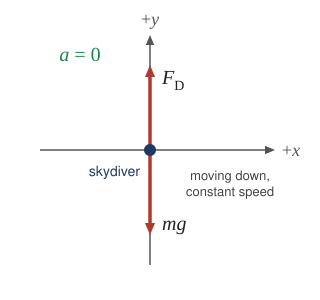
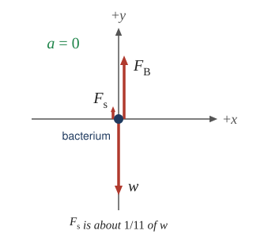

:::: abstract

* Express mathematically the drag force.
* Discuss the applications of drag force.
* Define terminal velocity.
* Determine the terminal velocity given mass.

::::

Another interesting force in everyday life is the force of drag on an object
when it is moving in a fluid (either a gas or a liquid). You feel the drag force
when you move your hand through water. You might also feel it if you move your
hand during a strong wind. The faster you move your hand, the harder it is to
move. You feel a smaller drag force when you tilt your hand so only the side
goes through the air—you have decreased the area of your hand that faces the
direction of motion. Like friction, the **drag force** always opposes the motion
of an object relative to the fluid. Unlike simple friction, the drag force is proportional to some
function of the velocity of the object in that fluid. This functionality is
complicated and depends upon the shape of the object, its size, its velocity,
and the fluid it is in. For most large objects such as bicyclists, cars, and
baseballs not moving too slowly, the magnitude of the drag force $$ F_{\text{D}} $$

is found to be proportional to the square of the speed of the object. We can
write this relationship mathematically as $$ F_{\text{D}}\propto v^{2} $$. When
taking into account other factors, this relationship becomes

$$ F_{\text{D}}=\frac{1}{2}C \rho A v^{2}, $$

where $$ C $$ is the drag coefficient, $$ A $$ is the area of the object facing
the fluid, and $$ \rho $$ is the density of the fluid. (Recall that density is
mass per unit volume.) This equation can also be written in a more generalized
fashion as $$ F_{\text{D}}=b v^{2} $$, where $$ b $$ is a constant equivalent to
$$ 0.5 C \rho A $$. We have set the exponent for these equations as 2 because,
when an object is moving at high velocity through air, the magnitude of the drag
force is proportional to the square of the speed. As we shall see later in this
section, for small particles moving at low speeds in a fluid, the
exponent is equal to 1.

:::: note {"class":"note","data-label":""}

Drag Force

Drag force $$ F_{\text{D}} $$
is found to be proportional to the square of the speed of the object.
Mathematically

$$ F_{\text{D}}\propto v^{2} $$

$$ F_{\text{D}}=\frac{1}{2} C \rho A v^{2}, $$

where $$ C $$ is the drag coefficient,
$$ A $$ is the area of the object facing the fluid, and
$$ \rho $$ is the density of the fluid.

::::

Athletes as well as car designers seek to reduce the drag force to lower their
race times. (
See [Figure 1](#Figure1)). “Aerodynamic” shaping of an automobile can reduce the
drag force and so increase a car’s gas mileage.

 ")
{: #Figure1}

The value of the drag coefficient, $$ C $$, is determined empirically, usually
with the use of a wind tunnel. (
See [Figure 2](#Figure2)).

")
{: #Figure2}

The drag coefficient can depend upon velocity, but we will assume that it is a
constant here. [Table 1](#Table1) lists some typical drag coefficients for a
variety of objects. Notice that the drag coefficient is a dimensionless
quantity. At highway speeds, over 50% of the power of a car is used to overcome
air drag. The most fuel-efficient cruising speed is about 70–80 km/h (about
45–50 mi/h). For this reason, during the 1970s oil crisis in the United States,
maximum speeds on highways were set at about 90 km/h (55 mi/h).

#### Table 1: Drag Coefficient values $$C$$

|Object| $$C$$ |
|--- |--- |
|Airfoil|0.05|
|Toyota Camry|0.28|
|Ford Focus|0.32|
|Honda Civic|0.36|
|Ferrari Testarossa|0.37|
|Dodge Ram pickup|0.43|
|Sphere|0.45|
|Hummer H2 SUV|0.64|
|Skydiver (feet first)|0.70|
|Bicycle|0.90|
|Skydiver (horizontal)|1.00|
|Circular flat plate|1.12|

{: #Table1}

Substantial research is under way in the sporting world to minimize drag. The
dimples on golf balls are being redesigned as are the clothes that athletes
wear. Bicycle racers and some swimmers and runners wear full bodysuits.
Australian Cathy Freeman wore a full body suit in the 2000 Sydney Olympics, and
won the gold medal for the 400 m race. Many swimmers in the 2008 Beijing
Olympics wore full-length body suits; it might have made a difference in
breaking many world records (See [Figure 3](#Figure3)). Most elite swimmers (and
cyclists) shave their body hair. Such innovations can have the effect of slicing
away milliseconds in a race, sometimes making the difference between a gold and
a silver medal. One consequence is that careful and precise guidelines must be
continuously developed to maintain the integrity of the sport.

")
{: #Figure3}

Some interesting situations connected to Newton’s second law occur when
considering the effects of drag forces upon a moving object. For instance,
consider a skydiver falling through air under the influence of gravity. The two
forces acting on him are the force of gravity and the drag force (ignoring the
buoyant force). The downward force of gravity remains constant regardless of the
velocity at which the person is moving. However, as the person’s velocity
increases, the magnitude of the drag force increases until the magnitude of the
drag force is equal to the gravitational force, thus producing a net force of
zero. A zero net force means that there is no acceleration, as given by Newton’s
second law. At this point, the person’s velocity remains constant and we say
that the person has reached his *terminal velocity* ( $$ v_{t} $$ ). Since $$ F_{\text{D}} $$ increases with speed (as $$ v^{2} $$), a heavier skydiver must go faster
for $$ F_{\text{D}} $$ to equal his weight. Let’s see how this works out more
quantitatively.

At the terminal velocity,

$$ F_{\text{net}}=mg -F_{\text{D}}=ma =0 . $$

Thus,

 $$ mg =F_{\text{D}}. $$

Using the equation for drag force, we have

 $$ mg =\frac{1}{2}\rho C Av^{2}. $$

Solving for the velocity, we obtain

 $$ v=\sqrt{\frac{2mg }{\rho CA}}. $$

Assume the density of air is $$ \rho =1.21 \text{kg/m}^{3} $$. A 75-kg skydiver
descending feet first will have an area approximately $$ A=0.18 \mm $$ and a
drag coefficient of approximately $$ C=0.70 $$. We find that

$$ \begin{array}{lll}
v&=& \sqrt{\frac{2\left(75 \kg \right)\left(9.80 \mss \right)}{\left(1.21 \kg/\m^{3}\right)\left(0.70\right)\left(0.18 \mm\right)}}\\
v&=& 98 \ms \\
v&=& 350 \text{km/h}.
\end{array} $$

This means a skydiver with a mass of 75 kg achieves a maximum terminal velocity
of about 350 km/h while traveling in a feet-first position, minimizing
the area and his drag. In a spread-eagle position, that terminal velocity may
decrease to about 160–200 km/h as the area increases (see the next example). This terminal velocity becomes
much smaller after the parachute opens.

:::: note {"class":"note","data-label":""}

Take-Home Experiment

This interesting activity examines the effect of weight upon terminal velocity.
Gather together some nested coffee filters. Leaving them in their original shape, measure the time it
takes for one, two, three, four, and five nested filters to fall to the floor from the same height
(roughly 2 m). (Note that, due to the way the filters are nested, drag is constant and only mass varies.)
They obtain terminal velocity quite quickly, so find this velocity as a function of mass.
Plot the terminal velocity $$ v $$ versus mass. Also plot $$ v^{2} $$ versus mass.
Which of these relationships is more linear? What can you conclude from these graphs?

::::

:::: example

A Terminal Velocity

Find the terminal velocity of an 85-kg skydiver falling in a spread-eagle position.

**Strategy**

At terminal velocity, $$ F_{\text{net}}=0 $$. Thus the drag force on the skydiver
must equal the force of gravity (the person’s weight). Using the equation of
drag force, we find $$ mg =\frac{1}{2}\rho C A v^{2} $$.

Thus the terminal velocity $$ v_{t} $$ can be written as

 $$ v_{\text{t}}=\sqrt{\frac{2mg }{\rho C A}}. $$

**Solution**

All quantities are known except the person’s projected area. This is an adult
(85 kg) falling spread eagle. We can estimate the frontal area as

 $$ A=\left(2 \m \right)\left(0.35 \m \right)=0.70 \mm . $$

Using our equation for $$ v_{\text{t}} $$, we find that

$$ \begin{array}{lll}
v_{\text{t}}&=& \sqrt{\frac{2\left(85\kg \right)\left(9.80\mss \right)}{\left(1.21\text{kg/m}^{3}\right)
\left(1.0\right)\left(0.70 \mm\right)}}\\
v_{\text{t}}&=& 44 \ms .
\end{array} $$

**Discussion**

This result is consistent with the value for $$ v_{\text{t}} $$ mentioned
earlier. The 75-kg skydiver going feet first had a $$ v=98 \ms $$. He weighed
less but had a smaller frontal area and so a smaller drag due to the air.

::::

The size of the object that is falling through air presents another interesting
application of air drag. The terminal velocity of a small squirrel is less than the terminal velocity we found previously for the skydiver, and so the squirrel can fall from a significant height without injury.

The following interesting quote on animal size and terminal velocity is from a
1926 essay by a British biologist, J.B.S. Haldane, titled “On Being the Right
Size.”

_To the mouse and any smaller animal, \[gravity\] presents practically no
dangers. You can drop a mouse down a thousand-yard mine shaft; and, on arriving
at the bottom, it gets a slight shock and walks away, provided that the ground
is fairly soft. A rat is killed, a man is broken, and a horse splashes. For the
resistance presented to movement by the air is proportional to the surface of
the moving object. Divide an animal’s length, breadth, and height each by ten;
its weight is reduced to a thousandth, but its surface only to a hundredth. So
the resistance to falling in the case of the small animal is relatively ten
times greater than the driving force._

For very small objects moving slowly through a fluid, drag is often
proportional to speed rather than speed squared. For a spherical object in
this slow-flow regime, **Stokes’ law** gives the drag force:

$$ F_{\s}=6 \pi r\eta v, $$

where $$ r $$ is the sphere’s radius, $$ \eta $$ is the viscosity of the
fluid, and $$ v $$ is the object’s speed relative to the fluid. The fluid must
flow smoothly around the sphere with negligible effects from its inertia.

:::: note {"class":"note","data-label":""}

Stokes’ Law

$$ F_{\s}=6 \pi r\eta v, $$

For a sphere moving slowly through a fluid, $$ r $$ is its radius,
$$ \eta $$ is the fluid viscosity, and $$ v $$ is the speed relative to the
fluid.

::::

Good examples of this law are provided by microorganisms, pollen, and dust
particles. Because each of these objects is so small, we find that many of these
objects travel unaided only at a constant (terminal) velocity. Terminal
velocities for bacteria (size about $$ 1 \text{μm} $$)
can be about $$ 2 \text{μm/s} $$. To move at a greater speed, many bacteria swim
using flagella (organelles shaped like little tails) that are powered by little
motors embedded in the cell. Sediment in a lake can move at a greater terminal
velocity (about $$ 5 \text{μm/s} $$ ), so it can take days to reach the bottom
of the lake after being deposited on the surface.

If we compare animals living on land with those in water, you can see how drag
has influenced evolution. Fishes, dolphins, and even massive whales are
streamlined in shape to reduce drag forces. Birds are streamlined too. Flocks of
migrating geese fly in a V formation (see [Figure 4](#Figure4)): each bird rides
in the rising air (upwash) shed from the wingtip of the bird ahead, which
reduces the effort needed to stay aloft.

')
{: #Figure4}

:::: note {"class":"note","data-label":""}

Galileo’s Experiment

Galileo is said to have dropped two objects of different masses from the Tower of Pisa.
He measured how long it took each to reach the ground.
Since stopwatches weren’t readily available, how do you think he measured their fall time?
If the objects were the same size, but with different masses, what do you think he should
have observed? Would this result be different if done on the Moon?

::::

:::: note {"class":"note","data-label":"PhET Exploration"}

 Projectile Motion

Launch objects through the air with and without air resistance. On the Drag screen, change the drag coefficient, diameter, mass, and altitude, and compare how drag shortens the range and changes the shape of the trajectory.

::: figure {}

<iframe loading="lazy" src="https://phet.colorado.edu/sims/html/projectile-motion/latest/projectile-motion_en.html" width="600" height="450"  allowfullscreen></iframe>
<figcaption>
Projectile Motion
</figcaption>

:::

::::

### Section Summary

- Drag forces acting on an object moving in a fluid oppose the motion. For
  larger objects (such as a baseball) moving at a velocity $$ v $$ in air, the
  drag force is given by
  

  $$ F_{\text{D}}=\frac{1}{2}C\rho Av^{2}, $$
  

where $$ C $$ is the drag coefficient (typical values are given
in [Table 1](#Table1)), $$ A $$ is the area of the object facing the fluid, and
$$ \rho $$ is the fluid density.

- For a small spherical object moving slowly through a fluid, the drag force
  can be found using Stokes’ law,
  

    $$ F_{\s}=6 \pi r \eta v , $$
  

where $$ r $$ is the sphere’s radius, $$ \eta $$ is the fluid viscosity,
and $$ v $$ is its speed relative to the fluid.

### Conceptual Questions

:::: problem

Athletes such as swimmers and bicyclists wear body suits in competition.
Formulate a list of pros and cons of such suits.

::::

:::: solution

**Strategy**

Use the drag equation $$ F_{D} = \tfrac{1}{2} C \rho A v^{2} $$. A suit can change the drag coefficient $$ C $$ (through surface smoothness and shape) and the frontal area $$ A $$. Then weigh other effects on the athlete.

**Solution**

To see how much is at stake, estimate the drag on a cyclist moving at $$ v = 12 \ms $$ with $$ C = 0.90 $$ and $$ A = 0.35 \mm $$, in air of density $$ \rho = 1.21 \kg/\text{m}^3 $$:

$$ F_{D} = \tfrac{1}{2}(0.90)(1.21 \kg/\text{m}^3)(0.35 \mm)(12 \ms)^2 = 27 \N $$

Overcoming this force at $$ 12 \ms $$ takes a power of $$ F_{D}v = (27 \N)(12 \ms) = 330 \text{ W} $$. A suit that lowers $$ C $$ by just $$ 5\% $$ saves about $$ 1.4 \N $$, or $$ 16 \text{ W} $$, which can decide a race.

**Pros**

- A smooth, tight surface lowers the drag coefficient $$ C $$ and reduces turbulence compared with loose clothing, skin, or body hair.
- Compressing the body smooths its shape and slightly reduces the frontal area $$ A $$.
- Compression may reduce muscle vibration and fatigue.
- Some swimsuit materials trap air or add buoyancy, raising the swimmer higher in the water. (Suits made of such materials were banned in 2010.)

**Cons**

- The suits are expensive and wear out quickly.
- They can be uncomfortable and may restrict movement or breathing.
- They hold in body heat, which is a problem for a cyclist producing hundreds of watts.
- They are hard to put on, and some designs are banned, which raises questions of fairness.

Body suits reduce the drag force $$ F_{D} = \tfrac{1}{2} C \rho A v^{2} $$ mainly by lowering $$ C $$ and slightly lowering $$ A $$, which can save several watts out of the roughly $$ 330 \text{ W} $$ a racing cyclist spends on drag at $$ 12 \ms $$, but they are costly, short-lived, hot, and can restrict movement.

::::

:::: problem

Two expressions were used for the drag force experienced by a moving object in a liquid.
One depended upon the speed, while the other was proportional to the square of the speed.
In which types of motion would each of these expressions be more applicable than the other one?

::::

:::: solution

**Strategy**

Compare the two drag laws: the Stokes form $$ F_{s} = 6\pi r \eta v $$, which is proportional to $$ v $$, and $$ F_{D} = \tfrac{1}{2} C \rho A v^{2} $$, which is proportional to $$ v^{2} $$. Sketch both against speed to see where each is larger.

**Solution**

**Drag proportional to $$ v $$** applies to **small, slow objects in viscous fluids**, where the fluid flows smoothly (laminar flow) around the object. Viscosity, the fluid's internal friction, sets the drag. Examples are bacteria swimming, red blood cells moving in plasma, pollen or dust settling in air, and fine sediment sinking in water. A sand grain of radius $$ 0.10 \text{ mm} $$ sinking through water at a few $$ \text{mm/s} $$ follows this law.

**Drag proportional to $$ v^{2} $$** applies to **larger, faster objects**, where the fluid becomes turbulent behind the object. The drag then comes from the momentum given to the fluid pushed out of the way. Examples are a car at $$ 25 \ms $$, a skydiver at $$ 50 \ms $$, a baseball, and a swimmer.

In the graph, the linear law gives the larger drag at low speeds. The quadratic law grows faster and takes over at high speeds, so doubling the speed of a car quadruples its drag, while doubling the speed of a settling dust grain only doubles its drag.

The drag force proportional to speed (Stokes's law) applies to small, slow objects in viscous fluids with smooth flow, such as bacteria or settling dust, while the drag force proportional to the square of the speed applies to larger, faster objects with turbulent flow, such as cars, balls, and skydivers.

::::

:::: problem

As cars travel, oil and gasoline leaks onto the road surface.
If a light rain falls, what does this do to the control of the car?
Does a heavy rain make any difference?

::::

:::: solution

**Strategy**

The braking and steering forces on a car come from static friction between the tires and the road, with a maximum of $$ \mu_{s} N $$. Ask how oil and water change $$ \mu_{s} $$, and use the maximum deceleration $$ a = \mu_{s} g $$ on a level road to compare stopping distances.

**Solution**

Take $$ +x $$ in the car's direction of motion. On a level road $$ N = mg $$, so the largest braking force is $$ \mu_{s} mg $$ in the $$ -x $$ direction, and the largest deceleration is $$ \mu_{s} g $$. From $$ v^{2} = v_{0}^{2} + 2ax $$ with $$ v = 0 $$, the shortest stopping distance from $$ v_{0} = 25 \ms $$ is $$ x = v_{0}^{2}/(2\mu_{s} g) $$:

- dry concrete, $$ \mu_{s} = 1.0 $$: $$ x = (25 \ms)^2 / [2(1.0)(9.80 \mss)] = 32 \m $$
- wet concrete, $$ \mu_{s} = 0.7 $$: $$ x = 46 \m $$
- oily, wet surface, $$ \mu_{s} \approx 0.3 $$ (estimate): $$ x \approx 110 \m $$

A **light rain** is the most dangerous. The water lifts the oil out of the pores of the road and mixes it into a thin, slippery film on top. That film makes the coefficient of friction much smaller, so the car can neither brake nor turn as hard. For a turn of radius $$ 50 \m $$, the highest safe speed $$ v = \sqrt{\mu_{s} r g} $$ drops from $$ 22 \ms $$ on dry pavement to about $$ 12 \ms $$ on the oily film.

A **heavy rain** washes the oil off the road, so after a while traction improves to the ordinary wet value. Heavy rain brings another hazard, though. At high speed a layer of water can build up under the tires (hydroplaning), and the tires lose contact with the road almost completely.

A light rain lifts the leaked oil into a slippery film that greatly reduces the coefficient of friction (stopping distances from $$ 25 \ms $$ can grow from about $$ 32 \m $$ to over $$ 100 \m $$), while a heavy rain washes the oil away and restores ordinary wet-road traction, although deep water can then cause hydroplaning.

::::

:::: problem

Why can a squirrel jump from a tree branch to the ground and run away undamaged,
while a human could break a bone in such a fall?

::::

:::: solution

**Strategy**

Compare the terminal speeds of a squirrel and a human using $$ v_{t} = \sqrt{2mg/(\rho C A)} $$, then compare how hard each body is loaded when it lands, using the way mass and bone cross-section scale with size.

**Solution**

**1. The squirrel falls more slowly.** Use $$ \rho = 1.21 \kg/\text{m}^3 $$ and $$ C \approx 1.0 $$ for a body spread out flat. For a $$ 0.50 \kg $$ squirrel with its legs and tail spread over $$ A = 0.030 \mm $$:

$$ v_{t} = \sqrt{\frac{2(0.50 \kg)(9.80 \mss)}{(1.21 \kg/\text{m}^3)(1.0)(0.030 \mm)}} = 16 \ms $$

For a $$ 70 \kg $$ human with $$ A = 0.70 \mm $$, the same calculation gives $$ v_{t} = 40 \ms $$. Mass grows with the cube of an animal's size but area only with the square, so the ratio $$ m/A $$, and with it the terminal speed, is much smaller for the squirrel. In a fall of $$ 10 \m $$, a human hits the ground at nearly the free-fall speed $$ \sqrt{2(9.80 \mss)(10 \m)} = 14 \ms $$, while air resistance holds the spread-out squirrel noticeably below that.

**2. The squirrel's body is loaded less.** A human is about $$ (70 \kg / 0.50 \kg)^{1/3} \approx 5 $$ times larger than a squirrel in each dimension. The force needed to stop a body is proportional to its mass ($$ \propto L^{3} $$), but the cross-sectional area of the bones that must carry that force grows only as $$ L^{2} $$. For the same deceleration, the stress in the bones is about 5 times larger in the human.

A squirrel survives the jump because its small mass compared with its area gives it a low terminal speed (about $$ 16 \ms $$ compared with $$ 40 \ms $$ for a human), so it lands more gently, and because its bones carry about one fifth the stress that a human's would for the same deceleration, whereas a human lands faster with bones loaded closer to their breaking point.

::::

### Problems &amp; Exercise

:::: problem

The terminal velocity of a person falling in air depends upon the weight and the
area of the person facing the fluid. Find the terminal velocity (in meters per
second and kilometers per hour) of an 80.0-kg skydiver falling in a pike
(headfirst) position with a cross section area of $$ 0.140 \mm $$.

::::

:::: solution

**Strategy**

At terminal velocity, the drag force equals the weight, so acceleration is zero. We use the drag force equation $$ F_{\text{D}} = \frac{1}{2}C\rho Av^{2} $$ and set it equal to $$ mg $$ to solve for $$ v $$. For a pike (headfirst) position, we use the drag coefficient $$ C = 0.70 $$ from Table 1 (skydiver feet first). The density of air is $$ \rho = 1.21 \text{ kg/m}^3 $$.

**Solution**

1. Draw the free-body diagram with $$ +y $$ upward. The skydiver falls (moves along $$ -y $$), so the drag force, which opposes the motion, points along $$ +y $$. The weight points along $$ -y $$:

   {: .fbd}

   At terminal velocity the acceleration is zero, so drag equals weight:

$$ \sum F_y = F_{\text{D}} - mg = 0 \quad \Rightarrow \quad F_{\text{D}} = mg $$

$$ \frac{1}{2}C\rho Av_{t}^2 = mg $$

2. Solve for terminal velocity:

$$ v_t = \sqrt{\frac{2mg}{C\rho A}} $$

3. Substitute known values:

$$ v_t = \sqrt{\frac{2(80.0 \kg)(9.80 \mss)}{(0.70)(1.21 \text{ kg/m}^3)(0.140 \mm)}} $$

$$ v_t = \sqrt{\frac{1568 \N}{0.1187 \text{ kg/m}}} = \sqrt{13210 \text{ m}^2/\text{s}^2} $$

$$ v_t = 115 \ms $$

4. Convert to km/hr:

$$ v_t = 115 \ms \times \frac{3600 \text{ s}}{1 \text{ hr}} \times \frac{1 \text{ km}}{1000 \text{ m}} = 414 \text{ km/hr} $$

**Discussion**

The terminal velocity is $$ 115 \ms $$ or $$ 414 \text{ km/hr} $$. This is very fast—about 250 mph! The pike position minimizes the frontal area, allowing the skydiver to reach higher speeds. In a spread-eagle position, the larger area would result in a much lower terminal velocity (around 50-60 m/s or 180-220 km/hr).

::::

:::: problem

A 60-kg and a 90-kg skydiver jump from an airplane at an altitude of 6000 m,
both falling in the pike position. Make some assumption on their frontal areas
and calculate their terminal velocities. How long will it take for each skydiver
to reach the ground (assuming the time to reach terminal velocity is small)?
Assume all values are accurate to three significant digits.

::::

:::: solution

**Strategy**

We assume both skydivers have similar body proportions, so their frontal areas in pike position are similar. A reasonable assumption for pike position is $$ A \approx 0.14 \mm $$ (as in the previous problem). We use $$ C = 0.70 $$, $$ \rho = 1.21 \text{ kg/m}^3 $$. Once we find terminal velocities, the time to fall 6000 m is simply $$ t = d/v_t $$ (since we're told to assume they reach terminal velocity quickly).

**Solution**

Using the terminal velocity formula:

$$ v_t = \sqrt{\frac{2mg}{C\rho A}} $$

For the 60-kg skydiver:

$$ v_{t,60} = \sqrt{\frac{2(60 \kg)(9.80 \mss)}{(0.70)(1.21 \text{ kg/m}^3)(0.14 \mm)}} $$

$$ v_{t,60} = \sqrt{\frac{1176 \N}{0.1187 \text{ kg/m}}} = \sqrt{9907 \text{ m}^2/\text{s}^2} = 99.5 \ms $$

For the 90-kg skydiver:

$$ v_{t,90} = \sqrt{\frac{2(90 \kg)(9.80 \mss)}{(0.70)(1.21 \text{ kg/m}^3)(0.14 \mm)}} $$

$$ v_{t,90} = \sqrt{\frac{1764 \N}{0.1187 \text{ kg/m}}} = \sqrt{14860 \text{ m}^2/\text{s}^2} = 122 \ms $$

Time to reach ground (distance = 6000 m):

For 60-kg skydiver:

$$ t_{60} = \frac{6000 \m}{99.5 \ms} = 60.3 \s $$

For 90-kg skydiver:

$$ t_{90} = \frac{6000 \m}{122 \ms} = 49.2 \s $$

**Discussion**

The 60-kg skydiver has a terminal velocity of $$ 99.5 \ms $$ and reaches the ground in about $$ 60 \s $$. The 90-kg skydiver has a terminal velocity of $$ 122 \ms $$ and reaches the ground in about $$ 49 \s $$. The heavier skydiver falls faster because their weight increases more than their drag force (same area). This is why heavier skydivers must account for the difference when doing formation jumps with lighter partners.

::::

:::: problem

A 560-g squirrel with a cross section area  of $$ 930 \text{cm}^{2} $$
falls from a 5.0-m tree to the ground. Estimate its terminal velocity. (Use a
drag coefficient for a horizontal skydiver.) What will be the velocity of a
56-kg person hitting the ground, assuming no drag contribution in such a short
distance?

::::

:::: solution

**Strategy**

For the squirrel, we calculate terminal velocity using the drag equation with $$ C = 1.0 $$ (horizontal skydiver from Table 1). For the person, we use kinematic equations for free fall without air resistance: $$ v^2 = v_0^2 + 2gh $$.

**Solution**

For the squirrel's terminal velocity:

1. Convert units:
   - Mass: $$ m = 560 \text{ g} = 0.560 \kg $$
   - Area: $$ A = 930 \text{ cm}^2 = 0.0930 \mm $$

2. Calculate terminal velocity using $$ C = 1.0 $$ and $$ \rho = 1.21 \text{ kg/m}^3 $$:

$$ v_t = \sqrt{\frac{2mg}{C\rho A}} = \sqrt{\frac{2(0.560 \kg)(9.80 \mss)}{(1.0)(1.21 \text{ kg/m}^3)(0.0930 \mm)}} $$

$$ v_t = \sqrt{\frac{10.98 \N}{0.1125 \text{kg/m}}} = \sqrt{97.6 \mmss} = 9.88 \ms \approx 10 \ms $$

For the person falling 5.0 m without drag:

$$ v = \sqrt{2gh} = \sqrt{2(9.80 \mss)(5.0 \m)} = \sqrt{98 \mmss} = 9.9 \ms $$

**Discussion**

Using the prescribed horizontal-skydiver coefficient $$ C = 1.0 $$, the squirrel's terminal velocity is $$ 9.88 \ms $$, comparable to the $$ 9.9 \ms $$ impact speed of a 56-kg person falling 5.0 m without drag. Whether a squirrel survives a particular fall depends on more than terminal speed alone (impact duration, landing surface, and anatomy also matter), but the calculation shows why small animals with large drag areas relative to their mass reach relatively low terminal speeds compared with heavier objects.

::::

:::: problem

To maintain a constant speed, the force provided by a car's engine must equal the
drag force plus the force of friction of the road (the rolling resistance).
(a) What are the magnitudes of drag forces at 70 km/h and 100 km/h for a Toyota
Camry? (Drag area is $$ 0.70 \mm $$ )

(b) What is the magnitude of drag force at 70 km/h and 100 km/h for a Hummer H2?
(Drag area is $$ 2.44 \mm $$)
Assume all values are accurate to three significant digits.

::::

:::: solution

**Strategy**

The stated drag areas are the products $$ C_{\text{d}}A $$ (coefficient times reference area), so the drag force is $$ F_{\text{D}} = \frac{1}{2}\rho (C_{\text{d}}A) v^{2} $$ without introducing $$ C_{\text{d}} $$ again. We use $$ \rho = 1.21 \text{ kg/m}^3 $$ for air density. First convert speeds from km/h to m/s.

**Solution**

Convert speeds:

- 70 km/h = 70 × (1000/3600) = 19.44 m/s
- 100 km/h = 100 × (1000/3600) = 27.78 m/s

(a) Toyota Camry (drag area $$ C_{\text{d}}A = 0.70 \mm $$):

At 70 km/h (19.44 m/s):

$$ F_{\text{D}} = \frac{1}{2}(1.21 \text{ kg/m}^3)(0.70 \mm)(19.44 \ms)^2 $$

$$ F_{\text{D}} = \frac{1}{2}(1.21 \text{kg/m}^3)(0.70 \mm)(378 \mmss) = 160 \N $$

At 100 km/h (27.78 m/s):

$$ F_{\text{D}} = \frac{1}{2}(1.21 \text{kg/m}^3)(0.70 \mm)(27.78 \ms)^2 $$

$$ F_{\text{D}} = \frac{1}{2}(1.21 \text{kg/m}^3)(0.70 \mm)(772 \mmss) = 327 \N $$

(b) Hummer H2 (drag area $$ C_{\text{d}}A = 2.44 \mm $$):

At 70 km/h (19.44 m/s):

$$ F_{\text{D}} = \frac{1}{2}(1.21 \text{kg/m}^3)(2.44 \mm)(19.44 \ms)^2 $$

$$ F_{\text{D}} = \frac{1}{2}(1.21 \text{kg/m}^3)(2.44 \mm)(378 \mmss) = 558 \N $$

At 100 km/h (27.78 m/s):

$$ F_{\text{D}} = \frac{1}{2}(1.21 \text{kg/m}^3)(2.44 \mm)(27.78 \ms)^2 $$

$$ F_{\text{D}} = \frac{1}{2}(1.21 \text{kg/m}^3)(2.44 \mm)(772 \mmss) = 1139 \N $$

**Discussion**

The drag forces are: Toyota Camry: $$ 160 \N $$ at 70 km/h and $$ 327 \N $$ at 100 km/h. Hummer H2: $$ 558 \N $$ at 70 km/h and $$ 1139 \N $$ at 100 km/h. The Hummer's larger drag area (about 3.5 times that of the Camry) produces much greater drag, which helps explain the difference in fuel use at highway speeds. Note that drag roughly doubles when speed increases from 70 to 100 km/h (since drag is proportional to $$ v^2 $$).

::::

:::: problem

By what factor does the drag force on a car increase as it goes from 65 to 110 km/h?

::::

:::: solution

**Strategy**

Since drag force is proportional to $$ v^2 $$, and all other factors (C, ρ, A) remain constant, the ratio of drag forces equals the ratio of velocities squared.

**Solution**

The factor by which drag increases is:

$$ \frac{F_{\text{D,110}}}{F_{\text{D,65}}} = \frac{v_{110}^2}{v_{65}^2} = \left(\frac{110 \text{ km/h}}{65 \text{ km/h}}\right)^2 $$

$$ = \left(\frac{110}{65}\right)^2 = (1.692)^2 = 2.86 \approx 2.9 $$

**Discussion**

The drag force increases by a factor of $$ 2.9 $$ when speed increases from 65 to 110 km/h. This nearly tripling of drag force explains why fuel efficiency drops dramatically at highway speeds. Since power required equals force times velocity, the power needed to overcome drag increases even more dramatically—by a factor of about $$ 2.9 \times (110/65) = 4.9 $$! This is why maintaining highway speed limits significantly improves fuel economy.

::::

:::: problem

Calculate the speed a spherical rain drop would achieve falling from 5.00 km
(a) in the absence of air drag
(b) with air drag. Take the size across of the drop to be 4 mm, the density to be
$$ 1.00\times 10^{3}{\text{kg/m}}^{3} $$, and the cross section area to be $$ \pi r^{2} $$.

::::

:::: solution

**Strategy**

For part (a), we use kinematics without air resistance: $$ v = \sqrt{2gh} $$. For part (b), we calculate terminal velocity, which the raindrop will reach well before hitting the ground from 5 km. We use the drag force equation with $$ C = 0.45 $$ for a sphere (from Table 1).

**Solution**

First, calculate the raindrop's properties:

- Diameter: 4 mm, so radius $$ r = 2 \text{ mm} = 0.002 \m $$
- Cross-sectional area: $$ A = \pi r^2 = \pi(0.002 \m)^2 = 1.257 \times 10^{-5} \mm $$
- Volume: $$ V = \frac{4}{3}\pi r^3 = \frac{4}{3}\pi(0.002 \m)^3 = 3.35 \times 10^{-8} \text{ m}^3 $$
- Mass: $$ m = \rho V = (1.00 \times 10^3 \text{ kg/m}^3)(3.35 \times 10^{-8} \text{ m}^3) = 3.35 \times 10^{-5} \kg $$

(a) Speed without air drag:

$$ v = \sqrt{2gh} = \sqrt{2(9.80 \mss)(5000 \m)} = \sqrt{98000 \mmss} = 313 \ms $$

(b) Terminal velocity with air drag:

Using $$ C = 0.45 $$ and $$ \rho_{\text{air}} = 1.21 \text{ kg/m}^3 $$:

$$ v_t = \sqrt{\frac{2mg}{C\rho_{\text{air}} A}} $$

$$ v_t = \sqrt{\frac{2(3.35 \times 10^{-5} \kg)(9.80 \mss)}{(0.45)(1.21 \text{ kg/m}^3)(1.257 \times 10^{-5} \mm)}} $$

$$ v_t = \sqrt{\frac{6.57 \times 10^{-4} \N}{6.85 \times 10^{-6} \text{ kg/m}}} = \sqrt{95.9 \text{ m}^2/\text{s}^2} = 9.8 \ms $$

**Discussion**

Without air drag, the raindrop would hit the ground at an incredible $$ 313 \ms $$ (about 1130 km/h or 700 mph)—comparable to the speed of sound in air (about 340 m/s at room temperature). With air drag, the terminal velocity is only about $$ 9.8 \ms $$ (35 km/h), which is why rain doesn't hurt when it hits us. The raindrop reaches terminal velocity within the first few hundred meters of fall and maintains that speed for the remaining distance. This dramatic difference illustrates the crucial role air resistance plays in everyday phenomena.

::::

:::: problem

Using Stokes' law, verify that the units for viscosity are kilograms per meter per second.

::::

:::: solution

**Strategy**

Stokes' law states $$ F_{\s} = 6\pi r\eta v $$. We solve this equation for viscosity $$ \eta $$ and then perform dimensional analysis to verify the units.

**Solution**

1. Solve Stokes' law for viscosity:

$$ \eta = \frac{F_{\s}}{6\pi r v} $$

2. Determine the units of each quantity:
   - Force: $$ [F_{\s}] = \N = \kg \cdot \m/\s^2 $$
   - Radius: $$ [r] = \m $$
   - Velocity: $$ [v] = \m/\s $$
   - Note: $$ 6\pi $$ is dimensionless

3. Perform dimensional analysis:

$$ [\eta] = \frac{[F_{\s}]}{[r][v]} = \frac{\kg \cdot \m/\s^2}{\m \cdot \m/\s} $$

4. Simplify:

$$ [\eta] = \frac{\kg \cdot \m}{\s^2} \cdot \frac{\s}{\m \cdot \m} = \frac{\kg}{\m \cdot \s} $$

**Discussion**

The units for viscosity are confirmed to be $$ \frac{\kg}{\m \cdot \s} $$ (kilograms per meter per second), also written as Pa·s (pascal-seconds) since $$ 1 \text{ Pa} = 1 \N/\mm = 1 \kg/(\m \cdot \s^2) $$, so $$ 1 \text{ Pa·s} = 1 \kg/(\m \cdot \s) $$. Common viscosity values: water has $$ \eta \approx 0.001 \text{ kg/(m·s)} $$, while honey has $$ \eta \approx 2-10 \text{ kg/(m·s)} $$.

::::

:::: problem

Find the terminal velocity of a spherical bacterium (diameter $$ 2.00 \mu m $$ )
falling in water. You will first need to note that at terminal velocity Stokes'
drag balances the bacterium's effective weight in water:
$$ 6\pi\eta r v_t = (\rho_{\text{bacterium}} - \rho_{\text{water}}) V g $$.
Take the density of the bacterium to be
$$ 1.10\times 10^{3} \text{kg/m}^{3} $$.

::::

:::: solution

**Strategy**

For such a small object moving slowly through a viscous fluid, Stokes' law applies: $$ F_{\s} = 6\pi r\eta v $$. At terminal velocity, the drag force equals the weight minus the buoyant force. The viscosity of water is $$ \eta = 1.002 \times 10^{-3} \text{ kg/(m·s)} $$ at 20°C.

**Solution**

1. Calculate the bacterium's properties:
   - Radius: $$ r = 1.00 \text{ μm} = 1.00 \times 10^{-6} \m $$
   - Volume: $$ V = \frac{4}{3}\pi r^3 = \frac{4}{3}\pi(1.00 \times 10^{-6} \m)^3 = 4.19 \times 10^{-18} \text{ m}^3 $$
   - Mass: $$ m = \rho_{\text{bact}} V = (1.10 \times 10^3 \text{kg/m}^3)(4.19 \times 10^{-18} \text{m}^3) = 4.61 \times 10^{-15} \kg $$

2. Draw the free-body diagram with $$ +y $$ upward. The bacterium sinks (moves along $$ -y $$), so Stokes drag $$ F_{\s} $$ points along $$ +y $$. The buoyant force $$ F_B = \rho_{\text{water}}Vg $$ also points along $$ +y $$, and the weight $$ w = \rho_{\text{bact}}Vg $$ points along $$ -y $$:

   {: .fbd}

   At terminal velocity, $$ \sum F_y = F_{\s} + F_B - w = 0 $$, so $$ F_{\s} = w - F_B $$, the effective weight.

   Calculate the effective weight (weight minus buoyancy):

$$ W_{\text{eff}} = (\rho_{\text{bact}} - \rho_{\text{water}})Vg $$

$$ W_{\text{eff}} = (1100 \text{kg/m}^3 - 1000 \text{kg/m}^3)(4.19 \times 10^{-18} \text{m}^3)(9.80 \mss) = 4.11 \times 10^{-15} \N $$

3. At terminal velocity, Stokes drag equals effective weight:

$$ 6\pi r\eta v_t = W_{\text{eff}} $$

4. Solve for terminal velocity:

$$ v_t = \frac{W_{\text{eff}}}{6\pi r\eta} = \frac{4.11 \times 10^{-15} \N}{6\pi(1.00 \times 10^{-6} \m)(1.002 \times 10^{-3} \text{ kg/(m·s)})} $$

$$ v_t = \frac{4.11 \times 10^{-15} \N}{1.89 \times 10^{-8} \text{N}\cdot\text{s/m}} = 2.18 \times 10^{-7} \ms = 0.218 \text{ μm/s} $$

**Discussion**

The terminal velocity of the bacterium is approximately $$ 2.2 \times 10^{-7} \ms $$ or about $$ 0.2 \text{ μm/s} $$. This incredibly slow sinking speed explains why bacteria and other microorganisms appear to be suspended in water—they sink so slowly that even tiny currents or Brownian motion can keep them aloft. At this rate, it would take the bacterium about 5 seconds to fall just 1 micrometer! This is why bacteria must actively swim using flagella to move any appreciable distance.

::::

:::: problem

Stokes' law describes sedimentation of particles in liquids and can be used
to measure viscosity. Particles in liquids achieve terminal velocity quickly.
One can measure the time it takes for a particle to fall a certain distance and
then use Stokes' law to calculate the viscosity of the liquid. Suppose a
steel ball bearing (density $$ 7.8\times 10^{3}\text{kg/m}^{3} $$, diameter
$$ 3.0 \text{mm} $$) is dropped in a container of motor oil.
It takes 12 s to fall a distance of 0.60 m. Calculate the viscosity of the oil. (Neglect the buoyant force of the oil on the ball.)

::::

:::: solution

**Strategy**

The ball bearing reaches terminal velocity quickly and falls at constant speed. We can determine this speed from the distance and time. At terminal velocity, Stokes' drag equals the ball's weight. As the problem instructs, we neglect buoyancy (the density of the oil is not given), and then check how much it would change the result.

**Solution**

1. Calculate the terminal velocity from the given data:

$$ v_t = \frac{d}{t} = \frac{0.60 \m}{12 \s} = 0.050 \ms $$

2. Calculate the ball bearing's properties:
   - Radius: $$ r = 1.5 \text{ mm} = 1.5 \times 10^{-3} \m $$
   - Volume: $$ V = \frac{4}{3}\pi r^3 = \frac{4}{3}\pi(1.5 \times 10^{-3} \m)^3 = 1.41 \times 10^{-8} \text{ m}^3 $$

3. Calculate the weight of the ball bearing:

$$ W = \rho_{\text{steel}}Vg = (7800 \text{kg/m}^3)(1.41 \times 10^{-8} \text{m}^3)(9.80 \mss) = 1.08 \times 10^{-3} \N $$

4. At terminal velocity, Stokes drag equals the weight:

$$ 6\pi r\eta v_t = W $$

5. Solve for viscosity:

$$ \eta = \frac{W}{6\pi r v_t} = \frac{1.08 \times 10^{-3} \N}{6\pi(1.5 \times 10^{-3} \m)(0.050 \ms)} = \frac{1.08 \times 10^{-3} \N}{1.41 \times 10^{-3} \text{m}^2/\text{s}} = 0.76 \text{ kg/(m·s)} $$

6. Check the effect of buoyancy. Motor oil has a density of about $$ 900 \text{ kg/m}^3 $$, so the buoyant force reduces the effective weight to

$$ W_{\text{eff}} = (\rho_{\text{steel}} - \rho_{\text{oil}})Vg = (6900 \text{kg/m}^3)(1.41 \times 10^{-8} \text{m}^3)(9.80 \mss) = 9.54 \times 10^{-4} \N $$

which gives $$ \eta = (9.54 \times 10^{-4} \N)/(1.41 \times 10^{-3} \text{m}^2/\text{s}) = 0.68 \text{ kg/(m·s)} $$. Neglecting buoyancy overestimates the viscosity by about 12%.

**Discussion**

The viscosity of the motor oil is approximately $$ 0.76 \text{ kg/(m·s)} $$ or $$ 0.76 \text{ Pa·s} $$. This is a relatively high viscosity—about 760 times more viscous than water—which is expected for motor oil. This falling-ball method is a standard technique for measuring viscosity in the lab, known as a falling-ball viscometer. A slow, steady descent does not by itself confirm that Stokes' law applies; the test is a small Reynolds number, $$ \text{Re} = \rho d v/\eta $$, which depends on the fluid's density and viscosity and the ball's size as well as its speed. With the illustrative values $$ \rho \approx 900 \text{ kg/m}^3 $$, $$ d = 0.0030 \m $$, $$ v = 0.050 \ms $$, and $$ \eta \approx 0.68 \text{ Pa·s} $$, $$ \text{Re} \approx 0.20 $$, small enough that Stokes' law is a reasonable approximation.

::::

:::: glossary

### Glossary
{: class="glossary-title"}

drag force
: $$ F_{\text{D}} $$, found to be proportional to the square of the speed of the
object; mathematically

  

  $$ F_{\text{D}}\propto {v}^{2} $$
  

  

  $$ F_{\text{D}}=\frac{1}{2} C\rho Av^{2}, $$
  

where $$ C $$ is the drag coefficient, $$ A $$ is the area of the object facing
the fluid, and $$ \rho $$ is the density of the fluid

Stokes’ law
: the drag relation $$ F_{s}=6 \pi r \eta v $$ for a sphere of radius $$ r $$
moving slowly through a fluid of viscosity $$ \eta $$ at relative speed $$ v $$

::::
