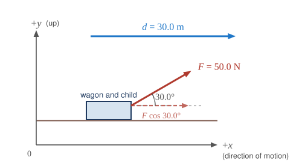

::: abstract

* Explain how an object must be displaced for a force on it to do work.
* Explain how relative directions of force and displacement determine whether the work done is positive, negative, or zero.

:::

### What It Means to Do Work

The scientific definition of work differs in some ways from its everyday
meaning. Certain things we think of as hard work, such as writing an exam or
carrying a heavy load on level ground, are not work as defined by a scientist.
The scientific definition of work reveals its relationship to energy—whenever
work is done, energy is transferred.

For work, in the scientific sense, to be done, a force must be exerted and there
must be displacement in the direction of the force.

Formally, the **work** done on a system by a constant force is defined to be
_the product of the component of the force in the direction of motion times the
distance through which the force acts_. For one-way motion in one dimension,
this is expressed in equation form as

 $$W= \mag{F} \left(\cos \theta \right) \mag{d} ,$$

where $$W$$ is work, $$\mag{d}$$ is the magnitude of the displacement of the
system, and $$\theta$$ is the angle between the force vector $$\vb{F}$$ and
the displacement vector $$\vb{d}$$, as in [Figure 1](#Figure1). We can also write
this as

 $$W=Fd\cos{\theta} .$$

To find the work done on a system that undergoes motion that is not one-way or
that is in two or three dimensions, we divide the motion into one-way
one-dimensional segments and add up the work done over each segment.

::: note {"class":"note","data-label":""}

What is Work?

The work done on a system by a constant force is *the product of the component of the force in the direction of motion times the distance through which the force acts*. For one-way motion in one dimension, this is expressed in equation form as

 $$W=F d \cos{\theta} ,$$

where $$W$$ is work,
$$F$$ is the magnitude of the force on the system,
$$d$$ is the magnitude of the displacement of the system,
and $$\theta$$ is the angle between the force vector $$\vb{F}$$
and the displacement vector $$\vb{d}$$.

:::

![Five drawings labeled a through e. In (a), person pushing a lawn mower with a force F. Force is represented by a vector making an angle theta with the horizontal and displacement of the mower is represented by vector d. The component of vector F along vector d is F cosine theta. Work done by the person W is equal to F d cosine theta. (b) A person is standing with a briefcase in his hand. The force F shown by a vector arrow pointing upwards starting from the handle of briefcase and the displacement d is equal to zero.
(c) A person is walking holding the briefcase in his hand. Force vector F is in the vertical direction starting from the handle of briefcase and displacement vector d is in horizontal direction starting from the same point as vector F. The angle between F and d theta is equal to 90 degrees. Cosine theta is equal to zero. (d) A briefcase is shown in front of a set of stairs. A vector d starting from the first stair points along the incline of the stair and a force vector F is in vertical direction starting from the same point as vector d. The angle between them is theta. A component of vector F along vector d is F d cosine theta. (e) A briefcase is shown lowered vertically down from an electric generator. The displacement vector d points downwards and force vector F points upwards acting on the briefcase.](../resources/Figure_07_01_01.jpg 'Examples of work. (a) The work done by the force \( F \) on this lawn mower is \( F d \cos{ \theta} \) . Note that \( F \cos{ \theta} \) is the component of the force in the direction of motion. (b) A person holding a briefcase does no work on it, because there is no displacement. No energy is transferred to or from the briefcase.
(c) The person moving the briefcase horizontally at a constant speed does no work on it, and transfers no energy to it. (d) Work is done on the briefcase by carrying it up stairs at constant speed, because there is necessarily a component of force \( F \) in the direction of the motion. Energy is transferred to the briefcase and could in turn be used to do work. (e) When the briefcase is lowered, energy is transferred out of the briefcase and into an electric generator. Here the work done on the briefcase by the generator is negative, removing energy from the briefcase, because \( F \) and \( d \) are in opposite directions.')
{: #Figure1}

To examine what the definition of work means, let us consider the other
situations shown in [Figure 1](#Figure1). The person holding the briefcase
in [Figure 1](#Figure1)(b) does no work, for example. Here $$d=0$$, so $$W=0$$.
Why is it you get tired just holding a load? The answer is that your muscles are
doing work against one another, *but they are doing no work on the system of
interest* (the “briefcase-Earth
system”—see [Gravitational Potential Energy](./ch7GravitationalPotentialEnergy)
for more details). There must be displacement for work to be done, and there
must be a component of the force in the direction of the motion. For example,
the person carrying the briefcase on level ground in [Figure 1](#Figure1)
(c) does no work on it, because the force is perpendicular to the motion. That
is, $$\cos{90^\circ} =0$$, and so $$W=0$$.

In contrast, when a force exerted on the system has a component in the direction
of motion, such as in [Figure 1](#Figure1)(d), work _is_
done—energy is transferred to the briefcase. Finally, in [Figure 1](#Figure1)(e),
energy is transferred from the briefcase to a generator. There are two good ways
to interpret this energy transfer. One interpretation is that the briefcase’s
weight does work on the generator, giving it energy. The other interpretation is
that the generator does negative work on the briefcase, thus removing energy
from it. The drawing shows the latter, with the force from the generator upward
on the briefcase, and the displacement downward. This makes $$\theta =180^\circ$$, and $$\cos 180^\circ=-1$$; therefore, $$W$$ is negative.

### Calculating Work

Work and energy have the same units. From the definition of work, we see that
those units are force times distance. Thus, in SI units, work and energy are
measured in **newton-meters**. A newton-meter is given the special name
**joule** (J), and $$1 \J =1\N \cdot \m =1\kg \cdot \mmss$$. One joule is not a
large amount of energy; it would lift a small 100-gram apple a distance of about
1 meter.

::: example

Calculating the Work You Do to Push a Lawn Mower Across a Large Lawn

How much work is done on the lawn mower by the person in [Figure 1](#Figure1)
(a) if he exerts a constant force of $$75.0\N$$ at an angle $$35^\circ$$
below the horizontal and pushes the mower $$25.0\m$$
on level ground? Convert the amount of work from joules to kilocalories and
compare it with this person’s average daily intake of $$10 000 \text{kJ}$$ (about $$2400 \text{kcal}$$)
of food energy. One *calorie* (1 cal) of heat is the amount required to warm 1
g of water by $$1^\circ\text{C}$$, and is equivalent to $$4.184 \J$$, while one *food calorie* (1 kcal) is equivalent to $$4184 \J$$.

**Strategy**

We can solve this problem by substituting the given values into the definition
of work done on a system, stated in the equation $$W=F d \cos{\theta}$$. The
force, angle, and displacement are given, so that only the work $$W$$ is
unknown.

**Solution**

The equation for the work is

 $$W=F d \cos{\theta} .$$

Substituting the known values gives

$$\begin{array}{lll}
W&=& \left(75.0 \N \right)\left(25.0 \m \right)\cos\left(35.0^\circ\right)\\
W&=& 1536 \J =1.54\times 10^{3} \J .
\end{array}$$

Converting the work in joules to kilocalories yields $$W=\left(1536 \J \right)\left(\frac{1\text{kcal}}{4184 \J} \right)=0.367\text{kcal}$$.
The ratio of the work done to the daily consumption is

 $$\frac{W}{2400 \text{kcal}}=1.53\times 10^{-4}.$$

**Discussion**

This ratio is a tiny fraction of what the person consumes, but it is typical.
Very little of the energy released in the consumption of food is used to do
work. Even when we “work” all day long, less than 10% of our food energy intake
is used to do work and more than 90% is converted to thermal energy or stored as
chemical energy in fat.

:::

### Section Summary

- Work is the transfer of energy by a force acting on an object as it is
  displaced.
- The work $$W$$ that a force $$\vb{F}$$ does on an object is the product of
  the magnitude $$F$$ of the force, times the magnitude $$d$$ of the
  displacement, times the cosine of the angle $$\theta$$ between them. In
  symbols,
  

  $$W=F d \cos{\theta} .$$
  

- The SI unit for work and energy is the joule (J), where $$1 \J =1\N \cdot \m =1 \kg \cdot \mmss$$.
- The work done by a force is zero if the displacement is either zero or
  perpendicular to the force.
- The work done is positive if the force and displacement have the same
  direction, and negative if they have opposite direction.

### Conceptual Questions

::: problem

Give an example of something we think of as work in everyday circumstances that
is not work in the scientific sense. Is energy transferred or changed in form in
your example? If so, explain how this is accomplished without doing work.

:::

::: solution

**Strategy**

In physics, work is $$ W = Fd\cos\theta $$, so a force does work on an object only if the object moves and the force has a component along the motion. Find an everyday "work" in which the object does not move, then trace where the energy goes.

**Solution**

Holding a $$ 20 \kg $$ box at rest at chest height for $$ 60 \s $$ feels like hard work. Your arms push up on the box with a force equal to its weight, $$ F = (20 \kg)(9.80 \mss) = 196 \N $$, but the box does not move, so $$ d = 0 \m $$ and

$$ W = Fd\cos\theta = (196 \N)(0 \m)\cos 0° = 0 \J $$

No work is done on the box, and its energy does not change.

Energy is nevertheless transformed, inside your body. To keep pushing, muscle fibers repeatedly contract and relax, each contraction pulling on other tissue over small distances. That internal work, and the chemistry that powers it, turns chemical energy from food into thermal energy. If your arm muscles use an extra $$ 50 \text{ W} $$ to hold the box, then in $$ 60 \s $$ they convert about $$ (50 \text{ W})(60 \s) = 3000 \J $$ of chemical energy into heat. This is why you get tired and warm. The energy changes form within your body without any work being done on the box.

Holding a $$ 196 \N $$ box motionless feels like work but does no work on the box, since its displacement is zero ($$ W = 0 \J $$); energy is still transformed, because your muscles convert chemical energy into thermal energy (about $$ 3000 \J $$ in a minute) through the internal contractions of their fibers, not through work on the box.

:::

::: problem

Give an example of a situation in which there is a force and a displacement, but
the force does no work. Explain why it does no work.

:::

::: solution

**Strategy**

A force does no work when it is perpendicular to the displacement, because then $$ \cos\theta = \cos 90° = 0 $$ in $$ W = Fd\cos\theta $$.

**Solution**

You carry a $$ 10 \kg $$ backpack at constant velocity across a level room, a distance of $$ 8.0 \m $$. Take $$ +x $$ in your direction of walking and $$ +y $$ straight up. To hold the pack up, your shoulders push on it with an upward force equal to its weight:

$$ F = mg = (10 \kg)(9.80 \mss) = 98 \N \quad \text{(along } +y\text{)} $$

The displacement is $$ 8.0 \m $$ along $$ +x $$. The angle between the force and the displacement is $$ 90° $$, so

$$ W = Fd\cos\theta = (98 \N)(8.0 \m)\cos 90° = 0 \J $$

The upward force has no component along the motion, so it neither speeds the pack up nor slows it down, and its kinetic and gravitational potential energies stay the same. Other examples: the normal force on a box sliding across a level floor, and the tension in a string whirling a ball in a horizontal circle.

When you carry a backpack across a level room, your upward $$ 98 \N $$ supporting force and the $$ 8.0 \m $$ horizontal displacement are perpendicular, so the force does no work ($$ W = Fd\cos 90° = 0 \J $$).

:::

::: problem

Describe a situation in which a force is exerted for a long time but does no work. Explain.

:::

::: solution

**Strategy**

The time a force acts does not appear in $$ W = Fd\cos\theta $$. Look for a force that acts for a long time but with zero displacement, or always perpendicular to the motion.

**Solution**

**Example 1: a shelf holding a book.** A shelf supports a $$ 2.0 \kg $$ book for a whole year, pushing up with $$ N = (2.0 \kg)(9.80 \mss) = 19.6 \N $$. The book never moves, so $$ d = 0 \m $$ and

$$ W = (19.6 \N)(0 \m) = 0 \J $$

no matter how long the force acts.

**Example 2: Earth's gravity on the Moon.** Earth has pulled on the Moon for billions of years with a force of about $$ 2.0 \times 10^{20} \N $$. The Moon's orbit is nearly circular, so this force, directed toward Earth, is always nearly perpendicular to the Moon's velocity, which is along the orbit. In every short stretch of the orbit $$ \theta = 90° $$, so $$ W = Fd\cos 90° = 0 \J $$. The Moon's speed and kinetic energy therefore stay nearly constant.

Work depends on force and displacement, not on time.

A force can act for a long time without doing work if the object does not move, as when a shelf supports a book with $$ 19.6 \N $$ for a year, or if the force stays perpendicular to the motion, as Earth's gravity does on the Moon's nearly circular orbit; in both cases $$ W = Fd\cos\theta = 0 \J $$.

:::

### Problems &amp; Exercises

::: problem

How much work does a supermarket checkout attendant do on a can of soup
he pushes 0.600 m horizontally with a force of 5.00 N? Express your answer in joules and kilocalories.

:::

::: solution

**Strategy**

The work done is given by $$W = Fd\cos{\theta}$$, where the force and displacement are in the same direction ($$\theta = 0^\circ$$), so $$W = Fd$$. We then convert the result to kilocalories using 1 kcal = 4184 J.

**Solution**

The work done is:

$$\begin{array}{lll}
W &=& Fd = (5.00\N)(0.600\m)\\
W &=& 3.00\J
\end{array}$$

Converting to kilocalories:

 $$W = 3.00\J \times \frac{1\text{ kcal}}{4184\J} = 7.17 \times 10^{-4}\text{ kcal}$$

**Discussion**

The work done is 3.00 J, which is a very small amount of energy. To put this in perspective, converting to kilocalories gives $$7.17 \times 10^{-4}$$ kcal, which is less than one-thousandth of a food Calorie. This makes sense for the minimal effort required to slide a can along a checkout counter. The force applied (5.00 N) is about the weight of a 500-gram object, and the distance (0.600 m) is less than the length of an arm. Such a small amount of work would barely register as physical exertion for a person, which aligns with our everyday experience of pushing items at a checkout counter.

**Answer**

The checkout attendant does **3.00 J** of work on the can of soup, which is equivalent to **$$7.17 \times 10^{-4}$$ kcal**.

:::

::: problem

A 75.0-kg person climbs stairs, gaining 2.50 meters in height. Find the work done to accomplish this task.

:::

::: solution

**Strategy**

To lift the person at constant speed, the applied force must equal the person's weight. The work done against gravity is the product of this force and the vertical displacement. We use $$W = Fd\cos{\theta}$$, where the force and displacement are in the same direction ($$\theta = 0^\circ$$), so the work done is $$W = mgh$$.

**Solution**

The work done to lift the person is:

 $$W = mgh$$

Substituting known values:

$$\begin{array}{lll}
W &=& (75.0\kg)(9.80\mss)(2.50\m)\\
W &=& 1838\J \approx 1.84\times 10^{3}\J
\end{array}$$

**Discussion**

The work done to climb stairs is 1840 J, which represents the gravitational potential energy gained by the person. This is about 600 times more energy than pushing a can across a checkout counter (Problem 1). The result is reasonable because lifting a 75-kg person (about 165 lbs) through a height of 2.50 m requires significant work against gravity. This amount of mechanical energy (approximately 0.44 kcal) is still quite small compared to daily food intake, but climbing stairs repeatedly would add up—climbing 10 flights of similar height requires about 4.4 kcal of mechanical work. The food energy actually consumed is several times larger, because the body converts food energy to mechanical work with an efficiency of only about 20-25%. The work done increases linearly with both the mass of the person and the height climbed.

**Answer**

The work done to lift the person climbing stairs is **$$1.84 \times 10^{3}$$ J** (or **1840 J**).

:::

::: problem

(a) Calculate the work done on a 1500-kg elevator car by its cable to lift it
40.0 m at constant speed, assuming friction averages 100 N?
(b) What is the work done on the elevator car by the gravitational force in this process?
(c) What is the total work done on the elevator car?

:::

::: solution

**Strategy**

At constant speed, the net force is zero. The cable must pull upward with a force equal to the weight of the elevator plus the friction force. For part (a), we calculate the work done by the cable using $$W = Fd$$. For part (b), gravity does negative work since it acts downward while the displacement is upward. For part (c), we sum all work done on the elevator.

**Sketch and coordinate system**

{: .sketch}

Take $$ +y $$ upward, the direction of motion. The cable tension $$ T $$ points along $$ +y $$, parallel to the displacement ($$ \theta = 0^\circ $$, positive work), while the weight $$ w = mg $$ and friction $$ f $$ point along $$ -y $$, opposite to it ($$ \theta = 180^\circ $$, negative work).

**Solution**

**Part (a): Work done by the cable**

At constant speed, the upward tension force equals the downward forces (weight plus friction):

 $$T = mg + f = (1500\kg)(9.80\mss) + 100\N = 14700\N + 100\N = 14800\N$$

The work done by the cable (force and displacement in same direction):

$$\begin{array}{lll}
W_{\text{cable}} &=& Td = (14800\N)(40.0\m)\\
W_{\text{cable}} &=& 5.92\times 10^{5}\J
\end{array}$$

**Part (b): Work done by gravity**

The gravitational force is $$F_g = mg = 14700\N$$ acting downward, opposite to the upward displacement ($$\theta = 180^\circ$$):

$$\begin{array}{lll}
W_{\text{gravity}} &=& mgd\cos{180^\circ} = -mgd\\
W_{\text{gravity}} &=& -(1500\kg)(9.80\mss)(40.0\m)\\
W_{\text{gravity}} &=& -5.88\times 10^{5}\J
\end{array}$$

**Part (c): Total work done**

The total work includes work by cable, gravity, and friction. The friction force opposes motion (acts downward), so:

 $$W_{\text{friction}} = -fd = -(100\N)(40.0\m) = -4000\J$$

The total work is:

$$\begin{array}{lll}
W_{\text{total}} &=& W_{\text{cable}} + W_{\text{gravity}} + W_{\text{friction}}\\
W_{\text{total}} &=& 5.92\times 10^{5}\J - 5.88\times 10^{5}\J - 4.00\times 10^{3}\J\\
W_{\text{total}} &=& (5.92 - 5.88 - 0.04)\times 10^{5}\J = 0\J
\end{array}$$

**Discussion**

The cable does positive work ($$5.92\times 10^{5}$$ J) to lift the elevator, while gravity does an almost equal amount of negative work ($$-5.88\times 10^{5}$$ J). Friction does a relatively small amount of negative work ($$-4000$$ J). The total work done on the elevator is zero, which is consistent with the elevator moving at constant speed—there is no change in kinetic energy.

This problem illustrates that even though significant forces act and significant work is done by individual forces, the net work can be zero when an object moves at constant velocity. The cable must do extra work (4000 J) beyond what's needed just to lift the elevator, to overcome the frictional forces. Of the 592,000 J of work done by the cable, 588,000 J goes into increasing the gravitational potential energy of the elevator, while 4000 J is dissipated by friction.

**Answer**

(a) The cable does **$$5.92\times 10^{5}$$ J** of work on the elevator.

(b) Gravity does **$$-5.88\times 10^{5}$$ J** of work on the elevator.

(c) The total work done on the elevator is **0 J** (consistent with constant speed motion).

:::

::: problem

Suppose a car travels 108 km at a speed of 30.0 m/s, and uses 2.0 gal of gasoline.
Only 30% of the gasoline goes into useful work by the force that keeps the car
moving at constant speed despite friction. (See  [Table 1 of Conservation Of Energy](./ch7ConservationOfEnergy#Table1) for the energy content of gasoline.)
(a) What is the magnitude of the force exerted to keep the car moving at constant speed?
(b) If the required force is directly proportional to speed, how many gallons will be used to drive 108 km at a speed of 28.0 m/s?

:::

::: solution

**Strategy**

For part (a), we need to find the work done by the force keeping the car moving at constant speed, which equals the useful energy from the gasoline. From Table 1 in Conservation of Energy, 1 gallon of gasoline contains $$1.2 \times 10^{8}\J$$. Only 30% of this is useful work. We can then use $$W = Fd$$ to find the force.

For part (b), if force is proportional to speed, then $$F \propto v$$. We can use the ratio of speeds to find the new force, and then calculate the gasoline consumption.

**Solution for (a)**

The total energy available from 2.0 gallons of gasoline is:

 $$E_{\text{total}} = (2.0\text{ gal})(1.2 \times 10^{8}\J/\text{gal}) = 2.4 \times 10^{8}\J$$

The useful work done is 30% of this:

 $$W = 0.30 \times 2.4 \times 10^{8}\J = 7.2 \times 10^{7}\J$$

The distance traveled is $$d = 108\text{ km} = 1.08 \times 10^{5}\m$$. Using $$W = Fd$$:

$$\begin{array}{lll}
F &=& \frac{W}{d} = \frac{7.2 \times 10^{7}\J}{1.08 \times 10^{5}\m}\\
F &=& 667\N \approx 6.7 \times 10^{2}\N
\end{array}$$

**Solution for (b)**

If $$F \propto v$$, then:

 $$\frac{F_{2}}{F_{1}} = \frac{v_{2}}{v_{1}} = \frac{28.0\ms}{30.0\ms} = 0.933$$

The new force is:

 $$F_{2} = 0.933 \times 667\N = 622\N$$

The work done at this new force is:

 $$W_{2} = F_{2}d = (622\N)(1.08 \times 10^{5}\m) = 6.72 \times 10^{7}\J$$

The total energy needed (accounting for only 30% efficiency) is:

 $$E_{\text{needed}} = \frac{6.72 \times 10^{7}\J}{0.30} = 2.24 \times 10^{8}\J$$

The number of gallons required is:

 $$\text{gallons} = \frac{2.24 \times 10^{8}\J}{1.2 \times 10^{8}\J/\text{gal}} = 1.87\text{ gal} \approx 1.9\text{ gal}$$

**Discussion**

The force required to overcome friction and keep the car moving at constant speed is 667 N (about 150 lbs). This seems reasonable for highway driving—it's the combined effect of air resistance and rolling friction. The fact that only 30% of the gasoline's energy goes into useful work reflects the inherent inefficiency of internal combustion engines, with the remaining 70% lost as heat.

For part (b), driving at a slower speed (28.0 m/s instead of 30.0 m/s) reduces the required force proportionally, resulting in less fuel consumption (1.9 gal instead of 2.0 gal). This 6.7% reduction in speed leads to a 5% reduction in fuel consumption, demonstrating that driving slower can improve fuel efficiency. The savings would be even more dramatic at highway speeds where air resistance increases as the square of velocity, but this problem assumes a simpler linear relationship between force and speed.

**Answer**

(a) The magnitude of the force exerted to keep the car moving at constant speed is **667 N** (or **$$6.7 \times 10^{2}$$ N**).

(b) At the lower speed of 28.0 m/s, approximately **1.9 gallons** of gasoline will be used to drive 108 km.

:::

::: problem

Calculate the work done by an 85.0-kg man who pushes a crate 4.00 m up along a
ramp that makes an angle of $$20.0^\circ$$ with the horizontal.
(See [Figure 2](#Figure2).) He exerts a force of 500 N
on the crate parallel to the ramp and moves at a constant speed. Be certain to
include the work he does on the crate *and* on his body to get up the ramp.

{: #Figure2}

:::

::: solution

**Strategy**

The total work includes: (1) work done pushing the crate with force 500 N through distance 4.00 m, and (2) work done raising his own body mass. The vertical height gained is $$h = d\sin{\theta} = (4.00\m)\sin{20.0^\circ}$$.

**Sketch and coordinate system**

{: .sketch}

Take $$ +x $$ up the ramp, the direction of the push and of the motion, and measure heights along $$ +y $$ (upward) from the bottom of the ramp. The push $$ F $$ and the displacement $$ d $$ both point along $$ +x $$, so $$ W_{\text{crate}} = +Fd $$; the man and the crate both rise $$ h = d\sin{20.0^\circ} $$ along $$ +y $$.

**Solution**

Work done pushing the crate:

 $$W_{\text{crate}} = Fd = (500\N)(4.00\m) = 2000\J$$

Vertical height gained:

 $$h = d\sin{\theta} = (4.00\m)\sin{20.0^\circ} = (4.00\m)(0.342) = 1.37\m$$

Work done lifting his own body:

 $$W_{\text{body}} = mgh = (85.0\kg)(9.80\mss)(1.37\m) = 1141\J \approx 1.14 \times 10^{3}\J$$

Total work done:

$$\begin{array}{lll}
W_{\text{total}} &=& W_{\text{crate}} + W_{\text{body}}\\
W_{\text{total}} &=& 2000\J + 1141\J = 3141\J \approx 3.14 \times 10^{3}\J
\end{array}$$

**Discussion**

The man does a total of 3140 J of work. About 64% of this (2000 J) goes into pushing the crate up the ramp, while 36% (1140 J) goes into lifting his own body mass against gravity. This demonstrates that when pushing objects uphill, a significant portion of the effort goes into lifting one's own body weight.

The result is reasonable: climbing 1.37 m vertically while pushing a heavy crate requires substantial energy. If the man's mass were comparable to the crate's mass, the work to lift himself would be comparable to the work on the crate. The total energy of 3140 J is about 0.75 kcal, which is a small but noticeable expenditure of energy—roughly equivalent to the energy in a single potato chip.

This problem illustrates an important practical consideration: when moving heavy objects up inclines, workers expend significant energy just moving themselves, not only the object. This is why ramps at gentler angles (smaller $$\theta$$) can be advantageous—they reduce the vertical height gained per unit distance, though requiring longer travel.

**Answer**

The man does a total of **3140 J** (or **$$3.14 \times 10^{3}$$ J**) of work, consisting of 2000 J on the crate and 1140 J on his own body.

:::

::: problem

How much work is done by the boy pulling his sister 30.0 m in a wagon as shown
in [Figure 3](#Figure3)? Assume no friction acts on the wagon.

{: #Figure3}

:::

::: solution

**Strategy**

The work done is given by $$W = Fd\cos{\theta}$$, where $$F = 50.0\N$$ is the magnitude of the pulling force, $$d = 30.0\m$$ is the displacement, and $$\theta = 30.0^\circ$$ is the angle between the force and the horizontal displacement.

**Sketch and coordinate system**

{: .sketch}

Take $$ +x $$ horizontal in the direction of motion and $$ +y $$ upward. The displacement lies along $$ +x $$, so only the $$ x $$-component of the pull, $$ F\cos{30.0^\circ} $$, does work; the $$ y $$-component is perpendicular to the motion.

**Solution**

Substituting the known values into the work equation:

$$\begin{array}{lll}
W &=& Fd\cos{\theta}\\
W &=& (50.0\N)(30.0\m)\cos{30.0^\circ}\\
W &=& (50.0\N)(30.0\m)(0.866)\\
W &=& 1299\J \approx 1.30 \times 10^{3}\J
\end{array}$$

**Discussion**

The boy does 1300 J of work pulling his sister in the wagon over a distance of 30.0 m. Only the horizontal component of the pulling force ($$F\cos{30.0^\circ} = 43.3\N$$) does work; the vertical component lifts slightly on the wagon but doesn't contribute to horizontal displacement.

This is a good example of how the angle of applied force affects work. If the boy pulled horizontally ($$\theta = 0^\circ$$), he would do $$(50.0\N)(30.0\m) = 1500\J$$ of work with the same force magnitude. By pulling at 30° above horizontal, he does only 1300 J of work—about 87% as much. However, pulling upward at an angle has the practical advantage of reducing the normal force on the wagon wheels, which would reduce friction if friction were present. Since this problem states there's no friction, pulling horizontally would be most efficient for doing work.

**Answer**

The boy does **1300 J** (or **$$1.30 \times 10^{3}$$ J**) of work pulling the wagon.

:::

::: problem

A shopper pushes a grocery cart 20.0 m at constant speed on level ground, against
a 35.0 N frictional force. He pushes in a direction $$25.0^\circ$$
below the horizontal.
(a) What is the work done on the cart by friction?
(b) What is the work done on the cart by the gravitational force?
(c) What is the work done on the cart by the shopper?
(d) Find the force the shopper exerts, using energy considerations.
(e) What is the total work done on the cart?

:::

::: solution

**Strategy**

For constant speed, the net force is zero. The friction force opposes motion ($$\theta = 180^\circ$$), gravity is perpendicular to motion, and the shopper pushes at $$25.0^\circ$$ below horizontal. We use $$W = Fd\cos{\theta}$$ for each force.

**Sketch and coordinate system**

{: .sketch}

Take $$ +x $$ horizontal in the direction of motion and $$ +y $$ upward. The displacement $$ d $$ and the $$ x $$-component of the push, $$ F\cos{25.0^\circ} $$, point along $$ +x $$, while friction points along $$ -x $$. The weight and the normal force lie along the $$ y $$-axis, perpendicular to the motion, so they do no work.

**Solution for (a)**

The friction force is opposite to the displacement:

 $$W_{\text{friction}} = fd\cos{180^\circ} = -(35.0\N)(20.0\m) = -700\J$$

**Solution for (b)**

Gravity acts vertically downward, perpendicular to the horizontal displacement ($$\theta = 90^\circ$$):

 $$W_{\text{gravity}} = mgd\cos{90^\circ} = 0$$

**Solution for (c)**

At constant speed, the horizontal component of the shopper's force must equal the friction force. From Newton's second law: $$F\cos{25.0^\circ} = 35.0\N$$. The work done by the shopper must equal the negative of the work done by friction:

 $$W_{\text{shopper}} = -W_{\text{friction}} = 700\J$$

**Solution for (d)**

The horizontal component of the shopper's force equals the friction force:

$$\begin{array}{lll}
F\cos{25.0^\circ} &=& 35.0\N\\
F &=& \frac{35.0\N}{\cos{25.0^\circ}} = \frac{35.0\N}{0.906} = 38.6\N
\end{array}$$

We can verify: $$W = Fd\cos{25.0^\circ} = (38.6\N)(20.0\m)(0.906) = 700\J$$ ✓

**Solution for (e)**

The total work is the sum of all work done:

 $$W_{\text{total}} = W_{\text{friction}} + W_{\text{gravity}} + W_{\text{shopper}} = -700\J + 0 + 700\J = 0$$

**Discussion**

This problem illustrates several important concepts about work and energy. First, gravity does no work on the cart because the gravitational force is perpendicular to the horizontal displacement—this is why carrying a suitcase horizontally doesn't require you to do work against gravity (though your muscles still work internally to maintain the upward force).

Second, the shopper does positive work (700 J) while friction does an equal amount of negative work (-700 J), resulting in zero net work. This is consistent with the work-energy theorem: since the cart moves at constant speed, its kinetic energy doesn't change, so the net work must be zero.

Third, notice that the shopper must exert 38.6 N at an angle to overcome only 35.0 N of friction. This is because only the horizontal component of the shopper's force ($$38.6\N \times \cos{25.0^\circ} = 35.0\N$$) counteracts friction. The vertical component ($$38.6\N \times \sin{25.0^\circ} = 16.3\N$$) pushes down on the cart, increasing the normal force and thus increasing friction. Pushing downward at an angle is less efficient than pushing horizontally—in fact, it makes the task harder by increasing friction.

The energy transferred from the shopper (700 J) is completely dissipated by friction as thermal energy, which is why the cart doesn't speed up despite the applied force.

**Answer**

(a) Friction does **-700 J** of work on the cart.

(b) Gravity does **0 J** of work on the cart (force perpendicular to displacement).

(c) The shopper does **700 J** of work on the cart.

(d) The shopper exerts a force of **38.6 N** at $$25.0^\circ$$ below horizontal.

(e) The total work done on the cart is **0 J**, consistent with constant speed motion.

:::

::: problem

Suppose the ski patrol lowers a rescue sled and victim, having a total mass of
90.0 kg, down a $$60.0^\circ$$ slope at constant speed, as shown in [Figure 4](#Figure4). The
coefficient of friction between the sled and the snow is 0.100.
(a) How much work is done by friction as the sled moves 30.0 m along the hill?
(b) How much work is done by the rope on the sled in this distance?
(c) What is the work done by the gravitational force on the sled?
(d) What is the total work done?

{: #Figure4}

:::

::: solution

**Strategy**

First, we need to find the forces acting on the sled. The normal force is $$N = mg\cos{\theta}$$. The friction force is $$f = \mu_{k}N = \mu_{k}mg\cos{\theta}$$. Since the sled moves down the slope at constant speed, the net force is zero. The component of weight down the slope is $$mg\sin{\theta}$$. We can use $$W = Fd\cos{\alpha}$$ for each force, where $$\alpha$$ is the angle between the force and displacement.

**Sketch and coordinate system**

{: .sketch}

Use tilted axes: $$ +x $$ down the slope, the direction of motion, and $$ +y $$ perpendicular to the slope. The displacement is $$ d = +30.0\m $$ along $$ +x $$. The weight's component $$ mg\sin{60.0^\circ} $$ points along $$ +x $$ (positive work), the rope tension $$ T $$ and friction $$ f $$ point along $$ -x $$ (negative work), and $$ N $$ along $$ +y $$ does no work. With $$ a = 0 $$, $$ \sum F_x = mg\sin{\theta} - T - f = 0 $$.

**Solution for (a)**

The friction force opposes motion (acts up the slope), and the sled moves down the slope, so the angle between friction and displacement is $$180^\circ$$:

 $$f = \mu_{k}mg\cos{\theta} = (0.100)(90.0\kg)(9.80\mss)\cos{60.0^\circ} = 44.1\N$$

The work done by friction is:

$$\begin{array}{lll}
W_{f} &=& fd\cos{180^\circ} = -fd\\
W_{f} &=& -(44.1\N)(30.0\m) = -1323\J \approx -1.32 \times 10^{3}\J
\end{array}$$

**Solution for (b)**

At constant speed, the net force along the slope is zero. The tension in the rope acts up the slope:

 $$T + f = mg\sin{\theta}$$

 $$T = mg\sin{\theta} - f = (90.0\kg)(9.80\mss)\sin{60.0^\circ} - 44.1\N = 763.8\N - 44.1\N = 719.7\N$$

The tension acts up the slope and the displacement is down the slope ($$\theta = 180^\circ$$):

 $$W_{T} = Td\cos{180^\circ} = -(719.7\N)(30.0\m) = -2.159 \times 10^{4}\J \approx -2.16 \times 10^{4}\J$$

**Solution for (c)**

The gravitational force is $$W = mg = 882\N$$ acting vertically downward. The displacement along the slope makes an angle with the vertical. It's easier to use the component of weight along the slope: $$mg\sin{\theta}$$, which acts in the direction of motion:

$$\begin{array}{lll}
W_{g} &=& (mg\sin{\theta})d\\
W_{g} &=& (90.0\kg)(9.80\mss)(\sin{60.0^\circ})(30.0\m)\\
W_{g} &=& (763.8\N)(30.0\m) = 2.292 \times 10^{4}\J \approx 2.29 \times 10^{4}\J
\end{array}$$

**Solution for (d)**

The total work is the sum of all work done. Use the unrounded values; the rounded three-figure values do not add exactly to zero:

$$\begin{array}{lll}
W_{\text{total}} &=& W_{f} + W_{T} + W_{g}\\
W_{\text{total}} &=& -1323\J - 21592\J + 22915\J\\
W_{\text{total}} &=& 0\J
\end{array}$$

**Discussion**

This problem demonstrates the interplay of multiple forces doing work on an object moving at constant speed. Gravity does positive work (22,900 J) because it has a component along the direction of motion down the slope. Both the rope tension and friction do negative work, removing energy from the system.

The rope does the most negative work (-21,600 J), which represents the energy absorbed by the ski patrol as they control the descent. This energy must be dissipated (often as heat in a braking mechanism) or stored (if using a winch system). Friction does a much smaller amount of negative work (-1,320 J), converting mechanical energy to thermal energy that slightly warms the sled runners and snow.

The sum of all work equals zero, confirming the work-energy theorem: at constant speed, kinetic energy is constant, so net work must be zero. This is a controlled descent—without the rope tension, the sled would accelerate down the slope, gaining kinetic energy equal to the difference between gravitational work and friction work.

Because friction also removes energy, the rope removes **less** energy than gravity adds: $$ |W_T| = W_g - |W_f| $$. Of the 22,915 J that gravity contributes, 1,323 J is dissipated by friction, leaving 21,592 J that the rope must remove through tension.

The relatively small friction force (44.1 N compared to 764 N down the slope) shows why steep, icy slopes are dangerous—friction provides minimal resistance, requiring large rope tensions for safe descent.

**Answer**

(a) Friction does **$$-1.32 \times 10^{3}$$ J** (or **-1,320 J**) of work on the sled.

(b) The rope does **$$-2.16 \times 10^{4}$$ J** (or **-21,600 J**) of work on the sled.

(c) Gravity does **$$+2.29 \times 10^{4}$$ J** (or **+22,900 J**) of work on the sled.

(d) The total work done is **0 J**, consistent with the constant speed descent.

:::

::: glossary

### Glossary
{: class="glossary-title"}

energy
: the ability to do work

work
: the transfer of energy by a force that causes an object to be displaced; the
product of the component of the force in the direction of the displacement and
the magnitude of the displacement

joule
: SI unit of work and energy, equal to one newton-meter

:::
