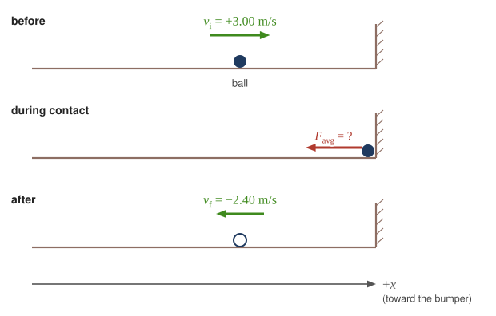
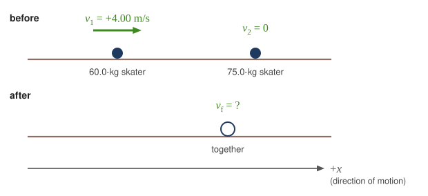
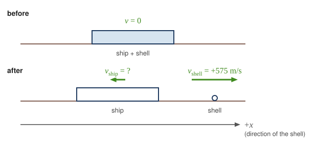
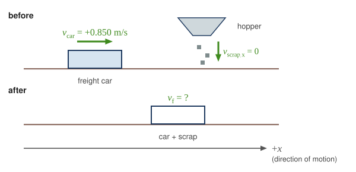
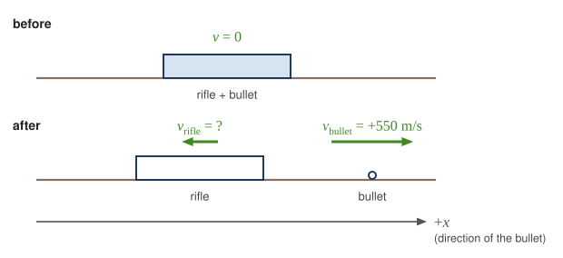
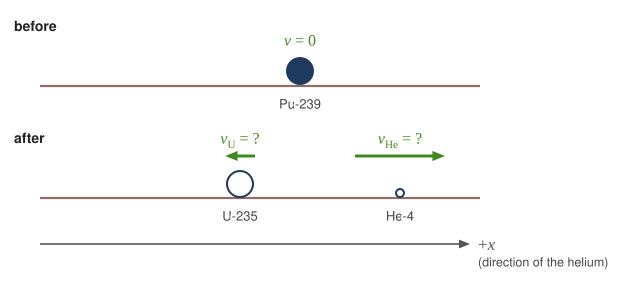
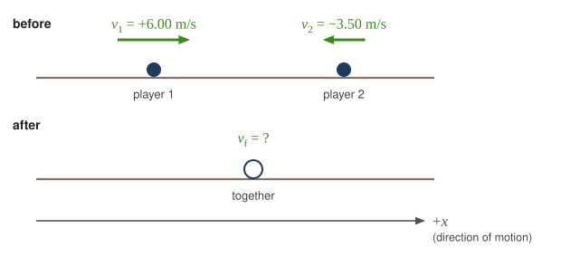
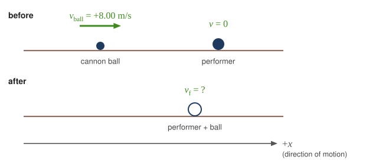
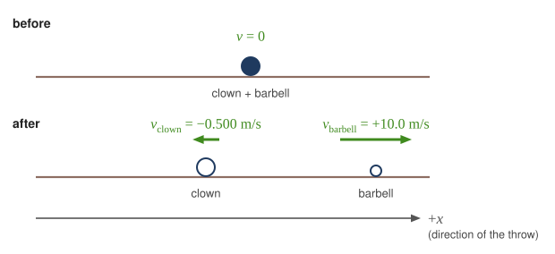

::: abstract

* Define inelastic collision.
* Explain perfectly inelastic collision.
* Apply an understanding of collisions to sports.
* Determine recoil velocity and loss in kinetic energy given mass and initial velocity.

:::

We have seen that in an elastic collision, internal kinetic energy is conserved.
An **inelastic collision** is one in which the internal kinetic energy changes (
it is not conserved). This lack of conservation means that the forces between
colliding objects may remove or add internal kinetic energy. Work done by
internal forces may change the forms of energy within a system. For inelastic
collisions, such as when colliding objects stick together, this internal work
may transform some internal kinetic energy into heat transfer. Or it may convert
stored energy into internal kinetic energy, such as when exploding bolts
separate a satellite from its launch vehicle.

::: note {"class":"note","data-label":""}

Inelastic Collision

An inelastic collision is one in which the internal kinetic energy changes (it is not conserved).

:::

[Figure 1](#Figure1) shows an example of an inelastic collision. Two objects that
have equal masses head toward one another at equal speeds and then stick
together. Their total internal kinetic energy is initially $$ \frac{1}{2}m v^{2}+\frac{1}{2}m v^{2}=m v^{2} $$. The two objects come to rest after sticking
together, conserving momentum. But the internal kinetic energy is zero after the
collision. A collision in which the objects stick together is sometimes called
a **perfectly inelastic collision** because it reduces internal kinetic energy
more than does any other type of inelastic collision. In fact, such a collision
reduces internal kinetic energy to the minimum it can have while still
conserving momentum.

::: note {"class":"note","data-label":""}

Perfectly Inelastic Collision

A collision in which the objects stick together is sometimes called “perfectly inelastic.”

:::

 Two objects of equal mass initially head directly toward one another at the same speed.
(b) The objects stick together (a perfectly inelastic collision), and so their final velocity is zero. The internal kinetic energy of the system changes in any inelastic collision and is reduced to zero in this example.')
{: #Figure1}

::: example

Calculating Velocity and Change in Kinetic Energy: Inelastic Collision of a Puck and a Goalie

(a) Find the recoil velocity of a 70.0-kg ice hockey goalie, originally at rest, who catches a 0.150-kg hockey puck slapped at him at a velocity of 35.0 m/s.
(b) How much kinetic energy is lost during the collision? Assume friction between the ice and the puck-goalie system is negligible. (See [Figure 2](#Figure2) )

![The first picture shows an ice hockey goal keeper of mass m 2 bent on his knees, turning to the left on a frictionless ice surface with zero velocity and a hockey puck of mass m 1 and velocity V 1 moving toward the right. The total momentum of the system is p 1 which is the momentum of the puck and the net force is zero. The second picture shows the goalie to catch the puck. The puck moves with velocity V 1prime and the goalie with velocity V 2 prime and their magnitudes are equal. The momentum of the puck is p 1 prime and the goalie is p 2 prime. The total momentum remains same as before collision. But the kinetic energy after collision is lesser than the kinetic energy before collision. This is true for inelastic collisions.](../resources/Figure_08_05_02.jpg 'An ice hockey goalie catches a hockey puck and recoils backward. The initial kinetic energy of the puck is almost entirely converted to thermal energy and sound in this inelastic collision.')
{: #Figure2}

**Strategy**

Momentum is conserved because the net external force on the puck-goalie system
is zero. We can thus use conservation of momentum to find the final velocity of
the puck and goalie system. Note that the initial velocity of the goalie is zero
and that the final velocity of the puck and goalie are the same. Once the final
velocity is found, the kinetic energies can be calculated before and after the
collision and compared as requested.

**Solution for (a)**

Momentum is conserved because the net external force on the puck-goalie system
is zero.

Conservation of momentum is

 $$ p_{1}+p_{2}={p^{\prime} }_{1}+{p^{\prime} }_{2} $$

or

 $$ m_{1}v_{1}+m_{2}v_{2}=m_{1}{v^{\prime} }_{1}+m_{2}{v^{\prime} }_{2}. $$

Because the goalie is initially at rest, we know $$ v_{2}=0 $$. Because the goalie catches the puck, the final velocities are equal, or $$ {v^{\prime} }_{1}={v^{\prime} }_{2}=v^{\prime} $$. Thus, the conservation of momentum equation simplifies to

 $$ m_{1}v_{1}=\left(m_{1}+m_{2}\right)v^{\prime} . $$

Solving for $$ v^{\prime} $$ yields

 $$ v^{\prime} =\frac{ m_{1}}{ m_{1}+m_{2}}v_{1}. $$

Entering known values in this equation, we get

 $$ v^{\prime} =\left(\frac{0.150 \kg }{0.150 \kg +70.0 \kg }\right)\left(35.0 \ms \right)=7.48 \times 10^{-2} \ms . $$

**Discussion for (a)**

This recoil velocity is small and in the same direction as the puck’s original
velocity, as we might expect.

**Solution for (b)**

Before the collision, the internal kinetic energy $$ \KE_{\text{int}} $$ of the
system is that of the hockey puck, because the goalie is initially at rest.
Therefore, $$ \KE_{\text{int}} $$ is initially

$$ \begin{array}{lll}
\KE_{\text{int}}&=& \frac{1}{2}m v^{2}=\frac{1}{2}\left(0.150 \kg \right){\left(35.0 \ms \right)}^{2}\\
\KE_{\text{int}}&=& 91.9 \J .
\end{array} $$

After the collision, the internal kinetic energy is

$$ \begin{array}{lll}
\KE^\prime_{\text{int}}&=& \frac{1}{2}\left(m+M\right){v}^{2}=
\frac{1}{2}\left(70.15 \kg \right){\left(7.48 \times 10^{-2} \ms \right)}^{2}\\
\KE^\prime_{\text{int}}&=& 0.196 \J .
\end{array} $$

The change in internal kinetic energy is thus

$$ \begin{array}{lll}
\KE^{\prime}_{\text{int}}-\KE_{\text{int}}&=& 0.196 \J -91.9 \J \\
\KE^{\prime}_{\text{int}}-\KE_{\text{int}}&=& -91.7 \J
\end{array} $$

where the minus sign indicates that the energy was lost.

**Discussion for (b)**

Nearly all the initial internal kinetic energy is lost in this perfectly
inelastic collision. $$ \KE_{\text{int}} $$ is mostly converted to thermal
energy and sound.

During some collisions, the objects do not stick together and less of the
internal kinetic energy is removed—such as happens in most automobile accidents.
Alternatively, stored energy may be converted into internal kinetic energy
during a collision. [Figure 3](#Figure3) shows a one-dimensional example in which
two carts on an air track collide, releasing potential energy from a compressed
spring. [Example 2](#example2) deals with data from such a collision.

![A compressed spring is attached to a glider with triangular cross sectional area of mass m 1 which moves with velocity v 1 toward the right. Another solid glider of mass m 2 and triangular cross sectional area moves toward the left with velocity V 2 on a frictionless surface. The total momentum is the sum of their individual momentum p 1 and p 2. After collision m 1 moves to the left with velocity V 1 prime and momentum p 1prime. M 2 moves to the right with velocity V 2 prime. Their individual momentum becomes p 1prime and p 2 prime but the total momentum remains the same. The internal kinetic energy after collision is greater than the kinetic energy before collision.](../resources/Figure_08_05_03.svg 'An air track is nearly frictionless, so that momentum is conserved. Motion is one-dimensional. In this collision, examined in <a href="#example2">Example 2</a>, the potential energy of a compressed spring is released during the collision and is converted to internal kinetic energy.')
{: #Figure3}

Collisions are particularly important in sports and the sporting and leisure
industry utilizes elastic and inelastic collisions. Let us look briefly at
tennis. In a collision, the momentum of the racquet helps determine how much
momentum the ball receives. A heavier racquet moving at the same speed gives the
ball more speed, but a heavier racquet is also harder to swing quickly, so
players choose a racquet that balances mass and swing speed. The same trade-off
applies to bats in other sports.

The location of the impact of the tennis ball on the racquet is also important,
as is the part of the stroke during which the impact occurs. A smooth motion
results in the maximizing of the velocity of the ball after impact and reduces
sports injuries such as tennis elbow. A tennis player tries to hit the ball on
the “sweet spot” on the racquet, where the vibration and impact are minimized
and the ball is able to be given more velocity. Sports science and technologies
also use physics concepts such as momentum and rotational motion and vibrations.

:::

::: note {"class":"note","data-label":""}

Take-Home Experiment—Bouncing of Tennis Ball

1.  Find a racquet (a tennis, badminton, or other racquet will do). Place the racquet on the floor and stand on the handle. Drop a tennis ball on the strings from a measured height. Measure how high the ball bounces. Now ask a friend to hold the racquet firmly by the handle and drop a tennis ball from the same measured height above the racquet. Measure how high the ball bounces and observe what happens to your friend’s hand during the collision. Explain your observations and measurements.
2.  The coefficient of restitution $$ \left(c\right) $$
    is a measure of the elasticity of a collision between a ball and an object, and is defined as the ratio of the relative speed of the objects after the collision to their relative speed before it. A perfectly elastic collision has a
 $$ c $$ of 1. For a ball bouncing off the floor (or a racquet on the
floor), $$ c $$ can be shown to be $$ c=\sqrt{\frac{h}{H}} $$ where $$ h $$  is the height to which the ball bounces and $$ H $$ is the height from which the ball is dropped.
Determine $$ c $$ for the cases in Part 1 and for the case of a tennis ball bouncing off
a concrete or wooden floor ( $$ c\approx 0.75 $$ for new tennis balls used on a tennis court).

:::

::: example {"class":"example","id":"example2"}

Calculating Final Velocity and Energy Release: Two Carts Collide

In the collision pictured in [Figure 3](#Figure3), two carts collide inelastically. Cart 1 (denoted $$ m_{1} $$ carries a spring which is initially compressed. During the collision, the spring
releases its potential energy and converts it to internal kinetic energy. The
mass of cart 1 and the spring is 0.350 kg, and the cart and the spring together
have an initial velocity of $$ 2.00 \ms $$. Cart 2 (denoted $$ m_{2} $$
in [Figure 3](#Figure3)) has a mass of 0.500 kg and an initial
velocity of $$ -0.500 \ms $$. After the collision, cart 1 is observed to recoil
with a velocity of $$-4.00 \ms $$.
(a) What is the final velocity of cart 2?
(b) How much energy was released by the spring (assuming all of it was converted into internal kinetic energy)?

**Strategy**

We can use conservation of momentum to find the final velocity of cart 2,
because $$ F_{\text{net}}=0 $$
(the track is frictionless and the force of the spring is internal). Once this
velocity is determined, we can compare the internal kinetic energy before and
after the collision to see how much energy was released by the spring.

**Solution for (a)**

As before, the equation for conservation of momentum in a two-object system is

 $$ m_{1}v_{1}+m_{2}v_{2}=m_{1}{v^{\prime} }_{1}+m_{2}{v^{\prime} }_{2}. $$

The only unknown in this equation is $$ v^{\prime}_{2} $$. Solving for $$ v^{\prime}_{2} $$
and substituting known values into the previous equation yields

$$ \begin{array}{lll}
v^{\prime}_{2}&=& \frac{ m_{1}v_{1}+m_{2}v_{2}-m_{1}{v^{\prime} }_{1}}{ m_{2}}\\
v^{\prime}_{2}&=& \frac{ \left(0.350 \kg \right)\left(2.00 \ms \right)+
\left(0.500 \kg \right)\left(-0.500 \ms \right)}{0.500 \kg }-
\frac{ \left(0.350 \kg \right)\left(-4.00 \ms \right)}{0.500 \kg }\\
v^{\prime}_{2}&=& 3.70 \ms .
\end{array} $$

**Solution for (b)**

The internal kinetic energy before the collision is

$$ \begin{array}{lll}
\KE_{\text{int}}&=& \frac{1}{2}m_{1}v_{1}^{2}+\frac{1}{2}m_{2}v_{2}^{2}\\
\KE_{\text{int}}&=& \frac{1}{2}\left(0.350 \kg \right){\left(2.00 \ms \right)}^{2}+\frac{1}{2}\left(0.500 \kg \right){\left(-0.500 \ms \right)}^{2}\\
\KE_{\text{int}}&=& 0.763 \J .
\end{array} $$

After the collision, the internal kinetic energy is

$$ \begin{array}{lll}
\KE^\prime_{\text{int}}&=& \frac{1}{2}m_{1}{v^{\prime}}_{1}^{2}+\frac{1}{2}m_{2}{v^{\prime}}_{2}^{2}\\
\KE^\prime_{\text{int}}&=& \frac{1}{2}\left(0.350 \kg \right) \left(-4.00 \ms \right)^{2}+
\frac{1}{2}\left(0.500 \kg \right) \left(3.70 \ms \right)^{2}\\
\KE^\prime_{\text{int}}&=& 6.22 \J .
\end{array} $$

The change in internal kinetic energy is thus

$$ \begin{array}{lll}
\KE^{\prime}_{\text{int}}-\KE_{\text{int}}&=& 6.22 \J -0.763 \J \\
\KE^{\prime}_{\text{int}}-\KE_{\text{int}}&=& 5.46 \J .
\end{array} $$

**Discussion**

The final velocity of cart 2 is large and positive, meaning that it is moving to
the right after the collision. The internal kinetic energy in this collision
increases by 5.46 J. That energy was released by the spring.

:::

### Section Summary

- An inelastic collision is one in which the internal kinetic energy changes (it
  is not conserved).
- A collision in which the objects stick together is sometimes called perfectly
  inelastic because it reduces internal kinetic energy more than does any other
  type of inelastic collision.
- Sports science and technologies also use physics concepts such as momentum and
  rotational motion and vibrations.

### Conceptual Questions

::: problem

What is an inelastic collision? What is a perfectly inelastic collision?

:::

::: solution

**Strategy**

Define each type by what happens to the internal kinetic energy, and illustrate with numbers.

**Solution**

An **inelastic collision** is one in which the **internal kinetic energy changes**, so kinetic energy is not conserved. Usually some is converted into thermal energy, sound, or deformation. (In an explosion-like collision, stored energy can instead add kinetic energy.) Momentum is still conserved if the net external force is zero.

A **perfectly inelastic collision** is one in which the objects **stick together** and move with a common velocity afterward. This gives the largest possible loss of kinetic energy consistent with conservation of momentum.

For example, take $$ +x $$ in the direction of motion. A $$ 2.0 \kg $$ ball of clay moving at $$ 3.0 \ms $$ hits a $$ 1.0 \kg $$ ball of clay at rest, and they stick:

$$ (2.0 \kg)(3.0 \ms) = (3.0 \kg)v' \quad \Rightarrow \quad v' = 2.0 \ms $$

The kinetic energy drops from $$ \tfrac{1}{2}(2.0 \kg)(3.0 \ms)^2 = 9.0 \J $$ to $$ \tfrac{1}{2}(3.0 \kg)(2.0 \ms)^2 = 6.0 \J $$. The $$ 3.0 \J $$ difference becomes thermal energy and deformation of the clay. A tennis ball hitting a racquet is an inelastic collision that is not perfectly inelastic: the ball bounces off but loses some kinetic energy.

An inelastic collision is one in which the internal kinetic energy is not conserved, and a perfectly inelastic collision is one in which the objects stick together, losing as much kinetic energy as momentum conservation allows (for example, $$ 3.0 \J $$ of the $$ 9.0 \J $$ when two clay balls of $$ 2.0 \kg $$ and $$ 1.0 \kg $$ stick).

:::

::: problem

Mixed-pair ice skaters performing in a show are standing motionless at arms length just before starting a routine. They reach out, clasp hands, and pull themselves together by only using their arms. Assuming there is no friction between the blades of their skates and the ice, what is their velocity after their bodies meet?

:::

::: solution

**Strategy**

Take the two skaters as the system. With no friction from the ice and the vertical forces balanced, the net external force is zero, so their total momentum is conserved. Take $$ +x $$ from one skater toward the other.

**Solution**

Before they move, both skaters are at rest, so the total momentum is

$$ p_{\text{tot}} = m_{1}(0 \ms) + m_{2}(0 \ms) = 0 \kg \cdot \ms $$

Pulling on each other's arms, they exert equal and opposite internal forces, which do not change the total momentum. As they pull together, they move toward each other with momenta that are equal and opposite. A $$ 50 \kg $$ skater moving at $$ +1.2 \ms $$ is matched by a $$ 75 \kg $$ skater moving at $$ -0.80 \ms $$, since $$ (50 \kg)(1.2 \ms) + (75 \kg)(-0.80 \ms) = 0 \kg \cdot \ms $$. When their bodies meet and they hold together, they move with a common velocity $$ v' $$, a perfectly inelastic collision:

$$ (m_{1} + m_{2})v' = 0 \kg \cdot \ms \quad \Rightarrow \quad v' = 0 \ms $$

Their center of mass never moved, and they meet there. The kinetic energy they gained from their arm muscles is converted into thermal energy and deformation when they collide.

Their velocity after their bodies meet is zero, because the total momentum of the two skaters was zero before they started and no net external force acts on them, so it remains zero after they come together.

:::

::: problem

A small pickup truck that has a camper shell slowly coasts toward a red light with negligible friction. Two dogs in the back of the truck are moving and making various inelastic collisions with each other and the walls. What is the effect of the dogs on the motion of the center of mass of the system (truck plus entire load)? What is their effect on the motion of the truck?

:::

::: solution

**Strategy**

Take the system to be the truck plus its entire load, including the dogs. The forces between the dogs and the truck are internal. Take $$ +x $$ in the direction the truck is coasting.

**Solution**

**Center of mass.** With negligible friction, the net external horizontal force on the system is zero. Gravity and the road's normal force are vertical and balance. So the total momentum, and therefore the velocity of the center of mass, is constant:

$$ v_{\text{cm}} = \frac{p_{\text{tot}}}{M_{\text{tot}}} = \text{constant} $$

The dogs have **no effect** on the motion of the center of mass, no matter how they run or collide.

**The truck.** The truck itself does change speed slightly. When a $$ 20 \kg $$ dog runs forward, it pushes back on the truck bed, and the truck slows. When the dog hits the front wall and stops, it pushes the truck forward. Suppose the truck plus everything except the dog has mass $$ 2000 \kg $$. If the dog's velocity relative to the ground increases by $$ 3.0 \ms $$, momentum conservation requires the truck's velocity to change by

$$ \Delta v_{\text{truck}} = -\frac{(20 \kg)(3.0 \ms)}{2000 \kg} = -0.030 \ms $$

So the truck jerks back and forth by a few centimeters per second as the dogs move. On average these changes cancel, and the truck moves with the center of mass.

The dogs have no effect on the motion of the center of mass of the truck-plus-load system, which keeps coasting at constant velocity because the dogs' forces are internal, but they make the truck itself speed up and slow down slightly (by about $$ 0.030 \ms $$ when a $$ 20 \kg $$ dog changes its speed by $$ 3.0 \ms $$) as they run and collide.

:::

### Problems &amp; Exercises

::: problem

A 0.240-kg billiard ball that is moving at 3.00 m/s strikes the bumper of a pool table and bounces straight back at 2.40 m/s (80% of its original speed). The collision lasts 0.0150 s.
(a) Calculate the average force exerted on the ball by the bumper.
(b) How much kinetic energy in joules is lost during the collision?
(c) What percent of the original energy is left?

:::

::: solution

**Strategy**

For part (a), we use the impulse-momentum theorem. The ball reverses direction, so the change in momentum includes both the original momentum and the rebound momentum. For parts (b) and (c), we compare kinetic energies before and after.

**Sketch and coordinate system**

{: .sketch}

Take $$ +x $$ in the ball's initial direction, toward the bumper. Then $$ v_i = +3.00\ms $$ and the rebound velocity is $$ v_f = -2.40\ms $$; a negative average force means the bumper pushes the ball along $$ -x $$, away from the bumper.

**Solution**

**Part (a)**

Let positive be the initial direction of motion. The ball reverses direction, so the final velocity is negative.

$$ \Delta p = m(v_f - v_i) = (0.240 \kg)(-2.40 \ms - 3.00 \ms) = (0.240 \kg)(-5.40 \ms) = -1.296 \kg \cdot \ms $$

Apply the impulse-momentum theorem:

$$ F_{\text{avg}} = \frac{\Delta p}{\Delta t} = \frac{-1.296 \kg \cdot \ms}{0.0150 \s} = -86.4 \N $$

The average force on the ball is 86.4 N directed away from the bumper (opposite to the ball's initial motion).

**Part (b)**

Initial kinetic energy:

$$ \KE_{i} = \frac{1}{2}mv_{i}^2 = \frac{1}{2}(0.240 \kg)(3.00 \ms)^2 = 1.08 \J $$

Final kinetic energy:

$$ \KE_{f} = \frac{1}{2}mv_{f}^2 = \frac{1}{2}(0.240 \kg)(2.40 \ms)^2 = 0.691 \J $$

Energy lost:

$$ \Delta \KE = \KE_{i} - \KE_{f} = 1.08 \J - 0.691 \J = 0.389 \J $$

The kinetic energy lost during the collision is 0.389 J.

**Part (c)**

$$ \text{Percent remaining} = \frac{\KE_{f}}{\KE_{i}} \times 100\% = \frac{0.691 \J}{1.08 \J} \times 100\% = 64.0\% $$

64.0% of the original kinetic energy remains after the collision.

**Discussion**

Although the ball retains 80% of its speed, it only retains 64% of its kinetic energy. This is because kinetic energy depends on the square of velocity: $$ (0.80)^2 = 0.64 $$. The lost energy is converted to heat and sound during the collision with the bumper.

:::

::: problem

During an ice show, a 60.0-kg skater leaps into the air and is caught by an initially stationary 75.0-kg skater.
(a) What is their final velocity assuming negligible friction and that the 60.0-kg skater's original horizontal velocity is 4.00 m/s?
(b) How much kinetic energy is lost?

:::

::: solution

**Strategy**

This is a perfectly inelastic collision where the skaters stick together. We use conservation of momentum to find the final velocity, then compare kinetic energies.

**Sketch and coordinate system**

{: .sketch}

Take $$ +x $$ in the leaping skater's direction of motion, so $$ v_1 = +4.00\ms $$ and $$ v_2 = 0 $$. A positive $$ v_f $$ means the pair moves the way the leaping skater was going.

**Solution**

**Part (a)**

Apply conservation of momentum:

$$ m_1 v_1 + m_2 v_2 = (m_1 + m_2) v_f $$

Since the catching skater is initially at rest ($$ v_2 = 0 $$):

$$ (60.0 \kg)(4.00 \ms) + (75.0 \kg)(0) = (60.0 \kg + 75.0 \kg) v_f $$

$$ 240 \kg \cdot \ms = 135 \kg \times v_f $$

$$ v_f = \frac{240 \kg \cdot \ms}{135 \kg} = 1.78 \ms $$

The final velocity of the pair is 1.78 m/s in the direction of the leaping skater's original motion.

**Part (b)**

Initial kinetic energy (only the leaping skater is moving):

$$ \KE_{i} = \frac{1}{2}m_1 v_1^2 = \frac{1}{2}(60.0 \kg)(4.00 \ms)^2 = 480 \J $$

Final kinetic energy (both skaters moving together):

$$ \KE_{f} = \frac{1}{2}(m_1 + m_2) v_f^2 = \frac{(m_1 v_1)^2}{2(m_1 + m_2)} = \frac{(240 \kg \cdot \ms)^2}{2(135 \kg)} = 213.3 \J $$

(Using the unrounded $$ v_f = \frac{240\kg\cdot\ms}{135\kg} $$ avoids the rounding error that $$ 1.78 \ms $$ would introduce.)

Kinetic energy lost:

$$ \Delta \KE = \KE_{i} - \KE_{f} = 480 \J - 213.3 \J = 266.7 \J $$

The kinetic energy lost during the catch is 267 J.

**Discussion**

More than half (55%) of the original kinetic energy is lost in this perfectly inelastic collision. This energy goes into the work done by the skaters' muscles and joints as they absorb the impact, plus some heat and sound. A trained pair skater knows how to absorb this impact safely while maintaining an elegant appearance.

:::

::: problem

**Professional Application**

Using mass and speed data
from [Example 1](./ch8LinearMomentumAndForce#exampleFootball) and
assuming
that the football player catches the ball with his feet off the ground with both
of them moving horizontally, calculate:
(a) the final velocity if the ball and player are going in the same direction
and
(b) the loss of kinetic energy in this case.
(c) Repeat parts (a) and (b) for the situation in which the ball and the player
are going in opposite directions. Might the loss of kinetic energy be related to
how much it hurts to catch the pass?

:::

::: solution

**Strategy**

From Example 1, we use: player mass = 110 kg, player velocity = 8.00 m/s, ball mass = 0.410 kg, ball velocity = 25.0 m/s. We apply conservation of momentum and compare kinetic energies for both cases.

**Solution**

**Part (a) - Same direction**

$$ m_1 v_1 + m_2 v_2 = (m_1 + m_2) v_f $$

$$ (110 \kg)(8.00 \ms) + (0.410 \kg)(25.0 \ms) = (110.41 \kg) v_f $$

$$ 880 \kg \cdot \ms + 10.25 \kg \cdot \ms = (110.41 \kg) v_f $$

$$ v_f = \frac{890.25 \kg \cdot \ms}{110.41 \kg} = 8.06 \ms $$

The final velocity is 8.06 m/s in the original direction.

**Part (b) - Energy loss (same direction)**

$$ \KE_{i} = \frac{1}{2}(110 \kg)(8.00 \ms)^2 + \frac{1}{2}(0.410 \kg)(25.0 \ms)^2 = 3520 \J + 128 \J = 3648 \J $$

Subtracting two large, nearly equal energies amplifies rounding errors (with $$ v_f $$ rounded to 8.06 m/s, the difference comes out as 62 J). Instead, use the exact result for a perfectly inelastic collision, which depends only on the reduced mass and the relative velocity:

$$ \Delta \KE_{\text{loss}} = \frac{1}{2}\left(\frac{m_1 m_2}{m_1 + m_2}\right)(v_1 - v_2)^2 = \frac{1}{2}\left(\frac{(110\kg)(0.410\kg)}{110.41\kg}\right)(8.00\ms - 25.0\ms)^2 = 59.0 \J $$

The kinetic energy lost is 59.0 J.

**Part (c) - Opposite directions**

Ball velocity is now $$ -25.0 \ms $$ (opposite to player):

$$ (110 \kg)(8.00 \ms) + (0.410 \kg)(-25.0 \ms) = (110.41 \kg) v_f $$

$$ 880 \kg \cdot \ms - 10.25 \kg \cdot \ms = (110.41 \kg) v_f $$

$$ v_f = \frac{869.75 \kg \cdot \ms}{110.41 \kg} = 7.88 \ms $$

Energy loss for opposite direction:

$$ \Delta \KE_{\text{loss}} = \frac{1}{2}\left(\frac{m_1 m_2}{m_1 + m_2}\right)(v_1 - v_2)^2 = \frac{1}{2}\left(\frac{(110\kg)(0.410\kg)}{110.41\kg}\right)(8.00\ms + 25.0\ms)^2 = 222 \J $$

The kinetic energy lost is 222 J.

**Discussion**

When the ball is coming toward the player (opposite directions), 3.77 times more kinetic energy is lost (222 J vs. 59.0 J), the ratio $$ (33.0/17.0)^2 $$ of the squared relative speeds. This lost energy is absorbed by the player's hands and arms as they decelerate and then accelerate the ball to match the player's velocity. This is why catching a ball thrown against your direction of motion hurts more—more energy must be dissipated in your body.

:::

::: problem

A battleship that is $$ 6.00 \times 10^{7}\kg $$ and is originally at rest fires a 1100-kg artillery shell horizontally with a
velocity of 575 m/s.
(a) If the shell is fired straight aft (toward the rear of
the ship), there will be negligible friction opposing the ship's recoil.
Calculate its recoil velocity.
(b) Calculate the increase in internal kinetic
energy (that is, for the ship and the shell). This energy is less than the
energy released by the gun powder—significant heat transfer occurs.

:::

::: solution

**Strategy**

This is an "explosion" type problem where an initially stationary system separates into two parts. We use conservation of momentum for part (a) and calculate the total kinetic energy after firing for part (b).

**Sketch and coordinate system**

{: .sketch}

Take $$ +x $$ in the direction the shell is fired (toward the rear of the ship), so $$ v_{\text{shell}} = +575\ms $$. Since the total momentum stays zero, $$ v_{\text{ship}} $$ comes out negative: the ship recoils along $$ -x $$, toward its bow.

**Solution**

**Part (a)**

Initial momentum is zero (ship and shell at rest). Apply conservation of momentum:

$$ 0 = m_{\text{ship}} v_{\text{ship}} + m_{\text{shell}} v_{\text{shell}} $$

$$ v_{\text{ship}} = -\frac{m_{\text{shell}} v_{\text{shell}}}{m_{\text{ship}}} $$

$$ v_{\text{ship}} = -\frac{(1100 \kg)(575 \ms)}{6.00 \times 10^{7} \kg} = -1.05 \times 10^{-2} \ms $$

The recoil velocity of the battleship is $$ 1.05 \times 10^{-2} \ms $$ (about 1 cm/s) in the direction opposite to the shell.

**Part (b)**

Initial kinetic energy: $$ \KE_{i} = 0 $$ (both at rest)

Final kinetic energy:

$$ \KE_{f} = \frac{1}{2}m_{\text{shell}} v_{\text{shell}}^2 + \frac{1}{2}m_{\text{ship}} v_{\text{ship}}^2 $$

$$ \KE_{f} = \frac{1}{2}(1100 \kg)(575 \ms)^2 + \frac{1}{2}(6.00 \times 10^{7} \kg)(1.05 \times 10^{-2} \ms)^2 $$

$$ \KE_{f} = 1.82 \times 10^{8} \J + 3.31 \times 10^{3} \J = 1.82 \times 10^{8} \J $$

The increase in internal kinetic energy is $$ 1.82 \times 10^{8} \J $$ (182 MJ).

**Discussion**

The ship's recoil velocity is tiny (1 cm/s) despite the massive momentum transfer because of the ship's enormous mass. Nearly all (99.998%) of the kinetic energy goes to the shell rather than the ship. The chemical energy released by the gunpowder is considerably larger than 182 MJ—much energy is lost to heat, sound, and deforming the gun barrel.

:::

::: problem

**Professional Application**

Two manned satellites approaching one another, at a relative speed of 0.250 m/s,
intending to dock. The first has a mass of $$ 4.00 \times 10^{3}\kg $$, and the
second a mass of $$ 7.50\times 10^{3}\kg $$.
(a) Calculate the final velocity (after docking) by using the frame of reference
in which the first satellite was originally at rest.
(b) What is the loss of kinetic energy in this inelastic collision?
(c) Repeat both parts by using the frame of reference in which the second
satellite was originally at rest. Explain why the final velocity is
different in the two frames, whereas the change in kinetic energy is the same in
both.

:::

::: solution

**Strategy**

This is a perfectly inelastic collision (docking). We analyze it in two different reference frames. In each frame, we apply conservation of momentum to find the final velocity, then calculate the kinetic energy loss. The key insight is that while velocities are frame-dependent, energy loss is the same in all inertial frames.

**Sketch and coordinate system**

{: .sketch}

In both frames take $$ +x $$ from satellite 2 toward satellite 1. In the frame of part (a), satellite 2 approaches with $$ v_2 = +0.250\ms $$; in the frame of part (c), satellite 1 approaches with $$ v_1 = -0.250\ms $$. The sign of $$ v_f $$ then tells which way the docked pair moves in each frame.

**Solution**

**Part (a) - Frame where first satellite is at rest**

In this reference frame:
- First satellite: $$ m_1 = 4.00 \times 10^3 \kg $$, $$ v_1 = 0 $$
- Second satellite: $$ m_2 = 7.50 \times 10^3 \kg $$, $$ v_2 = 0.250 \ms $$ (approaching)

Apply conservation of momentum:

$$ m_1 v_1 + m_2 v_2 = (m_1 + m_2) v_f $$

$$ (4.00 \times 10^3 \kg)(0) + (7.50 \times 10^3 \kg)(0.250 \ms) = (11.5 \times 10^3 \kg) v_f $$

$$ 1875 \kg \cdot \ms = (11500 \kg) v_f $$

$$ v_f = \frac{1875 \text{kg}\cdot\text{m/s}}{11500 \kg} = 0.16304 \ms \approx 0.163 \ms $$

The final velocity is 0.163 m/s in the direction of motion of the more massive satellite.

**Part (b) - Energy loss**

Initial kinetic energy (only satellite 2 is moving in this frame):

$$ \KE_{i} = \frac{1}{2} m_2 v_2^2 = \frac{1}{2}(7.50 \times 10^3 \kg)(0.250 \ms)^2 = 234.375 \J $$

Final kinetic energy:

$$ \KE_{f} = \frac{1}{2}(m_1 + m_2) v_f^2 = \frac{1}{2}(11.5 \times 10^3 \kg)(0.16304 \ms)^2 = 152.853 \J $$

Energy lost:

$$ \Delta \KE = \KE_{f} - \KE_{i} = 152.853 \J - 234.375 \J = -81.522 \J $$

The kinetic energy lost is 81.5 J.

**Part (c) - Frame where second satellite is at rest**

In this reference frame:
- First satellite: $$ m_1 = 4.00 \times 10^3 \kg $$, $$ v_1 = -0.250 \ms $$ (approaching)
- Second satellite: $$ m_2 = 7.50 \times 10^3 \kg $$, $$ v_2 = 0 $$

Apply conservation of momentum:

$$ (4.00 \times 10^3 \kg)(-0.250 \ms) + (7.50 \times 10^3 \kg)(0) = (11.5 \times 10^3 \kg) v_f $$

$$ -1000 \kg \cdot \ms = (11500 \kg) v_f $$

$$ v_f = -\frac{1000 \text{kg}\cdot\text{m/s}}{11500 \kg} = -0.086957 \ms \approx -0.0870 \ms $$

The final velocity is $$ 8.70 \times 10^{-2} \ms $$ in the direction of motion of the less massive satellite.

Energy loss in this frame:

Initial kinetic energy:

$$ \KE_{i} = \frac{1}{2} m_1 v_1^2 = \frac{1}{2}(4.00 \times 10^3 \kg)(0.250 \ms)^2 = 125 \J $$

Final kinetic energy:

$$ \KE_{f} = \frac{1}{2}(11.5 \times 10^3 \kg)(0.086957 \ms)^2 = 43.478 \J $$

$$ \Delta \KE = 43.478 \J - 125 \J = -81.522 \J $$

The energy loss is 81.5 J, the same as in part (b).

**Discussion**

The final velocities differ in the two reference frames (0.163 m/s vs. -0.0870 m/s) because velocity is frame-dependent. However, the kinetic energy loss is the same in both frames (81.522 J, or 81.5 J). Note that each satellite's **change** in velocity is the same in both frames (Galilean velocity changes do not depend on the frame); it is the final velocity that differs. This is because the energy lost to internal forces—converted to heat, deformation, and vibration during docking—is an invariant quantity independent of the reference frame. The center of mass of the system moves at constant velocity in both frames since there are no external forces, and the energy dissipated in the collision is the same regardless of which frame we use to observe it.

:::

::: problem

**Professional Application**

A 30 000-kg freight car is coasting at 0.850 m/s with negligible friction under
a hopper that dumps 110 000 kg of scrap metal into it.
(a) What is the final velocity of the loaded freight car?
(b) How much kinetic energy is lost?

:::

::: solution

**Strategy**

This is a perfectly inelastic collision where the scrap metal (initially at rest horizontally) joins the moving freight car. We apply conservation of horizontal momentum.

**Sketch and coordinate system**

{: .sketch}

Take $$ +x $$ in the direction the freight car coasts, so $$ v_{\text{car}} = +0.850\ms $$. The scrap falls straight down, so its $$ x $$-velocity is zero; only $$ x $$-momentum is conserved, because the track supplies the vertical forces.

**Solution**

**Part (a)**

The scrap metal has no horizontal velocity before landing in the car. Apply conservation of momentum:

$$ m_{\text{car}} v_{\text{car}} + m_{\text{scrap}} v_{\text{scrap}} = (m_{\text{car}} + m_{\text{scrap}}) v_f $$

$$ (30000 \kg)(0.850 \ms) + (110000 \kg)(0) = (140000 \kg) v_f $$

$$ 25500 \kg \cdot \ms = (140000 \kg) v_f $$

$$ v_f = \frac{25500 \kg \cdot \ms}{140000 \kg} = 0.182 \ms $$

The final velocity of the loaded freight car is 0.182 m/s.

**Part (b)**

Initial kinetic energy:

$$ \KE_{i} = \frac{1}{2}(30000 \kg)(0.850 \ms)^2 = 10\,838 \J $$

Final kinetic energy:

$$ \KE_{f} = \frac{1}{2}(140000 \kg)(0.1821 \ms)^2 = 2322 \J $$

Kinetic energy lost:

$$ \Delta \KE = \KE_{f} - \KE_{i} = 2322 \J - 10\,838 \J = -8516 \J \approx -8.52 \times 10^{3} \J $$

Approximately 8500 J of kinetic energy is lost.

**Discussion**

The car slows dramatically from 0.850 m/s to 0.182 m/s—a reduction of nearly 80%—because the added mass is almost 4 times the original car mass. About 79% of the kinetic energy is lost, converted to heat and sound as the scrap metal settles and deforms in the car.

:::

::: problem

**Professional Application**

Space probes may be separated from their launchers by exploding bolts. (They
bolt away from one another.) Suppose a 4800-kg satellite uses this method to
separate from the 1500-kg remains of its launcher, and that 5000 J of kinetic
energy is supplied to the two parts. What are their subsequent velocities using
the frame of reference in which they were at rest before separation?

:::

::: solution

**Strategy**

This is an "explosion" problem where initial momentum is zero and energy is added. We use two equations: conservation of momentum (gives relationship between velocities) and the kinetic energy equation (gives magnitudes).

**Sketch and coordinate system**

{: .sketch}

Take $$ +x $$ in the direction the satellite moves after separation, in the frame where both parts start at rest. Then $$ v_1 $$ is positive, and conservation of momentum makes the launcher's velocity $$ v_2 = -3.2\,v_1 $$ negative.

**Solution**

Conservation of momentum (initial momentum = 0):

$$ m_1 v_1 + m_2 v_2 = 0 $$

$$ (4800 \kg) v_1 + (1500 \kg) v_2 = 0 $$

$$ v_2 = -\frac{4800 \kg}{1500 \kg} v_1 = -3.2 v_1 $$

The kinetic energy supplied:

$$ \KE = \frac{1}{2} m_1 v_1^2 + \frac{1}{2} m_2 v_2^2 = 5000 \J $$

Substitute $$ v_2 = -3.2 v_1 $$:

$$ \frac{1}{2}(4800 \kg) v_1^2 + \frac{1}{2}(1500 \kg)(-3.2 v_1)^2 = 5000 \J $$

$$ 2400 \kg v_1^2 + 750 \kg(10.24) v_1^2 = 5000 \J $$

$$ 2400 \kg v_1^2 + 7680 \kg v_1^2 = 5000 \J $$

$$ 10080 \kg v_1^2 = 5000 \J $$

$$ v_1 = \sqrt{\frac{5000 \J}{10080 \kg}} = 0.704 \ms $$

Now find $$ v_2 $$:

$$ v_2 = -3.2(0.704 \ms) = -2.25 \ms $$

The satellite moves at 0.704 m/s and the launcher remains move at 2.25 m/s in the opposite direction.

**Discussion**

The lighter launcher remains move faster (2.25 m/s vs 0.704 m/s) because momentum must be conserved. The velocity ratio (3.2) equals the inverse mass ratio (4800/1500). The lighter object receives more of the kinetic energy because $$ \KE \propto v^2 $$ and the lighter object moves faster.

:::

::: problem

A 0.0250-kg bullet is accelerated from rest to a speed of 550 m/s in a 3.00-kg rifle. The pain of the rifle's kick is much worse if you hold the gun loosely a few centimeters from your shoulder rather than holding it tightly against your shoulder.
(a) Calculate the recoil velocity of the rifle if it is held loosely away from the shoulder.
(b) How much kinetic energy does the rifle gain?
(c) What is the recoil velocity if the rifle is held tightly against the shoulder, making the effective mass 28.0 kg?
(d) How much kinetic energy is transferred to the rifle-shoulder combination? The pain is related to the amount of kinetic energy, which is significantly less in this latter situation. (e) Calculate the momentum of a 110-kg football player running at 8.00 m/s. Compare the player's momentum with the momentum of a hard-thrown 0.410-kg football that has a speed of 25.0 m/s. Discuss its relationship to this problem.

:::

::: solution

**Strategy**

We use conservation of momentum to find recoil velocities. The rifle (or rifle-shoulder system) recoils with momentum equal and opposite to the bullet. Then we calculate kinetic energies.

**Sketch and coordinate system**

{: .sketch}

Take $$ +x $$ in the direction the bullet is fired, so $$ v_{\text{bullet}} = +550\ms $$. The total momentum stays zero, so the rifle's velocity comes out negative: it recoils along $$ -x $$.

**Solution**

**Part (a)**

Conservation of momentum (initially at rest):

$$ m_{\text{bullet}} v_{\text{bullet}} + m_{\text{rifle}} v_{\text{rifle}} = 0 $$

$$ v_{\text{rifle}} = -\frac{m_{\text{bullet}} v_{\text{bullet}}}{m_{\text{rifle}}} = -\frac{(0.0250 \kg)(550 \ms)}{3.00 \kg} = -4.58 \ms $$

The rifle recoils at 4.58 m/s away from the bullet.

**Part (b)**

$$ \KE_{\text{rifle}} = \frac{1}{2} m_{\text{rifle}} v_{\text{rifle}}^2 = \frac{1}{2}(3.00 \kg)(4.58 \ms)^2 = 31.5 \J $$

The rifle gains 31.5 J of kinetic energy.

**Part (c)**

With effective mass of 28.0 kg (rifle + shoulder):

$$ v_{\text{system}} = -\frac{(0.0250 \kg)(550 \ms)}{28.0 \kg} = -0.491 \ms $$

The recoil velocity is 0.491 m/s when held tightly.

**Part (d)**

$$ \KE_{\text{system}} = \frac{1}{2}(28.0 \kg)(0.491 \ms)^2 = 3.38 \J $$

Only 3.38 J of kinetic energy is transferred to the rifle-shoulder combination.

**Part (e)**

Football player momentum: $$ p = (110 \kg)(8.00 \ms) = 880 \kg \cdot \ms $$

Football momentum: $$ p = (0.410 \kg)(25.0 \ms) = 10.25 \kg \cdot \ms $$

Ratio: $$ \frac{880 \text{kg}\cdot\text{m/s}}{10.25 \text{kg}\cdot\text{m/s}} = 85.9 $$

The player has about 86 times more momentum than the football.

**Discussion**

Holding the rifle tightly reduces the recoil kinetic energy from 31.5 J to 3.38 J—a factor of 9.3 reduction! This dramatically reduces pain and bruising. The key insight is that the same momentum is absorbed, but spreading it across a larger mass reduces velocity and kinetic energy. Similarly, in football, the much more massive player absorbs the ball's momentum with minimal velocity change.

:::

::: problem

**Professional Application**

One of the waste products of a nuclear reactor is plutonium-239 $$ \left( {}^{239}\text{Pu}\right) $$. This nucleus is radioactive and decays by splitting
into a helium-4 nucleus and a uranium-235 nucleus $$ \left( {}^{4}{\text{He}}+{}^{235}U\right) $$, the latter of which is also radioactive
and will itself decay some time later. The energy emitted in the plutonium decay
is $$ 8.40\times 10^{-13} \J $$ and is entirely converted to kinetic energy of
the helium and uranium nuclei. The mass of the helium nucleus is $$ 6.68\times 10^{-27}\kg $$, while that of the uranium is $$ 3.92 \times 10^{-25}\kg $$
(note that the ratio of the masses is 4 to 235).
(a) Calculate the velocities of the two nuclei, assuming the plutonium nucleus
is originally at rest.
(b) How much kinetic energy does each nucleus carry away? Note that the data
given here are accurate to three digits only.

:::

::: solution

**Strategy**

This is similar to an explosion problem: initial momentum is zero, and energy is released. We use conservation of momentum and the kinetic energy equation to solve for both velocities.

**Sketch and coordinate system**

{: .sketch}

Take $$ +x $$ in the direction the helium nucleus moves, so $$ v_{\text{He}} $$ is positive. With the plutonium nucleus initially at rest, $$ v_{\text{U}} = -(m_{\text{He}}/m_{\text{U}})\,v_{\text{He}} $$ is negative: the uranium nucleus recoils along $$ -x $$.

**Solution**

**Part (a)**

Conservation of momentum (plutonium initially at rest):

$$ m_{\text{He}} v_{\text{He}} + m_{\text{U}} v_{\text{U}} = 0 $$

$$ v_{\text{U}} = -\frac{m_{\text{He}}}{m_{\text{U}}} v_{\text{He}} = -\frac{6.68 \times 10^{-27} \kg}{3.92 \times 10^{-25} \kg} v_{\text{He}} = -0.01704 v_{\text{He}} $$

Total kinetic energy:

$$ \frac{1}{2} m_{\text{He}} v_{\text{He}}^2 + \frac{1}{2} m_{\text{U}} v_{\text{U}}^2 = 8.40 \times 10^{-13} \J $$

Substituting $$ v_{\text{U}} = -0.01704 v_{\text{He}} $$:

$$ \frac{1}{2}(6.68 \times 10^{-27} \kg) v_{\text{He}}^2 + \frac{1}{2}(3.92 \times 10^{-25} \kg)(0.01704)^2 v_{\text{He}}^2 = 8.40 \times 10^{-13} \J $$

$$ (3.34 \times 10^{-27} \kg + 5.69 \times 10^{-29} \kg) v_{\text{He}}^2 = 8.40 \times 10^{-13} \J $$

$$ (3.40 \times 10^{-27} \kg) v_{\text{He}}^2 = 8.40 \times 10^{-13} \J $$

$$ v_{\text{He}} = \sqrt{\frac{8.40 \times 10^{-13} \J}{3.40 \times 10^{-27} \kg}} = 1.57 \times 10^{7} \ms $$

$$ v_{\text{U}} = -0.01704 (1.57 \times 10^{7} \ms) = -2.68 \times 10^{5} \ms $$

The helium nucleus moves at $$ 1.57 \times 10^{7} \ms $$ and the uranium nucleus moves at $$ 2.68 \times 10^{5} \ms $$ in the opposite direction.

**Part (b)**

$$ \KE_{\text{He}} = \frac{1}{2}(6.68 \times 10^{-27} \kg)(1.57 \times 10^{7} \ms)^2 = 8.26 \times 10^{-13} \J $$

(computed without rounding the speed; because the momenta are equal and opposite, the energy divides as $$ \KE_{\text{He}} = E\,m_{\text{U}}/(m_{\text{He}} + m_{\text{U}}) $$, so the two shares add to exactly $$ 8.40 \times 10^{-13} $$ J)

$$ \KE_{\text{U}} = \frac{1}{2}(3.92 \times 10^{-25} \kg)(2.68 \times 10^{5} \ms)^2 = 1.41 \times 10^{-14} \J $$

The helium nucleus carries away $$ 8.26 \times 10^{-13} \J $$ (98%) and the uranium nucleus carries away $$ 1.41 \times 10^{-14} \J $$ (2%).

**Discussion**

The light helium nucleus (alpha particle) carries away 98% of the energy while the massive uranium nucleus carries only 2%. This is because, for equal momenta, kinetic energy is inversely proportional to mass ($$ \KE = p^2/2m $$). The alpha particle travels at about 5% the speed of light!

:::

::: problem

**Professional Application**

The Moon’s craters are remnants of meteorite collisions. Suppose a fairly large
asteroid that has a mass of $$ 5.00 \times {10}^{12}\kg $$
(about a kilometer across) strikes the Moon at a speed of 15.0 km/s.
(a) At what speed does the Moon recoil after the perfectly inelastic collision (
the mass of the Moon is $$7.36 \times {10}^{22}\kg $$) ?
(b) How much kinetic energy is lost in the collision? Such an event may have
been observed by medieval English monks who reported observing a red glow and
subsequent haze about the Moon.
(c) In October 2009, NASA crashed a rocket into the Moon, and analyzed the plume
produced by the impact. (Significant amounts of water were detected.) Answer
part (a) and (b) for this real-life experiment. The mass of the rocket was 2000
kg and its speed upon impact was 9000 km/h. How does the plume produced alter
these results?

:::

::: solution

**Strategy**

This problem involves perfectly inelastic collisions where an object strikes the Moon and sticks to it. We use conservation of momentum to find the Moon's recoil velocity, then calculate the kinetic energy before and after collision. The Moon's enormous mass means it barely moves, but significant energy is dissipated.

**Solution**

**Part (a) - Asteroid collision**

Given:
- Asteroid mass: $$ m_a = 5.00 \times 10^{12} \kg $$
- Asteroid velocity: $$ v_a = 15.0 \text{ km/s} = 1.50 \times 10^4 \ms $$
- Moon mass: $$ m_M = 7.36 \times 10^{22} \kg $$
- Moon initial velocity: $$ v_M = 0 $$ (in Moon's reference frame)

Apply conservation of momentum:

$$ m_a v_a + m_M v_M = (m_a + m_M) v_f $$

$$ (5.00 \times 10^{12} \kg)(1.50 \times 10^4 \ms) + 0 = (m_a + m_M) v_f $$

Since $$ m_M \gg m_a $$, we have $$ m_a + m_M \approx m_M $$:

$$ v_f = \frac{m_a v_a}{m_M} = \frac{(5.00 \times 10^{12} \kg)(1.50 \times 10^4 \ms)}{7.36 \times 10^{22} \kg} = 1.02 \times 10^{-6} \ms $$

The Moon recoils at approximately $$ 1.02 \times 10^{-6} \ms $$ (about 1 micrometer per second).

**Part (b) - Energy lost in asteroid collision**

Initial kinetic energy (only asteroid moving):

$$ \KE_{i} = \frac{1}{2} m_a v_a^2 = \frac{1}{2}(5.00 \times 10^{12} \kg)(1.50 \times 10^4 \ms)^2 = 5.625 \times 10^{20} \J $$

Final kinetic energy:

$$ \KE_{f} = \frac{1}{2}(m_a + m_M) v_f^2 \approx \frac{1}{2}(7.36 \times 10^{22} \kg)(1.02 \times 10^{-6} \ms)^2 = 3.83 \times 10^{10} \J $$

Energy lost:

$$ \Delta \KE = \KE_{f} - \KE_{i} = 3.83 \times 10^{10} \J - 5.625 \times 10^{20} \J \approx -5.63 \times 10^{20} \J $$

Essentially all of the asteroid's kinetic energy ($$ 5.63 \times 10^{20} \J $$) is lost, converted to heat, crater formation, vaporization, and seismic waves.

**Part (c) - NASA rocket experiment (2009)**

Given:
- Rocket mass: $$ m_r = 2000 \kg $$
- Rocket speed: $$ v_r = 9000 \text{ km/h} = \frac{9000 \times 10^3 \text{ m}}{3600 \text{ s}} = 2500 \ms $$

Recoil velocity:

$$ v_f = \frac{m_r v_r}{m_M} = \frac{(2000 \kg)(2500 \ms)}{7.36 \times 10^{22} \kg} = 6.79 \times 10^{-17} \ms $$

The Moon's recoil velocity is $$ 6.79 \times 10^{-17} \ms $$ (essentially unmeasurable).

Energy lost:

$$ \KE_{i} = \frac{1}{2}(2000 \kg)(2500 \ms)^2 = 6.25 \times 10^9 \J $$

$$ \KE_{f} = \frac{1}{2}(7.36 \times 10^{22} \kg)(6.79 \times 10^{-17} \ms)^2 = 1.7 \times 10^{-10} \J $$

Energy lost is approximately $$ 6.25 \times 10^9 \J $$ (6.25 GJ).

Regarding the plume: The calculations above treat the collision as perfectly inelastic, with no ejecta, so that the rocket and Moon end with a single common velocity. That is a valid idealization, but a real impact throws up a plume of lunar material. Momentum conservation then fixes the total momentum of the **Moon plus plume**, not the momentum of the solid Moon alone:

$$ p_{	ext{Moon}} = p_{	ext{initial}} - p_{	ext{plume}} $$

Material ejected back toward the direction the rocket came from carries momentum opposite to the rocket's, so the solid Moon's instantaneous recoil is **larger** than the no-ejecta result. This is true even if the plume is gravitationally bound and later falls back. Its return then changes the Moon's motion again, and only the motion of the combined center of mass of Moon plus plume is fixed by the rocket's initial momentum throughout. The plume also carries kinetic energy, so the final state is not a single body moving with one common velocity, and somewhat less energy is converted to heat and deformation than the no-ejecta calculation suggests.

**Discussion**

The Moon barely recoils in either collision due to its enormous mass—it's about $$ 1.47 \times 10^{10} $$ times (15 billion times) more massive than the asteroid and about $$ 3.68 \times 10^{19} $$ times more massive than the rocket. In the asteroid collision, over 99.99999% of the kinetic energy is dissipated, creating the crater, vaporizing rock, generating heat, and producing seismic waves that medieval monks may have observed as a "red glow." The NASA experiment converted essentially all 6.25 GJ of the rocket's kinetic energy into crater formation, vaporization, and the plume's motion—which allowed scientists to analyze the ejected material and discover water ice in the lunar regolith. These examples illustrate why impacts with astronomical bodies are so devastating: the energy cannot go into moving the massive planet or moon, so it must be dissipated locally through destructive processes.

:::

::: problem

**Professional Application**

Two football players collide head-on in midair while trying to catch a thrown
football. The first player is 95.0 kg and has an initial velocity of 6.00 m/s,
while the second player is 115 kg and has an initial velocity of -3.50 m/s. What
is their velocity just after impact if they cling together?

:::

::: solution

**Strategy**

This is a perfectly inelastic collision where the players stick together. We apply conservation of momentum, noting that they are moving in opposite directions.

**Sketch and coordinate system**

{: .sketch}

Take $$ +x $$ in the first player's direction of motion, as the problem's signs already do, so $$ v_1 = +6.00\ms $$ and $$ v_2 = -3.50\ms $$. A positive $$ v_f $$ means the pair moves the way the first player was going.

**Solution**

Apply conservation of momentum:

$$ m_1 v_1 + m_2 v_2 = (m_1 + m_2) v_f $$

$$ (95.0 \kg)(6.00 \ms) + (115 \kg)(-3.50 \ms) = (95.0 \kg + 115 \kg) v_f $$

$$ 570 \kg \cdot \ms - 402.5 \kg \cdot \ms = (210 \kg) v_f $$

$$ 167.5 \kg \cdot \ms = (210 \kg) v_f $$

$$ v_f = \frac{167.5 \kg \cdot \ms}{210 \kg} = 0.798 \ms $$

The velocity of the players just after impact is 0.798 m/s in the direction of the first player's initial motion.

**Discussion**

Despite the second player being heavier (115 kg vs 95 kg), the first player's greater speed (6.00 m/s vs 3.50 m/s) gives him more momentum (570 vs 402.5 kg·m/s). The final velocity is in the direction of the player with more momentum, but the combined system moves much slower than either initial velocity. This is a dramatic collision—both players essentially stop each other, which explains why such collisions can cause injuries.

:::

::: problem

What is the speed of a garbage truck that is $$ 1.20 \times 10^{4}\kg $$ and is initially moving at 25.0 m/s just after it hits and adheres to a trash
can that is 80.0 kg and is initially at rest?

:::

::: solution

**Strategy**

This is a perfectly inelastic collision where the trash can (initially at rest) adheres to the moving truck. We apply conservation of momentum.

**Solution**

Apply conservation of momentum:

$$ m_{\text{truck}} v_{\text{truck}} + m_{\text{can}} v_{\text{can}} = (m_{\text{truck}} + m_{\text{can}}) v_f $$

Since the trash can is initially at rest:

$$ (1.20 \times 10^{4} \kg)(25.0 \ms) + (80.0 \kg)(0) = (1.20 \times 10^{4} \kg + 80.0 \kg) v_f $$

$$ 3.00 \times 10^{5} \kg \cdot \ms = (12080 \kg) v_f $$

$$ v_f = \frac{3.00 \times 10^{5} \kg \cdot \ms}{12080 \kg} = 24.8 \ms $$

The speed of the garbage truck after hitting the trash can is 24.8 m/s.

**Discussion**

The truck barely slows down (from 25.0 to 24.83 m/s, a decrease of only 0.66%) because the trash can's mass is only 0.67% of the truck's mass. The trash can has negligible effect on the massive truck's motion. This example illustrates why it's important for pedestrians and small objects to stay clear of large moving vehicles—the vehicle's motion is essentially unaffected while the smaller object absorbs enormous energy changes.

:::

::: problem

During a circus act, an elderly performer thrills the crowd by catching a cannon ball shot at him. The cannon ball has a mass of 10.0 kg and the horizontal component of its velocity is 8.00 m/s when the 65.0-kg performer catches it. If the performer is on nearly frictionless roller skates, what is his recoil velocity?

:::

::: solution

**Strategy**

This is a perfectly inelastic collision. The performer (initially at rest on frictionless roller skates) catches and holds the cannon ball. We apply conservation of horizontal momentum.

**Sketch and coordinate system**

{: .sketch}

Take $$ +x $$ in the direction of the cannon ball's horizontal motion, so $$ v_{\text{ball}} = +8.00\ms $$ and the performer starts with $$ v = 0 $$. Only horizontal momentum is conserved, since the ground supplies the vertical forces.

**Solution**

Apply conservation of momentum:

$$ m_{\text{ball}} v_{\text{ball}} + m_{\text{performer}} v_{\text{performer}} = (m_{\text{ball}} + m_{\text{performer}}) v_f $$

The performer is initially at rest:

$$ (10.0 \kg)(8.00 \ms) + (65.0 \kg)(0) = (10.0 \kg + 65.0 \kg) v_f $$

$$ 80.0 \kg \cdot \ms = (75.0 \kg) v_f $$

$$ v_f = \frac{80.0 \kg \cdot \ms}{75.0 \kg} = 1.07 \ms $$

The performer's recoil velocity is 1.07 m/s in the direction the cannon ball was traveling.

**Discussion**

The performer recoils at a modest 1.07 m/s (about 3.8 km/h or walking speed) despite catching a 10-kg cannon ball. This is because his mass is 6.5 times the ball's mass. The frictionless roller skates allow momentum to be conserved horizontally. In reality, the performer would need strong arms to absorb the impact over a short distance, and might lean back to increase the catching time and reduce the force.

:::

::: problem

(a) During an ice skating performance, an initially motionless 80.0-kg clown throws a fake barbell away. The clown's ice skates allow her to recoil frictionlessly. If the clown recoils with a velocity of 0.500 m/s and the barbell is thrown with a velocity of 10.0 m/s, what is the mass of the barbell?
(b) How much kinetic energy is gained by this maneuver?
(c) Where does the kinetic energy come from?

:::

::: solution

**Strategy**

This is an "explosion" type problem where an initially stationary system separates into two parts. We use conservation of momentum to find the barbell's mass, then calculate the total kinetic energy gained.

**Sketch and coordinate system**

{: .sketch}

Take $$ +x $$ in the direction the barbell is thrown, so $$ v_{\text{barbell}} = +10.0\ms $$ and the clown's recoil velocity is $$ v_{\text{clown}} = -0.500\ms $$.

**Solution**

**Part (a)**

Conservation of momentum (initial momentum = 0):

$$ m_{\text{clown}} v_{\text{clown}} + m_{\text{barbell}} v_{\text{barbell}} = 0 $$

Note: The clown and barbell move in opposite directions, so their velocities have opposite signs. Let the barbell move in the positive direction.

$$ (80.0 \kg)(-0.500 \ms) + m_{\text{barbell}}(10.0 \ms) = 0 $$

$$ -40.0 \kg \cdot \ms + m_{\text{barbell}}(10.0 \ms) = 0 $$

$$ m_{\text{barbell}} = \frac{40.0 \kg \cdot \ms}{10.0 \ms} = 4.00 \kg $$

The mass of the barbell is 4.00 kg.

**Part (b)**

Initial kinetic energy: $$ \KE_{i} = 0 $$ (both at rest)

Final kinetic energy:

$$ \KE_{f} = \frac{1}{2} m_{\text{clown}} v_{\text{clown}}^2 + \frac{1}{2} m_{\text{barbell}} v_{\text{barbell}}^2 $$

$$ \KE_{f} = \frac{1}{2}(80.0 \kg)(0.500 \ms)^2 + \frac{1}{2}(4.00 \kg)(10.0 \ms)^2 $$

$$ \KE_{f} = 10.0 \J + 200 \J = 210 \J $$

The kinetic energy gained is 210 J.

**Part (c)**

The kinetic energy comes from the chemical potential energy stored in the clown's muscles. When the clown throws the barbell, her muscles do work by converting ATP (adenosine triphosphate) chemical energy into mechanical energy. This is an internal energy conversion—the clown expends metabolic energy to create the kinetic energy of both the barbell and herself.

**Discussion**

Most of the kinetic energy (200 J out of 210 J, or 95%) goes to the barbell because it moves much faster. The clown, being 20 times more massive, recoils much slower. This is why throwing a light object allows you to remain relatively stationary while the object moves quickly.

:::

::: glossary

### Glossary
{: class="glossary-title"}

inelastic collision
: a collision in which internal kinetic energy is not conserved

perfectly inelastic collision
: a collision in which the colliding objects stick together

:::
