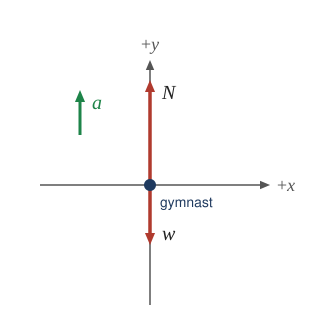

# Scripts

Build and utility scripts for the Physics Book project.

## Quick Reference

| Script                  | Command                           | Description                         |
| ----------------------- | --------------------------------- | ----------------------------------- |
| content                 | `npm run check:content`           | Validate and fix content quality    |
| equations               | `npm run check:equations`         | Validate and fix equations          |
| check-links             | `npm run check:links`             | Validate internal/external links    |
| check-orphans           | `npm run check:orphans`           | Find unreferenced files             |
| check-figures           | `npm run check:figures`           | Validate figure references          |
| check-math              | `npm run check:math`              | Check LaTeX delimiter balance       |
| check_math              | `npm run check:physics`           | Verify arithmetic and physics cases |
| find-unrendered-latex   | `npm run find:latex`              | Check math rendering in Chromium    |
| check-accessibility     | `npm run check:accessibility`     | Check alt text and accessibility    |
| check-yaml              | `npm run check:yaml`              | Validate YAML front matter          |
| check-structure         | `npm run check:structure`         | Validate document structure         |
| check-cross-references  | `npm run check:cross-refs`        | Validate cross-references           |
| lint-markdown           | `npm run lint:markdown`           | Lint markdown files                 |
| generate-pdf            | `npm run generate:pdf`            | Generate PDF of chapters            |
| generate-icons          | `npm run generate:icons`          | Generate PWA icons                  |
| generate-fbd            | `npm run generate:fbd`            | Generate free-body diagram SVGs     |
| generate-figures        | `npm run generate:figures`        | Generate line-art figure SVGs       |
| generate-sketches       | `npm run generate:sketches`       | Generate kinematics sketch SVGs     |
| build-index             | `npm run generate:search-index`   | Generate search index               |
| parse-summary           | `npm run parse:summary`           | Generate summary.json               |
| update-front-matter     | `npm run update:front-matter`     | Update YAML front matter            |
| rename-figures          | `npm run update:figures`          | Rename figures and update refs      |
| convert-webp            | `npm run convert:webp`            | Convert images to WebP              |
| convert-math-delimiters | `npm run convert:math-delimiters` | Convert LaTeX delimiters            |
| validate-deploy         | `npm run deploy:validate`         | Validate deployment                 |
| crawl-all-pages         | `npm run crawl`                   | Navigate all pages to find errors   |

---

## Script Naming Convention

All scripts follow a consistent naming convention using colons as separators:

| Prefix       | Purpose                   | Examples                               |
| ------------ | ------------------------- | -------------------------------------- |
| `check:*`    | Validation/quality checks | check:links, check:yaml, check:content |
| `fix:*`      | Auto-fix issues           | fix:content, fix:equations             |
| `lint:*`     | Lint files                | lint:markdown                          |
| `generate:*` | File/asset generation     | generate:pdf, generate:icons           |
| `parse:*`    | Parse/extract data        | parse:summary                          |
| `update:*`   | Update existing files     | update:front-matter, update:figures    |
| `convert:*`  | Format conversion         | convert:webp                           |
| `deploy:*`   | Deployment operations     | deploy:validate                        |

### Common Modifiers

- `:strict` - Enable stricter validation (e.g., `check:content:strict`)
- `:fix` - Apply fixes (e.g., `check:content:fix`)
- `:apply` - Apply changes to files (e.g., `lint:markdown:apply`)

---

## Shared Utilities Library

All scripts use a shared utilities library in `scripts/lib/`:

```
scripts/lib/
├── index.js       # Re-exports all utilities
├── constants.js   # Shared constants (UNITS, TERMINOLOGY, etc.)
├── parser.js      # Content parsing utilities
├── reporter.js    # Output formatting with chalk
├── cli.js         # CLI argument parsing
└── files.js       # File operations
```

### Using the Library

```javascript
// Import everything
import { UNITS, ContentParser, printHeader, runCli } from './lib/index.js';

// Or import specific modules
import { UNITS, TERMINOLOGY } from './lib/constants.js';
import { ContentParser } from './lib/parser.js';
import { printHeader, printResults } from './lib/reporter.js';
```

---

## Consolidated Scripts

### content.js

Combined content validation and fixing script. Replaces the old `check-content.js` and `validate-content.js`.

```bash
npm run check:content              # Check only
npm run check:content:strict       # Stricter validation
npm run check:content:fix          # Apply fixes
npm run fix:content                # Alias for --fix
```

**Checks/Fixes:**

- Physical units spacing (e.g., "20m" -> "20 m")
- Terminology consistency (British -> American English)
- Duplicate words
- Common typos
- Inconsistent notation

**Options:**

- `--fix` - Apply fixes to files
- `--strict` - Enable stricter validation
- `--check` - Check only mode

### equations.js

Combined equation validation and fixing script. Replaces the old `check-equations.js` and `validate-equations.js`.

```bash
npm run check:equations              # Check only
npm run check:equations:strict       # Stricter validation
npm run check:equations:fix          # Apply fixes
npm run fix:equations                # Alias for --fix
```

**Checks/Fixes:**

- Equation numbering consistency
- LaTeX syntax errors
- Unbalanced delimiters (braces, $, \left/\right)
- Equation references
- Common LaTeX mistakes
- Broken inline math

**Options:**

- `--fix` - Apply fixes to files
- `--strict` - Enable stricter validation

---

## Quality Assurance Scripts (`check:*`)

### check-links.js

Validates all links (internal and external) in markdown files.

```bash
npm run check:links              # Standard check
npm run check:links:fast         # Faster with shorter timeouts
```

**Options:**

- `--timeout <ms>` - Request timeout (default: 10000)
- `--retries <num>` - Retries for failed requests (default: 2)
- `--concurrent <num>` - Max concurrent requests (default: 10)

### check-orphans.js

Detects unreferenced files in `assets/` and `resources/` directories.

```bash
npm run check:orphans            # Report orphaned files
npm run check:orphans:cleanup    # Generate cleanup script
```

### check-figures.js

Comprehensive figure validation.

```bash
npm run check:figures            # Run all checks
npm run check:figures:pattern    # Check filename patterns only
npm run check:figures:missing    # Check for missing files only
```

### check-math.js

Checks for unbalanced LaTeX math delimiters.

```bash
npm run check:math               # Check contents/ directory
```

### check_math.py

Verifies numerical equalities with units and recomputes selected example and
exercise answers using reusable physics relations. It uses only the Python
standard library. `physics_latex.py` handles supported LaTeX and the unit registry,
`physics_quantity.py` evaluates quantities, and `physics_cases.py` binds cases to
their textbook sources. The relations and cases live in `physics-cases.json`.

```bash
npm run check:physics
python3 -B scripts/check_math.py --range 1-10
python3 -B scripts/check_math.py --file contents/ch2FallingObjects.md
python3 -B scripts/check_math.py --details
python3 -B scripts/check_math.py --json > physics-report.json
python3 -B scripts/check_math.py --no-scan --strict
python3 -B scripts/check_math.py --no-scan --strict --check-coverage
python3 -B -m unittest tests/test_check_math.py
```

The report distinguishes three outcomes:

- **checked**: both sides were evaluated, their dimensions agree, and their SI
  values agree within rounding and tolerance.
- **failed**: the numeric values or dimensions disagree, a calculation is
  undefined, or a required case cannot resolve its source references.
- **skipped**: automatic verification could not evaluate the notation, such as an
  unbound variable or unknown unit. Each result carries a reason. A math span
  without a supported equality is also counted as skipped.

A chain such as `v = 2 m + 3 m = 5 m` produces a skipped symbolic comparison and
a checked numeric comparison. Counts describe comparisons and standalone math
spans, not the number of exercises proven correct. The summary groups skip
reasons; `--details` and `--json` include each result and its specific reason.
JSON output is an object with `summary` and `results`, including successful and
skipped results. `summary.case_coverage` lists the number of cases and assertions
and the chapter numbers covered. Numeric diagnostics use SI values. The scanner
recognizes `$...$`, `$$...$$`, `\(...\)`, and `\[...\]`, ignoring escaped dollars,
HTML comments, and fenced or inline code. Single-dollar spans cannot cross a
blank paragraph or a display-math block.

`--strict` exits 1 if any result failed; skips alone do not fail the command.
`--min-error` filters displayed numeric failures without changing coverage or
strict exit status. `--no-cases` (also `--no-worked`) disables declarative cases.
`--cases PATH` supplies another case document. File and chapter filters apply to
both the scan and cases. A whole-book run includes required cases whose source
files have disappeared. CI requires the source-bound cases to pass; the broader
automatic scan remains a review report because some equations use conventions
or notation that need interpretation.

CI also uses `--check-coverage` to require every case/check ID recorded in
`scripts/physics-coverage.json`. Removing or renaming an assertion fails even
when another assertion replaces it and the total count stays the same. New
cases are allowed; record their IDs in the baseline to protect them too. An
intentional removal requires a reviewed baseline edit. `--check-coverage PATH`
uses a custom baseline. Coverage enforcement requires a whole-book run with
cases enabled, and empty case documents and empty baselines are rejected.

The evaluator preserves dimensions and converts units to SI throughout addition,
multiplication, division, powers, roots, and supported functions. Both sides may
be expressions. It never accepts an unexplained power-of-ten difference as a
prefix conversion. Radians are dimensionless in SI, with angle conversions
preserved. Celsius and Fahrenheit literals denote absolute temperatures;
`temperature: "interval"` explicitly marks temperature differences in cases.
There is no automatic retry under a different temperature interpretation.
For an equation explicitly calculating a temperature change, an invisible
`<!-- physics-scan: temperature=interval -->` comment immediately before its
math span selects interval units for the automatic scan. This annotation must
be chosen from the meaning of the equation; it should not be applied to an
absolute temperature or an absolute-plus-interval calculation. Unknown
annotation values fail visibly.

Unit identifiers must match a known symbol or an allowed prefix plus symbol.
Unknown words are not split into accidental unit products. Write compound units
with spaces or multiplication dots, such as `J s` or `N·m`; conventional `Wh`,
`Ah`, and `VA` symbols and their prefixes are also supported. `Gy` and `Sv`
denote radiation dose units, including `mGy` and `μSv`. `rad` retains its angle
meaning; ambiguous legacy radiation notation needs an explicit interpretation.

Decimal literals carry half a unit in the last printed place. Relation
coefficients, integer inputs, and exponents are exact; a standalone displayed
integer answer on the right side may be rounded to the nearest unit. The left
side does not gain an integer-answer rounding allowance, so `1 m = 2 m` fails.
An integer zero stays exact and may omit its unit in an equality, but explicitly
incompatible zero units still fail. Rounding bounds propagate
through operations and SI conversions. `exact: true` overrides rounding for an
exact source quantity. The relative tolerance defaults to 1% (`--tolerance PCT`)
and at least 5% for approximate equalities. A check may set its own `tolerance`
in percent. These bounds accommodate printed precision; they do not establish
that the physical model or reasoning is appropriate.

For inverse sine and cosine, a valid central argument at `-1` or `1` may have a
rounding interval extending beyond the domain; only the part inside the domain
contributes to the output bound. A central argument outside the domain still
fails. Trigonometric calculations also carry a small floating-point allowance
scaled to the argument and derivative, so identities such as `cos(90°) = 0`
do not require a fixed absolute tolerance in SI units.
If the estimated floating-point error in a trigonometric value exceeds `1e-6`,
the calculation is skipped rather than receiving an arbitrarily large allowance.

#### Adding a source-bound case

Give the example container or exercise div a stable, unique ID. Existing IDs
are preserved. Add invisible markers immediately before the math quantities
needed by the case:

```markdown
:::: example {"class":"example","id":"constant-acceleration-demo"}

<!-- physics: initial -->$$v_0=13.0\ms$$
<!-- physics: acceleration -->$$a=-9.80\mss$$
<!-- physics: time -->$$t=2.00\s$$
<!-- physics: answer -->$$v=-6.60\ms$$

::::
```

Add a case to `physics-cases.json` using the existing relation:

```json
{
  "id": "constant-acceleration-demo",
  "file": "ch2FallingObjects.md",
  "source_id": "constant-acceleration-demo",
  "inputs": {
    "v0": { "marker": "initial" },
    "a": { "marker": "acceleration" },
    "t": { "marker": "time" }
  },
  "checks": [
    {
      "id": "velocity",
      "relation": "constant_acceleration_velocity",
      "arguments": { "v0": "v0", "a": "a", "t": "t" },
      "expected": { "marker": "answer" }
    }
  ]
}
```

Inputs and expected answers come from the referenced source block. Markers and
patterns must match exactly once within that block. A missing or duplicated
source ID, marker, or pattern fails visibly, even if the same number appears
elsewhere. References read the last nonempty equality segment by default.
`segment` selects another segment; multi-row equations require an explicit `row`
(negative indices count from the end).

A reference may instead provide a `pattern` with a named `(?P<value>...)`
capture. `{number}` in patterns expands to the shared signed-number pattern.
`format: "prose"` reads a number and unit from prose; `format: "count"` reads an
exact spelled-out count from one through four. A `unit` annotation supplies an
omitted unit only when the captured expression has no unit. It cannot override
an explicit unit. For a narrative example outside an existing container, an
invisible `<!-- physics-scope: unique-id -->` / `<!-- /physics-scope -->` pair can
define the source block without changing the layout.

Each relation declares its `inputs` and an arithmetic `expression`. Expressions
use a restricted parser, without Python `eval`, arbitrary functions, or imports.
Case `arguments` bind source inputs to the relation's parameters. Optional
`derived` quantities apply relations in declaration order for multistep models.
`constants` records exact model assumptions or definitions, such as the chosen
standard gravitational acceleration; it should not duplicate problem givens or
expected answers. Existing relations cover kinematics, energy, forces, circuits,
and radioactive decay. The tests deliberately alter signs, exponents, units,
givens, answers, and source bindings in temporary fixtures to verify detection.

### find-unrendered-latex.js

Checks every built textbook page in Chromium for leftover LaTeX and MathJax error
messages, including math in captions and hidden solutions. Run `npm run serve`
first. Failed page loads and missing MathJax are reported as failures; findings or
failures return a nonzero exit status.

```bash
npm run find:latex
npm run find:latex -- --no-enrichment --json /tmp/latex-issues.json
npm run find:latex -- --file 'ch3*.html' --verbose
npm run find:latex -- --base-url http://localhost:4001/physics-book/contents/
```

`--no-enrichment` skips optional speech and braille enrichment to speed up the
audit while retaining the textbook's TeX macros and rendering rules. Use
`--by-type` to group findings and `--concurrent 3` to set the number of workers.

### check-accessibility.js

Checks accessibility concerns in markdown files.

```bash
npm run check:accessibility          # Standard check
npm run check:accessibility:strict   # Strict mode
```

**Checks:**

- Missing or empty alt text on images
- Uninformative alt text
- Heading level skips
- Empty or uninformative link text

### check-yaml.js

Validates YAML front matter structure.

```bash
npm run check:yaml               # Standard validation
npm run check:yaml:strict        # Strict mode
```

### check-structure.js

Validates document structure and organization.

```bash
npm run check:structure          # Standard validation
npm run check:structure:strict   # Strict mode
```

### check-cross-references.js

Validates cross-references between chapters.

```bash
npm run check:cross-refs          # Standard validation
npm run check:cross-refs:strict   # Strict mode
```

---

## Fix Scripts (`fix:*`)

`fix:content` and `fix:equations` apply the auto-fixes from `content.js` and `equations.js`.

---

## Lint Scripts (`lint:*`)

### lint-markdown.js

Lints markdown files for common issues and physics-specific rules.

```bash
npm run lint:markdown            # Dry run
npm run lint:markdown:apply      # Apply fixes
npm run lint:markdown:strict     # Strict mode
```

---

## Generation Scripts (`generate:*`)

### generate-pdf.js

Generates PDF versions of chapters using Playwright.

```bash
npm run generate:pdf             # All chapters separately
npm run generate:pdf:combined    # One combined PDF per chapter
npm run generate:pdf:book        # Entire textbook in pdf-output/complete-book.pdf
npm run generate:pdf:chapter     # Specific chapter
npm run generate:pdf:install     # Install Playwright browsers
```

The dev server must be running (`npm run serve`). The complete book includes the
preface, all chapter introductions and sections, and both appendices in
`SUMMARY.md` order.
It renders each source separately, waits for MathJax, fonts, and images, then
assembles the PDFs with continuous page numbers. A failed source stops the run
without replacing the previous book. `pdf-output/complete-book.json` records each
source's page range and the total page count.

### generate-pdf-parallel.js

Optimized parallel PDF generation with configurable concurrency. Generates all PDFs in three phases for maximum efficiency.

```bash
# Generate all PDFs with parallel processing (default: 4 concurrent)
node scripts/generate-pdf-parallel.js

# With custom concurrency
MAX_CONCURRENCY=8 node scripts/generate-pdf-parallel.js
```

**Features:**

- **Phase 1**: Section PDFs (241 items, 4 parallel) - ~683s
- **Phase 2**: Chapter intro PDFs (34 items, 4 parallel) - ~32s
- **Phase 3**: Combined chapter PDFs (34 items, 2 parallel) - ~1094s
- Automatic error handling and retry logic
- Real-time progress reporting
- Total generation: ~30 minutes for 309 PDFs

**Performance:**

- 4x-8x faster than sequential generation
- Memory-optimized with controlled concurrency
- Reuses browser instances across batches

### regenerate-failed-pdfs.js

Recovery script for failed PDF generations. Automatically regenerates problematic combined chapter PDFs with extended timeouts.

```bash
# Regenerate failed PDFs (hardcoded list)
node scripts/regenerate-failed-pdfs.js
```

**Features:**

- Extended timeout (300s vs standard 180s)
- No strict networkidle requirements for large content
- Sequential processing to avoid resource contention
- Detailed progress logging

This script is automatically called by the GitHub Actions workflow when parallel generation reports failures.

### generate-icons.js

Generates PWA icons and favicons from source logo.

```bash
npm run generate:icons
```

### generate-fbd.js

Generates the free-body diagrams used in the worked solutions of chapters 4–6.
Each diagram is defined in `scripts/fbd/ch04.js`, `ch05.js`, or `ch06.js` (built
with the small SVG helper in `scripts/fbd/fbd.js`) and written to
`resources/fbd_CC_SS_pNN.svg` (chapter, section, problem number). Every diagram
labels its `+x`/`+y` axes so the signs in the solution's `ΣFx` and `ΣFy`
equations can be read straight off the picture. Embed them with the `.fbd`
class, which lets multi-panel diagrams use their full width:

```markdown
{: .fbd}
```

```bash
npm run generate:fbd          # all diagrams
npm run generate:fbd -- 05_01 # only names containing "05_01"
```

### generate-figures.js

Generates the line-art figures (graphs, vector diagrams, geometry) in chapters
2–7 that replaced raster originals. Each figure is a function in
`scripts/figures/ch02.js`, `ch03.js`, or `ch04to07.js`, keyed by its file name,
and is written to `resources/Figure_CC_SS_NN.svg`. The drawing helpers live in
`scripts/figures/svg.js`: `Svg` (primitives, arrows, labels), `Frame` (math
coordinates for vector diagrams), and `Plot` (data graphs with ticks).

Graph data and vector magnitudes come from the text, so values read off a figure
agree with the worked examples and solutions. Edit the spec and regenerate
rather than editing an SVG by hand.

Label markup: `v_0` and `F_{app}` for subscripts, `m/s^2` for superscripts,
`**A**` for a bold vector, `\bar{v}` for an overbar, `\rm{m/s}` for upright
units, and `\it{t}` for an italic variable inside plain text.

```bash
npm run generate:figures          # all figures
npm run generate:figures -- 02_08 # only names containing "02_08"
```

### build-index.js

Creates a searchable index for the PWA using MiniSearch.

```bash
npm run generate:search-index
```

---

## Content Management Scripts

### parse-summary.js

Parses `SUMMARY.md` to generate `summary.json`.

```bash
npm run parse:summary
```

### update-front-matter.js

Updates YAML front matter with chapter/section numbers.

```bash
npm run update:front-matter
```

### rename-figures.js

Renames figure files and updates all references.

```bash
npm run update:figures -- Figure_01_02_03 Figure_01_02_04
```

---

## Conversion Scripts

### convert-webp.js

Converts figure JPG/PNG files to WebP next to the originals in `resources/`. A WebP is kept
only when it is at least `--min-savings` percent smaller (default 10). Dry run by default.

```bash
npm run convert:webp                                              # Preview all figures
npm run convert:webp -- --files Figure_01_01_01.jpg --update-refs # Preview one figure + refs
npm run convert:webp -- --apply --update-refs                     # Convert and repoint contents/
```

`--update-refs` rewrites `../resources/<name>.jpg` references in `contents/` to the WebP name.
The originals are then unreferenced; `npm run check:orphans` lists them for cleanup.

### convert-math-delimiters.js

Converts LaTeX math delimiters between formats (e.g., `\(...\)` to `$...$`).

```bash
npm run convert:math-delimiters           # Dry run
npm run convert:math-delimiters -- --apply  # Apply changes
```

---

## Deployment Scripts (`deploy:*`)

### validate-deploy.js

Validates deployed site with Playwright browser tests.

```bash
npm run deploy:validate           # Validate Vercel deployment
npm run deploy:validate:github    # Validate GitHub Pages
npm run deploy:validate:verbose   # Verbose output
```

**Prerequisites:**

- Playwright browsers installed: `npx playwright install chromium`

### crawl-all-pages.js

Navigates through all pages on the local dev server to detect errors during development.

```bash
npm run crawl                     # Crawl all pages (quiet mode)
npm run crawl:verbose             # Show detailed output for every page
```

**What it checks:**

- JavaScript console errors
- Failed resource loads (CSS, JS, images)
- Unrendered MathJax equations ($$)
- HTTP errors (404, 500, etc.)
- Page load failures

**Prerequisites:**

- Eleventy dev server must be running: `npm run serve`
- Playwright browsers installed: `npx playwright install chromium`

**Typical workflow:**

```bash
# Terminal 1: Start dev server
npm run serve

# Terminal 2: Crawl all pages
npm run crawl
```

This is especially useful after major changes to catch errors across the entire site.

---

## Running Audits

Full audit of the project:

```bash
npm run audit
```

This runs all validation scripts:

1. `check:links` - Link validation
2. `check:orphans` - Orphan file detection
3. `check:figures` - Figure validation
4. `check:yaml` - YAML front matter validation
5. `check:accessibility` - Accessibility checks
6. `check:content` - Content quality validation
7. `check:structure` - Document structure validation
8. `check:cross-refs` - Cross-reference validation
9. `check:equations` - Equation validation

For a comprehensive check including all validations:

```bash
npm run check:all
```

---

## Dependencies

Scripts use these npm packages:

- `chalk` - Terminal styling
- `cheerio` - HTML parsing (for search index)
- `glob` - File pattern matching
- `@11ty/gray-matter` - YAML front matter parsing
- `js-yaml` - YAML processing
- `minisearch` - Full-text search indexing
- `sharp` - Image processing
- `simple-git` - Git operations
- `@playwright/test` - PDF generation

For physics calculation verification:

- `python` - Python 3.10 or newer (for scripts/check_math.py; CI uses Python 3.12)

The build and development server generate the search index automatically. Run `npm run update:minisearch` after updating MiniSearch to refresh its self-hosted browser module and license.

`npm run audit` runs the content checks. `npm run check:all` adds the physics checker and JavaScript/Python unit tests. `npm test` runs JavaScript unit tests; `npm run test:links` checks links. Python checkers live in `scripts/`. The `fix:content` and `fix:equations` commands remain compatibility aliases for `check:content:fix` and `check:equations:fix`.
